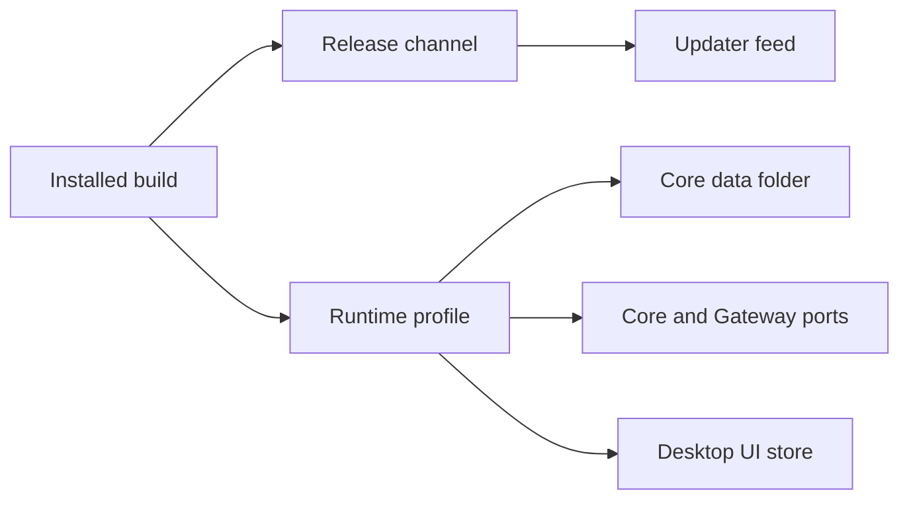

Ryu has two related settings:

- A **release channel** chooses which build train the updater follows.
- A **runtime profile** chooses the local Core data folder, ports, and supporting state.

They usually match, but not always. `Dev` is a local development profile rather than a published
updater channel. `Beta` is present in the desktop picker, but it currently follows the signed
stable desktop feed instead of having its own rolling desktop train.

<Callout type="info">
  Canary does not share a local Core data folder with Stable by default. Profile-specific desktop
  bundles also keep their UI storage separate. Remote accounts, providers, nodes, and explicitly
  configured telemetry destinations are separate boundaries that a release channel does not change.
</Callout>

## Channel meanings

| Channel | Version shape | Meaning | Update source | Risk and cadence |
| --- | --- | --- | --- | --- |
| **Stable** | `1.2.3` | The recommended signed release train | Stable release feed | Lowest change rate and the default choice |
| **Beta** | `1.2.3-beta.1` | A prerelease name supported by the picker, but not currently an independent desktop train | The signed stable feed today | Selecting Beta does not currently deliver a separate beta desktop build |
| **Nightly** | `1.2.3-nightly.20260813.42` | A scheduled snapshot of the latest eligible `main` build | Nightly channel feed | Changes every 3 hours when the source has moved; expect unfinished work |
| **Canary** | `1.2.3-canary.20260813.42` | A build produced from the latest eligible `main` change | Canary channel feed | Fastest published train; expect the most rough edges |
| **Dev** | Usually the in-tree version, without a required channel suffix | A local source or dev-variant build for development and debugging | No normal published updater feed | Manual rebuilds, local configuration, and incomplete features are expected |

The stable display name is a product label. The updater still calls that train `stable`, and a
version with no prerelease suffix is the stable version.

Which picker offers which channels:

- The desktop picker currently offers Canary, Nightly, Beta, and Stable.
- The standalone [Ryu Bot](/docs/surfaces/desktop/bot) app offers only Beta and Stable, because
  nightly and canary builds exist for Ryu only. A Nightly or Canary choice saved before that falls
  back to Stable.
- Dev is identified by the build/profile, not by a picker.

Ryu's desktop and Core updater do not currently publish an `rc` channel. You may see `rc` in the
Marketplace extension channel page because extensions have a separate version-derived contract.

<Callout type="warn">
  Beta is a current implementation detail, not a promise that a separate beta desktop artifact
  exists. The Beta feed currently points at the signed stable artifact, and a beta-suffixed build
  does not automatically create a separate local data profile.

  Marketplace extensions can have independent beta trains; see
  [Extension release channels](/docs/extend/develop/extensions/release-channels) for that
  different contract.
</Callout>

## How Ryu identifies a channel

For a published build, Ryu reads the first prerelease identifier from its semantic version:

| Version | Channel Ryu derives |
| --- | --- |
| `1.2.3` | `stable` |
| `1.2.3-beta.1` | `beta` |
| `1.2.3-nightly.20260813.42` | `nightly` |
| `1.2.3-canary.20260813.42` | `canary` |

The updater compares versions **within the selected channel**. Choosing Canary does not make a
stable release or a Nightly release eligible just because it has a larger version number. A
channel switch is a user choice, not an ordinary update, and a missing Canary or Nightly build is
not silently replaced with Stable.

The build that is running and the channel that the updater follows can differ. For example, a
stable desktop can be pointed at the Canary feed from **Settings → Updates**. The native window
title identifies the active product realm, while the release-channel setting identifies the train
the updater checks.

## Local data and state

The default profile mapping is the part that answers whether two channels share local Core data.
The ports below are the Core and Gateway ports; all profile-aware sidecars use the same offset.

| Channel or profile | Default Core data root | Core / Gateway ports | Core data relation to Stable | Desktop UI store relation |
| --- | --- | --- | --- | --- |
| Stable | `~/.ryu` | `7980` / `7981` | Baseline | Stable app store |
| Beta selected in the Stable updater | `~/.ryu` | `7980` / `7981` | Shared with Stable | Stable app store |
| Dedicated Beta profile build | `~/.ryu-beta` | `11980` / `11981` | Separate by default | Separate Beta app store |
| Canary profile build | `~/.ryu-canary` | `9980` / `9981` | Separate by default | Separate Canary app store |
| Nightly profile build | `~/.ryu-nightly` | `10980` / `10981` | Separate by default | Separate Nightly app store |
| Dev | `~/.ryu-dev` | `8980` / `8981` | Separate by default | Separate dev app store |

Core data includes conversations, Spaces, memory, models, installed runtimes, node records, local
credentials, and the local preference database. A separate profile keeps those Core-owned stores
from using the same directory, listener, or keychain slot.
[Data Folder & Storage](/docs/surfaces/desktop/user-guide/data-and-storage) covers moving,
exporting, and restoring the active Core folder.

Profile-specific desktop builds have distinct app identities and webview stores. Older channel
builds may share their desktop store. Selecting an updater feed alone does not create a new
profile or move existing data.

Each profile build owns its own deep-link scheme: Stable owns `ryu://`, and Dev, Beta, Nightly,
and Canary own `ryu-dev://`, `ryu-beta://`, `ryu-nightly://`, and `ryu-canary://`. See
[Deep links](/docs/surfaces/desktop/user-guide/deep-links) for opening the intended profile.

<Callout type="warn">
  `RYU_DIR` or a custom data-folder choice can override the default Core root. If you want profile
  isolation, do not point two profiles at the same folder. A separate port does not make a shared
  folder safe.
</Callout>

## Data handling and sharing

A release channel is not a privacy mode. The same consent gates and data-plane rules apply to every
desktop build. The full collection, default, and opt-out matrix is in [Privacy and Telemetry](/docs/surfaces/desktop/transparency).

| Data or event | Stable and Beta | Canary and Nightly | Dev | What can be shared |
| --- | --- | --- | --- | --- |
| Chats, files, memory, and local databases | Stored in the active Core profile | Stored in the Canary or Nightly Core profile | Stored in the Dev Core profile | Not shared between separate local Core roots |
| Model and provider requests | Same behavior | Same behavior | Same behavior | The selected model provider or remote node receives the content needed to perform the request, regardless of channel |
| Product analytics | On by default, opt-out; typed content-free events and a random install identifier | Same gate and event shape | Same gate; a stock local build with no analytics destination sends nothing | Packaged channels can share the UI storage that holds the preference mirror and install identifier |
| Crash reports | Separate on-by-default, opt-out consent | Same gate; the build version identifies the channel | Same gate; no destination means no report | If enabled, the crash service can see the version or release label, but not prompt or agent content under the documented scrub rules |
| OTLP diagnostics | Off by default and opt-in | Same gate | Same gate | Nothing leaves through this stream unless a destination is configured and the user opts in |
| Support access | Off by default and user-granted | Same gate | Same gate | Only the narrow, time-limited scope the user grants is sent |
| Update checks | Release metadata and the selected feed | Release metadata and the selected channel feed | Usually no signed feed to check | The updater does not need chats, files, or model content to select a release |

The boundary is local versus remote. Canary and Nightly keep their Core databases apart from
Stable, but a channel does not create a new Ryu Cloud account, provider account, or remote node.

If two profiles sign into the same account, connect to the same remote node, or use the same model
provider credentials, that remote service sees requests according to its own policy. Profile
isolation is local storage isolation, not an account or network isolation guarantee.

Ryu does not use chats, files, or activity to train Ryu models. The selected model provider, app, or
plugin may still process the content required for the task, so its terms apply.

## Choosing a channel

Use **Settings → Updates → Channel** in the desktop app.

| Choose | When |
|---|---|
| Stable | Ordinary work |
| Beta | Only to test the current picker behavior |
| Nightly | You want a snapshot every 3 hours when `main` has moved |
| Canary | You need the newest published build |
| Dev | You are developing Ryu itself or need a separate local stack for debugging |

Before switching to Canary or Nightly, decide whether their separate local Core profile is what you
want. Switching the updater feed inside one installed app keeps that app's desktop UI store. Only a
profile-specific desktop build has its own UI store.

## Restarting a local Dev Core

This section is for people who build Ryu from source. Local Dev Core keeps an independent
execution process, so rebuilding or restarting its listener preserves active turns and their
local data.

- `bun run dev:core:restart` rebuilds Core and replaces the execution process once running turns
  finish. Open chats reconnect on their own.
- Add `--now` to skip the wait. Interrupted threads then resume automatically.
- Core's `--stop-dev-execution` flag stops the execution process and its child tools, and the
  listener does not restart it.
- If the execution process crashes, the listener starts a new one on the next request.

On Linux, process protection stays enabled during startup and reconnect. Core verifies the
execution process before it attaches to it or stops it. If verification fails,
Core reports the failure and keeps the existing ownership record. Do not delete that record to
force a second process to open the same data folder.

### Upgrading from an older development build

1. Exit the running app and stop its execution process before you launch the new build.
2. If that older build cannot verify its protected process, use your operating system's process
   controls to end that development Core process and its child tools.
3. End any child tools that survive a crashed execution process before you restart Dev Core.
   Core keeps ownership while that unverified process group survives.

The new build keeps the old record until the previous process exits; it does not take over a
still-running owner. On Linux kernels before 6.9, Core force-stops the execution process and its
child tools; newer kernels allow a graceful stop first.

## Reading release notes

Each release note has a short highlights section and a package changelog. Stable releases also
have a page in [Release notes](/docs/release-notes) with the changelog for every affected package,
because the full list can be longer than a GitHub release body can hold.

Those pages describe what changed for users and developers. They leave out internal file paths,
configuration names, and operational details. They do not announce a capability that is still
rolling out gradually until it is generally available.

When a stable release's changelog exceeds GitHub's release-body limit, the release keeps its
highlights and breaking notices on the page and links to the matching Release notes page. Nightly
and Canary builds have no docs page; for those the release links to an attached
`release-notes-full.md` file with the complete package-by-package history.

The [public releases](https://github.com/amajorai/ryu/releases) include a full changelog
comparison link when a previous build is available.

## Related docs

<Cards>
  <DocCard href="/docs/core/updates" />
  <DocCard href="/docs/surfaces/desktop/transparency" />
  <DocCard href="/docs/surfaces/desktop/user-guide/data-and-storage" />
  <DocCard href="/docs/extend/develop/extensions/release-channels" />
</Cards>
