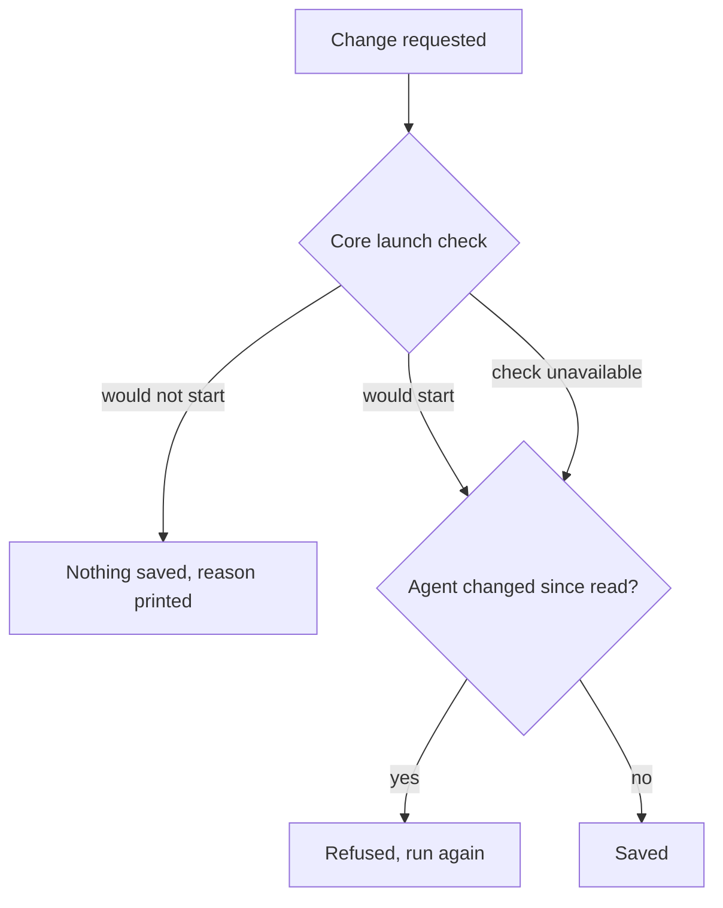

`ryu-cli agents` reads and changes how an agent works and which accounts it may use. Both
settings are the same ones the Desktop agent editor shows, as described in
[Agent Account Access](/docs/surfaces/desktop/user-guide/agent-account-access).

## Commands

| Command | What it does |
|---|---|
| `ryu-cli agents [list]` | List agents with their id and engine |
| `ryu-cli agents show <id>` | Show the agent's engine, how it works, and its account access |
| `ryu-cli agents create <name> [--identity <mode>] [--engine <id>] [--model <id>]` | Create an agent. `--identity` defaults to `managed`. The new agent has no tools and no account limit |
| `ryu-cli agents identity <id> [<mode> \| dismiss] [--engine <id>]` | Show or change how the agent works, or dismiss its app's request for another mode |
| `ryu-cli agents access <id> [list]` | List the account keys the agent may use |
| `ryu-cli agents access <id> available` | List every account the agent could be allowed, by name and key, and whether it is allowed now |
| `ryu-cli agents access <id> pick` | Tick and untick the agent's accounts on the terminal, then save |
| `ryu-cli agents access <id> add <key>…` | Allow more accounts. Adding to an agent with no limit limits it to Treg and the keys you add; every other account it could use before is no longer allowed |
| `ryu-cli agents access <id> remove <key>…` | Stop allowing accounts |
| `ryu-cli agents access <id> clear` | Remove the limit: the agent may use every account its mode allows |
| `ryu-cli agents access <id> none` | Allow no accounts, and no Treg |

Every command except `pick` accepts `--json`. Commands that change an agent also accept
`--dry-run`, which shows the result without saving it.

## Modes

| Mode | In the app | What it means |
|---|---|---|
| `managed` | Acts as you | Works on your behalf with the accounts you've connected. |
| `individual` | Its own identity | Gets its own accounts and logins, and never touches yours. |
| `mixed` | Both | Has its own accounts, and can also use the ones of yours you allow. |

When a newer version of an app asks for another mode for one of its agents and Ryu leaves the change
to you, `show` and `identity` print it as **App request** (`pending_identity_mode` with `--json`).
Set the agent to the requested mode to accept it, or run `ryu-cli agents identity <id> dismiss` to
keep the mode it has.

## Account keys

Account keys use the same format as Core:

| Key | Account |
|---|---|
| `platform:treg` | Treg |
| `composio:<connected-account-id>` | One of your connected apps |
| `provider:<id>` | One of your model providers, such as `openai`, `anthropic`, or `genai` for Gemini |
| `mcp:<profile>:<plugin>:<server>` | One MCP sign-in |
| `mcp-secret:<server-or-plugin>` | An MCP server or app that uses one of your saved keys |
| `platform:desktop` | Control of your desktop |
| `agent-composio:<connected-account-id>` | One of the agent's own connected apps |
| `agent:<vault-account-id>` | One of the agent's own logins |

The CLI refuses a key in any other format, because Core would ignore it and it would allow nothing.

- An agent with its own identity never uses your accounts.
- An agent that acts as you and has a limit uses none of its own accounts.
- A saved key the mode cannot use is shown with a note.

## List and pick accounts

`available` and `pick` list the same accounts as the Desktop agent editor, in the same groups:

- Treg.
- Yours: connected apps, model providers, MCP sign-ins, services using your saved keys, and control
  of your desktop.
- The agent's own logins and connected apps.

Only the groups the agent's mode can use are listed. A model provider row appears for an engine that
calls its vendor with your own sign-in, such as Claude Code. If a group cannot be loaded, the list
says so rather than showing it empty.

Keys the agent is allowed that are not listed now, such as an app you have since disconnected, are
shown under **Allowed but not listed now**. They are kept unless you untick them.

`pick` prints a numbered list and reads these inputs:

| Input | Effect |
|---|---|
| Row numbers or ranges, such as `2 4-6` | Toggle those rows |
| `all` | Allow every listed account |
| `none` | Allow no accounts |
| `unlimited` | Remove the limit |
| `save` | Save and exit |
| `cancel` | Exit without saving |

Unticking an account of an agent with no limit first limits it to every listed account, so only what
you untick is taken away. While a group could not be loaded, `pick` and the terminal editor will not
start a limit this way, because that group's accounts would be taken away too. `none` still works.

`pick` needs an interactive terminal. In scripts, use `available --json` and then `add` or `remove`.
In the terminal agent editor, the **account access** field opens the same list: Space allows or
denies the selected account, and the change is saved with the agent.

## Remote A2A agents

An agent whose engine is a remote A2A peer (`a2a:<peer>`) runs on that peer's node, with the
accounts set up there. For such an agent, the CLI and the terminal editor show **Runs on another
node** instead of its identity and account access.

`ryu-cli agents identity` and `ryu-cli agents access` refuse changes for it, because Core ignores
both for a remote peer. Pass `--engine` to move the agent to another engine in the same command.

## Checks before saving

Before saving a change, the CLI asks Core whether the agent's engine would still start
(`POST /api/agents/launch-check`).

- If Core says the engine would not start, nothing is saved and Core's reason is printed. An engine
  that signs in as you, such as Claude Code, cannot run an agent with its own identity. Pass
  `--engine acp:pi` to run the agent on Ryu instead.
- If Core cannot answer the check, the change is still saved, and Core checks again when the agent
  starts.
- If someone else saved the agent after the CLI read it, the change is refused. Run the command
  again.

## Related

<Cards>
  <DocCard href="/docs/surfaces/cli/reference" />
  <DocCard href="/docs/surfaces/desktop/user-guide/agent-account-access" />
</Cards>
