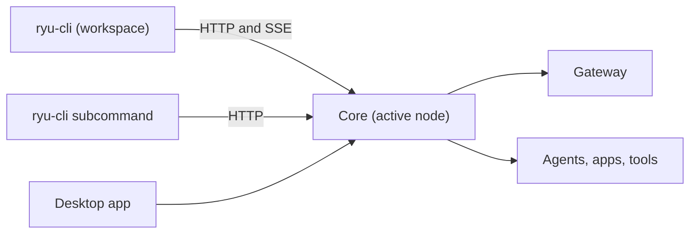

`ryu-cli` is Ryu's terminal client, built with Bun and OpenTUI. It is for people who want Ryu in a
terminal or in scripts. It connects to the same Core as Desktop over HTTP and Server-Sent Events
(SSE), so conversations, agents, apps, and node settings stay shared across clients.

<Figure name="cli" />

```sh
ryu-cli
```

Run it with no arguments to open the interactive workspace, or as `ryu-cli <subcommand>` to run one
command and exit. Install Ryu with the [Getting Started guide](/docs/start-here/getting-started)
first. From a source checkout, run `bun run --filter cli dev`.



## What it includes

- **Workspace** - chat, agents, groups, tasks, a library, workflows, spaces, tools, and app
  contributions.
- **Keys** - `Ctrl+K` opens the command palette, `Ctrl+N` switches nodes, `Ctrl+T` opens a chat
  tab, and `Ctrl+Shift+M` switches between Bot, Agent, and OS.
- **Agent mode** - on a managed node, Agent appears only after the CLI verifies that you hold
  Gateway configuration permission (owners and admins by default).
- **Managed nodes** - requests use that node's delegated credentials, and switching nodes keeps
  each request bound to its own node.
- **Updates** - official binaries update themselves in the background when the shared
  **Automatic updates** setting is on. See
  [Automatic CLI updates](/docs/surfaces/cli/getting-started#automatic-cli-updates).

Rich editors, phone-only controls, and operating-system window effects stay in their native
surfaces. See [Desktop parity](/docs/surfaces/cli/parity).

<Cards>
  <DocCard href="/docs/surfaces/cli/getting-started" />
  <DocCard href="/docs/surfaces/cli/tui" />
  <DocCard href="/docs/surfaces/cli/tui-chat" />
  <DocCard href="/docs/surfaces/cli/tui-settings" />
  <DocCard href="/docs/surfaces/cli/tui-integrations" />
  <DocCard href="/docs/surfaces/cli/reference" />
  <DocCard href="/docs/surfaces/cli/agent-commands" />
  <DocCard href="/docs/surfaces/cli/parity" />
  <DocCard href="/docs/surfaces/cli/troubleshoot" />
</Cards>
