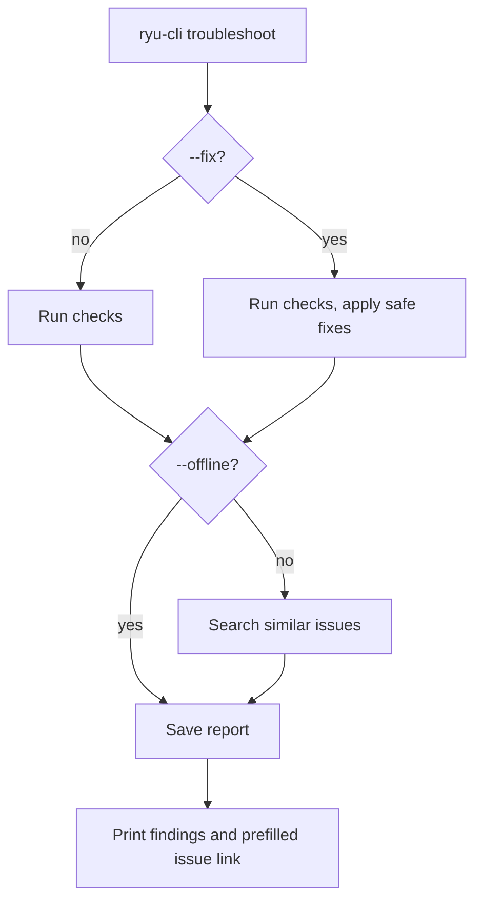

`ryu-cli troubleshoot` diagnoses an install of Ryu Core, Gateway, and the CLI. It works when Core is
not running. Each problem it finds comes with a fix. If you cannot fix the problem yourself, the
command saves a report and opens a GitHub bug report form with the details filled in.

```bash
ryu-cli troubleshoot "Core will not start after updating"
```

The description in quotes is optional. It improves the search for similar issues and becomes the
title of the bug report.



## What it checks

| Area | What it looks at |
|---|---|
| Machine | OS and architecture, CPU, memory, free disk space, the CLI version, and the release profile. It does not collect your hostname, username, or files. |
| Install | Whether the `ryu-core` and `ryu-gateway` binaries are installed, and whether the data folder exists and is writable. |
| Core | Whether Core answers at the configured address. If it does not, the command tells you whether Core is not running, another program is using its port, a Core from another release profile is running, or Core refused the CLI's token. |
| Services | The Gateway connection, missing sidecar binaries, the active inference engine, and error counts from Gateway Doctor and Plugin Doctor. |
| Versions | Whether the CLI and Core come from the same release, and whether Core is still installing its required runtime. |
| Updates | Whether a newer release is available. It asks Core first and falls back to the latest GitHub release when Core is down. If you are behind, update first: the problem may already be fixed. |
| Logs | Recent error lines from Core's log file. |

## Apply safe fixes

```bash
ryu-cli troubleshoot --fix --dry-run   # preview
ryu-cli troubleshoot --fix             # apply
```

`--fix` makes only these changes:

- creates the data folder if it is missing;
- starts a local Core when nothing else is using its port, downloading the Core and Gateway
  binaries first if they are not installed;
- applies the safe fixes from [Gateway Doctor](/docs/gateway/configuration-operations#safety-posture-and-doctor).

It does not change permissions, delete files, or stop other programs. When one of those is needed,
the command prints the step for you to run.

## Similar issues and bug reports

The command searches the public [Ryu issue tracker](https://github.com/amajorai/ryu/issues) for
similar reports. If one matches, add a comment or a reaction there instead of opening a new issue.

Every run saves a Markdown report in the `logs` folder of your Ryu data folder. If that folder is not
writable, it saves the report to the system temp folder.

The command also prints a link to a new GitHub issue with the bug report template filled in: what
went wrong, the findings, your machine details, and recent log errors. Nothing is posted
automatically. You review every field in your browser before you submit.

```bash
ryu-cli troubleshoot "Gateway keeps crashing" --open   # open the prefilled form in your browser
```

<Callout type="info">
Before anything is shown, saved, or added to the issue link, the command removes API keys, tokens,
passwords, credentials in URLs, email addresses, public IP addresses, and your home folder path. The
only network requests are the update check and the issue search. The search sends only a few
keywords from your description and the main finding. Use `--offline` to skip both.
</Callout>

The issue tracker covers Ryu's open-source parts: Core, Gateway, the CLI, the SDK, and the docs. For
the desktop, web, and mobile apps, contact support at [ryuhq.com/contact](https://ryuhq.com/contact).

## Options

| Flag | Effect |
|---|---|
| `--fix` | Apply the safe fixes listed above |
| `--dry-run` | With `--fix`, list the fixes without applying them |
| `--open` | Open the prefilled bug report in your browser |
| `--offline` | Skip the GitHub update check and issue search |
| `--json` | Print the full result as JSON for scripts and support tools |

The command exits with `1` when any check fails and `0` otherwise. `ryu-cli bug-report` is an alias.
It does not require a signed-in account, because a broken install can also break sign-in.
