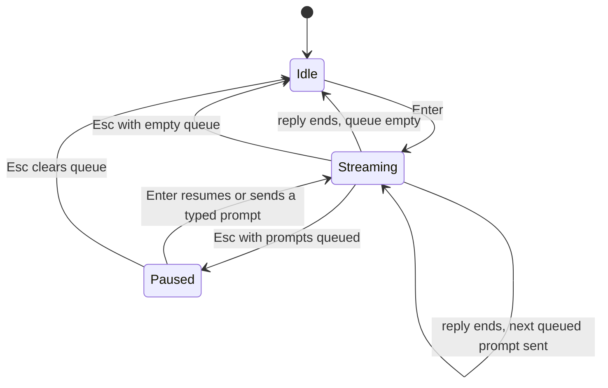

This page covers the Chat tab of the [terminal workspace](/docs/surfaces/cli/tui).

## Chat

The Chat tab streams replies from Core over SSE. Its keys are:

| Key | Action |
|---|---|
| `Enter` | Send the message (queue it while a reply is streaming) |
| `Shift+Enter` / `Alt+Enter` / `Ctrl+J` | Insert a newline |
| `↑` / `↓` | Prompt history from the first or last line of the draft |
| `Esc` | Interrupt the reply (pauses the queue), or close an overlay |
| `PgUp` / `PgDn` | Scroll the transcript a page (`Ctrl+Alt+U` / `Ctrl+Alt+D` scroll half a page) |
| `Ctrl+Home` / `Ctrl+End` | Go to the top of the transcript / jump to the latest output |
| `Ctrl+A` | Choose an agent (not in Bot mode) |
| `Ctrl+R` | Choose ACP settings (not in Bot mode) |
| `Ctrl+L` | Start a new conversation |
| `Ctrl+C` | Copy the selection, stop streaming, or clear the draft |
| `Ctrl+Q` | Focus the queued prompts |
| `Ctrl+O` | Expand or collapse long prompts |
| `Alt+1` / `Alt+2` / `Alt+3` | Resume a recent conversation from an empty chat |

- **`Ctrl+A`** opens the agent picker. The selected agent or team and the model show in the bar
  above the composer; set the model with `/model`.
- **`Ctrl+Q`** focuses the queued-prompt bar. Enter opens the full queue, `x` removes the selected
  prompt, `c` clears the queue, `Shift+↑/↓` reorders it, and Esc returns to the composer.
- Queued turns keep the agent, team, model, ACP settings, and plugin flags that were active when
  they were entered.

### Empty chat

An empty chat shows the Ryu mark, the current mode (**Ask anything**, **Agent: name**, or
**Group: name**), the CLI version, and short hints: `Ctrl+A pick agent`, `/ commands`,
`@ mention`, and `Ctrl+Q queue`. In Agent and OS, the composer placeholder suggests an example task.

Below the hints it lists up to three recent conversations. Press `Alt+1`, `Alt+2`, or `Alt+3` while
the composer is empty to resume one.

- Short terminals show fewer recent conversations, and `Alt+N` only resumes a visible row.
- When the pane holds several tabs, `Alt+1`–`Alt+9` switch tabs instead.

The full slash-command list is in `/help` and in `/` completion.

### Composer

The composer is multi-line. It wraps long text and grows with the draft to about a third of the
terminal height (at least 6 rows, and never more than half the terminal).

- `Enter` sends. On an empty composer it does nothing unless the queue is paused.
- `Shift+Enter` and `Alt+Enter` insert a newline in terminals that report modifier keys. `Ctrl+J`
  inserts a newline in every terminal.
- In a multi-line draft, `↑` and `↓` move between lines. They recall prompt history only from the
  first or last line, or when the composer is empty. Editing a recalled prompt starts a new history
  navigation position.

Pasted text keeps its line breaks. A paste of 3 or more lines, or more than 150 characters, appears
as a `[Pasted N lines #k]` or `[Pasted N chars #k]` placeholder; the full text is sent, queued, and
saved to history in its place. If you edit a placeholder, it is sent as the literal text you see.

Prompt history keeps your last 100 prompts:

- **Encryption.** The history file in the data folder is encrypted by the Ryu node running on the
  same machine, which holds the key. The CLI asks that local node to encrypt and decrypt it and never
  stores the key.
- **No local node.** History is kept in memory for the session only, and nothing is written.
- **Unreadable file.** If the local node cannot open the existing file (for example while it is
  still starting, or when it runs a different profile), the file is left untouched and new prompts
  stay in memory until it can.
- **Older files.** A history file written by an older version is read once, then rewritten
  encrypted after the encrypted copy has been checked.
- **What is recorded.** Collapsed pastes are recorded only as their placeholder, and slash commands
  only by name, never with their arguments.

### Streaming, interrupting, and the queue

While a turn runs, a one-row status above the composer shows a spinner, what the turn is doing
(**Thinking…**, **Running command…**, **Reading files…**, **Editing files…**, **Searching…**,
**Fetching…**, or **Waiting for permission…** while a prompt is open), the elapsed seconds, and
`esc interrupt`.

The placeholder changes to **Queue a follow-up… (Enter queue · Esc interrupt)**: `Enter` queues
another prompt, and `Esc` interrupts.

`Esc` stops the active turn on Core, not just its stream in the terminal, so a goal or other loop
plugin driving the turn stops with it. It keeps the text already received and adds a muted
**Interrupted** line under the turn. This marker is not saved with the conversation.

- `Ctrl+C` stops a running turn the same way, and `Ctrl+L` stops it on Core before it starts a new
  chat.
- Delayed events from the stopped turn cannot change the next reply or its Stop control.
- A prompt you enter before Core confirms the stop waits in the queue and is sent right after,
  unless the queue is paused.

If prompts are queued, `Esc` pauses the queue instead of sending the next prompt, and the queue bar
reads **Paused · Enter send next · Esc clear queue**. Press `Enter` on an empty composer to resume
the queue, or `Esc` again to clear it. A prompt you type while the queue is paused is sent first,
and the queue continues after it.

### Scrolling

New replies follow the bottom of the transcript as they arrive. Scrolling back keeps your place,
and new output never pulls you down.

While you are scrolled up, a strip under the transcript reads
**Jump to latest ↓ (N new) · Ctrl+End**, counting replies that arrived or grew off screen. Click it
or press `Ctrl+End` to return to the bottom and follow new output again. Sending a prompt also
jumps to the latest turn. Plain `Home` and `End` still move the cursor in the composer.

### Completion and mentions

Typing `/` lists slash commands ranked by exact name or alias, then name prefix, alias prefix, a
close spelling (`/hlp` finds `/help`), and finally a match in the description.

- The list floats above the composer and shows up to 10 rows.
- Each entry has a tag: local, ACP, plugin, prompt, agent, person, app, workflow, file, or folder.
- It shows **Searching…** or **No matches** when it has nothing to list.
- `Enter` on a complete built-in command that takes no arguments (`/new`, `/check`, `/agent`,
  `/config`, `/sessions`, `/unpin`, `/reasoning`) runs it immediately. `Tab` only completes.
- Other commands fill the composer so you can type arguments.

Type `@` followed by a path containing `/` (such as `@src/`, `@./`, or `@../lib/`) to list that
folder, relative to where the CLI was started. Folders are listed first and can be opened one level
at a time. `.git` and `node_modules` are hidden, and other dot entries appear only when the typed
name starts with `.`.

Choosing an entry inserts the `@path` text into the message; it does not attach the file. File
mentions need a local node and are not available in Bot mode.

### Slash commands

The built-in slash commands are:

| Command | What it does |
|---|---|
| `/agent` | Open the agent picker (same as `Ctrl+A`) |
| `/model [id\|clear]` | Choose or set the model for the chat; a bare `/model` opens the picker |
| `/group [id\|clear]` (`/team`) | Route turns to an agent group |
| `/config` (`/acp`), `/reasoning` | Choose ACP settings (same as `Ctrl+R`) |
| `/new` (`/newchat`) | Start a new chat |
| `/resume <conversation-id>` | Switch to another conversation |
| `/fork [message-id]` | Fork this conversation |
| `/rename <title>` | Rename this conversation |
| `/delete [conversation-id]` | Delete a conversation, after a confirmation |
| `/pin [off]`, `/unpin` | Pin or unpin this conversation |
| `/sessions` (`/session`) | List the run sessions of the current conversation |
| `/btw <question>` (`/b`) | Ask a quick side question; the answer is dismissible and never enters history |
| `/goal <text>` | Send a goal turn to Core's server-side goal turn-hook, which owns the completion condition and judge loop |
| `/proof <text>` | Send a proof turn to Core's server-side proof turn-hook |
| `/receipt <text>` | Send a receipt turn to Core |
| `/check` (`/double-check`) | Toggle the per-turn double-check hook through `plugin_flags`; Core reviews the next turn and the note lands in the stream |
| `/queue` (`/q`) | Inspect queued prompts; `/queue clear`, `/queue drop <id>`, `/queue up <id>`, and `/queue down <id>` manage them |
| `/theme` | Choose system, light, or dark mode, or the Ryu or Ryu Mono terminal preset |
| `/help [command]` (`/commands`) | Open the keyboard shortcuts overlay; `/help <command>` shows that command's usage |

A fresh terminal follows the desktop's shared theme mode, while explicit `/theme` choices are saved
to the active Core node. When the `NO_COLOR` environment variable is set to a non-empty value, the
terminal uses a hue-free light or dark theme instead (greys remain for contrast).

`/goal`, `/proof`, and `/check` are Core server-side plugin turn-hooks, so their behavior lives in
Core, not the client. `/goal` and `/proof` pass through as normal messages, and `/check` toggles the
double-check hook. The tool-call loop is surfaced inline as the agent works.

### Contributed and agent commands

- **Plugin commands.** Enabled plugin-contributed slash commands from Core's shared contributions
  feed appear in the composer, matching Desktop's command list. Select one with Up/Down and Enter or
  Tab. The CLI sends the command text through the normal chat stream, so Core's plugin hook handles
  it.
- **Local commands win.** `/goal`, `/proof`, and `/receipt` keep their CLI handlers and are not
  duplicated by plugin entries.
- **Load failures.** If Core cannot load the command list, choose **Retry contributed commands** from
  the slash menu.
- **Switching connections.** Changing nodes or accounts removes the previous connection's plugin
  commands and contributed views while Ryu loads the new connection. If loading fails, those old
  entries stay unavailable; choose **Retry contributed commands** to load the current connection.
- **ACP agent commands.** ACP agents can advertise slash commands during a chat. Their latest list
  replaces earlier suggestions, and an empty list removes them. Selecting one inserts its name, and
  submitting it keeps the current agent or team route. If the turn fails, you can retry the same
  command text.

### Agent, workflow, and people mentions

The composer completes `@agent`, `@workflow`, enabled `@app` and `@plugin` references, and human
`@person` mentions when Inbox is enabled.

- **Workflows.** Suggestions include only workflows with a root Input node, matching Core's
  chat-input rule. Choosing one inserts its visible name, and submitting the message routes the turn
  through Core with that workflow's id.
- **People.** When Inbox is enabled, selecting a person sends a recipient-scoped notification through
  Core, which rechecks the recipient's organization membership. The terminal reports send failures.
  With Inbox disabled or the directory unavailable, no human suggestions appear.
- **Incoming notifications.** Per-user notifications arrive as terminal toasts through Core's
  verified notification stream.

### Transcript

Your prompts appear on a raised background behind a coloured left bar, and replies appear indented
below them without labels. A prompt longer than 6 lines shows its first 6 lines and
**… N more lines (Ctrl+O expand)**. Click the hint to expand that prompt, or press `Ctrl+O` to
expand or collapse all long prompts.

Replies, `/btw` answers, and plugin notes render Markdown. Bold, italic, inline code, and links
stay inline with their markers hidden, and a link shows its URL in muted text after the label.
Tables draw as bordered grids, code blocks use theme syntax colours, and lists, quotes, headings,
and rules render natively. Streaming text updates as it arrives.

Reasoning shows as one collapsed row. While the model thinks it reads **Thinking: title** with a
spinner, where the title is the reasoning's leading bold heading or first line. When finished it
reads **+ Thought: title · 4.2s**. Click the row to show or hide the full reasoning. Conversations
saved before durations were recorded show no duration.

Tool output is rendered as bounded, collapsible terminal content, so a long stream cannot take over
the viewport. Todos show progress counts, and patch-shaped tool results use the terminal diff
renderer.

A collapsed tool row summarises its arguments:

- the file path, with a `:start-end` range for partial reads;
- `$ command` for shell commands;
- `"pattern" in path` for searches;
- the host for web fetches;
- `+N -M` line counts for edits.

A running tool shows what it is doing (for example **Reading** or **Running**) with a live timer, and
a finished tool keeps its duration, such as `· 2.1s`.

| Icon | Meaning |
|---|---|
| `✓` | The tool finished, or the turn ended without further output from it |
| `✗` | The tool failed; expand the row to see the error |
| `⊘ … interrupted` | The turn was stopped or cut off before the tool finished |
| struck-through `✗ … denied` | You rejected the tool's permission request |

Without Unicode, the icons are `[x]`, `[!]`, `[/]`, `[-]`, and `[ ]` for pending, with `>` and `v`
for collapsed and expanded rows.

Tool rows stay idle after completion. Their disclosure keys are inactive while a
text input has focus.

Each finished reply ends with a muted line showing the agent, model, duration, tokens, and tokens
per second, leaving out anything Core did not report.

The bar above the composer shows the route, the routed agent's configured model (or `default`), and
a usage chip such as `12.3K (8%) · $0.42`. The chip shows session tokens, the share of the context
window when it is known, and cost when the provider reports it. Usage resets on `/new`, `/resume`,
and `/fork`. Bot mode hides the reply line and the usage chip.

### Permission prompts and errors

When an agent needs approval for a tool, a **Permission required** prompt replaces the composer
and keeps your draft. It shows the command, working directory, file path, or edit diff; scroll a
long one with `PgUp`/`PgDn`.

Press `1`–`9` or click an option to choose it immediately, or move with
the arrow keys or `h`/`j`/`k`/`l` and press `Enter`. `Esc` rejects. While the prompt is open, the
matching tool row reads **awaiting permission**.

A failed turn appears in the transcript as a red **Error: reason** row. For HTTP errors, the reason
comes from Core's response. Under the latest failed turn, a hint reads **↑ edit & resend · /model
switch**. Failed turns are not sent back to the model as history.

## Related

<Cards>
  <DocCard href="/docs/surfaces/cli/tui" />
  <DocCard href="/docs/surfaces/cli/tui-settings" />
  <DocCard href="/docs/surfaces/cli/tui-integrations" />
  <DocCard href="/docs/surfaces/cli/reference" />
  <DocCard href="/docs/surfaces/cli/parity" />
</Cards>
