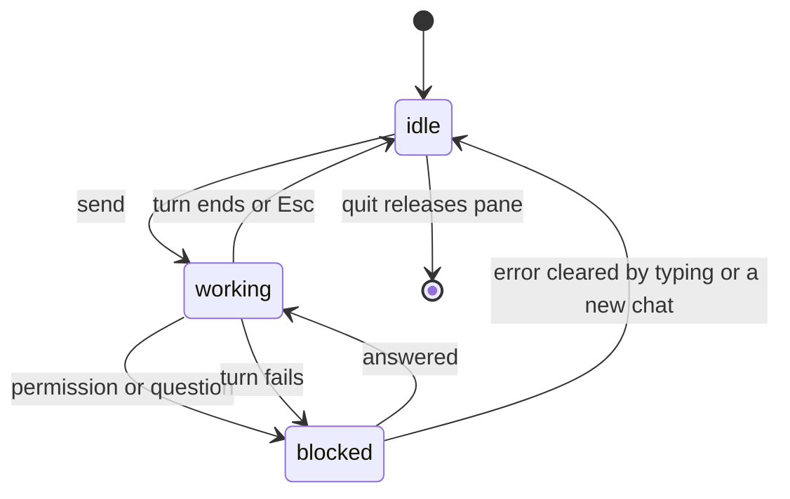

This page covers extension surfaces and terminal integrations of the [terminal workspace](/docs/surfaces/cli/tui).

## Extension surfaces in a terminal

The terminal host reads the same contribution metadata as the other clients, filtered to the CLI
or TUI surface.

- **Library views** use the portable declarative view contract. `list`, `table`, and `data-table`
  projections render today. Richer board, calendar, gallery, map, or custom renderers can be added
  without changing an app's record schema.
- **Missing renderers** are reported as unavailable. The client does not open a browser or silently
  change the view.
- **Native effects** differ in a terminal. Plugins can use Core tools, channel notifications, and
  status contributions, but should not assume browser permission prompts, phone haptics, Live
  Activities, or Dynamic Island.

See [Native bridges](/docs/extend/develop/extensions/native-bridges) for the cross-surface
capability contract.

## Terminal integrations

### Herdr

Run `ryu-cli` in a [Herdr](https://herdr.dev/docs/add-herdr-support/) pane, and Ryu reports pane
state to Herdr:

| State | When |
|---|---|
| `working` | A turn is running |
| `blocked` | Waiting for a tool permission or a question answer, or after a failed turn |
| `idle` | Ready for input |

With several chat tabs, a blocked or working chat takes priority over an idle one, and active turns
keep reporting while you are in another view. Quitting Ryu releases the pane. Outside Herdr,
reporting is off, and Herdr reporting failures never interrupt chat. A pasted prompt followed
immediately by Enter submits the complete text.

- **Errors.** A failed turn marks the pane blocked with an **Error:** line naming the first line of
  the error. It clears when you type, send, or start, fork, or resume a chat. Stopping a reply with
  Esc never marks the pane blocked.
- **Metadata.** Ryu reports the conversation title and model as pane metadata and clears them on
  exit. Herdr versions without metadata support are skipped after the first attempt.
- **Resume.** Saved chats give Herdr a resume command that reopens the conversation after a restart
  with the same node, agent or team, model, permission mode, reasoning settings, and double-check
  toggle. New chats become resumable after their first message.
- **No credentials.** The resume command never includes credentials. Ryu resolves them from the
  matching saved node or the environment.
- **Resume fallback.** Herdr gets a command that opens `ryu-cli` without resuming when an option
  contains an apostrophe or control character, the command is too long for Herdr, or the node URL
  has credentials, query parameters, or a fragment.

To reopen a conversation yourself, run `ryu-cli tui --resume <conversation-id>`, or use
`/resume <conversation-id>` inside the client. If you resume another conversation before the
previous request finishes, only the latest selection replaces the transcript. Repeat the same
`/resume` to retry a failed one.

### Terminal title

Ryu sets the terminal window or tab title to `ryu: <title>`, using the conversation title (from
`/resume` or `/rename`) or the tab name. While the focused chat streams, a spinner precedes it.
The title is cleared when Ryu quits.

## Related

<Cards>
  <DocCard href="/docs/surfaces/cli/tui" />
  <DocCard href="/docs/surfaces/cli/tui-chat" />
  <DocCard href="/docs/surfaces/cli/tui-settings" />
  <DocCard href="/docs/surfaces/cli/reference" />
  <DocCard href="/docs/surfaces/cli/parity" />
</Cards>
