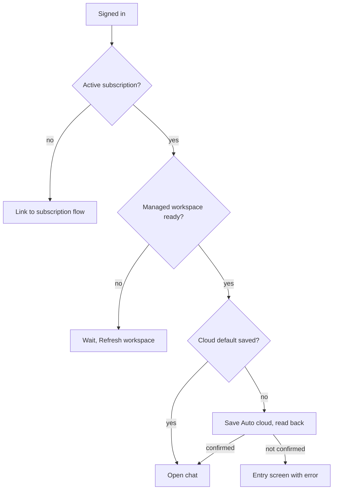

Bot is the managed desktop experience for people who want to use Ryu without configuring an AI
stack. Sign in with a Ryu account, keep an active subscription, and start a conversation.

## What Bot includes

- A focused chat workspace with saved conversations and the shared Ryu Work language mode.
- A Ryu-managed workspace that connects automatically when it is available for your account.
- Ryu-managed model routing, with no provider key or model picker to configure.
- The same chat runtime used by Agent, including Pi and sandbox actions when the managed
  workspace and the current organization allow them.
- Account access and the minimum managed-workspace status needed to explain connection problems.

## Bot pulse

Bot opens with an expanded profile card in the sidebar. The card shows the agent's current
status and a summary of the wider workspace. It does not show provider or infrastructure
controls.

The card has four views:

- **Overview** shows live work, pending attention, recent activity, and a
  handoff into a wider Mission Control-style summary.
- **Approvals** shows pending consequential actions and lets you approve or
  deny them through the existing Core and Gateway approval path.
- **Goals** gathers the goals attached to recently active conversations and
  separates active work from paused/passive work. Selecting a goal returns to
  its conversation; pause and resume update the existing goal record.
- **Feed** presents the same Core activity records as a post-like
  stream. You can choose which activity sources appear, add local reactions or
  comments, and open a chat draft for Ryu to help with a reply.

Feed reactions and comments stay local. They do not create public posts or send messages.
External actions remain behind the normal approval boundary.

If activity or goal data cannot be loaded, the card shows an error with a **Try again** action
instead of an empty feed. A failed approval decision stays in the queue, and a failed goal pause or
resume keeps its current state so you can retry it.

Bot keeps the visual language and chat behavior of the full desktop app, but its shell does not
show provider setup, model selection, routing, infrastructure, evaluation, agent editing, or
permission configuration.

While a Bot conversation is open, the chat page keeps a centered Ryu avatar and name label above
the transcript, below the desktop title bar. The identity row stays in place as messages scroll.

While the assistant works, its name bubble grows to show what it is doing right now: **Thinking…**,
**Typing…**, the tool it is running (for example **Searching the web…** or **Using List Events…**),
**Waiting for you** when it needs an answer or approval, or **Ran into a problem** after an error.
When the assistant is idle, the bubble shows only its name.

## Bot defaults for organization admins

On a Ryu-managed node, an organization owner or admin can open **Agent → Gateway → Default
agent & model** and set the **Bot realm default**. The setting carries the provider and model
together and applies to Bot chats on that managed node. Bot users still do not see a provider or
model picker.

If no custom value is saved, Bot uses **Auto cloud**, the Ryu-managed route that lets Ryu choose
the model. Changing the setting in Agent is preserved the next time Bot opens. Members can view
the setting, but only organization owners and admins with Gateway configuration permission can
change it.

## Sign-in and managed access

Bot checks the signed-in account's subscription and managed-workspace entitlement before opening
chat. If the account is not subscribed, the app links to the account's subscription flow. If a
subscription is active while its workspace is still being prepared, Bot waits and lets you refresh
the workspace state.

Before opening chat, Bot confirms the managed workspace's saved cloud default. If the default is
unset, it saves Auto cloud and reads it back. An existing choice made in Agent is preserved. If the
workspace cannot confirm the setting, Bot stays on the entry screen with an error; choose
**Refresh workspace** to retry. A failed confirmation does not replace your saved choice.

When you return from Agent, Bot keeps the selected managed workspace while it remains available
to your account. If that workspace is no longer available, Bot uses another available managed
workspace. A pending confirmation from a previous workspace cannot open chat on that workspace.

The managed connection uses the account and organization access already enforced by Ryu's control
plane and Core. Bot does not accept a personal provider key or let the client choose another node.

## Device and sandbox actions

Bot does not weaken device-access or sandbox security. Pi and Core continue to enforce the
existing server-side and organization permissions, and the operating system continues to request
the native permissions that an action needs. An action can still be refused when the account,
organization, managed workspace, or operating system does not allow it.

## Bot and Agent

Bot and [Agent](/docs/surfaces/desktop/agent) use the same desktop app, Core, Gateway, managed
Pi, sandbox, and device-access runtime. Agent is the power-user surface for configuring managed or
self-hosted nodes, bringing your own AI, and operating the wider Ryu workspace. Bot does not offer
those controls.

- **Default.** The sidebar product lockup shows Bot by default.
- **Switching to Agent.** On a Ryu-managed node, only members whose role grants Gateway
  configuration see the Agent option. See
  [Who can open Agent](/docs/surfaces/desktop/agent#who-can-open-agent). Core and the Ryu control
  plane check the same permissions on every request, so a member without that access cannot change
  node configuration through the API either.
- **Startup.** Agent access is checked when the app starts, so an unavailable Agent choice falls
  back to Bot. See
  [Choose the startup realm](/docs/surfaces/desktop/agent#choose-the-startup-realm).
- **Self-hosted and local nodes.** They have no Ryu platform organization authority and open
  directly in Agent, where the node owner is responsible for administration and security. The
  Ryu-managed Bot experience is the platform-managed path, not a self-hosted capability.
- **Island.** Island is not part of the Bot desktop product.

Bot, OS, and Agent are the built-in product tiers of the desktop
[interface switcher](/docs/surfaces/desktop/interfaces).

## Updates for the standalone Ryu Bot app

Ryu Bot is also published as a standalone app (**Ryu Bot**) alongside each stable Ryu release. It
updates from its own update feed, so an update always installs Ryu Bot, never the full Ryu app. The
standalone app follows the stable and beta channels. Nightly and canary builds exist for Ryu only,
so its **Release channel** picker offers only Beta and Stable.

For native Ryu Bot apps on phones, tablets, watches, TVs, and cars, see
[Ryu Bot on phone, tablet, watch, TV, and car](/docs/mobile/bot).

## Related

<Cards>
  <DocCard href="/docs/surfaces/desktop/user-guide/chat" />
  <DocCard href="/docs/surfaces/desktop/transparency" />
  <DocCard href="/docs/mobile/bot" />
</Cards>
