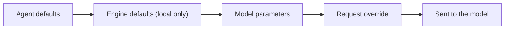

Advanced settings live on the engine they configure. Open **Library → Engines** or **Store → Engines**,
select an engine, and edit its configuration in the detail panel. Both surfaces edit the same
engine defaults, which every agent using that runtime shares. An explicit request override takes
precedence.

## Chat sampling defaults

Sampling values are sent with each chat request, so changing them does not restart an engine. Blank
fields leave that engine's defaults in place.

| Setting | Notes |
|---|---|
| Temperature, Top P, max tokens, seed, stop | Common request controls |
| Frequency and presence penalties | Standard OpenAI-compatible controls |
| Top K, Min P, repeat penalty | Sent on requests for llama.cpp, vLLM, and SGLang; MLX accepts repeat penalty; Ollama values are shown in its profile |
| Mirostat, DRY, dynamic temperature, XTC, sampler order | llama.cpp request extensions; Ollama's supported Mirostat values are shown in its profile |
| Response format, logit bias, prefill | Output shaping controls |
| Extra body fields | JSON fields passed to the selected chat engine |

Ryu only sends typed sampler controls through a verified request adapter. Ollama's Modelfile-only
samplers are saved as engine defaults and included in the copyable engine profile. They are not sent
as unsupported request fields. The JSON passthrough remains available for other engine-specific
request fields. A server can reject an unsupported field, and the chat shows that error.

## Per-model parameters and presets

Open **Gateway settings → AI & models → AI providers → Model parameters** to tune one model rather
than a whole engine. Choose **Local models** to pick a model served by a local engine, or
**Cloud models** to pick a provider model. Settings are saved on the active node and apply to every
chat that uses that model there, with no restart.

In a chat, the composer's settings menu has the same controls under **Parameters**. Pick a preset to
apply it to the chat's current model, or choose **Edit parameters…** to open the full editor.

The editor shows only the parameters the model accepts:

| Model | Parameters shown |
|---|---|
| llama.cpp | Every sampler above, plus grammar, response format, and logit bias |
| vLLM, SGLang | Standard controls plus Top K, Min P, repeat penalty, response format, and logit bias |
| MLX | Standard controls plus repeat penalty |
| Other local engines | Standard controls |
| Anthropic | Temperature, Top P, Top K, max tokens, stop sequences |
| OpenRouter | Standard controls plus Top K, Min P, repeat penalty, response format, and logit bias |
| Gemini, Cohere, Vertex | Temperature, Top P, Top K, max tokens, stop sequences |
| Bedrock | Temperature, Top P, max tokens, stop sequences |
| OpenAI and other OpenAI-compatible providers | Standard controls plus response format and logit bias |

Standard controls are temperature, Top P, max tokens, frequency and presence penalties, seed, and
stop sequences. Prefill and extra body fields are available for every model. Local models also show
their launch settings below the sampling editor.

Values are layered in this order, with later layers winning field by field. Cloud parameters apply
when Ryu routes the chat through the Gateway. External agents such as Claude Code or Codex use their
own settings.



**Presets** are named parameter sets saved on the node. Ryu ships read-only **Precise**,
**Balanced**, and **Creative** presets that set temperature and Top P. Presets are shared by every
client connected to the same node.

- **Save as preset** stores the current parameters. For a local model you can include its saved
  launch settings.
- **Apply** saves a preset to the selected model and skips any parameter that model does not
  accept, so one preset works for local and cloud models.
- **Update from current** overwrites a saved preset with the editor's values.
- **Delete** removes it.

## Chat runtime settings

Runtime settings are passed when Core starts a server. Save them while the engine is stopped or
restart it after saving to apply them. Options left blank use the runtime's own defaults.

| Engine | Ryu settings |
|---|---|
| llama.cpp | Context, GPU layers, batch sizes, threads, attention and cache, idle unloading, continuous batching, MoE offload, chat templates, speculative decoding, RoPE / YaRN, native options, and additional flags |
| vLLM | Context, GPU memory, tensor parallelism, dtype, quantization, KV cache, sequence limits, prefix caching, speculative config, native options, and additional flags |
| SGLang | Context, static memory fraction, tensor parallelism, dtype, quantization, KV cache, request limits, speculative decoding, native options, and additional flags |
| MLX | Native `mlx_lm server` options and additional command-line flags |
| MLX-VLM | Native `mlx_vlm.server` options and additional command-line flags, per engine or per model |
| MLX Serve | Context size, native `mlx-serve` options, and additional command-line flags |
| oMLX | Native `omlx serve` options (mostly server environment) and additional command-line flags |
| Apple Foundation Models | Native `apfel --serve` options and additional command-line flags |
| Mesh LLM | Context size, parallel lanes, draft model and draft max, native `mesh-llm serve` options, and additional command-line flags |
| Ollama | Chat request defaults and a copyable sampler profile; context, GPU layers, batch, threads, and memory settings are applied through a derived model when the engine starts or a model is activated. **Copy Modelfile profile** copies the read-only preview with supported launch and sampler parameters. Native options set the `ollama serve` environment |
| Lemonade, Magnitude, llama-swap, FreeToken, Docker Model Runner | Chat request defaults and extra request fields; Ryu stores raw launch arguments in a copyable per-engine profile. **Copy runtime args** copies one argument per line for the external runtime to apply |

These five runtimes have no native engine options. Ryu connects to a server you start and manage
in that tool, so configure models and hardware in the tool itself.

The llama.cpp launch editor includes a Jinja enable flag, an optional template-file path, and
inline template text. vLLM's speculative-config editor accepts only a JSON
object. vLLM and SGLang also expose typed speculative-decoding fields
beside the raw runtime arguments.

### Native engine options

Below the typed fields, **Native engine options** lists the runtime's own launch options, grouped by
area. Core publishes each engine's list, so the fields match the engine build Ryu installs.

| Engine | Native options |
|---|---|
| llama.cpp (chat, embedding, reranker, classifier, Speech Processing) | Batch and HTTP threads, process priority, polling, NUMA, devices, split mode, tensor split, main GPU, fitting to device memory, KV and projector offload, weight repacking, host buffer, full SWA cache, prompt-cache RAM and idle-slot caching, image token limits, warmup, tensor checks, tokens to keep, prediction limit, context shift, context checkpoints, YaRN parameters, reasoning mode, format, budget and budget message, chat-template kwargs, draft-model GPU layers, threads, devices, cache types and MoE placement, LoRA adapters, server timeout, slot similarity, slot save path, prompt caching, assistant prefill, SSE keep-alive, metrics, and the built-in web UI |
| vLLM | Pipeline and data parallelism, expert parallelism, CPU weight and KV offload, KV block size, eager mode, optimization level, batched-token limit, turning off chunked prefill, scheduling policy, long-prefill threshold, logprob limit, seed, remote code, model revision, tokenizer mode, generation config and overrides, Hugging Face config overrides, chat template, multimodal limits and processor cache, LoRA limits, reasoning parser, chat-template kwargs, and tool-call parsing |
| SGLang | Data, pipeline and expert parallelism, attention backend, decode and prefill CUDA graphs and their batch sizes, torch.compile, CPU offload, chunked prefill, prefill, total and queued request limits, page size, schedule policy and priority scheduling, radix and hierarchical cache, mixed chunks, stream interval, deterministic inference, seed, grammar backend, EAGLE draft settings and draft revision, remote code, model revision, chat template, reasoning parser, and tool-call parser |
| MLX | Remote code, adapter path, chat template and its arguments, draft model and tokens, decode and prompt concurrency, prefill step, prompt-cache entries and size, KV cache quantization, log level, and server default temperature, top-p, top-k, min-p, and max tokens |
| MLX-VLM | Remote code, adapter path, default max tokens, thinking defaults, KV cache size and quantization, prefill step, expert cache, vision feature cache, concurrent sequences, token queue timeout, speculative drafting, prefix cache, top-logprobs cap, and logging. Prefix-cache, queue-timeout, and drafting-coalesce settings are passed as the server environment |
| MLX Serve | Vision encoder, GGUF engine, SSD streaming, memory pre-flight, warmup, loaded-model and memory caps, idle unload, KV cache quantization and read path, GGUF KV cache type, exact dense decode, Neural Engine prefill, prefill chunk, embedding input limit, prefix cache (entries, memory, SSD), tokenize cache, SSM checkpoints, concurrency, GGUF sequences, stall timeout, metrics, tool-argument autocorrect, logging, default temperature, top-p, top-k and max tokens, reasoning budget, prompt lookup decoding, drafter, MTP, and DSpark controls. MLX Serve refuses unknown flags, so the list is limited to options present in MLX Serve 26.8.10 and later |
| oMLX | Concurrency and embedding batch, memory guard and keep-warm, paged SSD and hot RAM prefix cache, hybrid-model state cache, headless mode without the web dashboard, SSE keep-alive, upload and image limits, MCP config, usage history, Hugging Face and ModelScope endpoints and cache discovery, proxy and CA bundle, and log level, directory and retention. Most are passed as `OMLX_*` environment variables and apply only while Ryu runs the server. Memory guard, hot cache size, and SSE keep-alive are flags that oMLX also saves to its own settings |
| Apple Foundation Models (apfel) | Max concurrent requests, retry on transient errors, CORS headers, allowed browser origins, debug logging, and quiet and no-color output. Sampling and context are set per request because apfel's serve mode rejects them as launch flags |
| Mesh LLM | Startup model, load-time quantization, local-only serving, config file, llama.cpp backend flavor, device, VRAM cap, tensor split and auto-balance, speculative decoding, disk prompt cache, mesh membership (invite file, auto-join, discovery, publishing, names, region, client limit, QUIC port), privacy and trust (hardware enumeration, trust policy, owner attestation, guardrails, `MESH_LLM_ANALYTICS`), default plugins, and logging. Options were checked against Mesh LLM v0.78.1; an older install may reject newer flags |
| Ollama | `OLLAMA_FLASH_ATTENTION`, `OLLAMA_KV_CACHE_TYPE`, `OLLAMA_GPU_OVERHEAD`, `OLLAMA_SCHED_SPREAD`, `OLLAMA_VULKAN`, `OLLAMA_IGPU_ENABLE`, `OLLAMA_CONTEXT_LENGTH`, `OLLAMA_NUM_PARALLEL`, `OLLAMA_MAX_LOADED_MODELS`, `OLLAMA_MAX_QUEUE`, `OLLAMA_KEEP_ALIVE`, `OLLAMA_LOAD_TIMEOUT`, `OLLAMA_MAX_TRANSFER_STREAMS`, `OLLAMA_NOPRUNE`, `OLLAMA_NO_CLOUD`, and `OLLAMA_DEBUG`. They apply when Ryu starts `ollama serve` |
| whisper.cpp | Processors, CPU-only mode, GPU device, flash attention, audio context, word splitting and thresholds, no-speech threshold, carrying the initial prompt, diarization (tinydiarize or stereo, not both), DTW timestamp presets, ffmpeg conversion, and voice activity detection with its timing controls |
| stable-diffusion.cpp | Threads, automatic fitting and VRAM budget, backend and parameter placement, multi-GPU split, weight offload and prefetch, segmented compute, CPU placement for text encoders, VAE and ControlNet, VAE tiling and tile settings, temporal tiling, flash and SageAttention, direct convolution, weight types, memory mapping, eager loading, prediction type, RNGs, LoRA directory and apply mode, embeddings directory, default steps, CFG scale, sampler and scheduler, and log level |
| OuteTTS | Threads, GPU layers, devices, flash attention, context and batch size, max audio tokens, top-k, seed, guide tokens, speaker file, and model load mode |
| audio.cpp | Idle unload, minimum free memory, graph optimizer, voice library folder, and debug logging and log file |
| Ryu Audio | Kokoro's ONNX execution provider and log level, the eSpeak NG library, the KittenTTS model, and Hugging Face offline mode, telemetry, and download timeouts. All are passed as the sidecar's environment; it has no command-line flags |

A blank field keeps the engine default. How options combine:

- A per-model launch config can hold native options for several engines. Choose the engine under
  **Options for engine**. Each engine applies only its own options when it serves the model.
- Per-model native options are available for llama.cpp, vLLM, SGLang, MLX, and MLX-VLM. The other
  engines read their engine-wide settings only.
- Engine-wide and per-model native options merge option by option, with the model's value winning.
- **Additional flags** are appended after native options, so a raw flag can still override one.
  audio.cpp is the exception: it reads the first occurrence of a flag, so the native option wins.
- Flags Core manages, such as the host, port, model path, and output file, cannot be set here.

Options marked as environment variables apply only when Ryu starts the runtime, and a variable
already set in Core's environment wins.

A launch setting change affects the next start of that engine, not the model weights. The detail
panel offers **Restart** for running runtimes whose process Core owns. If Ryu adopts a server already
running outside Core, its launch flags remain controlled by that server's owner.

### Ollama

Ollama serves many models from one daemon and accepts no per-model launch flags, so Ryu applies
launch settings by creating a derived Ollama model. When the Ollama engine starts, or when you
activate a model on it, Ryu reads the launch config for the active Ollama model (falling back to the
per-engine config) and creates a model equivalent to this Modelfile:

```text
FROM llama3.2:3b
PARAMETER num_ctx 8192
PARAMETER num_gpu 20
```

| Ryu field | Ollama parameter |
|---|---|
| `ctx_size` | `num_ctx` |
| `gpu_layers` | `num_gpu` |
| `batch_size` | `num_batch` |
| `threads` | `num_thread` |
| `mlock` | `use_mlock` |
| `no_mmap` | `use_mmap false` |

The derived model is named `ryu-<model>-<hash>`. The hash covers the base model and its settings, so
the same settings reuse one model. Chat requests for the base model name (with or without `:latest`)
are then served by the derived model, through both the Gateway and Core's OpenAI-compatible endpoint.

If the derived model cannot be created, for example because the base model has not been pulled into
Ollama, Ryu keeps serving the base model without the settings. The Ollama engine then reports a
degraded health status explaining why the settings were not applied. Ryu leaves derived models in
place after you change settings; remove old ones with `ollama rm` if you want the space back.

## Embeddings, reranker, and classifier

The llama.cpp detail panel has a separate **Embedding engine** section for its auto-started
`llamacpp-embed` server. Context size, GPU layers, batch sizes, threads, idle unloading, cache
settings, native llama.cpp options, and raw flags are stored separately from Chat, so changing
embedding settings does not alter chat configuration. Use **Restart embedding server** to apply a
saved change.

**Reranker and classifier servers** holds the same launch settings for the Spaces search reranker
(`llamacpp-rerank`) and the routing and inspection classifier (`llamacpp-classify`). Each applies
the next time its server starts. Blank batch sizes keep the reranker's 8192-token defaults, and a
blank context size keeps the classifier's 4096-token default.

## Image generation

The stable-diffusion.cpp detail panel has **Engine launch settings** for `sd-server`, with its
native options and additional flags. Restart the engine to apply them. Ryu keeps the model, companion
weights, and listen address it selected.

## Speech recognition

Speech recognition settings are grouped with the engine that uses them:

| Engine | Settings |
|---|---|
| whisper.cpp | Language, translation, temperature, best-of, beam size, prompt, context controls, extra multipart fields, threads, native server options, and extra server flags |
| audio.cpp | Language, temperature, prompt, extra request fields, backend, device, threads, and maximum loaded models, plus **Engine launch settings** with native server options and extra server flags. Other Whisper-specific typed options are saved but not sent |
| Core Parakeet | Runs in-process on the CPU and currently uses the model library's defaults; there is no server process, so it has no launch flags or native options, and request options are not supported |
| Gateway | Ryu stores a per-node transcription profile, but the current Gateway request adapter does not forward these options to the provider |

See the whisper.cpp [upstream server options](https://github.com/ggml-org/whisper.cpp/blob/master/examples/server/README.md).
Core controls the server lifecycle; extra flags are for other upstream options.

Request settings apply to transcription calls for their selected engine. The UI marks Core
Parakeet's missing request options beside its settings.

## Speech Processing

The llama.cpp engine detail page also exposes the node-wide S1-mini Speech Processing defaults
(engine, style, structure, and context). See
[Speech Processing](/docs/surfaces/desktop/engines/voice-engines#speech-processing) for where else
they appear.

Below them, **Engine launch settings** configures the Speech Processing llama.cpp server. S1-mini
is served with thinking disabled and greedy decoding by default; setting **Reasoning** or **Chat
template kwargs** replaces the thinking default, and additional flags such as `--temp` override the
decoding default.

## Speech generation

The speech-generation engine, voice, and per-engine request fields are described in
[Audio](/docs/surfaces/desktop/engines/voice-engines#audio). The OuteTTS detail panel has
**Engine launch settings** for `llama-tts`, which apply to the next spoken reply.

The Ryu Audio detail panel also has **Engine launch settings** for its sidecar. They are applied as
the sidecar's environment, so there is no additional-flags field; restart the engine to apply them.
A Ryu Audio server that Core adopted instead of starting keeps its own environment.

## Per-engine ownership

Ollaya is a local typed-decision provider rather than a chat runtime. Configure its optional API
credential in its node settings; the model may also be selected on an individual decision call.
Unsloth training options belong to the Fine-tuning app because they configure training jobs, not a
resident inference engine.

For voice model selection and the rest of the Speech settings, see [Voice engines](/docs/surfaces/desktop/engines/voice-engines).
