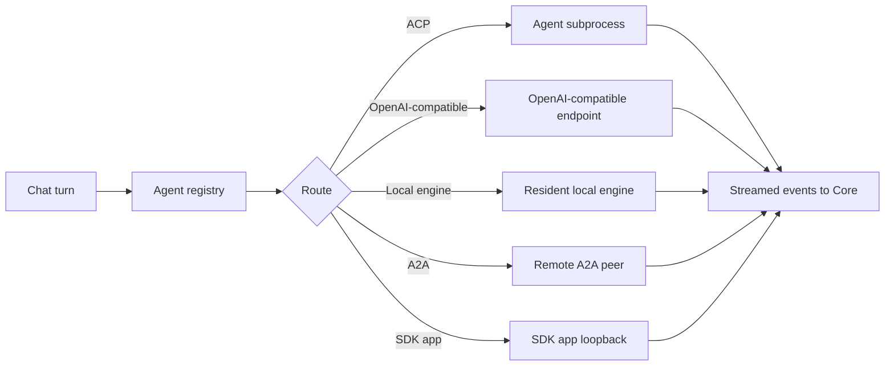

An agent runtime is the engine behind an agent. Core drives full coding agents over the **Agent
Client Protocol (ACP)**: each runs as a subprocess and streams events back to Core in the Vercel AI
SDK format, with the full tool loop that lets it read files, run commands, and edit code.

This is the reference for the ACP agent runtimes Core knows about and the catalog that installs
them. The registry is `AcpAgentRegistry` (`apps/core/src/sidecar/adapters/acp/registry.rs`).

The `ryu` flagship, the `jay-jr` founder bot, and the
[Patrol](/docs/surfaces/desktop/user-guide/agents#patrol-watches-your-setup) bot are installed by
default. Every other agent is opt-in through the agents catalog.

## File access

ACP file requests are mediated through the active session workspace:

- Existing paths are canonicalized before a read.
- Symlink escapes and protected credential directories are refused.
- New writes may create only a symlink-free path under that workspace.

A refused read is returned as empty content and a refused write is a no-op. A prompt-injected turn
cannot use the client file bridge to reach host credentials.

## How agents reach Core

Core picks one route per chat turn (`AgentRoute` in
`apps/core/src/sidecar/adapters/adapter_core/route_selection.rs`):

| Route | What Core does |
|---|---|
| ACP | Spawns the agent as a subprocess and streams its tool calls and output. Every agent on this page uses this route. |
| OpenAI-compatible | Calls an OpenAI-compatible endpoint, through the Gateway when it is healthy. ZeroClaw (local server on `:42617`) is the built-in agent on this route. |
| Local engine | Makes a local inference engine resident, then streams from it. |
| A2A | Calls a trusted remote A2A peer. |
| SDK app | Calls the loopback endpoint of an SDK app that Core manages (`sdk:<package>`). |

The default agent id is `ryu` (`DEFAULT_AGENT_ID`), resolved through the registry and overridable.

## Which agents Core can run

[ACP Agents](/docs/start-here/architecture/acp-agents) is the canonical list of curated, registry,
and binary-only agents, with each agent's Gateway egress.

The flagship `ryu` is Pi plus the Gateway. It is installed on first run, next to the removable
Jay Jr. and Patrol bots, which run on the same managed Pi. It manages its own Pi binary, and you
configure its model and provider in a dedicated panel (see
[Configure the Ryu Pi agent](#configure-the-ryu-pi-agent)).

For how the flagship works, see [Ryu Agent](/docs/start-here/architecture/ryu-agent) and [Pi Engine](/docs/start-here/architecture/pi-engine).

<Callout type="warn">
  An ACP agent's own LLM calls happen inside its subprocess.

  - Claude Code and Codex use the passthrough proxy by default. An explicit direct-egress
    preference keeps them outside it.
  - **Gemini is not wirable**, and every registry agent carries `gateway_bypass: true`, so their
    chat egress does not traverse the Gateway.

  Tool execution is governed on both planes. See [Gateway for any agent](/docs/gateway/gateway-for-any-agent).
</Callout>

Install notes that apply on the desktop:

- Binary-only registry agents (for example goose, opencode, cursor, kimi, and devin) use a
  per-platform archive downloader in `apps/core/src/sidecar/agents/archive_agent/mod.rs`
  (`ArchiveAgentSpec`, `ensure_installed`). Installing one from the catalog extracts the binary into
  `~/.ryu/bin` before the installed flag is set.
- Connecting an OpenClaw ACP entry does not replace its own Gateway configuration or route its model
  requests through Ryu Gateway. Confirm the runtime's credentials, tool permissions, and provider
  destinations yourself.
- NanoClaw is not a routable agent. It is a message-driven Node orchestrator with no HTTP or ACP
  endpoint Core can route to, so it is not in the startup order (`apps/core/src/boot/startup_order.rs`).

## Configure the Ryu Pi agent

You can edit the model and provider that the managed Pi behind the `ryu` agent uses. That
configuration lives in an isolated directory, `~/.ryu/runtimes/pi-agent`, never the user's own
`~/.pi/agent`. Core passes it to Pi as `PI_CODING_AGENT_DIR`, and `RYU_PI_AGENT_DIR` overrides it.

`apps/core/src/pi_config/mod.rs` is the single owner of that directory. It reads and writes the
three files Pi understands.

| File | What Ryu manages |
|---|---|
| `settings.json` | `defaultProvider`, `defaultModel`, `defaultThinkingLevel`, plus a Ryu routing marker. Unmanaged keys are preserved verbatim |
| `models.json` | Custom OpenAI-compatible providers (Ollama, LM Studio, vLLM, a proxy) and per-model overrides |
| `auth.json` | The *active* account's credential per provider, in the `{ "type": "api_key", "key": ... }` / `{ "type": "oauth", ... }` shape Pi expects |

### Routing

The routing choice is folded into the provider picker. Gateway routing is the default until you
choose otherwise.

- **Ryu Gateway** keeps egress governed. Core pins Pi's built-in `openai` provider at the local
  Gateway, so every model call routes through the firewall, budget, and audit layers.
- **Any other provider** switches to direct egress. This is a user-chosen bypass: Pi talks to that
  provider directly, and the api-key credential is written to `auth.json`.

### Accounts and credentials

**Credentials are sealed at rest.** Every sign-in is sealed with the at-rest master key and kept in
`~/.ryu/secrets/pi-accounts.db`. That covers a provider login such as ChatGPT, Claude, or Copilot,
a bring-your-own-key, and an ACP agent's auth. It uses the same `enc:v1:` envelope as plugin
secrets. The master key lives in the OS keychain and falls back to `~/.ryu/secrets/master.key`.

`auth.json` and `models.json` are only the *materialization* of the active account. Core writes them
on login, on account switch, and at spawn, so Pi keeps reading exactly the files it always did.

Multiple accounts for one provider or agent are supported. The Provider Command Center and composer
picker list them, switch between them, rename them, and remove them.

Provider account rows ask whether to **Use for yourself** or, for a gateway-compatible BYOK key,
**Set for Gateway**. The personal and Gateway selections are independent. Setting a Gateway account
requires the workspace's `gateway.configure` permission. Subscription OAuth credentials remain with
the caller and are never copied into the shared Gateway key store.

`auth.json` and `models.json` can hold credentials, so on Unix they are written with `0600`
permissions. Credentials are never returned when you read the config back.

| Action | Endpoint |
|---|---|
| Read the current Pi config | `GET /api/pi-config` |
| Apply a provider, model, or thinking-level change | `PUT /api/pi-config` |
| List supported providers, thinking levels, and api types | `GET /api/pi-config/catalog` |
| List a provider's accounts | `GET /api/pi-config/providers/:id/accounts` |
| Switch a provider's account for yourself or the Gateway | `POST /api/pi-config/providers/:id/accounts/switch` with `accountId` and optional `target` (`self` or `gateway`) |
| Rename a provider account | `POST /api/pi-config/providers/:id/accounts/rename` with `accountId` and `label` |
| Remove a provider account | `POST /api/pi-config/providers/:id/accounts/remove` |
| List an ACP agent's accounts | `GET /api/agents/:id/accounts` |

In the desktop, this is the `RyuPiConfig` panel
(`apps/desktop/src/components/agents/RyuPiConfig.tsx`), shown on the agent edit page for the `ryu`
agent only. Other agents are edited through the ordinary agent record.

<Callout type="info">
  This editor targets only the Ryu-managed Pi in its isolated directory, not any Pi you have
  installed yourself. Your own `~/.pi/agent` configuration is left untouched.
</Callout>

Canceling a managed Pi subagent sends a termination signal, then forces the child to exit if it is
still running after the grace period. Once the child closes, its cancellation listener and pending
escalation timer are released.

## Native provider accounts

Some installed agents support native account management. To add an account:

1. Open **Store → Agents** and select the agent to see **Native provider accounts**.
2. Add a name such as “Work” or “Personal”.
3. Choose **Sign in** and follow the provider’s instructions in the panel.

The account remains **Pending sign-in** until the provider verifies it. Keep the panel open to see
progress, or choose **Cancel sign-in** to stop the attempt.

| Control | What it does |
|---|---|
| **Use account** | Uses this account. Only verified, connected accounts offer it. |
| **Disconnect** | Stops using the connection. |
| **Log out** | Signs out through the provider. |
| **Remove** | Removes the saved account. |

These controls use the selected node and agent. Agents or older nodes without support do not show
the panel.

## The agents catalog

Onboarding detects which agent CLIs you already have on PATH and offers to add the matching agent.
Catalog entries start opt-in (not installed). Only `ryu`, `jay-jr`, and `patrol` are installed by
default.

| Action | Endpoint |
|---|---|
| List the installable catalog | `GET /api/agents/catalog` |
| Add a built-in agent to the picker | `POST /api/agents/catalog/install` |
| Remove one | `POST /api/agents/catalog/uninstall` |
| List the agents you can pick | `GET /api/agents` |

"Installing" a catalog agent adds it to the agent picker. For a binary-only registry agent, it
also downloads the binary into `~/.ryu/bin`. The catalog entry reports whether the agent's binary
was detected on PATH and whether it is already added.

- The `ryu` agent is always present and cannot be uninstalled.
- Jay Jr. (`jay-jr`) and Patrol (`patrol`) can be removed and added back like any other catalog
  agent. Adding either back downloads nothing, because both run on the `ryu` agent's managed Pi.
- Removing Patrol pauses its scheduled patrols, and adding it back resumes them.

Send `dryRun: true` to either catalog mutation to inspect the installed flag and runtime-file plan
without changing the picker or starting a download.

<TryInRyu page="agents" />

## Related

<Cards>
  <DocCard href="/docs/surfaces/desktop/user-guide/agents" />
  <DocCard href="/docs/gateway/gateway-for-any-agent" />
  <DocCard href="/docs/start-here/architecture/core-vs-gateway" />
</Cards>

