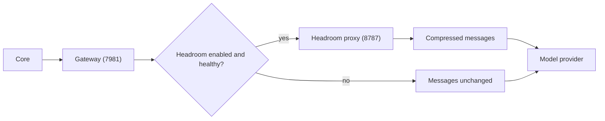

Besides chat, voice, and agent runtimes, Core manages these infrastructure processes.

## Gateway

The Ryu Gateway runs as a managed sidecar (`apps/core/src/sidecar/gateway.rs`). It binds to `7981`
by default, and Core reaches it at `http://127.0.0.1:7981`. Core derives the Gateway's `--bind` from
`RYU_GATEWAY_URL` and sets provider env on spawn (including `LOCAL_LLM_URL` for the active local
engine). Set `RYU_GATEWAY_MANAGED=0` to run an external Gateway instead of letting Core spawn one.

Credentials in `gateway.toml` are sealed with a key derived for the Gateway. Core hands that key
to a Gateway it spawns. An external Gateway needs the key too. Give it one of these:

- the `RYU_SEAL_KEY` and `RYU_SEAL_SCOPE` that `ryu-core gateway-seal-env` prints, or
- the same `RYU_MASTER_KEY` that Core uses.

Until you do, Core refuses to save a new credential into a `gateway.toml` that holds no sealed
value yet. It never writes a file your Gateway cannot read. See
[Gateway configuration](/docs/gateway/configuration).

The Gateway is on the default chat path. For everything it does, see [The Gateway](/docs/gateway).

## Headroom (context compression)

Headroom is an optional egress-compression proxy (default port `8787`). When enabled, the Gateway
posts request messages to Headroom before the provider call to cut token usage. It fails open: if
Headroom is absent or unhealthy, the Gateway sends messages unchanged.

<Callout type="warn">
  Headroom is off by default because it changes what is sent to the model. It also needs the
  `headroom` CLI on `PATH`, which you install yourself.
</Callout>

- The enabled state of the built-in `headroom` plugin decides whether compression is on.
  `RYU_HEADROOM_ENABLED=1` only seeds that default. When it is on, Core launches `headroom proxy`
  (`apps/core/src/sidecar/headroom.rs`) and sets the Gateway's compression env.
- The proxy URL is `RYU_HEADROOM_URL` (default `http://127.0.0.1:8787`).

See [Context compression](/docs/gateway/compression) for the full picture.

## Durable execution

Workflows run on Core's in-process engine (`apps/core/src/workflow/durable.rs`). It rewrites run
state to disk after every node and every loop iteration, so a run survives a Core restart and
resumes from the last completed node. It needs no extra sidecar. See
[Workflows](/docs/core/workflows).

<Callout type="info">
  Core has no Restate or Temporal workflow backend. The durable-engine interface is kept so a
  separate backend can be added later.
</Callout>

## Tool sidecars

Core also manages tool processes (`apps/core/src/catalog/registry.rs`):

| Sidecar | Purpose |
|---|---|
| `shadow` | Screen capture and OCR |
| `ghost` | Desktop automation MCP server |
| `agentbrowser` | Web browsing tool |
| `llmfit` | Hardware-aware model recommendations |

Ghost and Shadow are surfaced as built-in tool servers in the [MCP registry](/docs/core/mcp-registry).
Spider (web crawling) is not a managed sidecar. It is a plugin that calls a `spider` CLI you install
yourself.
