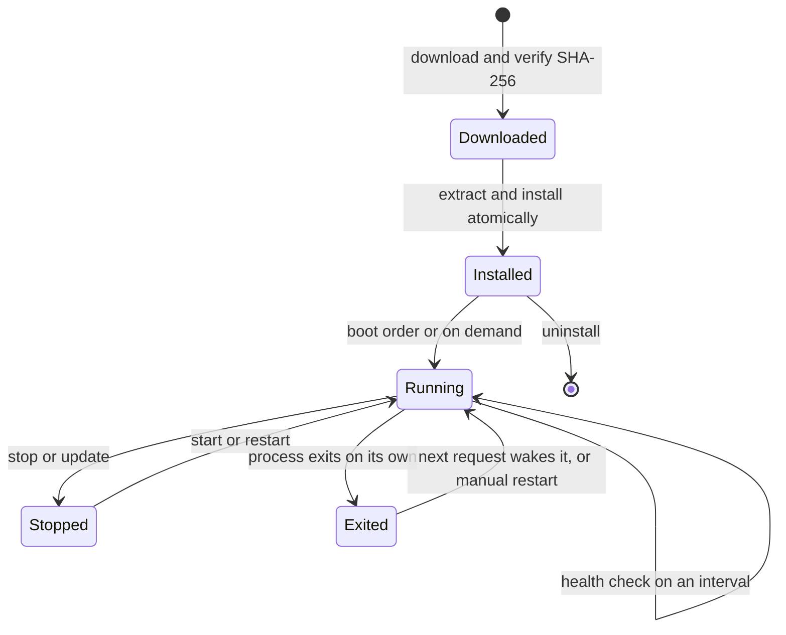

This page covers how Core manages every engine sidecar. For the engines themselves, see
[Engines and Sidecars](/docs/surfaces/desktop/engines).

## First-run install

On first launch Core installs a local stack in the background so chat works with no API key
(`apps/core/src/sidecar/onboarding.rs`). Each step is non-fatal. A failure adds a warning and never
blocks chat.

1. The llama.cpp binary.
2. The GGUF models served by llama.cpp, which need the binary from step 1:
   - the bundled chat model and its vision adapter;
   - the nomic embedding model, the reranker, the classifier, and the speech-processing model.

   The chat model is Gemma 4 E2B. A node whose RAM cannot hold it (it needs about 5 GB) gets
   Gemma 3 1B instead, and Core logs why. Set `RYU_LOCAL_CHAT_MODEL_ID` to choose your own.
3. The whisper.cpp voice engine and its `ggml-base.en.bin` model.
4. The parakeet speech model, the Silero VAD model, OuteTTS, and Kokoro text-to-speech.
5. The `sdcpp` engine and the default image model that fits the node, on platforms with a
   prebuilt server (Windows x64, macOS arm64, Linux x86_64):
   - Qwen Image 2.1 (about 11 GB) when it fits;
   - otherwise the lighter SDXL base (about 2.8 GB);
   - otherwise none, with a setup warning.

Onboarding owns every default model download. Engines such as `llamacpp-embed` only serve the file,
so an engine that auto-starts does not download the same model a second time. Voice, text-to-speech,
and image engines are downloaded but stay opt-in to run.

## The lifecycle

Every sidecar implements one trait with `start`, `stop`, `health_check`, and `uninstall`. The
`SidecarManager` orchestrates them.

- **Download and verify** - the download manager fetches the right asset for your platform, verifies
  its SHA-256, retries with backoff, extracts archives, and installs atomically.
- **Storage** - files go to fixed folders in the data directory. See
  [What's in the data folder](/docs/surfaces/desktop/user-guide/data-and-storage#whats-in-the-data-folder).
  - Inference engines: `~/.ryu/engines/<group>/<engine>/` (for example `engines/chat/llamacpp/` or
    `engines/image/sdcpp/`).
  - Small tools: `~/.ryu/bin/`.
  - Model weights: `~/.ryu/models/<modality>/`.
  - Service state: `~/.ryu/services/<name>/`.
  - Installed versions: `~/.ryu/state/versions.json`, so an up-to-date binary is not re-downloaded.
- **Startup order** - a defined boot sequence starts the installed sidecars. Voice engines are
  not in the startup order; they start on demand.
- **Health** - each sidecar is health-checked on an interval. Health is observable but Core does not
  auto-restart on degradation. A sidecar whose process exits on its own is not restarted in a loop.
  A wake-eligible sidecar restarts on the next request. Any other one can be restarted with
  `POST /api/sidecar/:name/restart` (see the routes below).

## Managing sidecars

| Action | Endpoint |
|---|---|
| Install progress for all sidecars | `GET /api/catalog` |
| Full install status | `GET /api/setup/status` |
| Install status of one sidecar | `GET /api/setup/status/:name` |
| Install a sidecar | `POST /api/setup/:name/install` |
| Uninstall a sidecar | `POST /api/setup/:name/uninstall` |
| Uninstall and delete its Ryu-owned data (for example its model store) | `POST /api/setup/:name/uninstall-with-data` |
| Running status of all sidecars | `GET /api/sidecar/status` |
| Start, stop, restart one | `POST /api/sidecar/:name/{start,stop,restart}` |
| Start or stop all | `POST /api/sidecar/{start-all,stop-all}` |

Installation and removal routes accept `dryRun=true` as a query parameter. A preview reports the
node support, current installed state, and whether data would be removed without downloading,
changing install status, stopping a process, or deleting files.

### Updates

An update is a forced install (`force=true`). Before replacing files, Core stops every running
sidecar that shares them. Updating llama.cpp or its embedding engine stops the whole llama.cpp
family: `llamacpp`, `llamacpp-embed`, `llamacpp-rerank`, `llamacpp-classify`, `llamacpp-speech`,
and `outetts`.

The sidecars Core stopped start again afterwards, whether or not the update succeeded. Only one
install or update of a sidecar runs at a time. A second request while one is in progress is refused
with an "already being installed" error, so wait for the first to finish before trying again.

## Per-engine resource usage

Core samples the resources each engine uses. A background sampler on the `SidecarManager`
refreshes per-process resident memory (RSS) and CPU usage every two seconds for the sidecars Core
owns a child process for (`apps/core/src/sidecar/resources.rs`, `apps/core/src/sidecar/manager.rs`).

The sampler holds one long-lived `sysinfo::System` and refreshes only the known sidecar PIDs, never
a full process scan. `sysinfo` reports CPU usage as a delta since the previous refresh of that PID,
so the first sample of a process reads `0` and later samples report real CPU usage.

`GET /api/sidecar/status` returns optional `pid`, `memory_bytes`, and `cpu_percent` fields per
sidecar (`apps/core/src/sidecar/mod.rs`). Each field is omitted when absent.

| Field | Meaning |
|---|---|
| `pid` | OS process id, present only when Core owns a resident child for the sidecar |
| `memory_bytes` | Resident-set memory of that process, in bytes |
| `cpu_percent` | CPU usage as a percentage of one core |

The desktop shows these on the **Engines & models** page of the expanded node selector, grouped by
modality (`apps/desktop/src/components/shell/NodeSelector.tsx`). Engines that adopt an external
server, run serverless, or run in-process report no `pid`. They show as running with no usage.

Chat rows are status-only there. Swapping Chat is a Store action, not a sidecar start or stop, so
the panel shows only the active Chat, not the installed-but-idle alternatives.

<Callout type="warn">
`cpu_percent` uses `sysinfo`'s per-core convention, so a busy multi-threaded engine can read above
100. The fields appear only for sidecars Core owns a PID for.
</Callout>

## Engine logos

Marketplace and Library show the engine's project logo when one is available. The same logo
appears in its detail view. Engines without project artwork show a generated icon. Logos are
bundled with Ryu and work offline. Monochrome marks adapt to light and dark mode.
