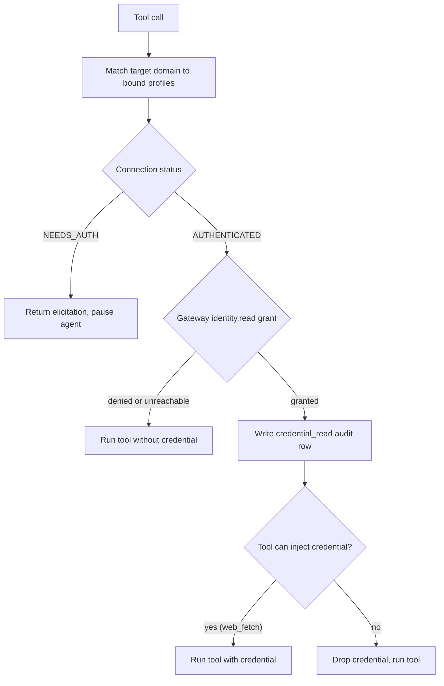

**Identities** lets an agent use a website login on your behalf without placing credential state
in the model. You store a connection for a domain once and attach its profile to an agent. When a
tool call targets that domain, Core checks the Gateway before any credential is used.

By default, Core keeps connections in its in-process identity store. When
Core is configured to use a remote [Passport](/docs/standalone/passport) service, the same routes
and tool-call checks go to Passport instead.

Credentials are:

- **Sealed at rest** before they are stored.
- **Never returned in any API response** - the sealed state is structurally excluded from every
  `ConnectionRecord` JSON response via `#[serde(skip)]`.
- **Never sent to the model** - decryption happens only at the tool-dispatch chokepoint, never
  inside the LLM context.

Open **Identities** from the command palette or the left sidebar to manage them.

## Profiles and connections

- A **profile** is a named grouping you can attach to one or more agents.
- A **connection** binds a profile to a single domain (the site the agent may sign in to).
- An agent bound to a profile can use every authenticated connection in that profile.
- Domain matching uses the exact host. Subdomains do not match.

```text
Agent → profile_ids[] → Profile → Connection (per domain) → sealed credential
```

## How it works at tool-call time

Every tool dispatch goes through a vault consult:

1. The agent's bound profile IDs are checked against the call's target domain (extracted from a
   `url` or `domain` argument).
2. If a bound connection is **`NEEDS_AUTH`**, the tool is not dispatched. A
   `__ryu_elicitation__` envelope is returned instead, pausing the agent until you complete login.
3. If a bound connection is **`AUTHENTICATED`**, the credential is read through the Gateway's
   `identity.read` grant gate. This gate fails closed:
   - If the Gateway denies the read or cannot be reached, the tool proceeds without the credential
     and returns its own auth error.
   - A `credential_read` audit row records only the domain and source, never the decrypted
     credential.
4. Only tools that can inject a credential into their own request (today `web_fetch`) receive it.
   For other tools, the credential is read and audited, then dropped.



<Callout type="info">
  When Core uses a remote Passport service, `web_fetch` and authenticated MCP connections go through
  Passport, which consumes the credential and returns only the result. Composio tools are skipped by
  this check because Composio has its own connection flow. Connect owns Composio account linking and
  action execution separately.
</Callout>

## Adding a connection

1. Open **Identities** and click **New connection**.
2. Enter a profile name (create a new one or reuse an existing one) and the exact domain,
   for example `app.example.com`.
3. The connection starts in **`NEEDS_AUTH`** with no credential state.

Canceling a new-connection form opened from a selected connection returns to that connection.

## Authenticating: manual import

Manual import is the supported login path:

1. Select the connection, then click **Start login**. A manual-kind flow has no hosted page.
2. Log in to the site yourself in a browser and copy the session cookie or token.
3. Paste it into the **Manual import** field and click **Import credentials**.
4. The plaintext is sealed immediately on receipt and never logged or returned. The connection
   flips to **`AUTHENTICATED`**.

If an import is rejected, the pasted value stays in the form so you can edit it or retry. A
successful import clears the field and refreshes the displayed status.

Use **Check status** to refresh the displayed status after an import.

<Callout type="warn">
  Manual import is the only credential capture path. Ryu does not capture browser sessions for
  you. Composio account linking and actions belong to the separate
  [Connect](/docs/standalone/connect) service, and Identities does not capture or export their
  provider credentials.
</Callout>

## Binding a profile to an agent

Open the agent's settings and add one or more profile IDs to its identity profiles list. Only
profiles explicitly bound to an agent are consulted at tool-call time. An agent with no bound
profiles has no vault activity.

Bound profiles apply only to agents set to **Acts as you** or **Both**. An agent set to **Its own
identity** never uses your profiles, even if some are still bound to it. It uses its own
[agent accounts](/docs/security/secret-vault-agent-accounts) instead. See
[Choose which accounts an agent can use](/docs/surfaces/desktop/user-guide/agent-account-access#choose-which-accounts-an-agent-can-use).

## Core compatibility API reference

The desktop calls these Core routes (port `7980` in the `release` profile). New standalone
integrations should use the [Passport API](/docs/standalone/passport-api) directly.

| Method | Path | Description |
|--------|------|-------------|
| `GET` | `/api/identities` | List all profiles and their connections (status only, no credential state) |
| `POST` | `/api/identities/connections` | Create a connection (`profile_id`, `domain` required; starts `NEEDS_AUTH`) |
| `POST` | `/api/identities/connections/:id/login` | Begin a login flow; returns `{flow_id, kind}` |
| `GET` | `/api/identities/connections/:id` | Poll a connection's `status` and `flow_status` |
| `POST` | `/api/identities/connections/:id/import` | Seal and import manual credential state; the status becomes `AUTHENTICATED` |
| `DELETE` | `/api/identities/connections/:id` | Delete a connection and its sealed state |

No response body ever contains `encrypted_state` or a decrypted credential.

## Related

<Cards>
  <DocCard href="/docs/standalone/passport" />
  <DocCard href="/docs/gateway/governance" />
  <DocCard href="/docs/security/authentication-and-pairing" />
  <DocCard href="/docs/surfaces/desktop/user-guide/account-security" />
</Cards>
