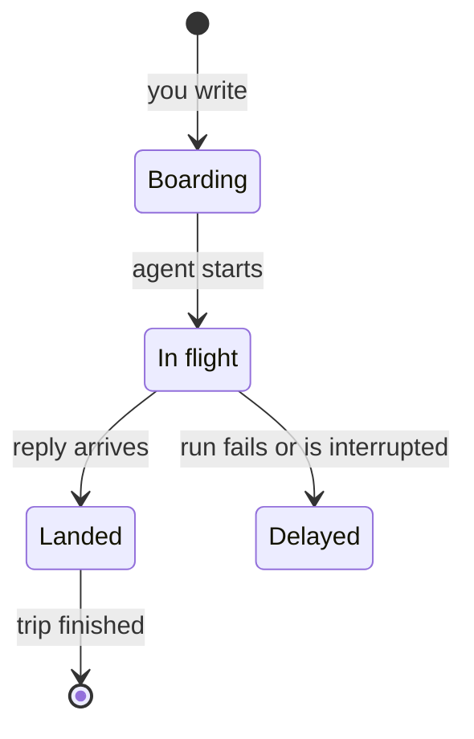

These built-in [workspace interfaces](/docs/surfaces/desktop/interfaces) are calm surfaces to keep open or check in passing. Each of them opens a
conversation without leaving the interface.

| Interface | What it shows |
| --- | --- |
| **Glance** | Minimal faces and widgets that adapt to how far away you are. |
| **Hub** | An ambient clock that wakes into large glanceable cards. |
| **Panels** | Suggestions and small panels over a sky for the time of day, with one chat. |
| **Moments** | An ambient timeline of flows, one focused card at a time. |
| **Persona** | A chat-first personal agent with side chats, ideas, and goals. |
| **Hologram** | A holographic command display with a reactor core and orbiting agents. |
| **Departures** | Conversations as flights on an airport departures board. |
| **Tracking** | Conversations as parcels with delivery tracking. |

## Glance

Ryu on a calm square display. It shows one face at a time: **Clock**, **Agents**, or **Flow**.
Page through them with the dots, the arrow keys (`Home` and `End` jump to the first and last), or
a swipe.

- **Distance** trades **Near** (more detail, the default) for **Far** (a few large facts).
  **Auto** switches between the two every few seconds.
- **Home Screen** lays the same information out as widgets. **Done** (or `Esc`) returns to the faces.

Conversations open in a sheet over the display; `Esc` closes it.

## Hub

A smart display. It rests on an ambient screen with a calm picture, a large clock, and one line
saying what needs you. Click it, or press `Enter`, to wake it into a row of large cards: **Waiting
on you**, **Needs attention**, **Working now**, **Agents**, and **Start a conversation**. Swipe,
drag, or use `←` and `→` to move between them (`Home` and `End` jump to the ends).

Conversations open in a full-height sheet. In **Start a conversation**, pick who it goes to, type,
and press `Enter`. `Esc` closes the open conversation, then sends the display back to its ambient
screen.

## Panels

A calm personal-assistant shell. The rail switches between three views:

- **Home** offers one-tap suggestions, the most urgent first, and small panels for **Working
  now**, **Agents**, and **Recent activity**, over a sky with the sun by day and the moon by night.
  Each panel links to its conversation. **Agents** lists working agents first, then those waiting
  on you, each with its role, and **Recent activity** lists replies, your messages, and finished or
  failed runs.
- **Chat** shows one conversation, large and centered, and returns to the last one you had open.
  **New chat** starts another.
- **Projects** lists each project and team as a topic with its conversations, and starts a new
  one there.

`Esc` closes the open conversation and returns you to where you were.

## Moments

An ambient timeline of flows, each filed under the day it last moved. The flows are
**Review what needs you**, each project and team, each agent, and your unassigned conversations.
The most recent flow leads the timeline at full width with its latest conversations side by side.

- Open a flow to zoom into it, with its conversations down the left and one focused card.
- Open a conversation and the card grows around it. A conversation that needs you opens in
  **Review what needs you**.
- `Esc`, a two-finger swipe right, or a pinch out closes the conversation, then zooms back out of
  the flow.

Type what you want in **What would you like to do?** and press `Enter` to start a conversation.
Write `@` and a name to send it to that agent. Suggestions appear as you type.

| Key | Action |
| --- | --- |
| `/` | Jump to the **What would you like to do?** box |
| `↓` from the empty box | Move into the timeline |
| `↑` / `↓` on the timeline | Change rows |
| `←` / `→` on the timeline | Move within a row |
| `Home` / `End` | Jump to the ends |
| `←` / `→` inside a flow | Move between cards |

`/`, `Esc`, and the arrow keys work even when nothing in Moments has focus.

## Persona

A chat-first app for one agent at a time. Pick an agent as your persona: its face and name sit at
the top with a status line that unfolds into what it is doing, and **Switch persona** changes it.
The rail (a tab bar on narrow windows) has five sections:

- **Chat** shows the persona's main conversation, with its other conversations as side chats above
  it. The main conversation is your pinned direct chat with the agent, else the one with the most
  messages, so a new side chat never takes over. **New side chat** starts another.
  - In a wide window, Chat opens the main conversation straight away. A column beside it suggests
    next steps (a reply waiting on you, work still running), lists the side chats, and previews
    Ideas and Goals. Each entry opens a conversation or starts an empty side chat.
  - When the main conversation is closed, suggestions under the latest message start a side chat
    with that prompt in the box. Nothing is sent until you send it.
- **Feed** lists the latest messages, grouped by day.
- **Ideas** suggests prompts from the persona's recent work. Choosing one fills the box; nothing is
  sent until you send it.
- **Goals** shows your projects and teams with answered and open conversations, and starts a new
  one in each.
- **Activity** starts with stopped or failed runs under **Needs attention**, then lists what waits
  on your approval, the persona's schedule, and a dated log.

Use the arrow keys to move between sections, and `Esc` to close the open conversation.

## Hologram

A holographic command display. A reactor core at the center pulses faster as more agents work, and
your agents orbit it as nodes on one or two rings. The rings turn once and then settle, and
**Pause rings** stops them sooner.

- Select a node for a radial menu with **Open latest**, **Show threads**, and **Message**.
- Floating panels show the **Priority** list of what needs you, **Active operations**, and
  **System** totals, with a typed briefing.
- A live run shows a turning mark and a clock counting up since its last signal.

Type in the command bar and press `Enter` to start a conversation. Begin with `@` and an agent's
name to send it to that agent. Press `/` to focus the command bar, and use the arrow keys to move
around the agent ring. An open conversation appears in a large holographic frame. `Esc` closes the
radial menu, then the frame.

## Departures

Your conversations as flights on an airport split-flap board. Every agent has its own two-letter
airline code.

- **Departures** lists conversations boarding (you wrote and the agent has not started) and in
  flight (the agent is working), with an estimated arrival based on how long its past runs took.
- **Arrivals** lists replies that just landed or wait at the gate for you, delayed flights (a
  failed or interrupted run), finished trips, and each routine's latest run, **Arrived** or
  **Delayed** when it failed.

| Key | Action |
| --- | --- |
| `←` / `→` on a flight or tab | Switch between **Departures** and **Arrivals** |
| `Home` / `End` on a tab | Pick a tab |
| `↓` from a tab | Move into the flights |
| `↑` / `↓` | Move along the rows |
| `Page Up` / `Page Down` | Jump eight rows |
| `Home` / `End` on a row | Jump to the ends |
| `Enter` or `Space` | Open a flight |

A flight's details appear in a panel over the conversation. `Esc` closes it.

**Book a flight** in the board's masthead asks for a gate (the agent), an optional terminal (a team
or project), and a message. It lists the chosen gate's recent flights and sends when you press
`Enter`.

## Tracking

Your conversations as parcels. **My deliveries** lists them under **All**, **On the way**,
**Delivered**, and **Exceptions**, each with a tracking number and a time.

The main page tracks the selected parcel with its route, a five-step progress bar, and its
history. The steps are **Order placed**, **Picked up**, **In transit**, **Out for delivery**, and
**Delivered**. A failed run is a delivery exception. The courier's routines are listed apart, and
only the next one appears in the history, marked as an estimate.

- **View conversation** opens the conversation in a panel. `Esc` closes the panel.
- **Reschedule** on an exception opens it so you can run it again.
- **Send a parcel** picks a courier (an agent) and starts a conversation with what you write.
- Search by tracking number, item, or courier, and use the arrow keys to move between parcels.

On medium-width windows, an open conversation docks beside the tracking page and the list steps
aside.

## Related

<Cards>
  <DocCard href="/docs/surfaces/desktop/interfaces" />
  <DocCard href="/docs/extend/develop/extensions/interfaces" />
</Cards>
