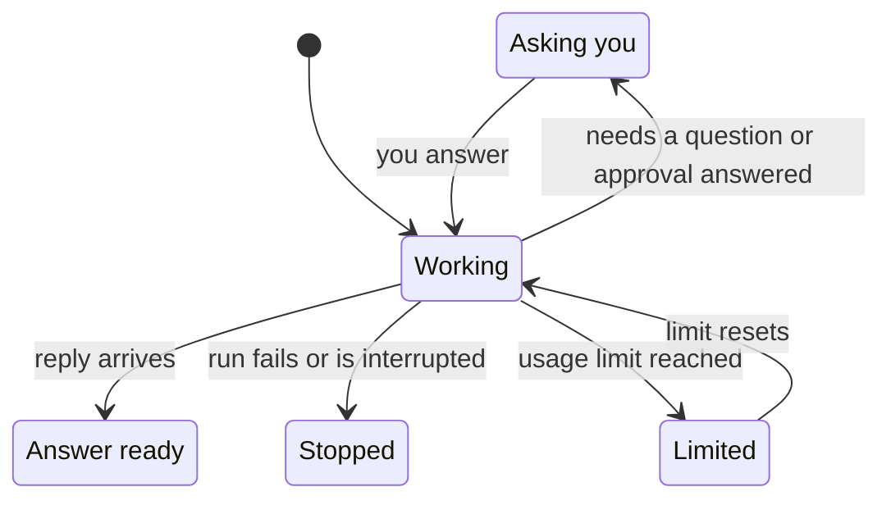

These interfaces turn your workspace into a small game. Their controls follow your color theme,
and the illustrated ones paint their scenes from a palette of their own, usually a daytime look in
light themes and a night look in dark ones. Each of them opens a conversation in a panel beside the
scene.

The 3D scenes fit any window:

- On a phone or a tall, narrow window the camera tilts a little steeper and zooms in on your agents,
  so the whole scene is in view without panning. Drag to see the rest of the island.
- Name plates move apart when the scene gets crowded, and a game's legend folds into a **?** button
  that opens it.
- With the keyboard, `Tab` reaches every plate. The arrow keys move between them in reading order
  (left to right, top to bottom), or in the game's own order where it has one, such as the doors of
  an advent calendar or the stops on a path.

| Interface | What it shows |
| --- | --- |
| **Path** | Conversations as stepping stones along a trail across a 3D island, grouped into units. |
| **Kitchen** | Agents as chefs at their stations, cooking your orders. |
| **Market** | A 3D market square of shops: projects as shops, teams as stalls, agents as shopkeepers. |
| **Workers** | A 3D open-plan office where each agent works at its own glowing computer. |
| **Arcade** | Agents as arcade cabinets in a cosy arcade hall. |
| **Farm** | Agents tend plots where conversations grow into fruit. |
| **Town** | You are the mayor: projects as districts, agents as buildings. |
| **Rides** | Agents as drivers in a 3D toon city, conversations as trips. |
| **Passport** | An open 3D passport on a desk: agents as visa pages, conversations as stamps. |
| **Lobby** | A 3D game plaza with your squad on a podium, a quest board and a play portal. |
| **Quiz Show** | A 3D TV studio with a wall of clue tiles and your agents at podiums. |
| **Warehouse** | Conversations as orders moving through a 3D toon warehouse. |

Each game, plus the **Seasonal** board, is described in
[Island Games](/docs/surfaces/desktop/interfaces/island-games) and
[Town and Stage Games](/docs/surfaces/desktop/interfaces/town-and-stage-games).

## How the games show what your agents are doing

World 2D, World 3D, and the 3D games above share one way of showing your agents. Each agent acts
out what it is doing, in the game's own terms:

- **Working**: the villager works at its station. Its current step shows as a bubble or sign,
  the plan's progress as a row of pips (a count like **3/7**), and its next step and elapsed time
  on a small board.
- **Asking you**: the agent carries its question, approval, or prompt to your spot (the
  **you-spot**: a doorstep, a kerb, a lectern, a counter) and waits in the queue there. A small
  timer beside it says how long it has waited. When an agent keeps working while its ask waits,
  the ask waits at your spot as a notice instead.
- **An answer ready**: the agent brings its reply to your spot and sets it down on a tray. Older
  replies wait as an unread mark at the agent's station.
- **Stopped**: a failed run shows an alarm at the station with its reason, one per failure, and an
  older failure that no longer counts shows a dim one. An interrupted run shows a grey mark.
- **Limited**: an agent that hit a usage limit rests at its station, with the time it can go
  again when that is known.
- **Suggestions**: fixes, skill proposals, and questions saved for later wait as notes at the
  agent's station. They are not in the way of any run.

When there are more agents than places, the most urgent take the stations: agents asking you
first, then stopped, limited, and working ones. A tally plate counts the rest and opens the queue.

### Answer from the ask card

Select a queued agent, a notice, or a tray to open its **ask card**. The ask card is the one
place you answer from a game. It shows what is asked and why, how long it has waited and until
when, and the choices.

- Approving a gated tool call, or allowing a permission prompt, asks you to confirm a second time.
- **Open** opens the conversation instead.
- While work details are hidden (see
  [Hide work details](/docs/surfaces/desktop/interfaces#hide-work-details)), the ask card offers
  only **Open**, to answer in the conversation or the inbox.

Select an alarm to open its **blocker card**: what stopped and why. It is read-only; open the
conversation to try again.

Along the top of each game:

- a summary line counts what needs you, what is working, what failed, and what is limited;
- **N need you** opens the most urgent ask;
- **Queue · N** lists everything waiting: asks, stopped runs, suggestions, and unread answers. It
  is also the touch path to all of it.

Some prompts appear only inside an open chat. When that can happen, a caption says so: **Some
questions and prompts only show in their chat**, or **Some prompts only show in an open chat**.

### Times and estimates

- Question and permission prompts expire after at most about 10 minutes. While you are away (or
  set to do not disturb, streaming, or gaming), an agent's questions don't hold its run.
- A time marked **~** is approximate. When a run ended is known only for runs the app saw finish.
- A run's estimate exists only for routines on a fixed (cron) schedule.
- **stalled?** means no progress has been seen for a while; the run may have stopped.

### Keyboard, screen readers, and no WebGL

Every game keeps its controls outside the scene too:

- `Tab` reaches the summary, **N need you**, and **Queue · N**.
- A list of what is waiting, and a list of every agent with what it is doing, appear when they get
  keyboard focus.
- A screen reader hears what changes as it happens: a new ask, a new failure, or an ask about to
  expire.
- Where WebGL is unavailable, the games show the same agents, asks, and cards as lists.

While a page such as **Settings** or the **Marketplace** is open over an interface, the page has
the keyboard: the interface's shortcuts wait until you go back to it.

## Related

<Cards>
  <DocCard href="/docs/surfaces/desktop/interfaces" />
  <DocCard href="/docs/extend/develop/extensions/interfaces" />
</Cards>
