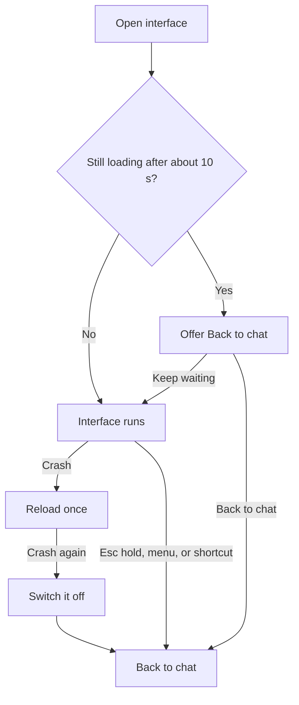
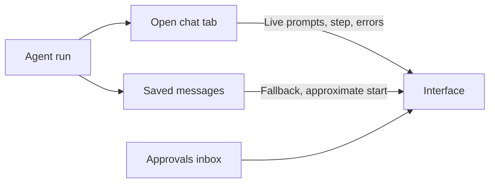

An **interface** is a way of looking at the same agents, conversations, and messages. Bot, OS,
and Agent were the first three. Channels, Feed, the 2D and 3D worlds, and the other
built-in layouts listed below are more of them, and plugins from the Store can add their own.

Changing the interface changes presentation only. Every interface opens the same conversations in
the same chat view, with the same streaming, tools, approvals, and history. A conversation you
start in the Feed is the same conversation in Channels, in OS, and on your phone.

<Figure name="interfaces" />

## Availability

<Callout type="warn">
  OS, the other built-in interfaces on this page, and interfaces from the Store are off by default
  and roll out per account. Until they are on for your account, the switcher lists Bot and, if you
  can use it, Agent. If you used one of the newer interfaces before, the app opens in Bot (or in
  the OS desktop, when only OS is on) until that interface is available to you.
</Callout>

## Switch interfaces

There are three ways to open the interface menu:

- In a full-window interface (Channels, a world, a game, and the rest), select the button with the
  interface's name at the top left, next to the **Ryu** lockup, for example **Kitchen ▾**.
- In the chat, select the **Ryu** lockup at the top of the sidebar. In OS, select it in the menu
  bar.
- Press `⌘ Shift U` on macOS or `Ctrl Shift U` on Windows and Linux, from anywhere: the chat, OS,
  or any interface. When no menu button is on screen (for example with the sidebar collapsed), the
  shortcut opens the same choices in a dialog. You can change the shortcut in **Settings → Keyboard
  Shortcuts** (**Switch Interface**).

The menu lists every interface available to you:

- **Back to chat** first, when you are in OS or another interface;
- the built-in interfaces;
- interfaces from installed plugins under **From the Marketplace**.

Choosing one switches the window immediately. The lockup and the native window title follow the
choice: the lockup reads **Channels** or **World 2D**, and the window title **Ryu · Channels** or
**Ryu · World 2D**.

Moving between **Bot** and any other interface also switches the Ryu assistant between everyday
and developer wording, so the app asks you to confirm first. That wording is part of every Ryu
assistant chat's system prompt, so each chat's next message is sent once without the provider's
prompt cache. **Cancel** keeps the current interface.

The full-window interfaces keep **Marketplace** and **Settings** in their top bar. Pages you open
from there, or from a link, shortcut, or notification, appear over the interface with a **Back**
button that returns you to it.

You can also ask the Ryu assistant to switch for you, for example "switch me to Channels". It
asks you to confirm in the chat first (unless your approval mode is **Off**), and it can only pick
an interface the menu would offer you: it cannot open Agent without Agent access, or an
interface that is not available to your account yet.

The startup realm in **Settings → General → On startup → Realm on startup** still applies. With
**Last used**, the app reopens in the interface you used last. Choosing **OS** there always opens
the OS desktop.

### You can always get back to the chat

Ryu, not the interface, draws the top bar with the switcher, **Marketplace**, and **Settings**. An
interface, whether built in or from the Store, can't hide, cover, or replace it, and it is there
even while an interface is loading or has failed. To leave any interface for the chat (Agent, or
Bot when you do not have Agent access):

- choose **Back to chat** in the interface menu;
- press `⌘ Shift U` (`Ctrl Shift U`) and choose **Back to chat**. An interface can't block the
  shortcut;
- hold `Esc` for about a second to go straight back to the chat;
- in the desktop app, choose **Switch Interface…** or **Back to Default Interface** from the Ryu
  icon in the menu bar or system tray.

Ryu also recovers on its own when an interface misbehaves:

- If an interface crashes, Ryu reloads it once. If it crashes again, Ryu switches it off and
  returns you to the chat with the message "*Name* crashed and was switched off".
- If an interface takes more than about 10 seconds to open, it offers **Back to chat** while you
  wait.
- If the interface you used last is no longer installed, Ryu opens the OS desktop.

To start the desktop app in the chat whatever interface was open last, launch it with
`--reset-interface`. You can also set **Realm on startup** to **Bot** or **Agent**.

## Interface settings

Open **Settings → Appearance → Interfaces**, or choose **Interface settings…** in the interface
menu (see [Switch interfaces](#switch-interfaces)), to adjust one interface. The section opens on
the interface you are using. Pick another from **Interface** to change its settings before you
switch to it.

Each interface lists only the settings it has. For example:

- **Board**: **Layout** (board or list) and **Group by**.
- **Calendar**: **Scale** and **Side rail**. **Timeline**: **Scale**.
- **Canvas**: **First layout** and **Minimap**.
- **Knowledge**: everything in its **Graph settings** panel: what the graph shows, its display, and
  its forces.
- **Channels**: where **Project threads** appear.
- **Feed**: **Order**.
- **World 2D**: **Theme**, and **Controls hint** (by window size, always shown, or hidden; the **?**
  slot shows or hides it and keeps your choice).
- **World 3D**: **Camera**, **Theme**, and **Minimap**.
- **Arcade**: **Hall lights** (following your color theme, by day, or at night with the neon lit) and
  **Meters** (the credits, running, and jackpot counts).
- **Lobby**: **Squad size** (one to four agents on the podium) and **Opens on** (the menu tab it
  opens on; switching tabs keeps the last one).
- **Quiz Show**: **Round** (doubling once the board is busy, always Round 1, or always the Double
  Round) and **Audience** (the studio audience in its theatre rows).
- **Rides**: **Time of day** (following your color theme, day, or night).
- **Seasonal**: which **Season** to show, or the one for today's date (the season switcher keeps
  your choice), and **Weather** (snow over the Advent square, motes over the patch and the street).
- **Card Table**: **Table** (the header's **Table** and **Cards** switch keeps your choice),
  **Felt** (classic, blue, or red), and **Card backs** (classic, red, or black).
- **Market**: **Awnings** (mixed, harvest, or seaside) and **Bunting**.
- **Warehouse**: **Shift** (following your color theme, day, or night) and **Paused** (the pause
  button on the floor keeps your choice).
- **Passport**: **Cover** (navy, burgundy, green, or black).
- **Planets**: **Orbit speed** (normal, slow, or still) and **Moon labels** (off, a moon's name shows
  only on hover or focus).
- **Kitchen**: **Service clock**. **Workers**: **Screen plates**. **Farm**: **Coins**. **Town**:
  **Speed** and **Data view**. **Aquarium**: **Wallpaper**. **Path**: **Streak and goal**.
- **World 2D**, **World 3D**, and the 3D games: **Overlay density** (**Minimal** keeps alarms, asks,
  and limits, and drops progress and next-step lines from stations) and **Work bubbles** (what each
  agent is working on, over its head; asks and alarms always show).

Changes apply right away to an open interface and are kept on this device.

The same choices made inside an interface are saved too. Board's layout or grouping, Calendar's
or Timeline's scale, Calendar's sidebar, Canvas's arrangement or minimap, and Knowledge graph
settings are remembered the next time you open the interface, and show here.

**Reset to defaults** puts the selected interface back to how it ships. An interface from the
Store starts from the settings its plugin chose, and may show fewer settings or rename them.

Two settings apply to every interface:

- **Hide work details**, under **Every interface** in the same section (see
  [Hide work details](#hide-work-details)).
- **Motion**: with animations turned off in **Settings → Appearance → Motion & effects**, the
  interfaces and games stop their animations too, as they do when your system asks for reduced
  motion.

The thread view inside an interface is the same chat as the default view, so **Settings →
Appearance → Chat view** (detail level, grouping tool uses, expanded edits and code blocks) applies
to both.

## Hide work details

Turn on **Hide work details** before you share your screen. The checkbox is in the Ryu lockup
menu, below the interface list, whenever you can use the workspace interfaces. The same checkbox
is under **Every interface** in **Settings → Appearance → Interfaces**.

While it is on, every workspace interface hides:

- conversation titles and message text;
- team, project, and routine names;
- the details of what an agent is asking for or why a run stopped.

Interfaces still show kinds and counts, for example that a conversation is waiting on you or that
a run failed. The choice is kept on this device until you turn it off.

The same hiding applies on its own while your status is **Streaming** (see
[Streaming mode](/docs/surfaces/desktop/user-guide/availability-and-prompts#streaming-mode)). While work
details are hidden, nothing is answered from an interface: selecting an ask opens its conversation,
or the approvals inbox, so you answer there.

## What needs you

Workspace interfaces read the same state of your work, and each one decides how much of it to draw:

- **Asks**: approvals waiting in your approvals inbox, tool-permission prompts, questions an agent
  asked you, and replies you have not read yet.
- **Why a run stopped**: a failed or interrupted run, an expired agent login, or a usage limit, with
  the time the limit clears when Ryu knows it.
- **How a run is going**: when the current run started and the step the agent is on.

Some of this exists only in a chat tab that has the conversation open, because only that tab
receives the run as it streams:

- a tool-permission prompt;
- the exact start of the current run and the agent's current step;
- a stream error, an expired agent login, or a usage-limit notice.

While such a tab is open on the same computer as the interface, the interface shows them too.
Without it, the interface falls back to what Ryu can read from the conversation's saved messages,
and a start time it only observed is marked as approximate.

### Answer in place

Where an interface shows an ask with its choices, you can answer it there:

- **Approvals**: **Approve** or **Reject**. Approving a tool call asks you to confirm first.
- **Tool permissions**: the options the agent offered, such as **Allow once** or **Deny**. Every
  allow option asks you to confirm. The answer goes through the chat tab that holds the prompt, so
  the prompt clears in that chat (and in any other tab showing the conversation) at the same time.
- **Questions**: a question with a single pick from up to four options and no free-text answer,
  while the run is waiting on it.

An answer always goes to the conversation the ask belongs to, on the computer the interface shows.

- If Ryu cannot find that conversation's open prompt or question, it opens the conversation
  instead of answering.
- If two asks on screen cannot be told apart, the answer is refused and the card says it did not
  go through.
- Switching to another computer starts the interfaces over with that computer's conversations.

Anything an interface cannot answer in place opens its conversation (or the approvals inbox, for an
approval that belongs to no conversation), so you answer it there. An interface never sends a chat
message to answer for you.

## Product tiers

Bot, OS, and Agent are also the three product tiers. The tier decides what you can access. The
interface decides how it looks.

| Interface | Tier | What it is for |
| --- | --- | --- |
| **Bot** | Managed | Focused chat with no provider, model, or node setup. See [Bot](/docs/surfaces/desktop/bot). |
| **OS** | Workspace | Dock, live app windows, and the App Launcher. See [OS](/docs/surfaces/desktop/ryu-os). |
| **Agent** | Admin | Configure nodes, models, tools, permissions, and Apps. See [Agent](/docs/surfaces/desktop/agent). |

Channels, Feed, the worlds, the other built-in layouts and interfaces, and every Store interface
run in the **workspace** tier, the same as OS.

Agent stays gated by your organization role. On a Ryu-managed node, only members whose role grants
Gateway configuration (owners and admins by default) see Agent in the menu. No interface, built-in
or installed, can open Agent for someone who does not have access to it.

## Built-in workspace interfaces

<Cards>
  <DocCard href="/docs/surfaces/desktop/interfaces/channels-feed-and-worlds" />
  <DocCard href="/docs/surfaces/desktop/interfaces/workspace" />
  <DocCard href="/docs/surfaces/desktop/interfaces/work" />
  <DocCard href="/docs/surfaces/desktop/interfaces/reading-and-community" />
  <DocCard href="/docs/surfaces/desktop/interfaces/at-a-glance" />
  <DocCard href="/docs/surfaces/desktop/interfaces/playful" />
  <DocCard href="/docs/surfaces/desktop/interfaces/games" />
  <DocCard href="/docs/surfaces/desktop/interfaces/island-games" />
  <DocCard href="/docs/surfaces/desktop/interfaces/town-and-stage-games" />
</Cards>

## Get more interfaces

Open the **Store** and browse the **Interfaces** shelf in the Plugins tab. An interface plugin is
installed, updated, enabled, and removed like any other plugin. Once it is installed and enabled,
its interfaces appear in the switcher under **From the Marketplace**, each with its creator's credit.

An interface entry is data only. It picks one of the interfaces built into Ryu and adjusts its
settings, such as the world's theme or how channels are grouped. The entry itself runs no code and
needs no permissions.

<Callout type="warn">
  The plugin that carries an interface can also contribute tools, hooks, or background services,
  and those can run code and request permissions. Check the permissions the Store lists for the
  plugin before you install it.
</Callout>

If you disable or uninstall the plugin behind the interface you are using, the window falls back to
the OS desktop. Your choice is kept, so re-enabling the plugin brings that interface back.

To build one, see [Publish an Interface](/docs/extend/develop/extensions/interfaces).

## Related

<Cards>
  <DocCard href="/docs/surfaces/desktop/ryu-os" />
  <DocCard href="/docs/surfaces/desktop/bot" />
  <DocCard href="/docs/extend/develop/extensions/interfaces" />
  <DocCard href="/docs/start-here/architecture/three-products" />
</Cards>
