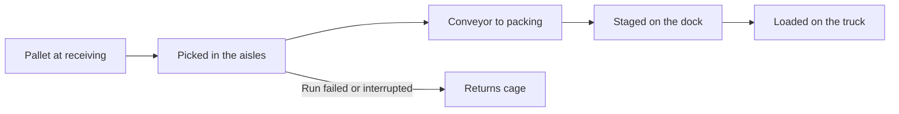

These are 3D game interfaces, each set on a cosy little island seen from above at an angle. See
[Games](/docs/surfaces/desktop/interfaces/games) for how every game shows what your agents are
doing, where you answer asks, and how the games work with a keyboard or without WebGL.

Every game on this page also has the 3D games' **Overlay density** and **Work bubbles** settings
in **Interface settings**. The settings listed under each game are its own extras.

## Path

Your conversations as a 3D island with a narrow dirt trail that winds up a terraced hill to a
summit flag. Each conversation is a stepping-stone pad on the trail. Each row of the switchback is
a terrace higher than the last, with steps where the trail climbs.

The pads are grouped into units, each starting at a chunky wooden signpost, in this order:

1. your projects;
2. teams;
3. each agent's other conversations;
4. conversations **Without an agent**.

### What the stones and hikers show

Each agent is a hiker standing by the stone of the conversation it is on. The legend explains the
colours.

| State | What you see |
| --- | --- |
| Finished | The pad glows gold with a little check flag. |
| Waiting on you | A bouncing **!** on the pad. |
| Waiting on an agent | A grey, mossy stone. |
| Asking you | The hiker walks down to the trailhead at the front of the island and waits in the queue there. |
| Working | The hiker holds a tool for its step (a hammer to edit, a wrench to run, a book to read, a lens to search, a quill to write, a clipboard to plan). The plan's pips sit on its stone, and its progress, time, and next step on a small board. |
| Answer ready | The hiker sets a parcel on the trailhead's tray. |
| Failed | An alarm at the stone. |
| Usage limit | The hiker rests beside its stone with **Resting till 15:10**. |

While agents are on the trail, the signposts step aside and the stones keep only their marks, so
the hikers' plates have room.

The top bar keeps three counts. Select one to see its card. On a phone, the summary of what needs
you takes the streak's place.

- **Streak**: days in a row on which a conversation finished with an answer.
- **XP**: one for every message.
- **Daily goal**: conversations you replied to today.

### Controls

- Select a stone or a hiker to open its conversation in a panel beside the island. A hiker asking
  you opens its ask card.
- Select a signpost's **+** to start a conversation in that unit, or **New thread** to start one
  anywhere.
- `Tab` and the arrow keys move between stones, hikers, and signposts.
- Drag to pan. The zoom buttons zoom in, out, or back to the whole island.
- `Esc` closes the conversation.

Where 3D is unavailable, the path is shown as a list of units and stops.

**Interface settings**: **Streak and goal** shows or hides the streak, XP, and daily goal in the
top bar.

## Kitchen

Your agents as a kitchen team in a cosy 3D restaurant kitchen. Each agent is a chef in a white hat
at their own station (a stove, a chopping board, or a grill). Conversations are paper order tickets
hanging on the rail across the top.

The rail puts the tickets that need you first, each with a patience bar that drains while it waits.
Today's tally (served today, need you, cooking, burnt) sits in the bottom left corner, and the
service clock in the bottom right.

### What the chefs show

| State | What you see |
| --- | --- |
| Working | The chef cooks and holds the tool for its step (a knife to edit, a pan to run, the order book to read, a ladle to think). The plan's pips sit on the counter and its words on a board beside it. Its ticket runs a timer against the chef's usual run time. |
| Asking you | The chef carries its ticket round to the front of the pass and queues there facing you. The pass bell rings once as it arrives. |
| Answer ready | A plated dish on the pass, ready to serve. The chef sets it down, waves under a pulsing **!**, and goes back. |
| Failed | A burnt order with smoke over the station, an alarm behind the counter, and a slumped chef. |
| Usage limit | The ticket reads **86'd till 15:10**. |

### Controls

- Serve a ticket or a dish to open its conversation in a sheet beside the kitchen.
- Select a chef's name plate to see their open and served tickets. Opening a chef's sheet glides
  the camera to their station.
- Choose **New order** to start a conversation with a chef you pick.
- The arrow keys move along the rail and between the chefs and dishes in the kitchen.
- Drag to pan. The zoom buttons or `+` and `-` zoom. `Esc` steps back out.

Light themes are a sunny day and dark themes night, with the windows lit. The kitchen is drawn
with WebGL. Without it, the line lists your chefs as buttons that open the same panels.

**Interface settings**: **Service clock** shows or hides the clock in the corner.

## Market

Your workspace as a cosy 3D market square. Shops stand in two rows around a cobbled square with a
fountain in the middle, bunting, lamps, benches, and crates of goods.

- Each project is a shop with a striped awning and its name painted on its signboard.
- Each team is a striped market stall.
- Agents in neither share the **General store**.
- Your agents are the shopkeepers, standing out front. The customers waiting at a shop are its
  upcoming runs.

### What the shopkeepers show

| State | What you see |
| --- | --- |
| Working | The shopkeeper holds a basket. |
| Reply waiting for you | The shopkeeper shows a **!**. Answers are set down as wrapped parcels at your own little stall in front of the fountain. |
| Asking you | The ask queues at the fountain in front of your own little stall. |
| Failed | The shopkeeper slumps and pulls the shutter half down, with the reason on a sign beside it. |
| Usage limit | **Back 15:10** chalked on the shop's board. |

The title plate and counters show how many conversations wait on you, how many shops are busy, and
how many orders are open. **Directory** lists every shop.

### Controls

- Select the plate by a shop's sign to open its sheet beside the square. The sheet shows the shop's
  shopkeepers, an order board of conversations pinned under what they need, and a box to place a
  new order with the shopkeeper you pick, filed under that shop's project or team.
- Select a shopkeeper's name plate to address the order to them straight away.
- **Serve** opens an order's conversation in the sheet, with **Back** to its shop.
- `Tab` and the arrow keys move between signs and shopkeepers.
- Drag to pan. The zoom buttons or `+` and `-` zoom.
- `Esc` steps back out, first from the open order, then from the shop.

Light themes are a sunny day and dark themes a starry night with lit windows, lamps, and bunting
lights. Where 3D is unavailable, the square is shown as a list of shops and their shopkeepers.

**Interface settings**: **Awnings** paints the shops' awnings in mixed colors, warm harvest tones,
or seaside blues. **Bunting** shows or hides the pennant strings over the square.

## Workers

Your workspace as a cosy 3D open-plan office with big windows, a bookshelf, potted plants, a rug,
and a coffee corner. Every agent sits at its own desk before a monitor. The office takes your
team's (or single project's) name when every worker belongs to it.

The desks face you, so each screen shows over its worker's shoulder. The current conversation's
title is on a small plate just above the screen, and the worker's name is on their chair.

### What the screens and workers show

The screen glows in the colour of what its worker is doing right now. The legend explains the
colours, and the counters show how many workers need you, are working, or failed.

| State | Screen | Worker |
| --- | --- | --- |
| Working | Green | Faces the screen. The plate says the step (**Editing snapshot.ts**), and the plan's pips run as a bar under the monitor. |
| Asking you | Amber | Turns round, then carries its laptop to your office door and waits in the queue there. |
| Answer ready | Dim screensaver | Drops a folder in your inbox tray by the door. |
| Failed | Red | Slumps. The plate says why the run stopped. |
| Interrupted | Grey | The plate says why the run stopped. |
| Idle or usage limit | Dim screensaver | Waits in the coffee corner, its mug saying when it is back (**Back 15:10**). |

### Controls

- Select a screen's plate to open that conversation in a sheet beside the office. **Back** shows
  the worker's desk: what they do, all their tasks, and a box to give them a new one.
- Select a worker's name plate to open their desk straight away, or **New task** to start a task
  with any worker.
- `Tab` and the arrow keys move between workers and screens.
- Drag to pan. The zoom buttons or `+` and `-` zoom.
- `Esc` steps back out, first to the worker, then out of the sheet.

Light themes are a sunny day and dark themes evening, lit by the screens and desk lamps. Where 3D
is unavailable, the office is shown as a list of workers and their screens.

**Interface settings**: **Screen plates** chooses what each monitor's plate says: what the worker
is doing, or the conversation's title.

## Arcade

A cosy 3D arcade hall, its walls trimmed with neon that glows at night. Every agent is an arcade
cabinet in its own colour, with a lit marquee, a big glowing screen, a joystick and buttons, and
its player standing beside it.

The cabinets stand in rows across the floor with every screen turned toward you. More than six
agents fill a second row behind the first, and on a phone the rows are two cabinets wide. The ends
of the rows hold a claw machine and a prize counter.

### What the reels and cabinets show

A cabinet's screen has three reels: the agent's latest conversations, in bold pixel symbols. The
paytable in the bottom right explains them.

| Reel symbol | Conversation state |
| --- | --- |
| Bell | Your turn |
| Seven | Working |
| BAR plate | Waiting |
| Cherries | Done |
| Flame | Failed run |

- A working cabinet's screen glows.
- A reply waiting on you lights the screen gold, and the player turns round under a pulsing **!**.
- A failed run tilts the machine with a red lamp, and its player slumps.

The credits, running, and jackpot meters sit in the bottom left corner. Your projects and teams are
chips under the title. Press one to narrow the hall to its machines.

### Controls

- Select a player's name to open their machine in a sheet beside the hall. Opening a machine glides
  the camera to it.
- In the sheet, cash a ticket or a reel to open its conversation at the redemption counter.
- Pull the lever, or select **Spin**, to open a play slip that starts a conversation with that
  agent.
- **Collect** on the prize counter opens the reply that has waited longest.
- **New game** starts a conversation without picking an agent.
- `Tab` and the arrow keys move between players. Drag to pan, and use the zoom buttons or `+` and
  `-` to zoom.
- `Esc` steps back, and from a filtered hall shows every machine again.

The hall is drawn with WebGL. Without it, the machines stand in an aisle with the same controls.

**Interface settings**: **Hall lights** and **Meters** (see
[Interface settings](/docs/surfaces/desktop/interfaces#interface-settings)).

## Farm

Your workspace as a cosy 3D farm. Each agent tends a raised bed and stands beside it as a villager.
Projects fence their agents' beds into fields, and the barn, silo, and pond sit in the yard.

### What the crops and farmers show

Every conversation is a crop whose growth shows where it stands. Each farmer shows their bed's most
urgent crop.

| State | Crop | Farmer |
| --- | --- | --- |
| Agent has yet to answer | A sprout with a water drop | |
| Working | A leafy plant that grows with the plan. The pips are a row of leaves behind the bed, and the step's words are on a board at its far end. | Works with a tool. |
| Your turn | Ripe fruit. A reply left unread over-ripens while it waits. | Waves under a pulsing **!**, then sets a basket of its crop on the porch and walks back. |
| Asking you | | Carries a letter to the farmhouse porch by the gate and queues at the mailbox facing you, each with an hourglass on a fence post. |
| Failed | A withered brown plant, with a scarecrow, a crow, and a red lantern in the bed. | Slumps with a red mark. |
| Usage limit | | Sits on a bench by the sundial, **Back 15:10**. |

The counters in the corner show how many farmers failed, need you, or are working. The coins count
one per message.

### Controls

- Click a crop to open its conversation beside the farm.
- Select a farmer's name (or a plot's sign) to open that plot: its crops and a **Plant a seed**
  composer that starts a new conversation with that plot's agent.
- The **Barn** lists every crop by status.
- `Tab` and the arrow keys move between the farmers, plots, and the barn. Opening a plot or the
  barn glides the camera to it.
- Drag to pan, and use the zoom buttons or `+` and `-` to zoom.

Light themes are a sunny day and dark themes a starry night with the lamps lit. The farm is drawn
with WebGL. Without it, the same fields, plots, and crops are listed.

**Interface settings**: **Coins** shows or hides the coins counter.

## Warehouse

The fulfillment side of your agents, as a cosy 3D toon warehouse. Six aisles of blue and orange
shelving hold the stock, a conveyor runs to the packing table, and a truck is backed up to the dock.
Every agent is a picker in a cap working an aisle.

### Where an order box goes

Every conversation is an order box moving through the building:

- A pallet at the receiving door is a conversation you wrote in that the agent has not started.
- The box is picked in the aisles while the agent works, and rides the conveyor while it wraps up
  its reply.
- It is staged with a label on the dock when the agent has replied or asks you something.
- It is loaded on the truck when done.
- It is flagged in the returns cage when the last run failed or was interrupted.

### What the pickers show

| State | What you see |
| --- | --- |
| Working | The picker walks its aisle with a basket, to the shelves its current step needs. |
| Idle | The picker waits at the aisle's end. |
| Reply waiting on you | The picker waves under a **!**. Answers are set down on the dispatch desk as labelled parcels, which ship once you have read them. |
| Asking you | The picker carries a clipboard to the dispatch desk by the outbound dock and waits in the queue there. Select it to open the ask card. |
| Message not picked up yet | The picker waits at intake. |
| Usage limit | The picker waits by its forklift, with **Back 15:10** on its board. |

The shift's numbers sit along the bottom, and each one opens the orders it counts. **Pause** stops
the floor's motion. Light themes are the day shift and dark themes the night shift, under the work
lights.

### Controls

- The orders sit on a clipboard beside the floor (under it on narrow windows), with **All**,
  **Unfulfilled**, **Ready to ship**, and **Exceptions** tabs.
- Select an order for its details and progress, and its box is marked on the floor. Choose
  **Fulfil** to open its conversation, and `Esc` closes it.
- Select a picker's name plate to see only their orders, or a zone's plate (receiving, packing, the
  dock, the cage, the truck) to open the tab that lists its orders.
- **Create order** picks who fulfils it and starts a conversation with what you describe.
- `Tab` and the arrow keys move between pickers and zones. Drag to pan, and the zoom buttons or `+`
  and `-` zoom.

Where 3D is unavailable, the floor is shown as lists of pickers and orders.

**Interface settings**: **Shift** follows your color theme or holds a day or night shift.
**Paused** keeps the floor still, and the **Pause** button saves its choice there. With **Work
bubbles** off, the shelf labels that name what each picker is working on are hidden too.

## Related

<Cards>
  <DocCard href="/docs/surfaces/desktop/interfaces" />
  <DocCard href="/docs/surfaces/desktop/interfaces/games" />
  <DocCard href="/docs/extend/develop/extensions/interfaces" />
</Cards>
