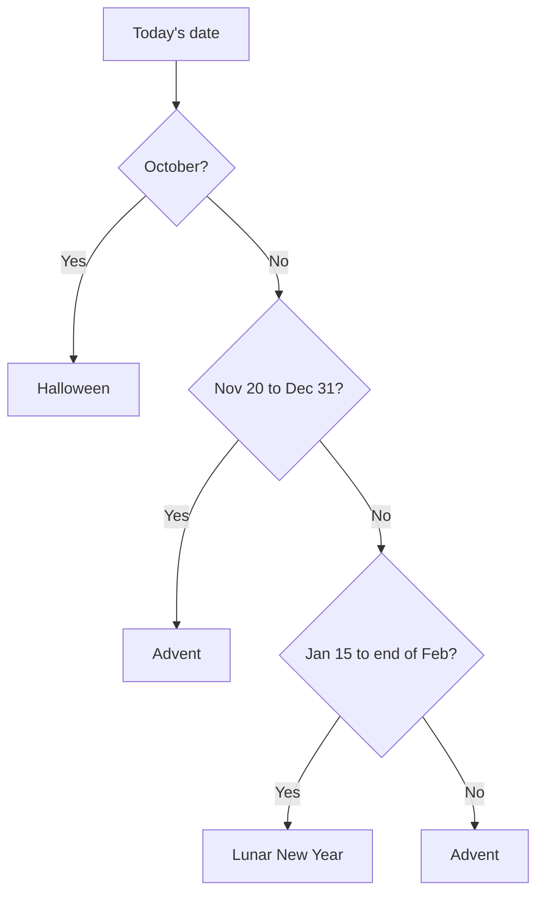

These are 3D game interfaces. See [Games](/docs/surfaces/desktop/interfaces/games) for how every
game shows what your agents are doing, where you answer asks, and how the games work with a
keyboard or without WebGL.

Every game on this page also has the 3D games' **Overlay density** and **Work bubbles** settings
in **Interface settings**. The settings listed under each game are its own extras.

## Town

Your agents as a small city, with you as its mayor. Projects and teams are districts, and agents in
neither live in Old Town. Every agent is a cosy cottage that grows bigger as its conversations add
up.

The town fills the window as a cosy island in the sea, with paved stone lanes, lush lawns, parks,
ponds, and a storybook City Hall with a clock tower. Light themes are a sunny day and dark themes a
starry night with the lamps and windows lit. Its name, date, and speed sit top left. Its
population, happiness, construction, and funds sit in the bottom left corner.

### What the buildings and villagers show

Each agent also walks the town as a little villager.

| State | Building | Villager |
| --- | --- | --- |
| Working | A crane works over it. | Hammers at their building. |
| Failed | A red beacon smokes over it. | Slumps by the door. |
| Asking you | | Walks to the steps of City Hall and queues down the plaza. Asks with no villager to carry them wait there as petition letters. |
| Answer ready | Unread answers and saved suggestions wait at the building. | Brings a crate to the inbox beside the steps. |
| Usage limit | **Closed till 15:10** hangs on its door. | |
| Otherwise | | Strolls round their block. |

### Controls

- Replies and failures are petitions at **City Hall**. The **City Hall** plate at the top shows how
  many asks wait on you. It opens City Hall in a sheet beside the town, with the petitions, upcoming
  runs, a map, and the districts.
- **Hear petition** opens one petition, and **Hear next petition** opens the first.
- Click a building to focus the camera on it and open its card, where **Commission work** starts a
  conversation with that agent.
- The zoom buttons, **Fit the town to the view**, the **Data view**, and the speed control (pause,
  normal, fast) sit around the map.

The town is drawn with WebGL. Without it, every building is listed, and each one opens the same
card.

**Interface settings**: **Speed** (automatic, normal, fast, or paused) and **Data view**
(districts, activity, or what needs you) set how the town opens. Changing either from the controls
on the map keeps your choice. Automatic runs at normal speed, or starts paused when you prefer
reduced motion. Picking Normal runs at normal speed either way.

## Rides

A ride-hailing app over your agents, set in a cosy 3D toon city: soft roads with dashed avenues
between blocks of rounded houses and little towers, a river under its bridges, and a park with a
pond. The city shows only the streets your trips use, so it stays compact. Light themes are a sunny
day and dark themes night, with lit windows, street lamps, and headlights.

### Drivers and trips

- You are the orange pin every trip starts from.
- Agents are drivers, each in a small rounded car of their own colour.
- A driver working on a conversation drives a route to its destination pin, with an estimated
  arrival from the agent's typical reply time. It parks at the pin once it replies.
- A driver asking you something pulls up at the kerb by your pin and waits in the queue there.
- A trip's word is the same on its pin, its row, and the open trip.

### The trip panel

The trip panel floats over the city's left side. On windows narrower than about 1000 pixels it is a
sheet along the bottom, so the city keeps its width. The counters show trips under way, arrived
trips, and free drivers.

The panel has three tabs: **Now** (trips under way), **Arrived**, and **Trips** (the history). The
first trip under way is selected when you arrive. Its route stands out in the city, and the bottom
of the panel shows the driver, the route from you to the conversation, the estimate, and **Open
trip**.

### Controls

- Type **Where to?**, pick a driver, and press `Enter` to book a trip, which starts a conversation
  with that agent.
- Select a pin's plate to show its trip and again to open it, a car's plate to show its trip, or an
  available driver's car to pick them.
- Open a trip to see the conversation in the sheet. `Esc` closes the open trip.
- `Tab` and the arrow keys move between cars and pins. Drag to pan, and the zoom buttons or `+` and
  `-` zoom.

Where 3D is unavailable, the cars and pins are shown as lists.

**Interface settings**: **Time of day** follows your color theme, or holds day or night.

## Passport

Your workspace as a passport booklet lying open on a desk, a 3D toon diorama. Turning its pages is
how you move through it: a wide window shows a two-page spread, a phone one page at a time. Light
themes are a sunny desk and dark themes an evening one.

- The identity page is the passport's summary: you as the holder, the totals of countries, stamps,
  and travel days, and the same summary line as the title plate.
- Each agent has a visa page with its photo (the agent's figure standing in the photo frame), its
  name, its emblem, and where it stands.
- Each conversation is an entry stamp on its agent's page, marked with where it stands from
  **APPLIED** to **ENTRY DENIED** in its country's ink.

### What the agents show

Every visa page has an index tab poking out round the booklet's edge. The agent stands on its tab
whichever page is open, stamping while it works.

- An agent asking you sends a visa slip to the customs desk at the booklet's front edge. It waits in
  the queue for your signature under a desk lamp that burns in the colour of the oldest wait.
  Select the agent to open its ask card. With no asks, the desk reads **No visas waiting**.
- Alarms, a usage limit (**Border closed till 15:10**, shortened to **Opens 15:10** on a phone), a
  ready answer, and suggestions are notes in the margin beside the agent, never on the printed page.
  They sit off the booklet's side for a side tab, and in a clip strip between the back row and the
  booklet for a back tab.
- A failed run also gets a red **DENIED** stamp.
- A delivered answer is set down on the customs desk as a stamped page.

### Controls

- The page controls at the bottom turn the pages. Their tabs turn straight to the identity page or
  an agent's visa pages (on a phone they scroll sideways under the arrows).
- `Page Up` and `Page Down` turn pages, and `Home` and `End` jump to the cover and the last page.
  `←` and `→` turn pages while the page controls have focus.
- **Booklet** opens the open page up close in a wide sheet (the whole screen on a phone). **Map of
  travels** lists the same entries plainly.
- Open a stamp to file the conversation as an immigration record. `Esc` files it away, then closes
  the sheet.
- Select an agent, or **Apply for a visa** in the booklet or the map, to start a new conversation
  with that agent. The booklet turns to its visa page.
- On the desk, `Tab` and the arrow keys move between agents. Drag to pan, and the zoom buttons or
  `+` and `-` zoom.

Where 3D is unavailable, the countries are shown as a list.

**Interface settings**: **Cover** binds the booklet in navy, burgundy, green, or black.

## Lobby

A game lobby on a cosy 3D plaza. **Lobby** puts up to four agents on a lit podium in the middle as
your squad, the most urgent first. Your picks lead among agents doing the same thing. Each has a
level plaque at their feet.

Around the podium stand:

- the quest board, which opens your **Daily quests**;
- a glowing portal, which starts a conversation with the chosen agent;
- the board of recent matches with your squad.

### Controls

- Select a squad member to choose it (a glow on the podium follows), or an **Open slot** to add an
  agent.
- Select **Play** to write a one-line brief, then **Drop in** (or `Enter`) to start a conversation.
  `Esc` cancels.
- `Tab` and the arrow keys move between everything on the plaza. Drag to pan, and use the zoom
  buttons to zoom.
- Anything you open shows the conversation in a panel beside the plaza. `Esc` closes it.

Where 3D is unavailable, the plaza is shown as a list.

### Tabs and levels

The menu tabs and your level sit along the top. Besides **Lobby**, the tabs are:

- **Quests**: **Daily quests** from what is waiting on you (claiming one opens it), **Weekly
  quests** from finished conversations per team and project, and **Milestones** from your messages.
- **Squad**: the roster. Picking an agent puts it in the squad.
- **News**: the latest activity as stories you page through.

Your level comes from messages: 100 XP each, and a level every 1,000 XP.

**Interface settings**: **Squad size** (one to four agents on the podium) and **Opens on** (the menu
tab it opens on).

## Quiz Show

A quiz show in a cosy 3D TV studio. The board is a big wall of glowing tiles facing you at the back
of the set, under a curved backdrop lined with marquee bulbs.

### The board

- There are always six categories (projects and teams, then the busiest agents) on lit header
  panels, by five values, 100 at the top to 500 at the bottom.
- A category's conversations fill its column from the bottom, so the one that needs you most is
  worth 500. The cheaper slots above read as already played.
- Tiles that need you glow brightest, played ones are dimmed, and each live tile carries a small
  badge for its state.
- An answer waiting to be read flips its tile to the answer's headline.

Pick a tile to reveal its clue, the latest message. **Answer** opens the conversation in the answer
sheet beside the studio, and **Back to board** (or `Esc`) returns.

### Contestants

Your agents (the most urgent four) stand behind podiums in front of the board. The host (you)
stands at a lectern marked **Host** beside them, and the audience sits in theatre rows along the
front.

- Each podium's screen says in a word what its contestant is doing.
- A contestant's current step shows in the gap beside its podium, and a stopped run's alarm hangs
  under its podium's screen.
- A contestant asking you something buzzes in and walks to the queue beside the lectern. Select it
  to open its ask card.
- Choose a contestant's name to ask them the **Final question**, which starts a new conversation
  with what you type.

`Tab` and the arrow keys move between the tiles' badges and the contestants. Drag to pan, and use
the zoom buttons to zoom. Where 3D is unavailable, the board is shown flat, and there the arrow keys
move between tiles and `Home`, `End`, `Page Up`, and `Page Down` jump.

**Interface settings**: **Round** (doubling once the board is busy, always Round 1, or always the
Double Round) and **Audience** (the studio audience in its theatre rows).

## Seasonal

A seasonal board as a cosy 3D island, with your agents as villagers busy by their conversations.
There are three boards:

- **Advent** is a snowy village square round a big advent house. Its 24 doors and windows face you
  on its two front walls, numbered in reading order across both walls with painted plaques. Opened
  ones are lit from inside with the shutters folded back.
- **Halloween** is a pumpkin patch at night. Each conversation is a carved jack-o'-lantern glowing
  from inside, and the places still empty are plain grey-green pumpkins.
- **Lunar New Year** is a lantern festival street hung with 24 numbered lanterns, blazing brightest
  where they need you.

The season switcher at the top right changes the board. By default it follows the date:

### What the places show

Each place is a conversation, the most urgent at the lowest numbers. Today's number is marked in the
board's own month. The legend explains the marks.

| State | What you see |
| --- | --- |
| Waiting on your answer | A red number plate and a glow. The agent carries a letter to the board's mailbox (the cauldron at the patch's gate, the post box at the street's end). |
| Working | Dots. Each door's words say what its agent is doing. |
| Stopped | Frosted shut (a cobweb over the pumpkin, a lantern gone dark) with a snowflake mark. |
| Usage limit | Words in the season's style, such as **Snowed in, back 15:10** or **Stall shut, back 15:10**. |
| Scheduled run | Tomorrow's door beside the agent (a little closed door, an uncarved pumpkin, an unlit lantern). An agent whose next step is only a plan step keeps the plain sign. |

Each season dresses the shared agent cues its own way:

- The wait beside a queued ask is a candle whose wax melts down as the ask's time runs out. Its
  flame turns the wait's colour and flickers only when the ask is about to expire (it holds still
  when your system asks for reduced motion).
- A reply set down at your spot is a wrapped gift (a treat bag in the patch) tagged with the
  answer's headline, such as **Edited 3 files**, shortened to 32 characters. There is no tag when the
  answer has no headline or conversation details are redacted, and none on a phone-sized board.
- An agent's helpers are dressed for the season: elves in green with red beanies, the scarecrow's
  helpers in his purple and straw hats, and festival helpers in red caps.

### Controls

- Select a villager to open that agent's conversation.
- Open a door to reveal a gift card, then choose **Open conversation** to hang the conversation
  beside the board. A door stays shut while its conversation has an unread answer and opens once
  you have read it.
- An empty pumpkin or lantern opens a box to start a conversation, as does the add button at the
  top right on every board. The advent house keeps its empty doors plain.
- Past the 24th, conversations go to **More gifts**. **All doors** at the bottom right lists every
  conversation on the board.
- `Tab` and the arrow keys move between the numbers, and `Enter` opens one. Drag to pan, and use the
  zoom buttons to zoom.

Where 3D is unavailable, the board is shown as a plain grid of numbered doors.

**Interface settings**: **Season** picks the board (the season switcher saves your choice there).
**Weather** shows or hides the snow over the Advent square and the motes drifting over the patch
and the street.

## Related

<Cards>
  <DocCard href="/docs/surfaces/desktop/interfaces" />
  <DocCard href="/docs/surfaces/desktop/interfaces/games" />
  <DocCard href="/docs/extend/develop/extensions/interfaces" />
</Cards>
