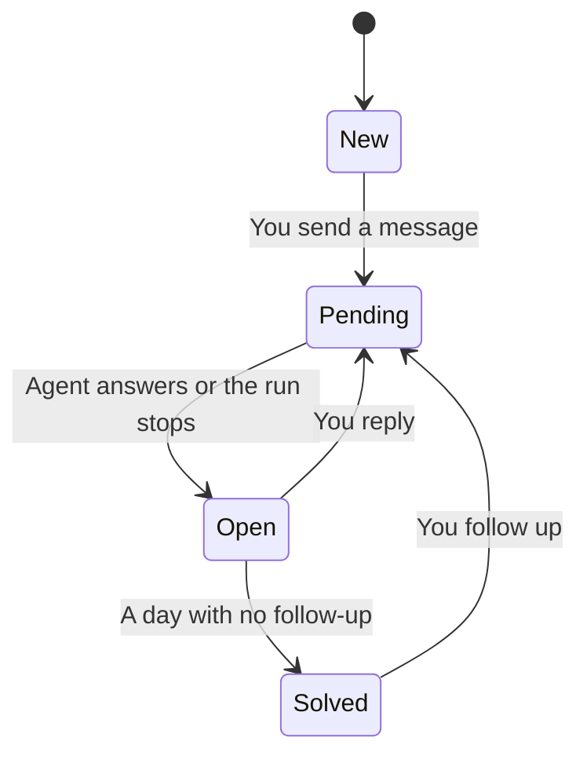

These built-in [workspace interfaces](/docs/surfaces/desktop/interfaces) lay your agents and conversations out like the work tools you already know. Each
of them opens a conversation in the normal chat view without leaving the interface.

| Interface | What it shows |
| --- | --- |
| **Tickets** | A support-ticket queue with views, statuses, priorities, and reply targets. |
| **Mail** | An email client: folders, labels, a message list, and a reading pane. |
| **Records** | Agents, teams, and projects as records with fields and an activity timeline. |
| **Jobs** | A hiring board: conversations are the jobs you posted, agents the freelancers you hire. |
| **Dashboard** | A grid of widgets you arrange yourself, including your upcoming runs. |
| **Status** | A status page: agents as components, failed runs as incidents, 30 days of uptime, and upcoming runs as scheduled maintenance. |
| **Mind Map** | Everything branching out from you as a mind map. |
| **Flow** | A calm canvas that starts as one card and grows into a flow of agents and conversations. |
| **Knowledge** | A 3D knowledge graph of agents, teams, projects, conversations, and the topics they share. |
| **Bank** | Your AI spend as a banking app: balance, spending, and transactions. |

## Tickets

A support-ticket queue. Every conversation is a ticket with a number, a subject, its agent as the
requester, a status, a priority, and a reply target.

| Status | When |
| --- | --- |
| **New** | Nothing has been said yet. |
| **Open** | The agent has answered and your reply is next, or the last run failed or stopped. |
| **Pending** | The ticket waits on the agent. |
| **Solved** | An answer has sat for a day without a follow-up. |

A failed or stopped run makes a ticket **Urgent**, and an answer waiting on you makes it **High**.
The reply target only counts down while the ticket waits on you.

- The **Views** list on the left counts the tickets in each view, such as **Your unsolved
  tickets**, **Urgent tickets**, and **All tickets**.
- Filter the table, sort it from its column headers, and group it by status or priority.
- Select tickets with their checkboxes (or `X`) and choose **Open in tabs** to open them all. Every
  ticket you open gets a tab above the table.
- A ticket's page shows the conversation between its header and a properties sidebar.
- **New ticket** (or `C`) opens a form. Describe what you need and submit with `Cmd+Enter`
  (`Ctrl+Enter` elsewhere).

| Action | Keys |
| --- | --- |
| Move between tickets | `J` / `K` or `↓` / `↑` |
| Open the selected ticket | `Enter` or `O` |
| Select the ticket | `X` |
| Filter | `/` |
| New ticket | `C` |
| Back to the table, clear the selection, or discard a draft | `Esc` |

## Mail

An email client over your agents. Conversations are messages, and the folders follow where each one
stands:

| Folder | Holds |
| --- | --- |
| **Inbox** | What waits on you: an agent's reply or a failed run. |
| **Starred** | Your pinned conversations. |
| **Working** | The ones running now. |
| **Sent** | The ones waiting on an agent. |
| **All mail** | Everything. |

Your teams and projects are labels, with a count of what waits on you in each.

- Open a message to read it in the reading pane beside the list, or in place of the list when the
  window is narrow.
- On a wide window the newest message opens in the reading pane when Mail loads. If you close it,
  the pane previews the highlighted message instead.
- **Compose** opens a docked window: pick the agent, write a subject and a message, and send with
  `Cmd+Enter` (`Ctrl+Enter` elsewhere). Composing from a label files the new conversation under
  that team or project.
- **Search mail** searches all mail and needs every word you type.

| Action | Keys |
| --- | --- |
| Move through the list, or between conversations while one is open | `J` / `K` or `↓` / `↑`; `Home` and `End` jump to the ends |
| Open the message | `O` or `Enter` |
| Back to the list | `U` |
| Select the message | `X` |
| Compose | `C` |
| Search | `/` |

## Records

Agents, teams, and projects as records, the way a contact database keeps people and companies. The
rail lists the three **Objects** and three **Views**: **Needs you**, **Working now**, and **Active
today**.

- An object opens as a **Table** you can sort from its headers, filter, and search, or as a
  **Board** grouped by status.
- Open a row to see the record's page: quick actions, an **Activity** timeline of its conversations
  grouped by day, and its **Details**. **Previous record** and **Next record** step through the
  table without leaving the page.
- A conversation opens beside whatever is on screen. **Start a thread** on an empty record starts
  one with that agent, team, or project.

Press `J` and `K` (or the arrow keys) to move through rows, with `Home` and `End` to jump to the
ends; on a record's page they open the next or previous record. `/` searches, and `Esc` closes the
conversation, then the record.

## Jobs

A hiring board. Every conversation is a job you posted, its agent is the freelancer you hired, and
its project or team is the company it is filed under (**Personal** when it has neither).

| Status | When |
| --- | --- |
| **Open** | The job waits for its freelancer to start. |
| **In progress** | The agent works. |
| **Review** | The work is delivered and waiting on you. |
| **On hold** | After a failed or interrupted run. |
| **Closed** | Otherwise. |

- **My jobs** shows filters and saved searches, the job list, and the selected job's details with
  its messages, which are the conversation. **Open full view** gives the conversation the whole
  window.
- **Freelancers** lists your agents with profiles and stats from their jobs, and a **Hire** box
  that posts a new job to that agent.
- **Post a job** starts a conversation; submit with `Cmd+Enter` (`Ctrl+Enter` elsewhere).

Press `J` and `K` (or the arrow keys) to move through jobs or freelancers (`Home` and `End` jump to
the ends), `Enter` to open a job or hire a freelancer, `/` to search, and `Esc` to close the job or
leave the full view.

## Dashboard

A grid of widgets:

- number tiles, such as **Your turn**, **Needs attention**, and **Running now**;
- the **Your turn**, **Needs attention**, and **Working now** lists;
- your **Agents**, 24 hours of **Activity**, **Upcoming runs**, **Pinned**, and **Recent**.

Select a row to open its conversation in a panel that slides over the dashboard. `Esc` closes it.
Selecting an agent opens its latest conversation, or starts one when it has none.

### Arrange the grid

Choose **Edit** to arrange the grid. The dashboard remembers your arrangement on this device.

- Drag a widget by its handle, or focus the handle and use the arrow keys (`Home` and `End` move it
  to either end).
- Each widget's size button steps through small, medium, large, and full width.
- Its remove button takes it off the grid, and **Add widget** brings one back.
- **Reset** restores the default arrangement, and **Done** (or `Esc`) leaves edit mode.

## Status

Your workspace as a status page, from top to bottom:

- A banner gives the overall state: **All systems operational**, **Degraded performance**, or
  **Partial outage**.
- The open **Incidents** are conversations whose last run failed or was interrupted.
- Every agent is a component, grouped by team, that reads **Operational**, **Working**, or
  **Degraded performance**.
- **Past incidents** covers the last week, and **Scheduled maintenance** lists your upcoming runs.

Each component has a 30-day uptime strip. Each conversation counts on the day of its latest run,
with that run's outcome, and scheduled runs keep their full history. A day with failed work shows
as a partial outage or an outage.

Select an incident to open its conversation in a side panel; `Esc` closes it. Team groups collapse
and expand. The uptime strip is a single tab stop: the arrow keys walk its days, each with a
tooltip. **New thread** starts a conversation.

## Mind Map

You at the center, with your projects, teams, and a **Direct** branch spreading out to the left and
right. Agents hang off each branch, and conversations are the leaves, most urgent first. Long lists
of leaves fold into a **more** leaf until you show them all, and big maps start with quiet agents
folded.

Select a leaf to open its conversation in a panel docked beside the map. Pan and zoom with the
mouse or the zoom controls, and choose **Fit to screen** to see everything.

| Action | Keys |
| --- | --- |
| Walk the map (parent, children, neighbors) | Arrow keys; `Home` returns to you |
| Fold or unfold a branch | `Space` |
| Open a conversation, or fold a branch | `Enter` |
| New conversation from an agent or branch | `+` |
| Fold or unfold every branch | `Alt+.` |
| Zoom in / out / reset | `Cmd` (`Ctrl` elsewhere) with `+` / `-` / `0` |
| Fit to screen | `Shift+1` |
| Close the open conversation | `Esc` |

## Flow

A calm canvas that starts as one card and grows as you use it. You connect to your agents (or their
teams), and each agent connects to its conversations, the most urgent first. A chip on a connection
counts what waits on you there, and long branches fold behind **N more**.

The start card offers ways in: **Review what needs you**, a message to one of your agents, or a
conversation in a project.

- Each agent's **+** opens a menu to start a new conversation with it or add one to a project. The
  canvas grows a card where you type, and `Esc` drops it unsent.
- Select a node to slide in its metrics, hourly activity, and logs, or, for a conversation, the
  conversation itself.
- The arrow keys travel along connections, `+` and `-` zoom, `0` fits the flow to the screen, and
  `Esc` closes the panel.

## Knowledge

Your workspace as a knowledge graph in 3D. Agents, projects, teams, conversations, and the topics
they share are nodes in a force-directed layout: two conversations that mention the same word in
their titles are linked through that topic. Dark themes get a deep canvas and light themes a
near-white one.

- Hover over a node to light up its neighbors, and search to dim everything that does not match.
- **Graph settings** filters the kinds of node and orphans, switches to a **Local graph** around
  the selection, and tunes the display (including link thickness) and the forces. **Animate**
  replays the layout. Your choices are kept for next time, and also appear in **Settings →
  Appearance → Interfaces**. **Restore default settings** undoes your changes.
- Select a node to open a side panel with its links and linked conversations. Select a
  conversation to read it in the same panel; starting from an agent, team, or project opens a new
  conversation there.

| Action | Keys |
| --- | --- |
| Walk the nodes | Arrow keys |
| Select a node | `Enter` or `Space` |
| Zoom in / out, fit the graph | `+` / `-`, `0` |
| Search, then move into the matching nodes (picking one selects it and clears the search) | `/`, then `↓` |
| Close the conversation, then the selection, then clear the search | `Esc` |

Without WebGL, the same graph is drawn flat in 2D. Knowledge also switches to 2D when its 3D view
fails while you use it, for example when the graphics context is lost or no frame is drawn within a
few seconds.

## Bank

Your AI spend as a banking app, in three sections:

- **Home** leads with your balance (with the plan, top-up, and gift credit behind it), this month's
  spend and tokens over a 30-day chart, and a feed of transactions grouped by day. Select a
  transaction for its model, provider, tokens, and balance after, and choose **View conversation**
  to open the conversation it belongs to.
- **Insights** ranks your spend by model, agent, and conversation. Everything past the top of each
  ranking rolls into an **Other** row, followed by spend **Outside conversations** and with **No
  agent**.
- **Statements** totals each month. A month whose opening balance plus money in, less money out,
  does not match its closing balance is marked **Doesn't reconcile**. A partly covered oldest month
  says when its history starts.

Search narrows the feed. `↑` and `↓` move through the transactions. `←` and `→` (with `Home` and
`End`) move between the section tabs and read the chart day by day. `Esc` steps back.

### Where the balance comes from

Bank reads your Ryu account's wallet, so it shows your balance, spend, and statements only while
you are signed in. It refreshes about once a minute and follows the organization you have selected.

When you are signed out or your account can't be reached, it shows **Balance unavailable**, keeps
retrying, and still lists your agents' activity. **Town** shows the same balance as **Funds** in its
top bar while you are signed in, and leaves it out otherwise. Top-ups happen in **Settings**.

## Related

<Cards>
  <DocCard href="/docs/surfaces/desktop/interfaces" />
  <DocCard href="/docs/extend/develop/extensions/interfaces" />
</Cards>
