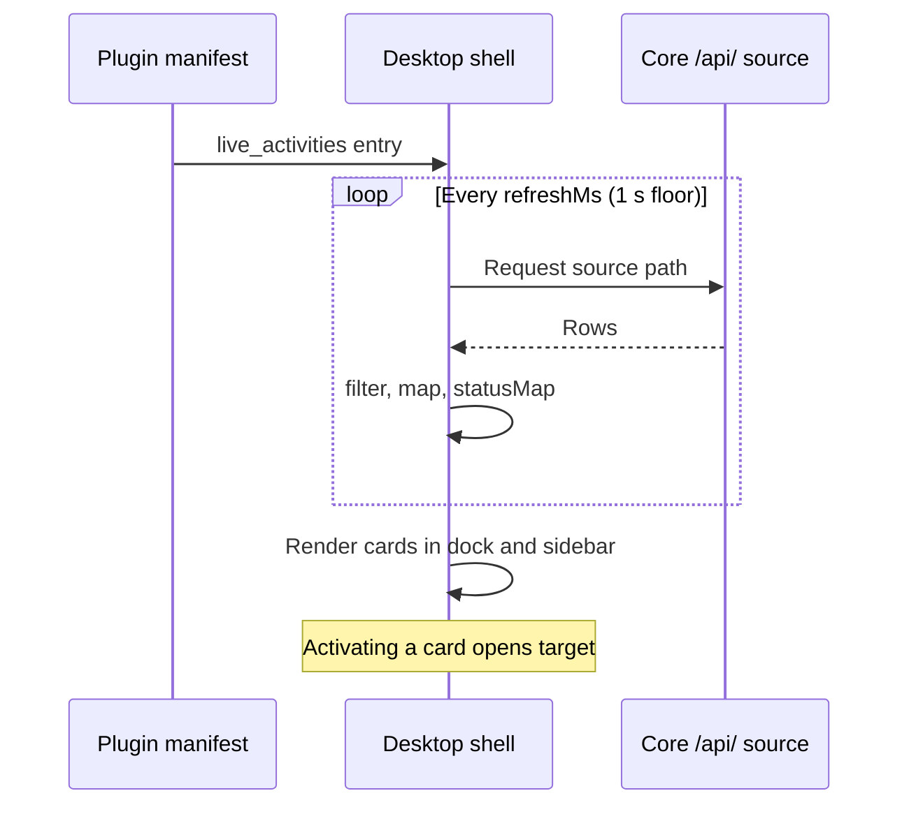

Live Activities are status cards that the Desktop shell renders for work in progress, such as an
agent run, a download, a pending approval, or a recording. They are modeled on iOS and macOS Live
Activities. Each card starts when the work starts, updates as it progresses, and ends with a
`done` or `error` state. The mobile clients use the same status vocabulary for agent activity.

They appear in two places:

- **The empty shell page** (when no tabs are open): a compact pill dock below the composer. Each pill
  shows the activity's glyph and a pulsing status dot. Interacting with it expands the pill into a
  detail card with the status badge, the detail line, a determinate progress bar, and an **Open** action.
- **The sidebar**: a pinned **Live** block above the announcements.

The dock and the sidebar block hide when nothing is live.

## What's built in

Desktop includes these live activities with no setup:

| Activity | Source | Status |
|---|---|---|
| Agent run | `GET /api/runs/stream` | `running` → `done` / `error` |
| Download | the shared downloads store | `running` with live progress |
| Pending approval | the approvals inbox | `waiting` ("needs your input") |
| Meeting recording | the meetings stream | `running` while recording |

Tapping a built-in card opens its owning surface: the chat that owns the run, the download center, the
approval inbox, or the meetings page.

## How apps and plugins expose one

Any enabled plugin can contribute live activities in its manifest, with no sidecar code. This works
like `sidebar_sections` for the sidebar. Add a `live_activities` entry to the manifest's
`contributes` block. Each entry names a `source` (a Core `/api/` path the shell polls) and a
field map from response rows to card fields.

Declarations from the same plugin that use the same approved source share one request, polled at
the fastest requested cadence with a one-second floor. Removing a declaration removes its cards. A
shared request stays active while another declaration needs it.

This entry shows one card per running agent run:

```json
{
  "contributes": {
    "live_activities": [
      {
        "id": "working",
        "title": "Working",
        "icon": "lucide:loader-circle",
        "accent": "var(--primary)",
        "spec": {
          "source": {
            "http": { "method": "GET", "path": "/api/runs" },
            "items": "runs",
            "filter": [{ "key": "run_status", "equals": "running" }],
            "map": {
              "id": "id",
              "title": "title",
              "titleFallback": "Untitled run",
              "detail": "folder_path"
            },
            "refreshMs": 5000,
            "limit": 5
          },
          "map": {
            "status": "run_status",
            "statusMap": {
              "running": "running",
              "completed": "done",
              "failed": "error"
            }
          },
          "target": "/chat?conversationId={{item.id}}"
        }
      }
    ]
  }
}
```

- `source` is the same `ViewSource` a `list-detail` view or a `sidebar_sections` entry uses: a Core
  `/api/` path, an optional `items` array key, row `filter`/`limit`, and a `refreshMs` poll cadence.
- `map.status` names the row key whose value is a status string. `statusMap` remaps backend
  wording onto the five shared [statuses](#statuses). An unmapped value that is already one of
  those statuses is kept as is. Any other value falls back to `running`.
  `map.progress` names a row key holding a 0–1 (or 0–100) progress value.
- `target` is a route template opened when the card is activated, filled with the row's
  `{{item.<key>}}` values. `sidebar_sections` uses the same template syntax.

The shell renders the card from this data. The app never supplies markup. The
[Agent Status](/docs/apps/agent-status) app ships a working example.



## Statuses

Every card carries one of five statuses, matching the mobile agent-activity vocabulary:

| Status | Meaning |
|---|---|
| `running` | In flight (pulsing dot) |
| `waiting` | Blocked on input (e.g. a pending approval) |
| `review` | Needs review |
| `done` | Finished |
| `error` | Failed |

Cards in the `done` or `error` state stay visible briefly, then leave the dock.
