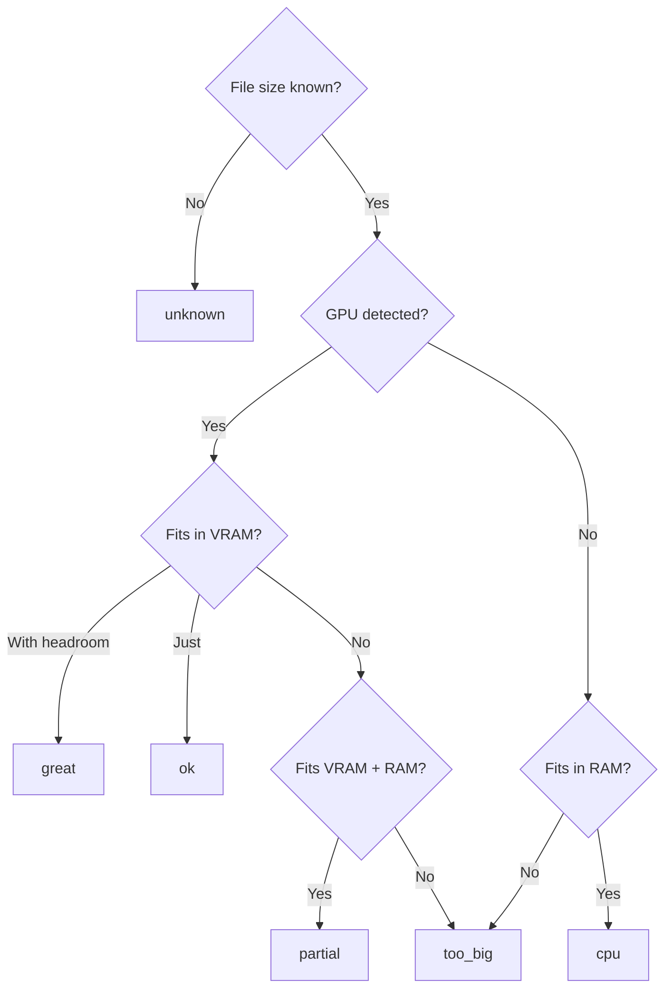
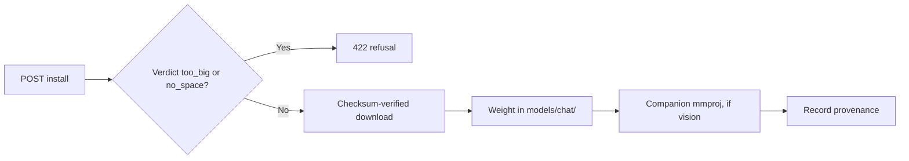

The model catalog lets you browse the Hugging Face Hub for models, see which will run on your
machine, and install one with a checksum-verified download. The logic lives in Core's model-catalog
crate (`crates/core/model-catalog/src/`), so every client (desktop, mobile, CLI, extension) uses the
same search, ranking, device-fit, and install behavior.

<Figure name="models" />

The catalog is format-aware. A model has a weight format, and the engine to serve it is derived from
that format, so the catalog browses across GGUF, safetensors, and MLX rather than GGUF only. See
[Model formats and engine compatibility](#model-formats-and-engine-compatibility) below.

## Browse

```text
GET /api/models/catalog
```

| Parameter | Meaning |
|---|---|
| `query` | Search text for the Hub. |
| `sort` | `trending`, `downloads`, `likes`, or `recent`. |
| `limit` | Page size. |
| `task` | Optional task filter. |
| `format` | `gguf`, `safetensors`, or `mlx`. Defaults to GGUF. |
| `cursor` | Opaque pagination cursor forwarded from the Hub. |
| `installed_only` | `true` lists what is already on disk without a network request. |

The desktop fans out across all three formats (`MODEL_FORMATS` in
`apps/desktop/src/lib/api/models.ts`) and keeps one clean Hub cursor per format.

An optional Hugging Face token (from preferences or environment) raises rate limits and unlocks gated
repos. No token is required for public models.

## Detail

```text
GET /api/models/catalog/detail?id=author%2Fname
```

The detail view fetches three things from the Hub and merges them:

- the model card metadata;
- the file tree: every runnable model-weight GGUF quantization with its real size and SHA-256;
- the README, with its front matter stripped.

Quantization inputs such as `imatrix_*.gguf` are omitted. They help create quantized weights but are
not models that the local engine can run.

### The download picker

The quantizations are presented as a single collapsed **download dropdown** rather than a flat list.

- The dropdown preselects the best device-fit quantization for this machine via
  `pickRecommendedFile`.
- A "Recommended for your Mac/PC/device" badge shows while that quant is selected, and disappears if
  you choose another.
- A `too_big` or `no_space` quant stays listed with its reason but cannot be added.
- A `cpu` or `partial` quant shows a "may be slow" warning.
- Installed quants and add-ons (like the mmproj projector) keep their own controls below the picker.

Repo ids and filenames are validated to prevent path traversal and URL injection before any request
or download.

## Device fit

For every quantization, Core computes a **device-fit verdict** so you know what will run before you
download (`crates/core/model-catalog/src/device.rs`). It detects your hardware with no setup:

- RAM via the OS (PowerShell on Windows, `/proc/meminfo` on Linux, `sysctl` on macOS).
- GPU VRAM via `nvidia-smi` for discrete NVIDIA cards, or unified memory on Apple Silicon.
- Free disk space on the drive that holds your models folder.

Query your detected hardware directly:

```text
GET /api/models/device
```

The verdict is one of:

| Verdict | Meaning | What you can do |
|---|---|---|
| `great` | Fits in VRAM with comfortable headroom | Install |
| `ok` | Fits in VRAM | Install |
| `partial` | Spills from VRAM into system RAM | Install, with a "may be slow" warning |
| `cpu` | Fits in system RAM only, no GPU acceleration | Install, with a "may be slow" warning |
| `too_big` | Needs more memory than this computer has | Blocked: loading it could freeze or crash the machine |
| `no_space` | The download doesn't fit on your disk (Ryu keeps 2 GB free in reserve) | Blocked until you free up space |
| `unknown` | Size or hardware could not be detected | Install; Ryu never blocks on an unknown |

### How the memory verdict is computed

The estimate budgets about 1.2x the file size for the model plus context, and adds about 1.5 GB of
system headroom for the RAM check. For a vision model, the projector that installs alongside it
counts toward the size too. Already-installed files are judged on memory only.

On a discrete GPU the check runs in this order. On Apple Silicon, unified memory is one pool, and
the same tiers apply to total RAM.



An unknown RAM figure gives `unknown`, never a refusal. The disk check that gives `no_space` runs
separately.

### Remote nodes and blocked options

The verdict is always computed by the node you are installing to. When the desktop points at a
remote node, the verdict, the warnings, and the blocks reflect that machine's RAM, GPU, and disk,
not the computer you are typing on.

Blocked options stay visible in the download picker with the reason and your device's numbers, but
their **Add** button is disabled. The one-click **Add** on Store Home picks the best quantization
that fits, and declines with an explanation when none does.

## Optional speed estimate

The native fit verdict is the fast, universal recommendation used by the catalog list and download
picker. On an install-capable desktop, the model detail page also offers an explicit **Estimate speed
on your device** action backed by the optional `llmfit` sidecar.

```text
GET /api/models/llmfit-estimate?repo=author%2Fname&context=32768&quant=Q4_K_M
```

The desktop sends the selected model's context window and the recommended model-weight quant when
they are available. The estimate then describes the artifact the picker recommends rather than an
unrelated default.

- LLM Fit reports estimated **tokens/sec**, not words/sec.
- It is not called for every list card.
- The sidecar call can take around 15 seconds and uses the sidecar's curated catalog.
- It falls back to the native device-fit verdict when it is unavailable or cannot match the model.

## Model formats and engine compatibility

A model carries a weight format, and the engine that serves it is derived from that format rather
than picked per agent (`crates/core/model-format/src/lib.rs`). Three formats are cataloged:

| Format | Wire value | Install shape | Serving engines |
|---|---|---|---|
| GGUF | `gguf` | Single file (`~/.ryu/models/chat/<stem>.gguf`) | llama.cpp, Ollama |
| Safetensors | `safetensors` | Repo snapshot directory (`~/.ryu/models/chat/snapshots/<slug>/`) | vLLM, SGLang |
| MLX | `mlx` | Repo snapshot directory (`~/.ryu/models/chat/snapshots/<slug>/`) | MLX, MLX-VLM |

Each Hub query supplies its own filter. GGUF and safetensors map to the Hub's `filter=` values. MLX
has no Hub filter, so it is scoped to the `mlx-community` org when the caller has not already chosen
an author (`crates/core/model-catalog/src/lib.rs`).

Because GGUF is a single quantized file, only GGUF gets per-file quantization listing and per-quant
device fit. Safetensors and MLX install as a multi-file repo snapshot and get a coarser repo-level
verdict.

### Compatibility per node

A catalog card is marked compatible when at least one engine that can serve its format is runnable
on this node. Otherwise it carries a `needs_engine` label (for example `vLLM` or `MLX`), so an
incompatible model still surfaces and is annotated rather than hidden. The desktop renders this as a
format facet plus compatibility badges.

Read which formats and engines a node can run with this route:

```text
GET /api/models/engines
```

<Callout type="info">
  MLX engines are Apple Silicon only, so on other nodes an MLX model surfaces with a `needs_engine`
  label instead of an Install action. Adding an engine is one row in the capability table in
  `crates/core/model-format/src/lib.rs`. oMLX and MLX Serve are not in that table, because they use
  their own model directories.
</Callout>

## Optional benchmark stats

If you set an Artificial Analysis API key, detail views are enriched with benchmark stats: an
intelligence index, output tokens per second, time to first token, and a blended price.

- Save the key in **Settings → Integrations**, or set `ARTIFICIAL_ANALYSIS_API_KEY`. A saved key
  takes precedence.
- Without a key, the catalog omits these stats.
- Artificial Analysis tracks hosted models, so many community repos get partial or no stats.

## Install

```text
POST /api/models/catalog/install
```

Install a chosen quantization by passing the repo `id` and the `file`. Core then:

1. fetches the SHA-256 from the file tree;
2. downloads the weight with the shared checksum-verified downloader (atomic, retrying) and stores
   it under `models/chat/`;
3. installs the companion projector for a vision model (see [Vision models](#vision-models-mmproj));
4. records provenance in `state/installed-models.json`.

Both paths are in the
[data folder](/docs/surfaces/desktop/user-guide/data-and-storage#whats-in-the-data-folder).



### Refusals and disk checks

For Hugging Face installs, Core refuses an install whose verdict is `too_big` or `no_space` with
HTTP `422` before any byte is downloaded, so a client that skips the picker can't install it either.
The response carries a `code` of `model_too_large` or `insufficient_disk` and a plain-language
message with the numbers.

Installs from a model index or the Ryu Marketplace don't get that refusal, because those sources
don't report a file size up front. Every download, whatever its source, checks free disk space as
soon as its size is known and stops early, rather than filling the disk partway through.

### Previews

Install, removal, and active-model previews show the complete plan returned by Core. Desktop
refuses an incomplete preview response instead of showing a partial plan. A preview does not
download, delete, or switch a model.

## Start a chat

For an installed text model, choose **Chat with this model** in its detail view. Desktop then:

1. checks the active node's format and engine capabilities;
2. reuses a compatible installed engine when possible, or installs the first supported engine when
   the node does not have one yet;
3. switches the served model and opens a new chat with the model selected for that tab.

This does not change the saved model choice for other agents or chats. If the model is already
active, the same action opens chat directly.

If engine setup or Gateway refresh fails, Desktop keeps the catalog open and shows a retryable setup
error. Models that are not chat models continue to use their format-specific local runtime controls.

<Callout type="info">
  Repeat browse and detail calls are served from a short in-process cache (a 60-second list cache and
  a 5-minute detail cache) for every client.
</Callout>

## Vision models (mmproj)

A GGUF vision model ships its multimodal projector as a separate companion file, named with an
`mmproj` token (`mmproj-F16.gguf`, `mmproj-model-f16.gguf`, and so on). Core detects this file and
installs it for you.

### Detection

In the detail view (`crates/core/model-catalog/src/lib.rs`), a repo is flagged `vision: true` when
any of its GGUF siblings is a projector file (`is_mmproj_filename`).

The projector is filtered out of the listed quantizations because it is an adapter, not a
user-selectable weight. The quant picker shows only the model weights, while the UI can still badge
the repo as vision-capable.

### Projector install

When you install a quant, Core auto-installs the matching projector alongside it
(`install_companion_mmproj`):

- It picks the projector by precision, preferring `f16` and falling back to the smallest available.
- It downloads it through the same checksum-verified downloader.
- It stores it bound to the model's stem at `~/.ryu/models/chat/<stem>.mmproj.gguf`.

The same path runs during onboarding for the default model (`apps/core/src/sidecar/onboarding.rs`).
Projector download is best-effort: if it fails, the model still chats as text-only.

You can override the projector precision:

| Variable | Default | Effect |
|---|---|---|
| `RYU_MMPROJ_QUANT` | `f16` | Preferred projector precision; falls back to the smallest projector if absent |

### Launch and chat

At launch, the local engine (`apps/core/src/sidecar/providers/llamacpp/mod.rs`) resolves the adapter
by the on-disk `<stem>.mmproj.gguf` convention. If the file is present it starts llama.cpp with
`--mmproj` so the served model accepts images. Otherwise it does a plain text launch. This runs both
for the registry default and for a runtime active-model switch.

On the chat path, a user message that carries image `file` parts becomes an OpenAI content array
(text plus each image as an `image_url` data-URL) through `route_openai_stream`
(`apps/core/src/sidecar/adapters/adapter_core/openai_stream.rs`). A locally served vision model with
its projector loaded, or any multimodal provider, then receives the image.

Text-only messages keep the plain-string content shape, so non-vision chat is unaffected.

<Callout type="warn">
  The projector must live in the same repo as the model weights (same-repo `mmproj` only). Vision
  needs the local engine running with a vision GGUF installed. Live vision inference has not been
  verified end to end.
</Callout>

## In the desktop

The Models page is a master-detail browser over these endpoints. Open it from the command palette or
the sidebar. See [The Store](/docs/surfaces/desktop/user-guide/store).

### Default model for evaluations

When an agent has no model of its own, its evaluation panel uses the selected node's saved local
default until you type a model ID. Set that default under **Gateway → Default agent & model**.

- Automatic evaluations stay disabled while that default is reloading or if it cannot be reloaded.
  Use **Retry** in the default controls.
- If a save fails, Desktop keeps the previous choice and shows the error.

### Provider catalogs

Provider account catalogs follow the selected node and its credentials. Switching identities
reloads the matching catalog. If a reload fails, the old account list stays hidden. Use **Retry** in
the provider controls to reload it before you edit.

External provider billing and transaction settlement stay with the provider and the Gateway.
