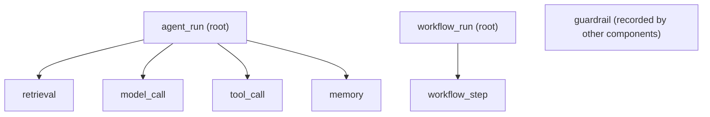
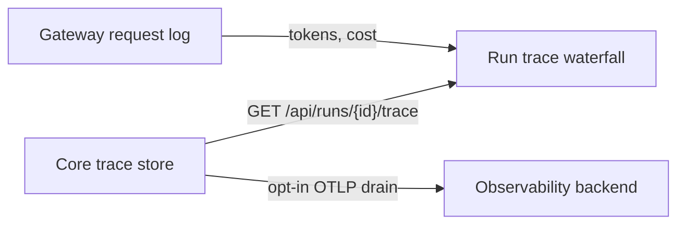

Every agent turn on a node is recorded as a **run trace**: a tree of spans that shows what ran, in
what order, how long each step took, and which step failed. Traces stay on the device by default.
You can also [export them](/docs/surfaces/desktop/diagnostics-reference#exporter-presets) to an
observability backend.

## What a trace contains

Each turn starts an `agent_run` span. Work done for that turn nests under it:

| Kind | Recorded for |
| --- | --- |
| `agent_run` | One agent turn (the root of the trace) |
| `workflow_run` / `workflow_step` | A workflow execution and each of its steps |
| `model_call` | One model request |
| `tool_call` | One tool invocation |
| `retrieval` | Auto-recall over memory, Spaces, and past chats |
| `memory` | A long-term memory write |
| `guardrail` | A policy or safety check |

Chat turns record agent runs, model calls, tool calls, auto-recall retrieval, and memory writes.
The workflow and guardrail kinds are part of the same trace format for the components that record
them.



Every span has a `trace_id`, a `span_id`, a `parent_span_id` (empty for the root), a `status`
(`running`, `ok`, `error`, or `cancelled`), start and end times, an `agent_id`, and a small
`attributes` object (for example the recall `top_k`, the number of injected memories, or a tool
call id). Tool spans keep a SHA-256 fingerprint of the tool input instead of the input itself.

### Content mode

Inputs and outputs (prompts, tool arguments and results, recalled context) are kept only when you
turn on **content mode** in **Settings → Privacy → Diagnostics & support**. With content mode off,
spans hold names, timing, status, counts, and fingerprints only.

Captured payloads are encrypted on disk, and turning content mode off clears the ones already
stored. See [content mode](/docs/surfaces/desktop/diagnostics-reference#content-mode).

### Tokens, cost, and retention

Token counts and cost are measured by the Gateway, not stored in the trace. The viewer joins them
from the Gateway's request log onto each model-call span by the run id and time window.



Run traces follow the same retention as the local trace store: 90 days and 1,000,000 spans by
default.

## The trace viewer

Open a conversation and expand **Run trace** below the reply. The waterfall shows one row per span.

- Indentation follows the parent/child tree. Use the arrow to collapse a subtree.
- Each bar is placed on the run's timeline, so gaps and overlaps are visible.
- The right-hand columns show duration and, for model calls (or a parent's total), tokens.
- The header shows the run's duration, total tokens, and estimated cost.
- Select a span to see its status, error, attributes, joined usage (tokens, cost, provider
  latency), and, in content mode, its input and output.

If the Gateway is not reachable, the waterfall still renders without tokens and cost.

## API

Both routes are on Core and only return runs the caller can read.

### Get a run's trace

`GET /api/runs/{id}/trace` returns the run's spans as a flat list, `{ "spans": [...] }`, in the
order they were written. Spans recorded before hierarchical traces existed have no `trace_id` or
`span_id`.

`GET /api/runs/{id}/trace?format=tree` returns the same spans nested:

```json
{
  "format": "tree",
  "run_id": "conv_123",
  "started_at": 1761000000000,
  "ended_at": 1761000004200,
  "duration_ms": 4200,
  "span_count": 6,
  "error_count": 0,
  "roots": [
    {
      "id": "…",
      "kind": "agent_run",
      "name": "support-agent",
      "trace_id": "4bf92f3577b34da6a3ce929d0e0e4736",
      "span_id": "00f067aa0ba902b7",
      "parent_span_id": null,
      "status": "ok",
      "normalized_kind": "agent_run",
      "depth": 0,
      "offset_ms": 0,
      "duration_ms": 4200,
      "children": []
    }
  ]
}
```

`offset_ms` is the span's start relative to the run's first span, which is what a waterfall needs.
`normalized_kind` maps older `tool-call` / `model-call` spellings to `tool_call` / `model_call`.

### List and search traces

`GET /api/traces` lists traces (one per agent run or workflow run), newest first:

| Query parameter | Meaning |
| --- | --- |
| `agent_id` | Only runs of this agent |
| `status` | `running`, `ok`, `error`, or `cancelled` |
| `kind` | Root kind, such as `agent_run` or `workflow_run` |
| `since`, `until` | Start-time bounds, as Unix milliseconds or RFC 3339 |
| `run_id` | Only this run |
| `q` | Substring of the root name, or an exact run id or trace id |
| `limit`, `offset` | Paging (`limit` 1–500, default 50) |

Each item has `trace_id`, `run_id`, `root_id`, `kind`, `name`, `agent_id`, `status`,
`started_at`, `ended_at`, `duration_ms`, `span_count`, and `error_count`.

### TypeScript client

`@ryuhq/core-client/traces` wraps both routes and the usage join:

```ts
import {
	fetchRunTraceTree,
	joinTraceUsage,
	listTraces,
} from "@ryuhq/core-client/traces";

const failed = await listTraces(target, { status: "error", agentId: "support" });
const tree = await fetchRunTraceTree(target, failed[0].runId);
// `auditRows` from the Gateway request log (GET /api/gateway/audit?session_id=…)
const withUsage = joinTraceUsage(tree, auditRows);
```

## Export to an observability backend

<Callout type="warn">
  Export is off by default and needs your consent and a configured backend. Ryu does not verify a
  live round-trip to any vendor project; confirm traces arrive in your backend after you set it up.
</Callout>

Run traces are exported through the same opt-in OTLP drain as Core's other spans. Choose a preset
for Langfuse, LangSmith, Braintrust, Arize Phoenix, Helicone, or Datadog, or point the generic
`otlp` preset at any collector. Credentials are secret references, never plain values.

See [Exporter presets](/docs/surfaces/desktop/diagnostics-reference#exporter-presets) for the
settings and the exact endpoints and headers each preset uses.
