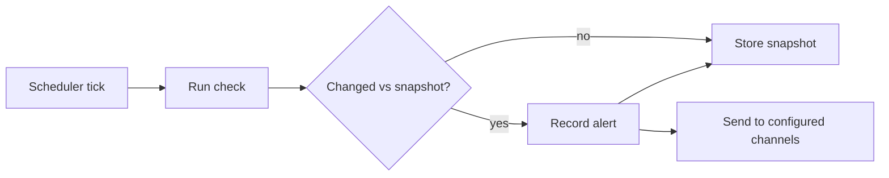

A **monitor** watches a URL on a schedule and alerts you when something changes. Open **Monitors**
from the command palette to create and manage them.

## Check types

Each monitor has a check type.

- **Uptime** - whether the site is up, and how fast it responds.
- **Keyword** - a substring or regex is present, or absent.
- **Content diff** - the page's normalized text changed (optionally only within a region you
  specify).
- **Price** - capture a number from the page and compare it: changed, above, below, drops by a
  percentage, or rises by a percentage.
- **Stock** - an in-stock phrase appeared.
- **Provider usage reset** - choose a supported provider and select usage windows or credit
  balances. The first check stores a baseline without an alert. Later checks notify on a refill,
  including a reset that the provider starts before its reported reset time.

### Watch one saved account

When a provider has more than one saved login, the provider usage reset form shows an **Account**
picker:

- **Follow active account** (the default) watches whichever account is active when each check
  runs. Switching accounts is not a reset: the next check records a fresh baseline for the newly
  active account and notes that the account changed, without sending an alert.
- **A specific account** watches that login only, even while another account is active. If that
  account is later removed, the check reports it as unavailable instead of reading a different
  account. Edit the monitor and choose another account to resume.

Per-account usage is available for Claude Pro/Max, ChatGPT, OpenAI Codex, and GitHub Copilot.
Other providers, including ChatGPT plan, Kiro, Kimi, Radius, Ant Ling, and agent CLI logins, don't
report usage per account, so their monitors always follow the active account and the picker is
hidden.

The picker lists your saved logins by name, which may be an email address. Monitors store only an
account identifier. Names are shown when you view a monitor and never appear in alert text.

Showing the picker requires Monitors to have permission to **see your subscription accounts**, and
it is available to the node owner or an admin only. Other members can't choose a provider, so they
can't create provider usage reset monitors.

Provider choices and selectable windows come from Core's normalized usage readers:

- Unsupported or unavailable accounts appear as unavailable.
- A failed read keeps the last successful baseline.
- An older monitor without an account selection follows the active account and records a new
  baseline on its first check.

## How alerts work

Every check compares against the previous **snapshot** and alerts only when the watched value
changes enough to count as a transition. Each monitor runs on Ryu's [scheduler](/docs/core/scheduler).

Provider reset monitors poll every five minutes by default (one minute minimum). Detection happens
on the next check, including for resets that do not match a weekly or hourly schedule. They alert
when:

- a selected quota window clears to near zero,
- it reaches the configured refill threshold,
- it crosses a reported reset boundary, or
- a credit balance increases.

## Notifications

When a monitor fires, Ryu sends the alert to every channel you configured:

- An in-app toast and a native desktop notification.
- A push notification to registered mobile devices.
- A per-monitor webhook (for example Slack or Discord).
- A Telegram message.
- An email sent through the node's configured SMTP transport.

Telegram bot tokens are hidden when you load a saved monitor. When editing a monitor with a
Telegram destination, enter its bot token before **Save monitor** becomes available.

<Callout type="info">
  Website monitors fetch pages with a plain HTTP fetch by default, or with the Spider crawler for
  pages that need a real crawl. Provider reset monitors read usage through Core's provider
  adapters. Alerts are stored and streamed live, so the Monitors page shows new alerts as they
  happen.
</Callout>

## Related

<Cards>
  <DocCard href="/docs/apps/monitors" />
  <DocCard href="/docs/core/website-monitoring" />
  <DocCard href="/docs/providers/codex-reset-planning" />
  <DocCard href="/docs/core/scheduler" />
  <DocCard href="/docs/gateway/channel-routing" />
</Cards>
