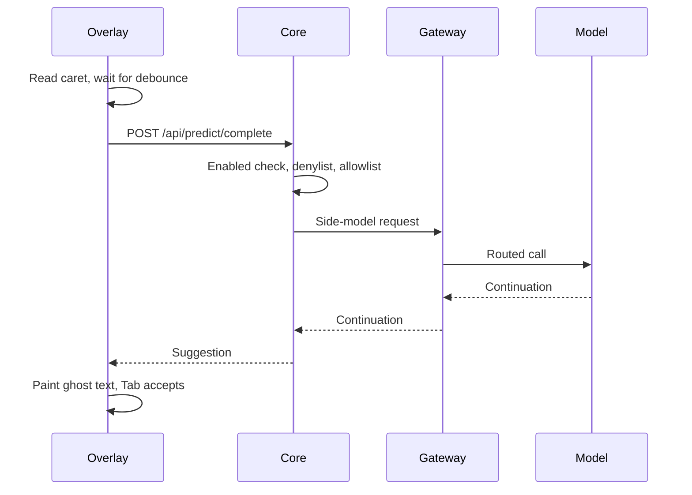

Predictive typing suggests the next few words as you type. Press **Tab** to accept a suggestion.
It runs in two places: in any text field on your machine (the **Autocomplete** app) and inside
Spaces documents (the editor copilot). Both ask a model for a continuation, and every request
routes through the Gateway like any other model call.

<Callout type="warn">
  The system-wide overlay is **Windows-first**, **opt-in**, and ships **off**. It needs a real
  display to runtime-verify, so treat it as built but not yet verified. Turn it on in
  <strong>Settings → Plugins</strong> before anything appears.
</Callout>

## Turn it on

System-wide predictive typing is the built-in **Autocomplete** app (`@ryu/predict`). It is
a Core app that is not preinstalled and ships disabled, so you opt in once:

<Steps>
<Step>Open **Settings → Plugins** and enable **Autocomplete**.</Step>
<Step>An **Autocomplete** tab appears under Settings once the app is on. Open it to set the
model, the per-app allowlist, and the debounce.</Step>
<Step>Start typing in any allowed app. When a suggestion appears inline as dim ghost text, press
**Tab** to accept it or keep typing to dismiss it.</Step>
</Steps>

Enabling the app is the only switch that starts predictions. To stop it everywhere, disable the
app again.

## The predict engine (Core)

Core produces the suggestions. The overlay only displays them. Core owns the model call:

```text
POST /api/predict/complete
GET  /api/predict/config
PUT  /api/predict/config
```

`POST /api/predict/complete` takes the text before your cursor and returns a continuation
(`crates/core/predict/src/api.rs`). It uses the same side-model path as `/btw`, so the prediction
goes through the Gateway and is governed like every other model call.

The enabled check runs first. With the app disabled, the whole `/api/predict/*` surface returns
`503` and Core never calls a model.

Core resolves the model in this order:

1. The picked agent's bound chat model.
2. The configured model.
3. The `RYU_PREDICT_MODEL` or `RYU_DEFAULT_LLM_MODEL` env var.
4. The built-in default.

Leave the model blank in the settings tab to use the system default.

Core also enforces privacy server-side (`crates/core/predict/src/lib.rs`):

- Password and other secure fields (`password`, `secure`, `pin`, `otp`, `cvv`, `secret`, and
  similar markers) are on a denylist and are never read.
- The per-app allowlist is matched on the app basename, case-insensitive.
- The denylist always wins, whatever you put in the allowlist.

## The system-wide overlay

A separate companion process, `apps-store/predict/`, draws the inline ghost text. It is a Win32
process that reads the caret through UI Automation, debounces, calls `POST /api/predict/complete`,
and paints a click-through overlay at the cursor.



A low-level keyboard hook (`apps-store/predict/src/hook.rs`) swallows **Tab** only while a
suggestion is showing, so Tab works normally when there is nothing to accept.

Use the **Autocomplete** settings tab to shape it:

| Setting | What it does |
|---|---|
| **Agent / model** | Pick an agent to use its own model, or choose **Default model (no agent)** and set one. Leave it blank for the system default. |
| **Allowed apps** | One app name per line. Leave it empty to allow every app. Secure fields stay excluded. |
| **Debounce (ms)** | How long after you stop typing before Ryu requests a suggestion. Range 0 to 5000, default 400. |

These settings belong to the selected node. Switching nodes loads that node's saved agent, model,
allowlist, and debounce. An unfinished save on the previous node does not change the new node's
controls.

While loading or saving, the controls wait for the request to finish. If loading fails, choose
**Retry** before editing. If saving fails, the saved settings stay active, and **Retry** applies the
same change again.

## The in-editor copilot

Inside a Spaces document, the editor has its own ghost-text completion (PlateJS). It is a
separate surface from the system-wide overlay:

- It is always available and is not gated by the Autocomplete app.
- It does not stream. Core returns the completion as plain JSON and the editor inserts it inline.

Configure the model behind it under **Settings → Editor & Embeddings → Inline AI editing**, not on
the Autocomplete tab. You can also open the same node-scoped card from **Gateway settings →
Apps → Spaces → Editor & Embeddings**.

- Choose an agent to use its model, or **Custom model** to enter a Gateway-routed model id directly.
- The optional Gateway base URL defaults to the active node's Gateway when blank.
- **Save** applies the choice to open editors immediately.

If the saved preference cannot load, use **Retry** in the card. A failed Save keeps the current
editor configuration active and leaves the draft in place so you can correct it or save again.

<Callout type="info">
  Both surfaces route through the Gateway, so your routing rules, budgets, and firewall apply to
  predictions exactly as they do to chat. See [The Gateway](/docs/gateway).
</Callout>

<TryInRyu page="settings" />
