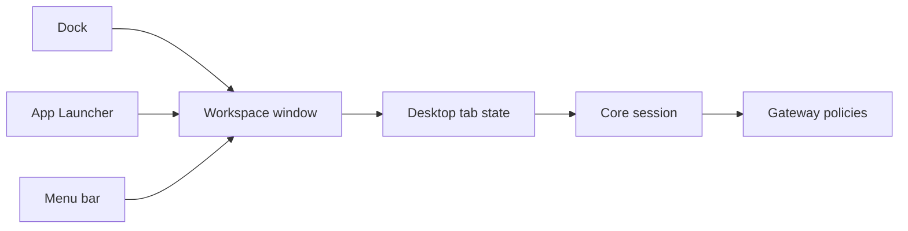

OS is a workspace view inside the Ryu desktop app. It has a dock for the surfaces you use
often, a window for each open surface, and an App Launcher to find and open Apps.

OS is a view, not a second runtime. It uses the same Core sessions, Gateway policies,
permissions, and tab state as [Agent](/docs/surfaces/desktop/agent).

<Callout type="warn">
  OS is rolling out gradually. Until it is turned on for your account, the interface switcher
  offers only Bot and Agent. See [Availability](#availability).
</Callout>

## Home customization

Home shows a short welcome that fades after five seconds and leaves your wallpaper, clock, and
date. Home is hidden while app windows are open. It comes back when all windows are closed or
minimized. The welcome does not repeat each time you minimize a window.

Open **View → Customize desktop** or use the customization button in the menu bar
to toggle the welcome text, clock, date, seconds, and 24-hour time. Changes apply
immediately and are saved on this device.

### Clock and time zone

The clock follows your display time zone from **Settings → Appearance → Date & time**. The selected
zone also sets:

- timestamp dates, and
- the sidebar's Today and Yesterday groups, which refresh at the zone's midnight, including on
  daylight saving days.

Open windows follow changes to the saved zone, and clearing the preference in another window
restores **System**. With **System** selected, the clock follows a changed device time zone once
the window detects it, for example when the window regains focus. Calendar-only dates keep their
original day and follow the selected display language.

If the device refuses to save the zone, the choice still applies in the current window. A reload
restores the last saved choice. Select the zone again once storage is available.

## Workspace model

### Dock

The dock starts with these first-party surfaces:

- App Launcher
- Mission Control
- Chat
- Spaces
- Tools
- Skills
- Apps
- Review

Each dock icon uses the same manifest-backed icon as the Store and the desktop sidebar: the
package's artwork, glyph, raster art, dither or background, and logo inset. A shell surface with no
manifest plate gets a seeded plate behind its glyph. A declared manifest presentation always wins.

Selecting an App opens its Ryu route as a window in the workspace. If that surface is already open,
Ryu brings its window forward instead of starting the work again.

Dock icons grow under the pointer. Each item has a square hit area and stays centered as it grows.
You can also focus dock items with the keyboard.

### OS menu bar

The OS menu bar groups workspace actions into **OS**, **Window**, and **View** menus. The bar
is transparent over the wallpaper. The **Window** menu lists open windows and includes App
Launcher. The **View** menu has the wallpaper set choices and the shuffle action.

Controls at the right edge of the menu bar sit on a blur and a soft tint so they stay readable over
the wallpaper:

- **Account avatar** - opens profile and settings options. Your availability shows at the avatar's
  bottom-right; choose **Availability** in the account menu to change your status.
- **Notifications** - one tray for the Inbox and announcements in OS, even when Agent's sidebar
  uses a split layout.
- **Downloads** - active installs and available updates.

### Live windows

Each open surface uses the desktop workspace's tab state. The window header has minimize,
maximize or restore, and close controls on the right. Minimizing keeps the window in the App
Launcher. Closing a window closes its tab. Switching to another window keeps the session running,
so work continues without a restart.

### App Launcher

The App Launcher is a searchable grid, not a content window. It lists Ryu OS's built-in surfaces and
every enabled App that has an openable Companion UI.

Select the **App Launcher** icon in the dock, choose it from the **OS** or **Window** menu, or
press `Cmd/Ctrl-K`. In OS the App Launcher takes the place of the command palette, so the same
shortcut opens it and pressing it again closes it. Changing or clearing **Toggle Command Palette**
in **Settings → Keyboard Shortcuts** changes the launcher's shortcut too, and the menu hints follow
it.

The launcher covers the workspace with a frosted view of your wallpaper. Open windows are spread
across the top as live workspace tiles. Below them are a search field, category tabs, and a grid of
App icons. An App tile shows a small active marker when that App already has a live workspace
window.

- **Categories** group Apps: **Agents**, **Knowledge**, **Build**, and the category each installed
  App declares. Apps without a category appear under **Apps**. **All** shows everything.
- **Search** looks across every category at once and also matches open windows.
- Choosing an App opens it; choosing a window brings it forward. Click the empty background or press
  `Esc` to close the launcher.

**Mission Control** remains a separate App tile for the project-level view over many chats.

## Wallpaper

OS and the desktop's account and node chooser share one wallpaper. By default it is a random
image from Ryu's curated Unsplash gallery, which includes Golden Gate, landscapes, coast, city,
night, and gradient sets. A new image is picked each time the app starts.

Choose a wallpaper from **Settings → Appearance → Wallpaper**, **View → Customize desktop**, or the
**Wallpaper** button on the account chooser. The picker has five tabs:

- **Gallery** - pick a curated image, or choose a set to shuffle from on each launch.
- **Animated** - choose a live backdrop and tune its supported parameters.
  - Installed plugins can add data-only variants under **Marketplace**.
  - Marketplace includes all 258 CSS patterns and gradients from the pinned
    [PatternCraft catalog](https://github.com/megh-bari/pattern-craft/blob/1550af7903f50b4f19a1b44786f27ca01f3ef6ab/src/data/patterns.ts),
    plus Remocn's Mesh Gradient and Dynamic Grid. Search by name or filter by category.
  - Each preset uses a host-owned CSS or shader adapter and keeps its source credit visible.
- **Unsplash** - search photos and keep scrolling to load more. Search runs through your node. If
  the node has no Unsplash access key, results come from Openverse instead. The photographer credit
  is shown with the wallpaper.
- **Upload** - drop in your own image. It is resized and kept on this device.
- **Link** - paste any `https://` image address. If this device refuses to save it,
  the current wallpaper and your pasted address stay available so you can retry.

**View → Wallpaper sets** and **Shuffle wallpaper** still work from the menu bar. Shuffling picks a
new image for this session without replacing a saved gallery choice.

The workspace keeps a dark readability gradient over the image, and a solid color underneath keeps
the surface usable when the image host is unavailable.

Wallpaper is presentation only. It is saved on this device, not per account, and it does not send
workspace content to the image host.

The desktop Store's **Wallpapers** tab lists every wallpaper the host can render. Install one to
keep it in **Library → Wallpapers**, or apply it directly from the Store. The Library can apply an
installed wallpaper again or remove it from this device.

## Account and node chooser

When the desktop app asks you to pick an account or node at launch, it shows a login-style screen
over your wallpaper: the date and a large clock at the top, and your accounts as round tiles near the
bottom. Use the arrow keys to move between accounts or nodes, `Return` to continue, and `Esc` to go
back from the node step. **Add account** and **Use as default** are on the same screen.

## Product boundaries

OS is for arranging and switching between work. Use [Bot](/docs/surfaces/desktop/bot) when
you want managed AI without configuration, or [Agent](/docs/surfaces/desktop/agent) when you need
to operate nodes, models, tools, permissions, and Apps.

[Ryu Gateway](/docs/gateway) remains the control point for governed model, tool, and Skill calls.
[Ryu Box](/docs/core/boxes) provides an isolated execution workspace. [Ryu Hire](/docs/standalone/hire) is
a planned service for running a specialist once without installing it. It is in early access and
not yet available.

## Availability

OS is a desktop workspace feature. Other clients may expose the same Apps or sessions, but
they do not inherit the desktop dock or window chrome unless their host supports those controls.

Until OS is turned on for your account, the interface switcher offers only Bot and Agent, and
**OS** is not listed under **Settings → General → Realm on startup**. If you used OS before, the
app opens in Bot instead (or in Agent, on a node where Bot is not available) until OS is available
to you.

<Cards>
  <DocCard href="/docs/surfaces/desktop" />
  <DocCard href="/docs/core/conversations-sessions" />
  <DocCard href="/docs/apps" />
  <DocCard href="/docs/gateway/tools" />
</Cards>
