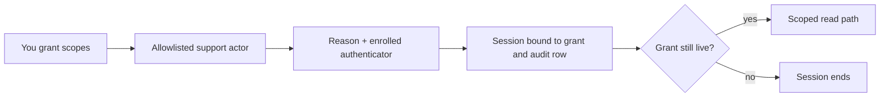

Support access is an exception you grant, not passive telemetry. It is off by default, you start it,
it is scoped and auto-expiring, and the actor is always recorded (delegation, not silent
impersonation). Cloud and local support access are separate grants. See
[Privacy and Telemetry](/docs/surfaces/desktop/transparency) for every other data stream.

## Control-plane support access

- **Default:** off. You grant it from your account settings.
- **How to disable:** it is off unless you grant it. Revoke it any time from your account settings
  or the active-session banner.

### What it covers

You choose from six diagnostic scopes: `billing`, `subscription`, `organization`, `sync-status`,
`channels`, and `marketplace`. The support session can use only the exact, reviewed read paths for
those scopes.

It never exposes prompts, messages, conversation or document content, provider credentials, API
keys, OAuth grants, or Core delegation.

### How a session is issued and ends

- Only an allowlisted support actor can start a session, through an audited handoff that requires a
  reason and an enrolled authenticator. The session records the support actor as the impersonator.
- The session ends at the earlier of your grant's expiry and a one-hour session ceiling. Using the
  session never extends that deadline.
- Every support session is bound to the exact live grant and its audit row. The binding is checked
  on every control-plane request, so expiry, revocation, an allowlist change, or a grant
  replacement takes effect immediately.
- Every session is recorded in an append-only log you can read (who, when, why, what scope). That
  log is never deleted when access ends.

### Active-session banner

The banner appears when a support session starts and clears when it ends, whether staff use Stop or
sign out, or you revoke access. If its live connection drops, for example while the service
restarts, it reconnects on its own and shows the current state as soon as it is back.

The banner counts only a session recorded in your audit log. A start interrupted before its record
was written, for example by a service restart, cannot be used and is not shown as active. Its
leftover session is deleted the next time your support status is read, once it is more than two
minutes old.

## Local Core support access

- **Default:** off. You grant it from the desktop, and it is enforced by your local Core.
- **How to disable:** it is off unless you grant it. It writes the `support-access-local-enabled`
  preference (default `false`) with a `support-access-local-expiry` instant. With access off the
  diagnostic endpoint refuses outright.

### What it covers

A narrow, read-only, allowlist diagnostic bundle:

- Core version and the active engine.
- Sidecar names and running state.
- The **names** of which preferences are set, never their values.
- Redacted trace spans (hashed args).

It never includes prompt or agent content and never touches credentials.

### Transport, expiry, and audit

- The bundle egresses only over the opt-in mesh (Tailscale) and through the Gateway firewall.
- Its expiry is checked on every request and swept at Core startup, which disables an expired grant.
- Each access writes to a local, append-only audit log with the actor stamped on every entry (the
  record is yours). The actor name is self-declared by the caller, not a verified identity.

### Active-access banner

The banner follows the selected node and refreshes its grant when you switch nodes or your
managed-node sign-in is refreshed. A pending request for a previously selected node does not change
the current node's banner.

**End now** disables access on that node. The banner closes after Core confirms the saved change. If
Core refuses the request or cannot confirm it, the banner stays visible with an error so you can
retry.

The banner uses Core's saved expiry. A missing, zero, or invalid expiry means **no expiry set**, so
enabled access stays visible until you end it. A valid expiry in the past hides the expired grant.

## When a grant fails to save

Local support access stays off if Ryu cannot finish saving a grant. Saving its deadline alone does
not enable access. Retry the grant to open the channel for a finite period, and use the switch or
**End now** to stop it.

## Manual diagnostics actions

On the system health screen, **Report issue** respects the crash-report preference. If reporting is
disabled or unavailable, Desktop explains why and offers copying diagnostics for manual sharing.

A queued report is labelled **Issue report queued**. This does not confirm delivery to the reporting
service. Manual reports exclude the recent console buffer.

**Copy diagnostics** and **Copy console** put the report on the local clipboard only. Desktop
confirms success only after the clipboard accepts it, and shows the error if it does not. Copied
diagnostics can include recent console output, so review the bundle before you share it.

## Related

<Cards>
  <DocCard href="/docs/surfaces/desktop/transparency" />
</Cards>
