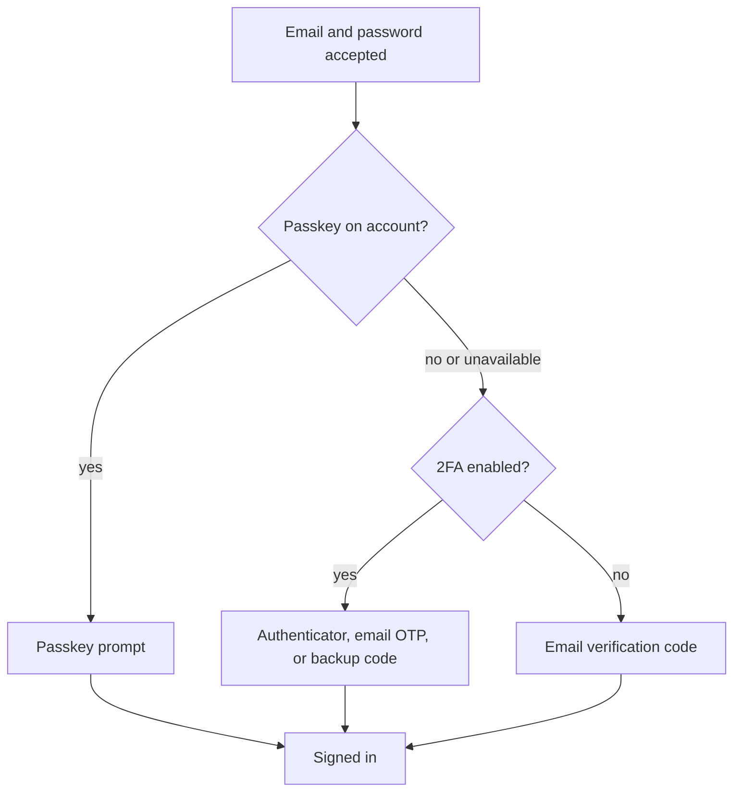

Use a **passkey** to sign in without a password. You can also protect your account with **two-factor
authentication (2FA)**. An authenticator app, such as Google Authenticator, 1Password, or Authy,
creates time-based one-time codes (TOTP). The same flow runs in the desktop app (**Settings →
Account → Enable 2FA**), the browser extension's Account settings, and the web app (**Settings →
Setup 2FA**).

## Using a passkey

Passkeys use the biometric unlock, PIN, or security key already protected by your device. They are
phishing-resistant and do not share a password with Ryu.

1. Sign in to the web app and open **Settings → Account → Passkeys → Manage passkeys**.
2. Optionally name the passkey, then choose **Add passkey** for the browser's device or password-manager
   choices. To register a hardware security key, choose **Add security key**, connect it by USB or
   use NFC when prompted, and follow the browser's instructions.
3. Approve the device prompt with Face ID, Touch ID, your device PIN, or a security key.
4. On your next web sign-in, choose **Use a passkey** or select the passkey from the browser's
   email-field autofill.

You can add multiple passkeys and hardware security keys to the same account, including a spare
key for recovery. Give each a recognizable name. Any registered credential can be used at sign-in;
hardware keys must support WebAuthn/FIDO2 and your browser's passwordless sign-in flow.

You can rename or remove individual credentials from the same **Manage passkeys** dialog without
affecting the others.

When Ryu requires a second factor, every account must keep an authenticator app or at least one
passkey. Removing your last passkey is refused until 2FA is enabled or another passkey is added.
Until an account has one, approving a desktop sign-in on the website first takes you to
**Setup 2FA**. See
[Required second factor](/docs/security/authentication-account#required-second-factor).

A workspace's own **Require MFA** policy counts only an authenticator app. If your workspace turns
it on, a passkey alone does not satisfy it; set up an authenticator app as well.

## Sign-in factor order

After an email-and-password sign-in, Ryu checks account factors in this order:

1. **Passkey** - if the account has one, Ryu asks for it before 2FA.
2. **2FA** - if a passkey is unavailable and 2FA is enabled, use the authenticator app, email OTP,
   or a backup code.
3. **Email verification code** - the recovery path when no passkey or 2FA is available.

Choose **Remember this device for 30 days** on the sign-in form to suppress these follow-up
challenges on that browser after the first successful verification. The device is not trusted until
the passkey, 2FA, or email code succeeds; the option does not bypass the first challenge.

## Enabling 2FA

1. Enter your password. In the web settings view, use the show/hide control to check password
   entries before submitting them.
2. Scan the QR code with your authenticator app. If it is too small to scan comfortably, select the
   expand button beside it to open a larger preview.
   If scanning is unavailable, open the manual setup key and copy it into the authenticator app.
3. Enter the 6-digit code from the app to verify the authenticator is set up.
4. You are shown a list of **backup codes**.
5. **Confirm you saved them** by typing one back. The flow does not finish until you do.

Copying the setup key or backup codes uses your local clipboard. The dialog confirms a successful
copy and shows an error when the clipboard is unavailable.

The backup codes shown are the ones issued when you started setup in step 1. If you go back and
continue again, a fresh set replaces them.

In the desktop app and the browser extension, turning 2FA on or off renews your sign-in in place, so
the app stays signed in to the same account afterwards. **Enable 2FA** and **Manage 2FA** each open
the view that matches the 2FA state shown on the row at that moment.

## The save-confirmation step

Backup codes are shown only once. Step 5 asks you to type one of them back (case- and
hyphen-insensitive). A wrong or missing entry bounces you back to the codes with a warning that they
will not be shown again, so you can copy them down before the flow completes.

<Callout type="warn">
  Without backup codes, a lost authenticator app locks you out of your account.
</Callout>

## Managing 2FA

Once enabled, the dialog offers:

- **Regenerate backup codes** - issues a fresh set (the old set stops working) and runs the same
  save-confirmation step before applying.
- **Disable 2FA** - turns two-factor authentication off for the account.

Enabling or disabling 2FA takes effect across surfaces: the same account works on the desktop, the
web app, and the terminal client (`ryu-cli whoami` reports the 2FA status).

## 2FA confirmations for billing

When 2FA is enabled, Ryu asks for the current 6-digit code from your authenticator app before a
card-funded action can continue:

- credit top-ups and automatic recharge changes;
- plan changes and seat changes;
- payment-method or cancellation portal handoffs;
- managed cloud-node purchases or resizes;
- paid Marketplace purchases.

The confirmation appears in a blocking dialog. It has no close button and cannot be dismissed with
Escape or a click outside the dialog; enter the current authenticator code to continue.

Ryu checks the same requirement on the control-plane request, so a different client cannot skip the
confirmation. An account without 2FA must enable it before these billing actions can continue.

## Confirming account changes

Ryu asks you to confirm your identity before changing the account email address or setting a
password. The confirmation uses the methods available on your account:

1. **Authenticator code** when 2FA is enabled.
2. **Backup code** when you need to recover access to an enrolled 2FA account.
3. **Current password** when the account has a password and 2FA is not enabled.
4. **Email verification link** for passwordless accounts without 2FA.

The email-link option opens a verification page in the same browser session. Keep the Settings
dialog open while you open the link. Once the link is accepted, return to Settings and the change
continues.

The server checks this confirmation for every client, so a direct API request cannot bypass it. If
the confirmation expires before a request reaches the server, Ryu asks you to confirm again before
retrying the change.

### Changing the account email

Changing the account email also requires confirmation from both the current and new email
addresses. The new address is not applied until both links are accepted.

- If you open the new-address link first, its page shows that the current address still needs to
  be confirmed and returns you to Settings.
- The current-address link confirms that step.
- Once both links are accepted, the page shows the completed change. **Continue with new email**
  opens sign-in with the updated address.

Account Settings shows which address still needs confirmation. If that status cannot load, select
**Retry** to check again without changing the request.

## Confirming sensitive workspace actions

Some organization actions also ask you to confirm with a code first, because they move money or
create access that outlives your current sign-in:

- **Billing actions** such as checkouts, plan changes, top-ups, credit transfers and payout setup.
  These accept only an authenticator code, so you need 2FA enabled to perform them. See
  [2FA confirmations for billing](#2fa-confirmations-for-billing).
- **Long-lived credentials**: creating a personal access token, issuing or revoking organization
  gateway keys and organization API keys, revoking a managed node (which also revokes its gateway
  credentials), storing integration secrets, and creating or revoking SCIM tokens.
- **Sign-in configuration**: adding, editing, verifying or removing an SSO provider.
- **Workspace membership**: changing a member's role, removing a member, canceling a pending
  invitation, and inviting (or re-sending an invitation to) someone as an owner, admin or billing
  manager. Inviting a member or viewer does not ask for a code.

A confirmation covers the action you are taking for a few minutes; after that Ryu asks again. The
server enforces these checks for every client, so calling the API directly does not skip them.

## Sessions and password changes

Open **Settings → Sessions** to review the account's active sessions. You can revoke an individual
session or revoke all other sessions. Both ask you to confirm before anyone is signed out, and you
cannot revoke the session you are using from this list.

Revoking a session, or letting it expire, also ends the live connections it opened: sync updates,
sign-in approval prompts, and webhook relay streams. Each connection checks its session again before
it sends anything new, so a revoked device receives nothing further, even over a connection that was
already open. A device that is still signed in reconnects on its own.

Changing the account password also revokes every other active session after the password is stored.
The current session remains available so you can continue the security flow. Browsers, desktop
clients, extensions, and other devices must sign in again.

This is separate from removing a paired Core node, which controls access to that one node.

If your email address is not verified yet, **Settings → Account** shows a banner with **Resend**.
Sending the verification email starts a 60-second cooldown before you can send another; if the
server refuses the request, the banner reports the failure and **Resend** stays available.

On the website, a passwordless account sees **Set password** in **Settings → Account**. After the
password is saved, the control updates to **Change password** without requiring a page reload.
Closing the dialog before saving clears both password fields; a failed save keeps the dialog open so
you can retry without re-entering the draft.

## Linked accounts

Open **Settings → Connections → Linked accounts** to link a Google, GitHub, or Discord identity to
your Ryu account. The provider account must use the same email address as the Ryu account. The link
is an account-level sign-in binding, not an organization or channel connection.

Ryu opens the provider's authorization page in your browser and keeps desktop Settings available
while you complete the flow. If linking fails, the account stays unchanged and you can retry.
Unlinking asks for confirmation. A permission error keeps the linked account available until a retry
succeeds.

The login page offers Google as its only social sign-in option. Telegram is not a linked account,
because Ryu's Telegram flow belongs to organization and channel setup.

## Google One Tap

On the Ryu website, Google One Tap can offer a signed-in Google account on both the sign-in and
sign-up views. It uses the same Google account-linking and account-provisioning rules as the normal
**Continue with Google** button. If One Tap is unavailable, dismissed, or not configured for the
site, the normal sign-in buttons remain available.

One Tap is a website convenience. Desktop, mobile, CLI, and the browser extension use an explicit
browser authorization flow instead, so installing a client never silently grants it an account.

## Choosing an account at startup

When more than one account is signed in to the desktop app, Ryu can open with a startup chooser.
Select the account first, then select the node (device or cloud workspace) to connect to. You can
mark either choice as the startup default so the corresponding step is skipped next time.

- Startup defaults are saved after the node selection succeeds. If Ryu cannot save the node, the
  chooser keeps the previous defaults, shows the error, and lets you retry **Open Ryu**.
- **Back** preserves the current account, node, and default-switch choices while you review them.
- Choices are temporarily locked while Ryu saves them or adds an account.

Change this behavior any time in **Settings → General → On startup**:

- **Always ask** shows the account and node chooser on every launch.
- **Use defaults** skips steps with a saved default and asks when a default is missing.
- **Never show** keeps the current account and node without opening the chooser.

Choosing **Ask at startup** for either default restores that step. Adding another account still uses
the existing browser sign-in flow, and signed-in accounts remain available from the desktop account
menu. Signing out an individual account from that menu asks for confirmation first.

Your profile, stats, and the list of emails Ryu sent you are in [Profile and Stats](/docs/surfaces/desktop/user-guide/profile-and-stats).

Continue with [Desktop user guide](/docs/surfaces/desktop/user-guide), [account authentication](/docs/security/authentication-account), [Passport](/docs/standalone/passport), [Gateway governance](/docs/gateway/governance), and [privacy](/docs/legal/privacy).
