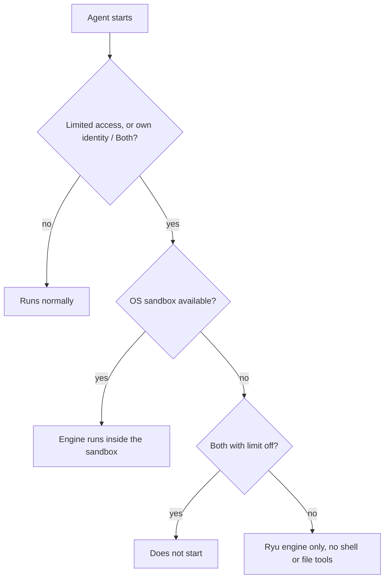

An OS sandbox hides your credentials and Ryu's own data from agents whose
[account access](/docs/surfaces/desktop/user-guide/agent-account-access) is limited. It runs in
every folder, trusted or not.

## Which agents run sandboxed

- Every agent with limited account access.
- Every agent set to **Its own identity** or **Both**, even with **Limit to selected accounts** off,
  because it holds accounts of its own.

The sandbox is available on macOS and on Linux with unprivileged user namespaces.

## What the sandbox hides

The sandbox hides these from the agent's engine and everything it runs:

- Ryu's own keys, tokens and databases, including every agent's account access, so the agent can't
  change its own.
- Ryu's app data and logs, the Ryu app's stored data, and the Ryu Browser's profile with its site
  sign-ins.
- The credential stores in your home folder that it hides in an untrusted folder: SSH keys, cloud
  sign-ins, GitHub CLI and Git credentials, package registry tokens, password stores and keyrings,
  and your web browsers' profiles.

When the agent's model providers are limited as well (it has a selection, or it has only its own
identity), the sandbox also hides your saved provider keys and sign-ins:

- Ryu's engine configuration, the Gateway's provider configuration, and Ryu's Codex homes.
- The Codex, Claude Code, Pi, Gemini CLI, Kiro (including its AWS sign-in cache), OpenClaw and
  Hermes sign-ins in your home folder.

## Exceptions and limits

- The sign-in of the engine the agent runs on stays readable, because hiding it would sign the agent
  out. For Kiro that is only its own token in the AWS sign-in cache; your other AWS sign-ins there
  stay hidden.
- A working folder inside one of these stores isn't made readable.
- Every limited agent's own Ryu engine settings are hidden from the other agents. Ryu rewrites them
  each time the agent's engine starts, so nothing the agent wrote there carries over apart from the
  engine's saved sessions and log.
- The sandbox doesn't cut the network unless the folder is also untrusted.

## Without the sandbox

Where the sandbox isn't available (Windows, or Linux without unprivileged user namespaces):

- Ryu's own engine runs a limited agent with its shell and file tools turned off.
- Other engines don't start for it.
- A **Both** agent with **Limit to selected accounts** off doesn't start on any engine, Ryu's
  included. Set it to **Acts as you**, or turn on **Limit to selected accounts**.

## Plugin command tools

Plugin command tools run for a limited agent refuse a path inside, or a folder that contains:

- Ryu's data, or the Ryu Desktop's or Ryu Browser's data;
- your home folder's credential stores, such as `~/.ssh`, `~/.aws`, `~/.config/gcloud`, `~/.kube`,
  `~/.docker`, `~/.netrc`, `~/.git-credentials` and your web browser profiles;
- one of your provider sign-in stores, when its model providers are limited.

Ryu follows symlinks first, so a store linked from elsewhere is refused where it really lives. Other
paths in a workspace inside your home folder still work.

## The macOS Keychain

On macOS the sandbox also denies the agent your Keychain. Its engine and the programs it runs inside
the sandbox can't reach the Keychain service or read the Keychain files in `~/Library/Keychains`, so
the `security` command and apps' Keychain calls find nothing there. Plugin command tools run for the
agent refuse a path in that folder too.

A program the agent asks macOS to start for it (with `launchctl` or `open`, for example) runs outside
the sandbox and isn't covered, the same as for the hidden files above.

Claude Code is the exception. On macOS it keeps its own sign-in in the Keychain, and the sandbox
can't allow one item without the rest, so an agent on Claude Code keeps the whole Keychain. macOS
may still ask you before a program other than the one that saved an item reads it.

Codex, Gemini CLI, Kiro and Ryu's engine normally sign in from files and lose the Keychain. One set
to keep its sign-in in the Keychain can't sign in for a limited agent.

<Callout type="warn">
  On Linux the system keyring service (Secret Service) and other system credential stores aren't
  covered. On any system the sandbox doesn't hide other files your user can read.
</Callout>

## Checks during setup

Ryu checks these rules while you set the agent up, not only when it starts. When the agent's engine
won't start with its identity and account access, the new-agent dialog, the editor's **Identity**
section and the **Account access** panel show why, with the message the agent's first chat would
show.

- The new-agent dialog and a custom agent's **Identity** section offer to switch it to the **Ryu**
  engine.
- The new-agent dialog doesn't create the agent until its engine would start.
- Where the sandbox isn't available, they also say that an agent with its own identity or limited
  accounts can run only on Ryu there, without shell or file tools.

The Codex and custom-agent Gateway routing settings shown for a limited agent note that they decide
whether its engine may start. Claude Code's routing setting doesn't, because Claude Code needs
**Anthropic** selected either way.

Under **Model providers**, the row for Codex's ChatGPT sign-in appears only while Codex uses that
sign-in, which is while Codex's own Gateway routing is on. With it off, Codex sends its model calls
through the Gateway and needs no row.

## Related

<Cards>
  <DocCard href="/docs/surfaces/desktop/user-guide/agents" />
  <DocCard href="/docs/surfaces/desktop/user-guide/tools-and-connections" />
  <DocCard href="/docs/surfaces/desktop/user-guide/agent-account-access" />
</Cards>
