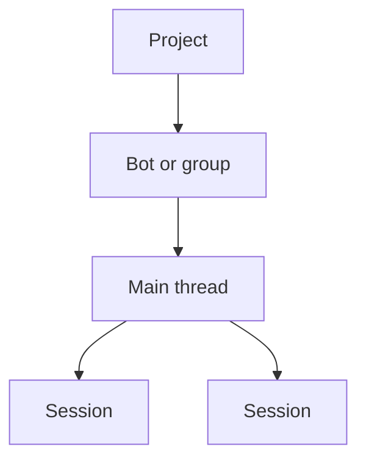

Most appearance choices are in **Settings → Appearance**. They apply at once on this device.

## Theme mode

Choose **Light**, **Dark**, or **System** from the account menu's **Theme** submenu. The page context menu offers the same choices under **Appearance**. The sun-to-crescent icon follows the active mode and respects the system reduced-motion setting.

In **Settings → Appearance → Color theme**, **Save as preset** keeps your draft open and shows an error if saving fails. Retry **Save** when storage is available. The saved selection changes only after the preset and its selection are both saved.

## Layout, text, and motion

In **Settings → Appearance → Layout & text**, **Chat width** sets the width of
chat content and the composer. The transcript keeps its side padding outside
that width, and narrow windows fit the available space. **Scale (UI zoom)**
resizes the whole interface, including text; **Zoom (spacing)** adjusts spacing.
Font, roundness, and card-padding choices also apply after restarting the app.

In **Motion**, **Animate streaming chat text** fades new assistant words in
while a reply arrives. Turning it off keeps streaming text static. Completed
replies stay static, and **Enable animations** and the system's reduced-motion
preference override the streaming animation choice.

## Date and time

In **Settings → Appearance → Date & time**, choose a display time zone. The picker shows current UTC offsets for each zone. Its labels refresh on the next render in a new minute, including after a daylight-saving change. This changes timestamp display, without rescheduling events.

### Chats, runs, and the sidebar

Chat date separators follow the calendar date in your display time zone.

- Messages from the same calendar date stay under the same date separator when daylight saving changes.
- In an open chat, the “Today” separator becomes “Yesterday” at that time zone's midnight, or when you return to a window that was in the background at midnight.
- An agent's activity feed groups its runs by calendar date in the same time zone, shows each run's time in that zone, and moves runs from “Today” to “Yesterday” at its midnight.
- Sidebar “Yesterday” and older date groups also use calendar-day boundaries in that time zone, including after daylight-saving changes.
- In an agent's **Run history** view (Activity tab), the 24-hour routine overview's “Window ending” time is shown in the same time zone and changes with it; the overview appears when the agent has routines.

### Calendars and date pickers

The Calendar tab on an agent's profile (Month, Week, Day, and Agenda) follows the same time zone. Runs are filed by calendar date in it, run times and the current-time line read that zone's clock, and **Today** is that zone's date.

<Callout type="info">
  The Calendar app's own page does not follow the display time zone yet. It still files runs under your computer's dates and marks your computer's today.
</Callout>

Date pickers, such as a date cell in a data grid or a date in a document, highlight today in your display time zone and move the highlight at that time zone's midnight. An empty date cell in a data grid opens on that time zone's current month.

When a suggested edit in a document adds or removes a date, its suggestion card reads “Today”, “Yesterday” or “Tomorrow” relative to the current date in your display time zone, and updates at that time zone's midnight. Other dates show the calendar day that was written, in your display language.

### Usage date range

The date range on **Settings → Usage** counts calendar days in your display time zone.

- Its presets (**24 hours**, **7 days**, **30 days**, **90 days** and **12 months**) are whole days ending with today's date there, so **24 hours** is today's date rather than a rolling day.
- The range opens on the last 30 days, and the calendar offers no date after today there.
- A picked range starts at that time zone's midnight, and the range label names its first and last day in that zone.
- The charts' day columns are still grouped by UTC day and labelled in your computer's time zone.

## Interface vocabulary

Open **Settings → Appearance → Interface → Use Bot terminology** to replace visible
Agent, agent, Agents, and agents labels with Bot, bot, Bots, and bots. The setting is
enabled by default, preserves normal capitalization, and leaves technical identifiers
and user-authored chat text unchanged. **Ryu Work** interface mode always turns it
on; switch to **Code** before turning it off.

### The Agents view sidebar

Ryu Work also starts in the built-in **Agents view** sidebar, organized as
**Projects › Bots and Groups › Sessions**. Bots appear in the roster with their direct
threads.

Below them, **Projects & chats** shows two default sections, **Projects** (each project's main
thread) and **Chats** (group chats and other conversations), plus any sections you create. Every
row uses the same layout: a large avatar, the name and time of the latest activity, and a one-line
preview.

- Select **New section** to add your own section, then drag projects and chats into it. Sections
  can be renamed, reordered, collapsed, and deleted; deleting one moves its rows back to their
  default section. Your sections follow your account across devices.
- Nest your own sections like folders: drag a section's header onto the middle of another
  section's header to move it inside, or onto the top or bottom edge to place it beside that
  section. You can also choose **Move section to** from a section's **…** menu. A collapsed section
  opens when you move a section into it, so the moved section stays in view. Deleting a section
  keeps its sub-sections and moves them up one level. **Projects** and **Chats** always stay at the
  top level.
- Select **+** on the **Projects** section to create a project.
- Sessions, the per-activity threads a main thread delegates, are not listed in the sidebar.
  Open them from the session cards in the main thread, or from **Sessions** above it. A row shows
  a spinner while any of its sessions is running.

### The thread bar and inherited defaults

Above a thread that belongs to a project or delegates work, a bar shows:

- where it sits (**Project › Bot › Session**, each part clickable);
- **Sessions**;
- **Defaults**, which shows the model the thread uses and where that value is inherited from.

**Defaults** sets a coordinator model and effort for main threads and a thread model and effort for
sessions, for the project, the bot, or the bot inside the project. The node-wide versions of the
same four settings are in the **Models** card under **Gateway → Default agent & model**. On a group's main thread, the bar also
sets the group's coordination strategy.

The view is built into Desktop. No separate app or plugin is required. Code users can choose
another sidebar arrangement from the same Appearance controls or the sidebar context menu. In the
Code interface, each main thread's sessions can also be expanded directly in the sidebar.

## Window appearance

On macOS, the native window buttons stay aligned with Ryu's title bar after resizing.
**Settings → Appearance → Roundness** controls the window corners and its translucent
backdrop together. Maximized and fullscreen windows use square edges; restoring the
window restores your chosen roundness.

## Background customization

You can give the sidebar and the page area custom backgrounds from **Settings → Appearance**. Each surface takes an independent background built from up to three layers composited top to bottom: an overlay tint, a custom image, and a linear gradient.

- **Gradient** - two hex colors and an angle.
- **Image** - any picked image, with fit options (cover, contain, stretch, center, tile) and a scale.
- **Overlay** - a tint layered over the image for legibility.

Each surface's Gradient and Image switches and image-fit selector have distinct accessible names, so
assistive technology can tell whether the control changes the Sidebar or the Page background.

Desktop also has two independent glass controls in **Settings → Appearance → Interface**:

- **Transparent sidebar** lets the sidebar reveal the native window backdrop while the page stays opaque.
- **Transparent window** lets the main app canvas reveal the native window backdrop while the sidebar keeps its own choice.

Both controls are off by default, apply immediately, and are included in Appearance reset and settings sync. On macOS, Ryu uses the system's semantic sidebar vibrancy under the webview. Other desktop platforms use their available compositor and CSS backdrop support.

<Callout type="info">
  Backgrounds are off by default. The Calendar and Timeline pages draw their own surface, so they occlude a page background image.
</Callout>

## The Island companion

Ryu is building a separate **Island** companion: a small floating window that stays above your
other windows on Windows and macOS. It is not available in the current desktop release. See
[Island](/docs/surfaces/island) for what it does and how consent works.
