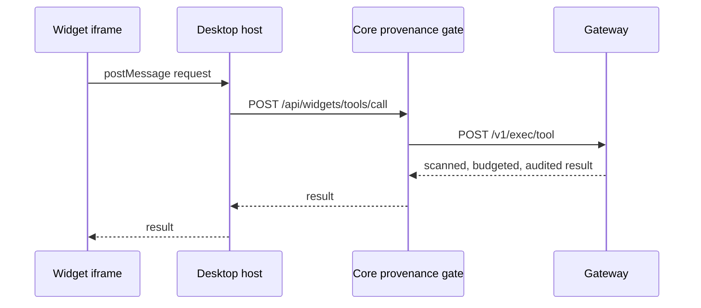

A Ryu App is a small interactive widget that appears inside a chat reply, such as a checklist or a
table you can use. Ryu Apps follow the OpenAI Apps SDK format, a standard for interactive
widgets, so compatible widgets can run in Ryu.

<TryInRyu page="chat" />

<Callout type="warn">
  The end-to-end path (a running node whose model calls a widget-bearing tool, rendered in the live
  desktop) is not yet fully live-verified. Treat this as an early surface.
</Callout>

Widgets come from plugins whose MCP tools declare a widget template. To build one, start from
[Author a Ryu App](/docs/extend/develop/extensions/ryu-apps).

## How a tool result becomes a widget

A tool can carry a widget binding in its MCP metadata (an `outputTemplate` pointing at a
`ui://widget/<slug>.html` resource). When such a tool runs, Core serves that HTML as an MCP
resource and the desktop renders it inline:

<Steps>
<Step>The agent calls a widget-bearing tool during a turn.</Step>
<Step>Core emits the widget as a stream part, and the desktop renders it as a standalone block in
the message list, not attached to a tool row.</Step>
<Step>The widget loads inside a null-origin sandboxed iframe. It talks to the host over a
`postMessage` port through a `window.ryu` bridge (aliased as `window.openai` for
Apps-SDK compatibility).</Step>
</Steps>

The iframe has no privileges. It never holds your Core token and never calls Core directly.
When a widget wants to do something privileged, the host bridges the request to a small set of
Core routes:

| Widget action | Host route |
|---|---|
| Call a tool | `POST /api/widgets/tools/call` |
| Inject a follow-up user turn | `POST /api/widgets/follow-up` |
| Persist widget state | `POST /api/widgets/state` (keyed by tool-call id, best-effort) |

## Provenance and Gateway gating

Because the iframe is untrusted, every privileged call is governed server-side. A widget tool call
takes this path:

1. The widget asks the host over its `postMessage` port.
2. The host, which holds the node token, calls Core's provenance gate.
3. Core sends the call to the Gateway's `POST /v1/exec/tool`, where it is scanned, budget-checked,
   forwarded, and audited like any other tool execution.

The `serverId` and `instanceId` are pinned by the host, never supplied by the frame, so a widget
cannot spoof which tool it is allowed to call. For how that execution path works, see
[Tools](/docs/surfaces/desktop/user-guide/tools-and-connections).

## Which agents can emit widgets

A widget only appears if the agent that serves the turn can route its tool calls through Core's
governed tool loop. That covers the bundled local engine (Gemma), OpenAI-compatible
registry agents, and bridged ACP agents (Claude Code, Codex, Gemini, or a BYO agent) when Gateway
routing is on for them.

<Callout type="warn">
  The flagship `ryu` agent runs on the Pi engine. It reaches Core's MCP tools, including
  widget-bearing ones, through a Ryu-managed Pi extension instead of Core's in-process tool bridge.
  Inline widget rendering from that path is not live-verified. The local Gemma engine does emit
  widgets.
</Callout>

## Next steps

<Cards>
  <DocCard href="/docs/surfaces/desktop/user-guide/chat" />
  <DocCard href="/docs/surfaces/desktop/user-guide/tools-and-connections" />
  <DocCard href="/docs/extend/develop/extensions/ryu-apps" />
</Cards>
