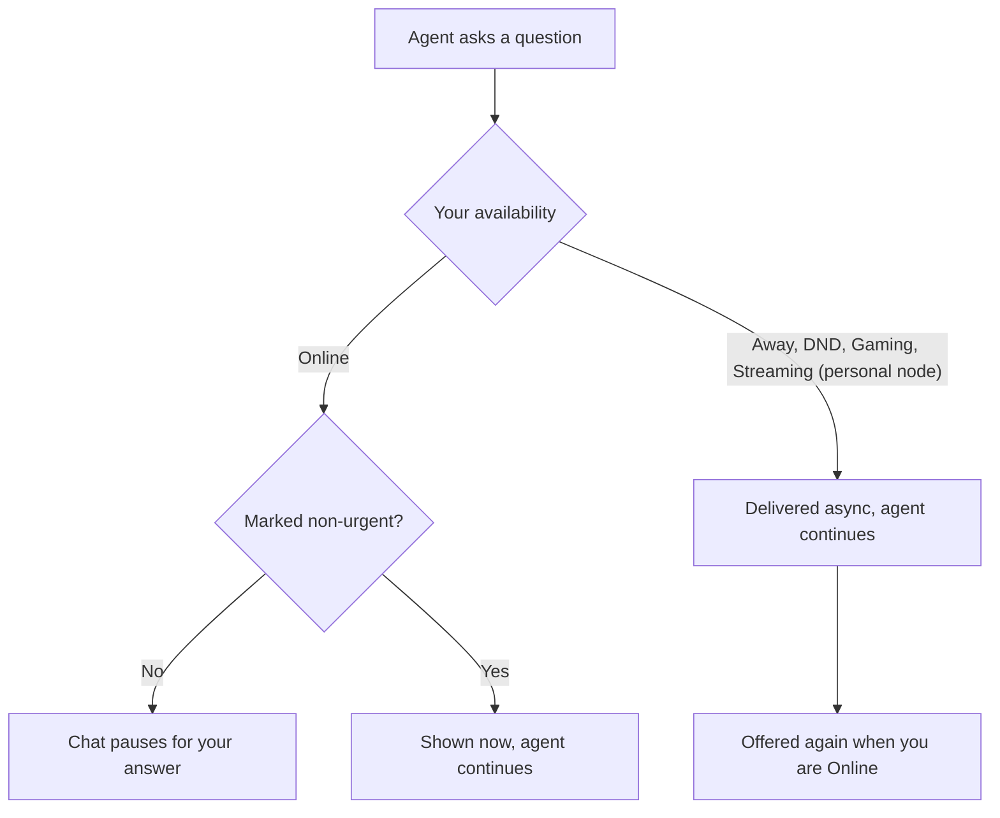

Your availability decides when agents may interrupt you with a question or a prompt. Other
sidebar controls are in [Sidebar and Chat Controls](/docs/surfaces/desktop/user-guide/chat-sidebar-controls).

## Availability and prompt interruptions

Use the account menu's **Availability** control to tell Ryu whether it may interrupt you for a
decision.

- **Online** surfaces pending questions and approval prompts in the composer as soon as they are
  ready.
- **Away**, **Do not disturb**, **Gaming**, and **Streaming** keep agents working. A question an
  agent asks while you are unavailable is delivered asynchronously, so the chat keeps going instead
  of pausing until you reply.

The question stays in the transcript, and the composer offers it again once you switch back to
Online. Your answer is sent to the agent as a new message.

### Automatic Away

Ryu can set you **Away** automatically when its window loses focus or stays idle. Configure the
timeout, or turn this behavior off, in **Settings → General → Chats → Availability & prompts**.

- Manual Away and Do not disturb always override AFK detection.
- Detection is local to this Desktop window and does not record your activity or expose an idle
  timestamp.
- If the Desktop stops checking in with its node (for example, the app is closed), the node treats
  you as Away so agents are not left waiting.

### Non-urgent questions

Agents that ask through Ryu's question tool can also mark a question as non-urgent while you are
Online. Ryu shows the question right away but does not pause the agent.

The agent continues with the rest of the task, states any assumption it made, and picks up your
answer whenever you send it. Questions the agent cannot continue without still pause the chat until
you answer, or until you step away.

### Gaming mode

Choose **Gaming** to keep agents working quietly while you play, and to free the memory local models
use. While Gaming is on, Ryu unloads local models (chat engines, embeddings, speech, and image
models) so the game gets the RAM and VRAM back. They load again when Gaming ends.

#### Detect games automatically

Turn on **Detect games** in **Settings → General → Chats → Availability & prompts** to switch to
Gaming automatically while a game runs. Ryu recognizes games installed through common launchers
(Steam, Epic Games, GOG, Xbox, Riot, EA, Ubisoft) and many popular titles.

- Add anything it misses under **Extra games** by executable name.
- List apps it mistakes for games (for example, tools installed through Steam) under **Not games**.
- Turn off **Free memory for games** to keep models loaded while Gaming is on.

Detection reads process names belonging to the OS user running Core only and sends nothing off your
machine. Do not disturb always takes priority over Gaming.

#### How these settings save

Gaming and Streaming settings apply to the selected node.

- Process-name lists save when you leave the field. Separate names with commas, and clear the field
  to remove the custom list.
- Controls pause while a change saves. If saving fails, the previous value returns so you can try
  again.
- Selecting another node or signing in with different node credentials loads that node's settings.
  A change still finishing for the previous node cannot replace them.

### Streaming mode

Choose **Streaming** from the Availability menu to keep agent questions out of the composer and
protect connected-app suggestions while you share your screen.

In **Settings → General → Chats → Availability & prompts**, **Detect streaming apps** switches the
status on while a listed app is running. You can edit the process-name list there. Ryu checks
process names on the node; it cannot confirm that a broadcast is live.

#### What Streaming hides

- Core does not send new Connect event contents to a model.
- Island shows generic private-activity alerts for connected-app events, including suggestions
  already in the inbox, without the app name, event title, message, or other payload details.
- The full Inbox also hides connected-app summaries that it loaded before Streaming was enabled.
  Open and archived rows switch to the private-activity message as the status changes, without
  waiting for a refresh or reopening the Inbox.

Ordinary workflow notifications remain visible, and explicit workflows continue their configured
actions. Do not disturb may remain the displayed status, but automatic streaming detection still
keeps these suggestions generic.

<Callout type="info">
  Async-question routing and automatic app detection apply to your personal node. On a node shared
  with an organization, questions keep blocking as before and process-based gaming and streaming
  detection stay off. Choosing Streaming manually still enables the node-wide Connect suggestion
  privacy guard without changing question routing.
</Callout>

## Related

<Cards>
  <DocCard href="/docs/surfaces/desktop/user-guide/chat-sidebar-controls" />
  <DocCard href="/docs/surfaces/desktop/user-guide/chat-session-controls" />
</Cards>
