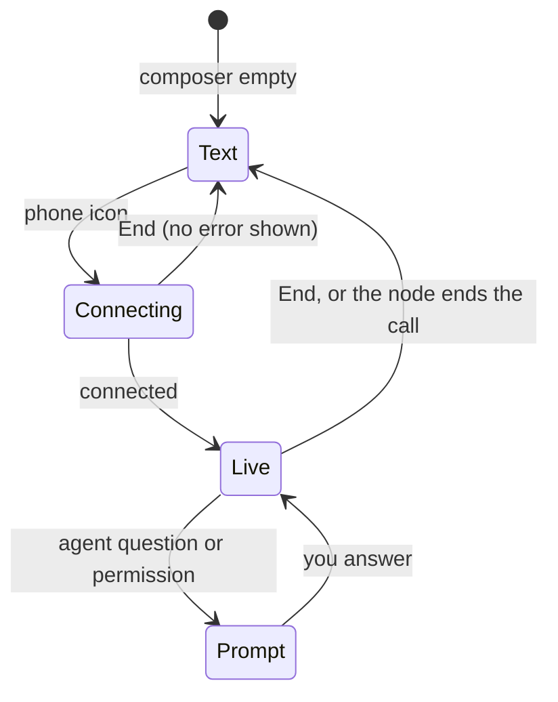

Part of the [Chat Features](/docs/surfaces/desktop/user-guide/chat) guide.

## Track model and provider changes

When your current agent advertises a model list, **Choose provider and model** includes a **Model**
section. You can select its models directly, even when no extra providers are configured.

The first saved turn records its provider and model in the conversation history. Each later change
adds a separator with the new selection. The latest choice belongs to the shared conversation, so
teammates see it update live and keep using it after reopening the thread. View-only collaborators
can read the markers but cannot change the selection. Temporary chats do not save model history.

If you change nodes while model choices are still being saved, those choices remain attached to
the original node and conversation. The new node loads its own model history. A refused save in
the current conversation shows an error; choose the model again to retry.

## Send attachments without text

Use the composer **+** menu and choose **Files and images** to stage context for a turn. You can
send the attachment on its own without typing a prompt; a staged file or image counts as composer
input and keeps the **Send** action available.

See [the primary composer button](/docs/surfaces/desktop/user-guide/chat-composer-and-media#the-primary-composer-button)
for when the voice-call action appears instead.

## Read attachments and rich replies

Newly saved user messages retain their attachment parts when you reopen the conversation. Ask Ryu
also retains the original displayed request separately from page context sent to the agent. Older
messages without this display information show the text that was saved.

### Files and images

Sent files keep their names and use the same colored file-type icons as the workspace file tree.
The **Sources** section in the pinned summary and the full **Sources** workspace tab use those same
icons, so a PDF, presentation, image, or source file is identifiable before you open it.

Images stay above the message text, wrap onto additional lines as needed, and can be opened from
the transcript. Agent image parts and Markdown images use the same preview:

- click an image to open the lightbox, or use the download action;
- scroll over the image to zoom toward the pointer;
- drag to pan, zoom with the keyboard, and move between images in a message with more than one.

See [Viewing images](/docs/surfaces/desktop/user-guide/chat-composer-and-media#viewing-images) for
the lightbox controls.

### Code, tables, and diagrams

Fenced code stays readable while syntax highlighting loads. Highlighting never changes the code you
copy: **Copy** keeps trailing spaces and final blank lines, even though the displayed block hides
final empty lines. Custom highlighting themes keep their configured colors.

| Content | Copy formats | Extra action |
|---|---|---|
| Markdown table | Markdown, CSV, TSV, or PNG | **Expand table**, plus a horizontal scroll surface |
| Fenced `mermaid` block (rendered once its source is complete) | Mermaid source, SVG, or PNG | **Expand diagram** opens the same zoomable viewer used for images |

Wide tables and diagrams can extend slightly past the prose column so long labels remain readable
without changing the transcript width.

While reading an older part of a long chat, a pinned user-message summary appears when you scroll
up and hides when you scroll down. Message times remain compact text with the full date available
on hover; day separators and the floating date label follow **Settings → Appearance → Date & time**.

## Read receipts in team chats

Shared conversations show a compact delivery state under each human message.

- A single check means Ryu has persisted the message.
- Once another teammate reads it, the check becomes a double check and their small overlapping
  avatars appear beside it.
- Select the avatar stack to open **Seen by** and see the full reader list for that message.
  Hovering an avatar shows the person's name, and a profile image falls back to initials when no image is available.

Ryu records one read marker per human and message, so the roster survives reopening the
conversation and updates live for teammates already in the chat. A marker is written when a
human-authored message enters the visible transcript, not merely when the thread is selected.
Temporary chats do not create read markers because they are not persisted or joined to a
collaboration room.

## Paste links and Markdown in the composer

The default composer stays a lightweight textarea. If you regularly paste formatted notes or need
to adjust links before sending, turn on **Rich Markdown composer** in **Settings → Appearance →
Interface**. It is off by default, and you can turn it off at any time to return to plain text
editing.

The rich mode uses the same Markdown editor as the rest of Ryu's editing surfaces and keeps the
composer value compatible with the normal chat send path.

- Paste a Markdown link such as `[project plan](https://example.com)` and it appears as a clickable
  link while you write. Click the link to open its small editor, where you can change the
  destination URL or the display text, or remove the link.
- Common Markdown marks and blocks, including emphasis, code, lists, quotes, headings, tables, and
  fenced code, are rendered inline as you edit.
- Chat mentions remain special. The `@` picker still inserts the same interactive mention tokens,
  and existing app, page, chat, team, workflow, and file mention renderings are preserved when the
  message is sent. Rich mode does not change the mention targets or the chat message format.

### Composer layout

After a conversation has messages, a plain draft that fits on one visible line uses the compact
composer: the textarea and controls share one row. As soon as the text wraps or you insert a line
break, the composer changes to the full stacked layout with the textarea above the controls row.
Deleting back to one visible line restores the compact row.

The Rich Markdown composer always uses the full stacked layout. On large windows, the desktop chat
keeps the transcript and composer in one wider centered column. The composer is a card with a
visible edge, and widget suggestions align with that card.

### Send shortcut

Choose how the Enter key behaves in **Settings → General → Chats → Send shortcut**:

| Option | Sends with | New line with |
|---|---|---|
| **Enter** (default) | Enter | Shift + Enter |
| **Shift + Enter** | Shift + Enter | Enter |
| **Command/Ctrl + Enter** | Command/Ctrl + Enter | Enter |

### Copy a mention

Copying a selected mention in either composer copies a Markdown link with a typed target. Ryu keeps
`@` tokens in sent messages; Markdown links provide the typed clipboard representation.

- When a matching item is available in the active directory, ChatGPT links for plugins, apps,
  conversations, Sites projects, and Skills resolve to the corresponding Ryu mention.
- Workspace file links become `@<path>` references.
- Other custom mention links keep their readable label as `@label`, while ordinary web links remain
  links.
- If a typed target only matches a different mention kind, Ryu keeps the original link instead of
  assigning the wrong kind.

## Open mentions from the transcript

Entity mentions stay interactive after a message is sent, in both your messages and agent replies.
Click an Agent, App, Plugin, Workflow, or older reference mention to open its destination:

- apps open their companion surface when available;
- plugins and Skills open their installed catalog;
- chats open in their saved conversation tab;
- Teams, workflows, spaces, MCP servers, integrations, and project folders open their corresponding
  surface;
- app-owned rows from the sidebar and Library lists can still resolve to the exact page, board, or
  meeting they contributed.

Human User mentions are reference-only in the transcript because they have no Desktop profile
route. They keep the person's avatar/initials and colored name without a filled chip background.

Website and file links in the same message remain clickable. App, plugin, and app-owned item
mentions keep their app icon and accent-colored text inline in the composer and transcript without
a filled chip background.

## Review turns, rewind, and goals

Reviewing a turn's edited files, rewinding with checkpoints, pursuing a goal, asking a side
question with `/btw`, and double-checking answers are covered in
[Turn Review, Checkpoints, and Goals](/docs/surfaces/desktop/user-guide/chat-turn-review).

## Voice Recognition

Click the **microphone** in the composer to dictate. A live waveform shows you are being heard.
When you stop, the recording is sent to `POST /api/voice/transcribe` and the transcript is appended
to the composer. The default Voice Recognition engine (whisper) is bundled, downloads
automatically, and can be swapped.

Pick your default microphone in **Settings → Audio**.

- Allow microphone access to show device names.
- If the OS blocks access, use **Open settings** and then **Retry**.
- If the device list fails to load, **Retry** checks it again.

For the speech engines you can swap in, see [Voice Engines](/docs/surfaces/desktop/engines/voice-engines).

## React to messages

Reactions are supplied by the built-in [**Message Reactions**](/docs/plugins/reactions) plugin, so
the feature can be enabled or disabled like any other plugin.

When it is enabled, hover a user or assistant message to see that message's compact action row.
Reaction, reply, and copy stay visible, while edit, regenerate, fork, speak, and contributed actions
live under **…**. Each message owns its row, which stays vertically centered beside its bubble.

Choose the reaction icon for common emojis or the complete
searchable picker. Your reaction is added immediately and the picker closes after you choose an
emoji. If saving is refused, the chip returns to its previous state; choose the emoji again to retry.

Switching nodes or sign-in credentials reloads the selected identity's reaction membership.
A refused reaction save leaves your other saved reactions and other people's reactions in place,
even when you choose several emojis before the earlier saves finish.

Agents can also react with the `agents.react` tool, which the same Message Reactions plugin
provides. It uses the exact persisted message id in the current conversation, including messages authored
by another agent, so the reaction appears in the same chip row as a human reaction.

## Temporary chats

The built-in [**Temporary Chats**](/docs/plugins/ghost-chats) plugin adds a **Temporary chat**
toggle to the composer's **+** menu. A temporary chat stays in the current tab and is never written to conversation history,
long-term memory, drafts, presence, or reactions. Its composer is marked with the temporary-chat
state so you can tell when the privacy boundary is active.

After a temporary chat has messages, choose **Save chat** (the bookmark action in the temporary-chat
bar) to promote the complete in-tab transcript into a normal saved chat.

The Memory plugin also adds **Use memory in temporary chat** to the **+** menu. It is off by
default. When enabled, it allows read-only personalized memories, auto-recall, and user
personalization without writing the temporary turns back to memory.

This plugin is packaged as `@ryu/ghost-chats` and is separate from the `@ryu/ghost` device-control
plugin. Disabling **Temporary Chats** removes temporary chats without changing device control.

## Expand the composer

The built-in [**Expanded Composer**](/docs/plugins/expanded-composer) plugin adds an **Expand composer** ghost button to the
composer toolbar. Select it to grow the composer in place with more room to write, while keeping
the same attachments, plugin controls, voice actions, and send behavior.

The expanded composer uses the same state, so text remains intact when you press **Escape** or
choose the close button in its top-right corner. The transition respects the system reduced-motion
preference.

## Live voice calls

Select the **phone** icon when the composer has no text or staged attachments to start a live voice
call with the selected agent. The composer itself turns into the call instead of opening a separate
screen.

- The text field becomes a single row that names who you are calling and shows the elapsed time and
  live captions.
- A colorful glow along the composer's bottom edge rises and blooms with your voice. While the
  agent is thinking, it gathers into a single beam that sweeps along the edge.
- With reduced motion enabled, the color drift stops and the thinking beam stays centered.

### Call controls

The call controls take the place of the model picker and **Send**:

| Control | What it does |
|---|---|
| **Mute** | Pauses microphone frames without ending the session |
| **Interrupt** | Stops the current reply |
| **End** (red) | Leaves voice mode |

Ending a call while it is still connecting releases the microphone without showing a connection
error. A call that the node ends or cannot open still reports its error.

### The composer during a call

- The composer **+** menu stays in its usual spot, so you can still stage files and images. They
  stay staged for your next message.
- Rows that would use or replace your typed text, such as image or video generation and the `@`
  mention rows for agents, apps, plugins, chats, and other items, leave the menu until the call ends.
- Anything you had typed before the call is kept and comes back when the call ends and the composer
  returns to text.
- If the agent asks you a question or needs a permission decision, the prompt takes the composer's
  place and the call row stays beneath it. **Mute**, **Interrupt**, **End**, and any call errors
  remain available while you answer.

### Transcript during a call

What you and the agent say appears in the chat as normal messages while the call is live, and any
UI cards the assistant sends appear above the call row.

Turn off **Show transcript in voice mode** to keep the call to its single composer row. The call
identity, timer, microphone state, activity feedback, errors, and call controls stay in place, and
microphone permission errors remain visible in the call row. The same activity treatment is
available in the Island companion.

## Recover interrupted and compacted history

If the app closes or crashes while an agent is replying, Ryu keeps the partial reply and places an
**Interrupted** separator beneath it. When Ryu starts again, it resumes the interrupted turn on its
own and the new reply appears beneath the separator; see
[Resume chats after Ryu restarts](/docs/surfaces/desktop/user-guide/chat-basics#resume-chats-after-ryu-restarts).

If the turn is not resumed, send a follow-up yourself to continue the conversation.

When Ryu compacts earlier context to make room for a new turn, it places an **Earlier context was
compacted** separator in the transcript. The separator is informational and does not add another
message to the conversation.

## Switch connections mid-chat

When you switch nodes or your account access changes, the chat loads the conversation from
the current connection. Messages from the previous connection do not remain in the transcript,
and late replies from that connection cannot replace the current conversation. Your unsent
composer text stays available while the new history loads.

While a reply is being generated, earlier messages retain their timestamps, content, and
agent labels. In team conversations, labels still update when the relevant agent information changes.

For what happens to queued messages when the connection drops, see
[Queue messages while a reply streams](/docs/surfaces/desktop/user-guide/chat-composer-and-media#queue-messages-while-a-reply-streams).
