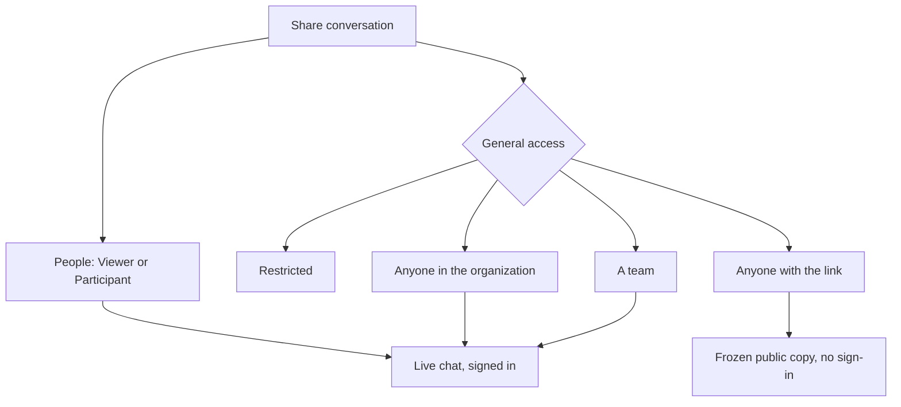

Part of the [Chat Features](/docs/surfaces/desktop/user-guide/chat) guide.

## Manage a saved chat from the sidebar

Open a chat's **⋯** menu, or right-click the row, to access the same session actions. You can pin,
rename, remove the chat from its project, archive it, open a side chat, fork it into the current
workspace or a new worktree, and open it in a separate window. Removing a chat from a project only
clears its workspace grouping; it does not delete the chat or touch files on disk.

The **Copy** submenu can copy the working directory, session ID, Ryu deeplink, or the full chat as
Markdown. **Add scheduled task…** appears when the Calendar app is enabled, and **Open side chat**
appears when the Side Chats app is available.

For a quicker rename, double-click a chat's title in the sidebar. The title becomes an inline
editor; press **Enter** to save it or **Esc** to cancel. The same conversation title is updated
wherever that chat is open.

Keyboard-focus a chat row and press **Enter** or **Space** to open it. Focused row controls such as
pin, archive, and the **⋯** menu keep their own keyboard action without also opening the chat.

## Track a session from the sidebar

When an agent is working from a checklist, its session row shows a slim progress rail along the
bottom. The filled portion represents the steps already complete, so you can scan several sessions
without opening them. Bot rows mirror the latest direct session for that bot.

An active checklist gives the whole row the same diagonal sheen used by plan badges. When every
step is finished, an unread session gets a green gradient and a large checkmark until you open it.
Chats without a saved checklist keep their normal sidebar treatment.

## Load older messages in long chats

Long conversations open at the newest message page. Scroll to the top of the transcript to load the
next older page; Ryu prepends it and keeps your reading position anchored so the messages already
on screen do not jump. Continue scrolling upward to walk back through the full history. New replies
still arrive at the live edge at the bottom.

Edited and regenerated conversations use the same paged history. Each page follows the
selected message versions, and version controls keep their original order. Loading older
messages does not switch to a different branch of the conversation.

## Find messages and project files

On the desktop chat page, press **Ctrl+F** (or **Cmd+F** on macOS) to open the find bar in the
**Chat** mode. Type a phrase to find it in the messages currently loaded in the transcript; use
Enter or the arrows to move between matches, and press Escape to close the bar. The selected turn
is outlined in the transcript.

Find reuses the loaded message text while you refine a query, and refreshes it when the
transcript changes. Closing the bar stops local matching. This searches loaded messages only;
it does not fetch older history or send your query to a model.

Press **Ctrl+F** or **Cmd+F** again while the bar is open to switch to **Files**. This opens the
chat's **Files** dock and drives its existing project-file search. The query stays in the bar while
you switch modes, so the same shortcut cycles between the current chat and the selected project's
file names.

## Ask a supported local model to answer now

For a supported local reasoning turn, Ryu waits briefly before showing **Answer now** directly below
the active thinking block. The grace period follows the selected effort: higher-effort turns get
longer to think before the action appears. Choose it to end the current reasoning block and continue
toward the final answer; it does not cancel the turn or discard the response.

This action depends on the provider. It is hidden when the selected cloud provider, Gateway route,
ACP agent, or local runtime does not advertise the operation. The bundled llama.cpp runtime supports
it. **Stop** remains the control for ending the whole turn.

## Leave a reply running

A reply in a saved conversation keeps running on Core when you switch tabs, open another chat,
close the window, or reload the app. Core still saves the finished reply.

When you return while the reply is still running, the chat rebuilds it from the beginning,
including its text, thinking, tool activity, and checklist. The chat then keeps streaming and shows
**Stop** again.

### What stops a running reply

- **Stop** ends a running reply. Closing the connection does not.
- **Stop** also ends a goal, auto-continue, or other loop plugin that is driving the reply, so no
  follow-up turn starts after it.
- Starting another reply in the same conversation, for example from a second window, stops a reply
  that is still running there.
- If Core itself restarts during a reply, the reply stops. Ryu saves a long single-agent reply every
  few seconds, so it keeps the part saved before the restart and marks the reply as interrupted.
  See [Resume chats after Ryu restarts](/docs/surfaces/desktop/user-guide/chat-basics#resume-chats-after-ryu-restarts).

## Make agent activity easier to follow

The optional [Action Summary](/docs/plugins/action-summary) plugin can add one plain-language line
for each visible thinking block or tool action while the agent works. It keeps the main transcript
unchanged, bounds the action input, redacts likely secrets, and lets you choose brief, standard, or
full detail plus a side model in Settings.

For long-running or high-risk work, the opt-in [Observer Agents](/docs/plugins/observer-agents) plugin
can review a bounded digest of recent activity after an assistant turn. It normally stays silent
and emits only concise advisory notes; it cannot call tools, change files, grant permissions, or
stop the worker.

## Use slash commands, Skills, and mentions

Type `/` to discover commands and enabled Skills. Commands stay in the **Commands** group; installed
Skills appear in **Skills** and insert their stable `/<skill-id>` command. A selected command or Skill
does not send the message until you finish writing and choose **Send**.

Type `@` to discover **Agents**, **Apps**, **Plugins**, and **Workflows**. When the [Inbox app](/docs/apps/approvals)
is installed and enabled, the same picker also shows **Users** from the current organization/team
scope. Each human row uses the person's name and avatar, with initials when no avatar is available.

Selecting a User inserts a visible `@Name` reference and sends that person an Inbox notification after
the chat message is saved. It does not change the selected agent, workflow, team, or conversation
target, and it never routes the turn to that person. Users are not shown when Inbox is unavailable;
Core still verifies the organization/team scope and recipient before delivering the notification.

## Reference another chat

Use the composer **+** directory and choose a conversation from **Chats**, or drag an open chat tab
into the active chat. Ryu inserts an `@Chat title` mention and attaches that saved chat's recent
transcript to the next turn as read-only context. Referencing a chat does not merge the two threads or
change where the reply is saved. Up to three chats can be attached to one turn.

<TryInRyu page="chat" />

## Use multiple desktop windows

Right-click an open chat tab or a supported sidebar item and choose **Open in new window**.
**Open in new tab** keeps the destination in the current desktop window; a new window gets its own
tab strip and layout. The same action is available for chat rows, agents, Spaces and Space pages,
and the main sidebar destinations.

When you click a chat from a sidebar, Ryu checks the other desktop windows first. If that chat is
already open elsewhere, Ryu focuses that window and activates its tab instead of opening it twice.
**Open in new window** is the exception: it creates another view of the same saved conversation.

- Conversation data and Core work stay shared across windows.
- Tabs, splits, and window layout stay local to each window.
- Closing a secondary window does not stop Core or the work in other windows.

Dragging a tab reorders it within its window. You cannot drag a tab out into a new window or into
another window.

<Callout type="info">
  To search past chats or recall relevant history automatically, see
  [Search and Recall](/docs/surfaces/desktop/user-guide/search-and-recall).
</Callout>

## Share a saved chat

Open a saved chat and choose **Share conversation** in the title bar. The access dialog separates
the live conversation from a public copy:

- Add a person as a **Viewer** to let them read the live chat, or as a **Participant** to let them
  read and send new messages.
- Set **General access** to **Restricted**, **Anyone in the organization**, or **A team**. Team access
  requires choosing a team before saving. If you try to save without one, the inline prompt clears
  as soon as a team is selected. Organization and team roles still apply, so read-only members do
  not gain write access.
- Choose **Anyone with the link** to publish a frozen, read-only copy that opens without sign-in.

### Public links

Public links contain only the chat title and the user/assistant transcript. They omit owner names,
tool activity, files, system messages, and other private context.

Messages added later do not appear automatically. Choose **Update copy** when you want to replace
the published snapshot. Returning General access to a signed-in option revokes your public link.

### Who can revoke a public link

A public link belongs to the workspace it was published from.

- The owner can always revoke it, and admins of that organization can revoke it too. Admins of
  other organizations cannot.
- Links published from a personal workspace can be revoked only by their owner.
- Updating the copy later keeps the workspace the link is already bound to.
- A link published before Ryu recorded workspaces is bound to the workspace that is active the next
  time its owner updates it. Until then, only its owner can revoke it.
- When several members published their own links to the same chat, an admin's revoke request must
  name whose link to remove. Ryu never picks one for them.

### Previews and share actions

When you post a public link, its preview image shows the chat title, the start of the first prompt,
and the start of the first answer, all taken from the public copy. Once the link is revoked, the
preview falls back to a generic Ryu card. Search engines are asked not to index public copies.

The public page also has share actions: **Post on X**, **Share on LinkedIn**, and **Copy link**.
**Share as image** turns one message you pick into a Ryu-branded card that includes the page link.
You can copy the card to the clipboard, where the browser supports copying images, or download it
as a PNG. The image is made in your browser.

### Who can change access

The owner and organization admins can change access. A person who can only read the chat can
inspect the current access list but cannot edit it.

Sharing a chat never shares the owner's private Spaces or long-term memory. Temporary chats cannot
be shared because they are not saved.

## Inspect runs in Sessions

Choose **Sessions** in the composer toolbar (hidden in **Ryu Work**) to see which agents or other
runners used this conversation, their status, cost, and latency. See
[Runs, cost, and trace for a conversation](/docs/surfaces/desktop/user-guide/chat-session-controls#runs-cost-and-trace-for-a-conversation).
