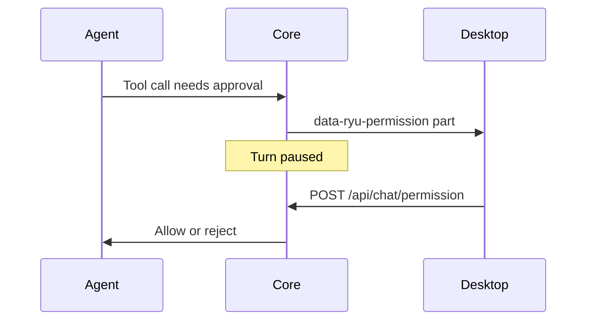

Use these controls to inspect, reply to, and organize chats without leaving the current
conversation. Read state is shared across the sidebar, tabs, and agent threads. See also
[chat session controls](/docs/surfaces/desktop/user-guide/chat-session-controls),
[chat messages](/docs/surfaces/desktop/user-guide/chat-messages), and
[Agents](/docs/surfaces/desktop/user-guide/agents).

## Auto-rename a chat

Open a chat row's **⋯** menu or right-click it and choose **Auto-rename**. Ryu writes a short
title from the first user message with the configured title model or the loaded local engine.

- It replaces a title you chose by hand and records the result in title history.
- It is separate from background automatic naming.
- If no model is available or none returns a usable title, the old title stays and an error appears.

## Quick-reply a chat from the sidebar

Open a chat row's **⋯** menu or right-click the row and choose **Quick reply**. A small floating
composer opens, and its textarea grows as you type.

**Send** uses the same conversation and agent session as the normal composer. If the chat is not
open yet, Ryu opens it when you send, so the streaming reply stays in the ordinary chat tab.

By default, hold **Alt / Option** and click a chat row to open the same quick-reply composer without
opening the row first. Change or disable that gesture in **Settings → Keyboard Shortcuts → Quick
reply click modifier**.

## Preview a chat and mark it unread

For a read-only peek, hold **Shift** and keep the primary click down briefly on a chat or agent
session row. The latest messages appear in a floating preview. The chat is not selected, opened, or
marked read; the preview has its own read/unread button. Change or disable the gesture in
**Settings → Keyboard Shortcuts → Quick preview click modifier**.

A caption below each of these two shortcut settings says which gesture it controls. Choose **Off**
to turn a gesture off.

The chat menus also include **Mark as unread** and **Mark as read**. The unread marker is shared by
sidebar chats, agent threads, and tabs, so it stays in every surface until you mark it read.

When an unread chat or agent thread is out of view, a **More unreads** button floats at the top or
bottom edge of the list. Click it to scroll the nearest unread row into view. Rows in a collapsed
section or behind **Show more** are not counted.

## Pin agents and see pull-request status

In the **Agents view**, open an agent's context menu and choose **Pin agent** to keep it at the top
of the roster. Pinned agents leave the ordinary list so they do not appear twice:

- one pinned agent gets a larger hero tile;
- two use a two-up pair;
- three or more use a compact three-up grid.

Unpin with the tile's pin control or the same context menu.

In **Code** mode, a code session with a saved project folder and branch can show a pull-request
status icon when the **Pull Requests** app finds a request. Open is GitHub green, draft is gray,
closed is red, and merged is purple. The icon links to the request; Ryu Work keeps the simplified row.

## Agent session pickers in the composer

When the active agent is an ACP (Agent Client Protocol) agent, the composer shows pickers for its
permission mode, reasoning effort, and model. Ryu builds each picker from what the agent advertises
at `session/new`, so a control appears only when that agent reports it.

Ryu's native agent publishes no ACP permission presets, so its Core approval policy stays in force.
The **Auto** entry in the agent picker is agent-auto routing: a local classifier chooses which agent
handles a turn. It is not a permission mode.

<Callout type="warn">
  These controls are data-driven. An agent that advertises neither a model config option nor the
  session-model capability shows no model picker.
</Callout>

| Control | When it appears | Source |
|---|---|---|
| **Permission mode** | The agent reports modes (for example `Auto`, `default`, `acceptEdits`, `plan`, `bypassPermissions`) | The agent's advertised mode set and active mode |
| **Reasoning effort** | The agent exposes a `thoughtLevel`-style select config option | That config option |
| **Model** | The agent advertises a model config option or the ACP session-model capability | The advertised options and current selection |

### How Core applies a choice

- Core fetches the advertisement once per agent with `GET /api/agents/:id/acp-config` and caches
  it. For a non-ACP agent every field is null.
- Your choice applies to the session of the next chat turn.
- A model supplied as a session config option is applied without a legacy model request. A legacy
  request can fall back to the conventional `model` config option when the agent rejects it.
- A successful write replaces the advertised option list. A rejected write shows a warning.

### Accounts and sign-in for ACP agents

- A saved ACP session resumes only under its recorded provider account. Changing accounts starts a
  fresh native session. Older saved sessions without an account identity are not restored into an
  account-bound connection.
- For external agents that own their login files, a saved sign-in label is not a switchable
  credential. Selecting it asks you to sign in again, and Ryu reports no switch until the
  credentials change. Unknown or removed account IDs are rejected.
- An agent accepting an authentication request does not prove a completed login. Ryu verifies
  managed Pi sign-ins against that runtime's credentials. For external agents, an unverified
  acknowledgement creates no saved account and is shown as a login to finish in the browser or
  terminal the agent opened.
- If an agent needs sign-in before it can create a session, Ryu keeps the login methods it
  advertised at initialization. Model and session controls stay empty until sign-in. Other session
  failures are reported as errors.

### Narrow composers

The picker adapts to the composer's width, for example in a split pane. The agent name stays
visible. The model label becomes a model icon, reasoning effort becomes a small stepped meter, and
secondary controls become icons or stay available in the picker. Hover text and accessible labels keep the full setting names.

### Picker placement and sidebar rows

Choose where the shared model and agent picker lives in **Settings → Appearance → Interface → Chat
model & agent picker**. **In composer** is the default. **In tab bar actions tray** moves it beside
the chat tabs. The choice is saved.

The same page has **Show latest message / tool state in sidebar**. When on, chat rows get a second
line that rotates between the latest message and a run state such as **In progress**, **Needs
input**, or **Interrupted**. The **Agents view** always uses two-line agent rows. With **Enable
animations** off, the latest state shows without the transition.

## Display and memory

Desktop unloads inactive tabs after 10 minutes by default to save memory. See
[Center-pane tab views](/docs/surfaces/desktop/user-guide/tabs-and-panes#center-pane-tab-views) to change it.

### Message counts and tables

Hover a chat row to open its preview popover. It shows the title, branch, folder, worktree, and
agent when available, plus **Messages**, the total message count for that conversation.

Markdown tables in messages stay compact and scroll horizontally, with a soft fade at the edge when
more columns exist. Hover a table and select the expand button in its top-right corner to open it in
a larger dialog that scrolls both ways.

### Motion

**Settings → Appearance → Motion → Enable animations** controls chat motion: sidebar state rotation,
loading treatments, composer progress, and message entrances. A sent message springs up from the
composer, and a reply or typing indicator grows in from the assistant's side.

Only messages that arrive while the chat is open animate. Opening a conversation, switching
threads, or loading older history keeps the transcript still. The operating system's reduced-motion
preference takes priority.

## Target changes and prompts

If you change the composer's agent, model, or effort while an agent is replying, Ryu briefly
confirms that the choice applies on the next turn. Idle changes stay quiet. **Settings → General →
Chats → Composer selection changes** sets whether the notice says "next turn" or "next user message".

### Agent-requested target changes

An active agent can ask for a different installed agent, model, or reasoning effort for the next
user turn with the built-in `agent_control.set_active_target` tool.

- Core validates the request against the conversation and applies it once, after normal model
  routing. Saved agent defaults do not change.
- The desktop adopts the handoff for the conversation and shows the effective agent, model, and
  effort in the transcript.
- For ACP targets, Core sets effort through the advertised or conventional effort option. An agent
  with no effort control keeps its own default.

This is not model routing. Routing decides from your message; agent control is a handoff the agent
requests during its work.

### Interactive tool-permission prompts

When an agent in a gating permission mode wants to run a tool, Core streams a
`data-ryu-permission` part and pauses the turn.

- The desktop shows the offered options (allow once, allow always, reject once, reject always) in
  the composer surface. If you are typing, Ryu keeps your draft and waits for 2.5 seconds of no
  typing before it shows the card.
- Your choice goes to `POST /api/chat/permission`, keyed by the request id.
- The card lasts only while the asking turn runs. Answering it in one tab, or from a
  [workspace interface](/docs/surfaces/desktop/interfaces#answer-in-place), clears it in every tab
  showing that conversation on this computer.
- A later turn that asks again gets a fresh card, even after a Core restart reuses the request id.
- **Ryu Work** uses plain-language action text and hides raw commands. **Code** can show the
  technical tool details.

### Agent questions

When an agent needs structured input, its Q&A card takes over the composer surface. If you are
typing, Ryu keeps your draft and waits for 2.5 seconds of no typing; until then the question stays
in the conversation. The microphone works in the card's **Other** input and free-text input.

## Availability and prompt interruptions

To choose when agents may interrupt you, see
[Availability and Agent Prompts](/docs/surfaces/desktop/user-guide/availability-and-prompts).

## Select several chats and move them between sections

You can select more than one chat in the sidebar.

- **Shift-click** a chat to select every visible chat between it and the chat you clicked last (or the
  open chat). Chats in collapsed sections are skipped. When **Search section overflow in a popover**
  is on, a range you shift-click inside that popover stays within it.
- With a chat focused, **Shift+Up** or **Shift+Down** extends the selection one chat at a time, and
  **Up** or **Down** on its own moves focus between chats.
- **Cmd-click** (macOS) or **Ctrl-click** adds or removes one chat. The first one also selects the open
  chat.
- A plain click, or **Esc**, clears the selection.

Right-click any selected chat to act on the whole selection: **Open in new tabs**, **Pin** or
**Unpin**, **Archive** or **Unarchive**, **Mark as read** or **Mark as unread**, **Move to project**
(or **Remove from project**), **Clear selection**, and **Delete**. Delete asks for confirmation first.

To move chats, drag a chat onto another section. Dragging any chat in a selection drags all of them.

| Drop on | Result |
| --- | --- |
| **Pinned** | Pins the chats and unarchives any that were archived. |
| **Archived** | Archives the chats. |
| **Chats** | Unpins and unarchives the chats and removes them from their project. |
| A project | Moves the chats into that project, unpinned and unarchived. |

**Pinned** and **Archived** show up as drop targets while you drag, even when they're empty. In the
Agents view, dragging a selection onto one of your custom sections in **Chats** moves every
selected chat into that section.

## Group, sort, and filter each chat section

**Pinned**, **Chats**, **Projects**, and **Archived** each keep their own view. Open a section's
**⋯** menu to change it. Your choices are saved per section, and **Reset sidebar** restores the
defaults.

**Group by** splits the section into collapsible groups. Drag a group's header to reorder the groups.

| Group by | Groups |
| --- | --- |
| **Default** | The section's usual layout: **Private** and **Team** in Chats, and date groups elsewhere when **Group lists by date** is on. |
| **None** | One flat, paged list. |
| **Date** | Today, Yesterday, and older date ranges, whatever the global date setting. |
| **Status** | **Needs attention** (needs input, failed, or interrupted), **Running** (including a main thread with a session that is still running), **Unread**, and **Idle**. |
| **Project** | One group per project, plus **No project**. A project with several folders is one group. Not offered in Projects, which is already split by project. |
| **Agent** | The agent that last took the chat, plus **No agent**. |
| **Environment** | **Chat only**, **Workspace folder**, or **Worktree**. |
| **Visibility** | **Private** and **Team**. |
| **Custom groups** | Groups you create with **New group**. Rename or delete a group from its **⋯** button. Deleting a group returns its chats to their default group (**Ungrouped**, or **Project threads** for a project's main thread) and never deletes them. |

Drop chats onto a custom group to file them there, or onto a project group to move them into that
project. Moving a chat into a project group keeps its pin and archive state. Custom groups are the
same groups you organize in the Agents view's **Chats** section, so they sync across your devices with
your other settings.

**Sort by** adds two orders for chat sections: **Status (needs attention first)**, which uses the
same statuses as **Group by → Status**, and **Most messages**. In **Projects**, the order applies to
the projects and to the chats inside each project.

**Filter** narrows the section:

- **Status** and **Environment** take any number of values. A chat matches if it has any of the
  selected values.
- **Activity** limits the list to the last 24 hours, 7 days, or 30 days, or to chats older than 30
  days.
- **Agent** keeps chats that any of the selected agents took part in.

A chat must pass every filter type that's set. While a filter is on, the section header shows a
filter icon, and the Projects section hides projects with no matching chats. Choose **Clear filters**
to show everything again. In the Agents view, the Chats section offers filters only, because it
already groups chats into your sections.

## Move a chat into a project

A chat doesn't need a project. Start it without choosing a folder and it stays in **Chats**. To
file it later, open the chat's **⋯** menu (or right-click it) and choose **Move to project**, then
pick a project. A chat that is already in a project shows **Move to another project** instead, and
**Remove from** followed by the project's name takes it back to **Chats**.

Moving a chat changes the project folder its next turns run in. If the chat belonged to a project on
the node, it leaves that project and joins the new one. A project's own main thread can't be moved.

## See chats from every computer

Right-click an empty part of the sidebar and choose **All computers** under **Sidebar mode** to
see the chats on every computer you have added, grouped by computer.

- The computer you are using comes first and keeps its usual **Pinned**, **Projects**, and
  **Chats** sections, with every action they normally offer.
- Each other computer has its own group, with a status dot and a **Cloud** badge for Ryu Cloud
  computers. Its chats are grouped by the project folder they ran in on that computer.
- Click a chat to open it in a tab that runs on that computer. Right-click it for **Open**,
  **Open in new tab**, and **Open in new window**. Rename, delete, pin, and move are not offered
  in another computer's list. Open the chat to manage it there.
- Select **+** on a computer's header to start a new chat on that computer.
- When a computer goes offline it stays in the list. Chats already loaded in this session stay
  visible but greyed out and can't be opened until it reconnects. After a restart, an offline
  computer shows **Offline. Threads appear when it reconnects.** instead of old titles; Ryu does
  not save another computer's chat titles on this device.
- Chats from other computers open in a tab connected to that computer, so they need per-tab
  computers. If you have turned that off, their rows and their **+** buttons are disabled and the
  sidebar offers **Turn on per-tab computers**.

Collapsed computer groups are remembered on this device.

## Delete chats in a section

For bulk cleanup, right-click the **Chats** or **Projects** section header and choose **Delete all chats**.
The confirmation names the number of conversations in that section's current scope. While a filter is
on, only the chats that match it are deleted. Cancel keeps them; confirming removes those conversations
and closes the confirmation.

## Hidden sidebar items

Sidebar sections and buttons you hide stay hidden after a restart, including buttons added by
plugins. If the saved list is damaged, the sidebar shows every item until you change visibility
again.
