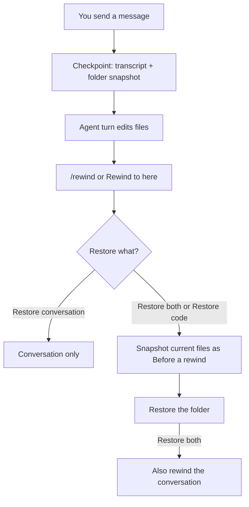

Part of the [Chat Features](/docs/surfaces/desktop/user-guide/chat) guide. For composing messages,
attachments, reactions, and voice, see [Messages, Turns, and Attachments](/docs/surfaces/desktop/user-guide/chat-messages).

## Review files changed by a turn

When an agent finishes a turn that edited or created files, an edited-files card stays at the end
of that reply.

- A one-file turn shows a compact **Edited filename** row with insertion and deletion totals.
- A multi-file turn shows an **Edited N files** card with the first few paths and a **Show N more**
  control.

The card comes from the saved tool activity, so it is still there when you reopen the chat, even
with tool detail hidden. Only completed tool results count. A failed write or a tool call still
streaming at turn end is not shown as a file change.

### Review or undo the turn

- **Review** opens the workspace **Changes** view on **Files from this turn**.
- **Undo**, after you confirm, reverses only the exact text replacements made in that turn.
  Unrelated changes stay. After it succeeds, the card stays and its control reads **Undone**.
- Undo refuses, and changes nothing, if an affected file is staged or its edited text changed since
  the turn. Review still works.

If you switch connections, chats, or project folders while Undo is waiting, the operation still
belongs to its original workspace. Its result does not appear in the new workspace. Reopen the
original workspace to check its files.

Agents can also leave a completed JSON UI or artifact card in the same end-of-turn position. Those
cards support the interactive components and safe web links described in the [built-in tools
reference](/docs/core/generative-ui-tools#end-of-turn-result-cards), while the existing inline tool
previews continue to behave as before.

## Rewind with checkpoints

Ryu takes a checkpoint before every message you send. When the chat has a project folder, the
checkpoint also snapshots that folder's files, or the chat's worktree when worktree isolation is on.

The snapshot covers the whole folder, not single tool calls. So it captures changes from an agent's
edit tools and its shell commands alike, for every agent and provider: Pi, Claude Code, Codex,
other ACP agents, and Ryu's own provider chats.

Open the rewind picker in either of these ways:

- Type `/rewind` in the composer.
- Open a user message's **More message actions** menu and select **Rewind to here**.

Pick the message you want to go back to. If the checkpoint has a file snapshot, the picker lists
the files a restore would change: **restore** for edited files, **recreate** for deleted files, and
**remove** for files created since. Then choose what to restore:

- **Restore both** restores the folder and rewinds the conversation to just before that message.
- **Restore conversation** rewinds only the conversation. Files stay as they are.
- **Restore code** restores only the folder. The conversation stays as it is.

Rewinding the conversation puts the rewound message back in the composer so you can edit and resend
it. The rewound turns stay as an earlier version of the thread, reachable with the version arrows.
The agent's next turn starts a fresh session, so Pi and other ACP agents forget the rewound turns.

### What a rewind protects

Before restoring files, Ryu snapshots the folder's current state. It appears in the picker as
**Before a rewind**, and restoring it undoes the rewind's file changes.

A rewind never destroys unsaved work. Ryu changes or removes a file only when its current content is
in that **Before a rewind** snapshot. It leaves a file unchanged when:

- its current content is not in any snapshot (for example, it is ignored, larger than 25 MB, or
  unreadable);
- a folder now sits where the file was;
- one of its parent folders is a symbolic link, which could point outside the project.

If a file is left unchanged, the picker stays open and lists it with the reason. Every other file is
still restored.

Files are written to a temporary file and then moved into place, so an interrupted rewind never
leaves a half-written file. Contents are restored byte for byte, including line endings, executable
bits, and symbolic links. Git LFS and other `.gitattributes` filters do not change them.

Checkpoints have some limits:

- Rewind is unavailable while this chat, or any other chat using the same folder, is running a
  turn. Stop the turn first.
- Files matched by the folder's `.gitignore`, dependency and build folders such as `node_modules`
  and `target`, files larger than 25 MB, and nested Git repositories are not captured. Rewind never
  changes them.
- A folder with more than 200,000 changed files, your home folder, or a filesystem root gets a
  conversation-only checkpoint.
- Snapshots need `git` on the device that runs the agent. They live in that device's Ryu data
  folder, apart from your project's Git history, and are not included in node backups. Your
  project's repository is never written to.
- In a Git project, the first snapshot reuses the repository's data to finish quickly. Ryu then
  copies that data into its own store, so later history rewrites or cleanup cannot affect it.
- Rewind is local undo, not version control. Changes made outside the chat in the same folder are
  part of the snapshot too, so restoring a checkpoint also reverts them. Use Git for permanent
  history.

## Pursue a goal

A goal is a persistent completion condition attached to a conversation. After each turn a separate
model judges whether the goal has been met; if not, the conversation keeps going on its own until
it is met or a safety cap is reached.

- Type `/goal <condition>` to set a goal, or use the composer **+** menu and pick **Pursue goal**.
- An active-goal chip and a goal bar appear above the composer, showing the editable condition, a
  live elapsed timer, and the latest judge reason. The Target icon on the chip turns into an
  **✕** on hover to clear it.
- When you create or edit a goal from the goal bar, Ryu adds the condition to the transcript as a
  user message and labels it **Sent as goal** beneath the bubble.
- Type `/goal` alone to open the bar, and `/goal clear` to remove the goal.
- The **Stop** button halts the loop at any time.
- An agent with the `goal.set` tool can set or replace the goal for the current conversation; the
  tool is scoped by Core and resets the judge progress when it is called.

The judge runs as its own model call, separate from your chat model. Choose which model judges
goals in **Settings → Goals**. The continuation loop is capped at a fixed number of turns so a goal
can never run away. For how the goal state and judge primitive work, see
[Goals](/docs/core/goals).

## Ask a side question with `/btw`

`/btw <question>` asks a quick question about the current conversation. It is the inverse of a
sub-agent: full context, no tools.

- The side model sees the visible transcript, including the latest in-flight text, but has no tools.
- It returns one answer in a dismissible overlay. The exchange never becomes a chat message.
- It needs at least one message in the thread.
- Pick its model and reasoning effort in **Settings** (the `btw-model` and `btw-effort` preferences).

The built-in [Side Chats](/docs/plugins/side-chats) plugin owns `/btw`. Each exchange is kept as a
side chat you can reopen from the Context rail or sidebar; see
[Side Questions](/docs/core/side-questions) for how persistence works.

Selection actions also fork the context. They reuse the main-chat model and the same bounded
visible transcript, but copy no tools and add no message to the main chat.

### Find and delete side chats

Expand a conversation in the sidebar to see its saved side chats in a branch-style list. Each entry
shows the question, a short answer preview, and its age, and opens the side-chat overlay. Sub-agent
entries share the list, so related follow-ups stay under their parent conversation.

- Hover a saved side chat in the Context rail or pinned summary to reveal **Delete side chat**. Ryu
  asks you to confirm; **Cancel** keeps it. Deleting never changes the main transcript.
- If deletion fails, the entry stays with an error so you can try again.
- If the list cannot load, expand **Side chats** and choose **Retry side chats**. Answers already
  shown stay visible.

## Double-check answers

Toggle **double-check** in the composer to have a second model review each answer as it arrives. It
fires once per assistant message and flags problems it finds. Configure which model reviews and at
what reasoning effort in **Settings → Double-check**. For the review primitive, see
[Double-Check](/docs/core/double-check).
