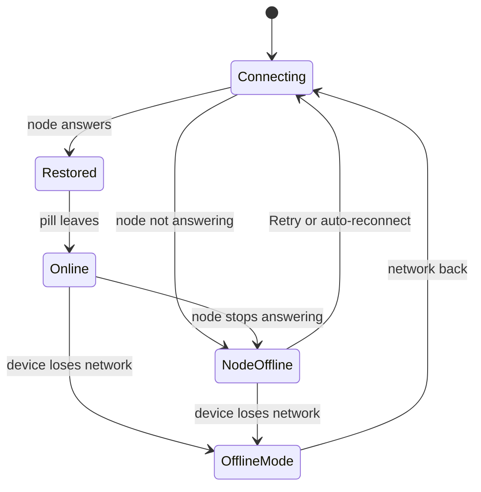

This page covers the chat window itself: unread chats, connection loss, history nodes, window
panels, and closing Ryu. To write and send messages, start at
[Chat Basics](/docs/surfaces/desktop/user-guide/chat-basics). Sidebar actions such as quick reply,
preview, and bulk moves are in
[Sidebar and Chat Controls](/docs/surfaces/desktop/user-guide/chat-sidebar-controls).

## Follow unread chats

The sidebar shows how many messages were added to a conversation while it was closed. Opening the
conversation or choosing **Mark as read** clears the count. Choosing **Mark as unread** shows a count
of one until more messages arrive. Counts above 99 display as `99+`.

## Keep the workspace open during a connection loss

The Desktop window stays open when your connection changes. A small status pill appears at the top
of the window without covering the workspace, and leaves after the connection recovers.

- Several statuses form a stack. Hover over it or focus a **Retry** button to expand it.
- Hover over a cut-off status line to read the full message.
- Reduced-motion preferences turn off the pill's movement.

| Status | Meaning |
|---|---|
| **Connecting to …** | Ryu is checking the selected node |
| **Node offline** | The selected local, self-hosted, or managed node is not answering. Ryu keeps reconnecting and offers **Retry** |
| **Offline mode** | The device reports no network connection. Ryu waits for connectivity before it retries live work |
| **Connection restored** | The node answered again. Ryu refreshes the affected data, and an enabled Reconnect Retry plugin can resume eligible interrupted chats |

Tabs already on screen and local drafts stay visible while a node is unavailable. Live features that
need the node, such as sending a message or changing shared data, wait until the node is reachable.

<Callout type="warn">
  This status surface does not provide full offline editing or an offline copy of every page.
</Callout>

## Switch the node that supplies chat history

Selecting another node, or changing its sign-in, reloads the sidebar history for that selection.
Chats from the previous node do not appear as unsent drafts on the new node. A slow history read or
a fork started on the previous node does not change the new node's view. Other open panels and
unsaved controls stay open. Refreshing the same node keeps its unsent local chat drafts.

## Window navigation and sidebar panels

Use the top-left back and forward buttons to move through tab history. The sidebar button opens or
closes navigation, and **Search** opens the command palette. At phone widths the cluster keeps the
sidebar and search controls, and the platform provides back navigation.

The sidebar footer has **Downloads** and Inbox controls. Their panels take keyboard focus when they
open. Press **Escape** or click outside a panel to close it and return focus to its button. Use the
panel's footer action to open the full page. These panels are separate from the operating system
tray menu.

Download controls report a failed pause, resume, cancel, retry, or dismiss so you can try again.

- Clearing unfinished downloads cancels them before it removes their rows.
- Clearing finished downloads also clears the saved history. Rows that Core cannot clear stay
  visible for retry.
- Cancelling a download deletes its partial file.
- If Ryu stops after a file fully arrives but before it is verified, the next attempt downloads the
  file again from the start.

Project markdown edits save automatically after you pause typing. Pending edits save when you leave
the editor, and saves run in order, so an older write cannot replace newer edits. If saving fails,
use **Retry**.

When a sketch dialog is open, press **Escape** to discard its draft and return to chat, even while
the sketch has keyboard focus. Closing the dialog does not attach an image.

## Close Ryu without stopping local work

**Stay in tray on close** is on by default. Closing the Desktop window hides it, and the local Core
process keeps running, so active agent turns and background work continue. Choose **Quit** from the
tray menu to stop Ryu completely. If **Stay in tray on close** is off, closing the window quits Ryu.
When local chat or workflow runs are active, Ryu asks you to confirm before it stops them.

## Next steps

<Cards>
  <DocCard href="/docs/surfaces/desktop/user-guide/search-and-recall" />
  <DocCard href="/docs/surfaces/desktop/user-guide/teams" />
  <DocCard href="/docs/core/goals" />
  <DocCard href="/docs/core/side-questions" />
  <DocCard href="/docs/core/conversations-sessions" />
</Cards>
