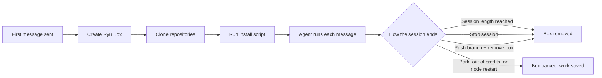
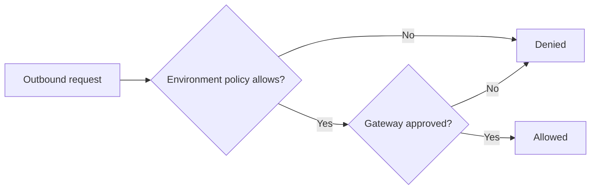

A cloud environment stores a project's repositories, setup script, network access, and credentials
on the selected Ryu node. Open **Gateway settings → Developer → Cloud environments** to create an
environment, edit its settings, or manage your personal vault.

## Start a cloud task

1. In a new Code chat, choose **Cloud** and open **Choose environment**.
2. Select a published environment on the active node. From this picker you can also search,
   create an environment, or open its settings.
3. Choose the **Ryu** agent and send your task.

To connect GitHub from the picker, enter a personal access token with access to the repositories
you need. Ryu verifies it, saves it in your encrypted personal vault, and lists the repositories it
can reach. Selecting a repository creates a draft that requests that credential. Review and publish
the draft before using it.

### What runs in the workspace

The **Ryu** agent keeps its selected model and native tool loop. It runs commands and reads,
writes, and lists files inside the isolated workspace. Host ACP agents, local project scripts,
worktrees, and browser tools cannot run there. A missing runtime or denied permission stops the task.

- The install script runs once, when the conversation's workspace is prepared.
- Start instructions are given to the model for its task.
- Later turns reuse the workspace and its original settings revision.
- A reopened cloud chat keeps its environment. Start a new chat to choose another one. Changing
  nodes clears the selection.

### Workspace lifetime

With the **Automatic** backend, workspaces expire after 30 minutes. A **Fresh cloud box** uses the
environment's session length. An expired, stopped, or interrupted conversation does not get a new
workspace; start a new conversation instead.

Deleting a cloud conversation removes its workspace and its environment binding. If the workspace
is still being set up or cleanup fails, the conversation stays blocked while the node retries in
the background.

A node keeps a limited number of active cloud conversations. Bindings for conversations that ended
more than 30 days ago do not count. At the limit, delete old cloud conversations or try again later.

## Run on a fresh Ryu Box

<Callout type="info">
  Fresh cloud box is on for every account by default. If the **Fresh cloud box** backend, the
  managed agents, **Review changes**, **Push branch**, or **View screen** are missing, your
  organization or Ryu has turned Ryu Boxes off for your account. An environment that already uses
  the box backend then cannot be selected or saved until you switch it to **Automatic**.

  The selected node must also have a Ryu Box service configured; managed cloud nodes get one from
  Ryu. When you are signed in, the node checks availability for your account in your active
  organization, so switching organizations can change it.

  A node that belongs to an organization accepts only a check made for that organization. If it
  refuses, switch to the node's organization and try again. Turning Ryu Boxes off never prevents
  stopping a box that is already running.
</Callout>

A fresh cloud box gives each chat its own new, isolated Ryu Box. To use it, open the environment
in **Gateway settings → Developer → Cloud environments** and set these fields under **Runtime**:

1. Set **Backend** to **Fresh cloud box**.
2. Choose an **Agent** - **Ryu**, **Claude Code**, **Codex**, **OpenCode**, or **Cursor**.
3. Set **Session length (minutes)** to a whole number from 5 to 240. The default is 30.
4. Publish the environment.

In the composer, choose **Cloud** and select the environment. Box environments show a
**Fresh box** badge.

Ryu creates the box when the first message is sent, clones the repositories, and runs the install
script. The box is removed when the session length ends, when you choose **Stop session**, or after
**Push branch** when **Remove the box after pushing** is checked.

The agent decides how messages run:

- **Ryu** uses the normal chat. Its command and file tools run inside the box.
- **Claude Code**, **Codex**, **OpenCode**, and **Cursor** run one prompt for each message you
  send. The agent works in the first repository's folder. When it finishes, its summary appears
  in the chat as the reply. You cannot send another message while a run is active.

The cloud task panel above the composer shows the task state, the time left, and the live output
of the active run. It has these actions:

- **Review changes** shows the files and the patch changed since the box was prepared.
- **Push branch** commits the changes and pushes them to a new branch on GitHub. It never force
  pushes. The default branch name is `ryu/` and the first eight characters of the chat id. After a
  push, the panel shows a **Compare** link to GitHub. If the push fails, Ryu keeps the box so your
  work is not lost.
  - Check **Open pull request** to open a pull request from the pushed branch into the branch the
    task started from. The title defaults to the commit message. Check **Open as draft** if you
    want a draft. After the push, the panel links the pull request instead of the compare view.
  - The optional Markdown description holds up to 65,536 characters. The dialog counts as you type
    and will not push while it is too long. Left blank, Ryu writes a short default.
  - If GitHub refuses the pull request, the push still counts. The panel says why (for example, a
    pull request for the branch already exists, or the credential cannot open pull requests) and
    keeps the **Compare** link so you can open one yourself. The box is removed or kept exactly as
    it would be without the pull request.
- **View screen** opens the box's own screen in a **Box screen** tab next to the chat (see
  [Watch the box's screen](#watch-the-boxs-screen)).
- **Stop session** stops the agent and removes the box. Changes that were not pushed are lost.

## Watch the box's screen

Every Ryu Box has its own virtual desktop and browser. Computer use and the browser tool in this
conversation run on that screen, not on your node's desktop. The **Box screen** tab streams it
live:

- The screen opens **view-only**: you watch the agent work, and your keyboard and mouse do not
  reach the box. **Take control** reconnects with a grant that accepts your input, for that box
  only. **Stop control**, or switching to another box, goes back to watching.
- **Reconnect** opens a fresh connection. Each connection uses a new single-use grant from your
  node, so a copied link cannot be replayed.
- **Park** stops the box and saves its work. Opening its screen again, or the agent's next task,
  resumes it.
- When the conversation runs [sub-agents in parallel](/docs/surfaces/desktop/user-guide/virtual-desktop#session-box-screens),
  each one that gets its own box appears in the **Subagents** tab with a **View screen** action,
  and the **Box screen** tab lets you switch between them.

On Ryu-hosted nodes the screen streams straight from the Ryu Box service to your app; it never
passes through your node. A self-hosted node with no public Box address streams it through the
node instead.

## Cost and credits

A running box is billed per second from your organization's credits, as **Box session compute**
in the credit ledger. The task panel shows what the current run has cost so far and how long it
has run, for example `$0.0123 · 18 min`. Hover the chip to see the hourly rate and about how many
minutes of box time your balance still covers. The figures come from the same metering that bills
the box.

- When credits are running low, the panel shows a warning with **Top up**, which opens your credit
  settings.
- When credits run out, Ryu stops the box within seconds and parks it, so its work is saved. The
  task shows **Stopped · out of credits** and a banner with **Top up**. Top up, then start a new
  message or resume the box.
- A box also stops when a spending budget for your organization is reached. The panel says so;
  ask an administrator to raise the budget.

Your plan sets how many boxes can run at the same time. When you reach the limit, a new box is
refused until another one stops or parks.

## Box requirements and limits

- Bind the agent's API key as an environment variable, for example `ANTHROPIC_API_KEY` for Claude
  Code or `OPENAI_API_KEY` for Codex.
- To push, the environment needs a GitHub credential for the repository.
- Managed agents need internet access. With **Package managers** or **Custom domains only**, the
  allowed domains must include `archive.ubuntu.com`, `security.ubuntu.com`, and the agent's
  provider hosts. Ryu rejects the environment and lists any missing domains.

The selected node must have a Ryu Box service configured, or the task fails to start. Ryu does not
fall back to another backend.

If the node restarts during a session, Ryu parks the box so its work is saved. It keeps the box until
the session length ends or you stop or delete the chat. The task does not resume on its own.

<Callout type="warn">
  - Managed agents can read the variables you bind, including their model API key. The GitHub
    token is not given to the agent. Ryu uses it only when it pushes and, when you ask, to open
    the pull request from your node rather than from the box.
  - Network secrets and VPN keys are not available on this backend.
  - **Push branch** pushes only the first repository, and only to a github.com HTTPS remote.
  - Opening a pull request needs a credential that can create pull requests on the repository,
    and a task that started on a branch. A task that started from a detached commit can only push.
  - Each prompt starts the agent CLI fresh, without the previous run's session state. The first run
    installs the CLI, which can take several minutes.
  - These flows, including the box screen and its cost display, are covered by automated tests
    with a simulated Box service. They have not been verified against every provider, GitHub
    account, or production Box deployment.
</Callout>

## Run on your own Claude or ChatGPT plan

A cloud task for the **Claude Code** or **Codex** agent can run on your own Claude or ChatGPT
plan instead of a Ryu Box, either in the provider's cloud or on your own computer. It counts toward
your plan's usage limits and uses no Ryu credits. Setup, accounts, fallback rules, and limits are
in [Cloud sessions on your own plan](/docs/surfaces/desktop/user-guide/cloud-sessions-on-your-plan).

## Repositories and setup

Give the environment a name and fill in its setup:

- **Repositories**: `owner/repository` names or HTTPS GitHub URLs. Setup clones each one into its
  own owner/repository folder.
- **Install script**: prepares tools and dependencies. It runs from the first repository root, or
  from the empty setup workspace when no repository is selected.
- **Start instructions**: describe how a task should begin work in the prepared checkout.

Save a draft while preparing the environment. Publish the settings when they are ready for cloud
setup. Saving a draft again clears the published mark.

**Run setup check** starts a disposable sandbox through the configured runtime on the selected node
and runs the install script. The script has a 120-second timeout. The check reports the exit code and
redacted output. It does not start an agent task, and saving start instructions does not execute them.

## Internet access

Choose whether the environment can access the internet. When access is enabled, choose a domain
policy:

| Policy | Access |
| --- | --- |
| All | Any internet destination approved by the Gateway and allowed by the cloud runtime |
| Package managers | The supported package registry domains and any additional allowed domains |
| Custom domains only | Only the additional allowed domains |

Additional domains can include wildcard hostnames. A network secret also declares the destinations
where it may be used. Disabling internet access denies all outgoing traffic, including destinations
declared by network secrets.

Restricted policies need a runtime that can enforce them:

- an OpenSandbox runtime with the network policy and credential proxy adapter, or
- the isolated VPN runtime, when Tailscale is configured.

Ryu checks that the runtime installed the policy before repository setup starts. With the standard
Docker fallback, **Run setup check** rejects restricted policies instead of running without them.

Your Gateway administrator must approve the outbound access before setup can run. Adding a domain
to an environment narrows what it requests; it never bypasses Gateway policy. Both the runtime's
policy and the Gateway's approval must allow a destination.

## Variables and network secrets

Environment variables pass their real values to the task and its tools. Use them for values the
task needs to read.

Network secrets are credentials that the OpenSandbox credential proxy or the isolated VPN runtime
substitutes into outgoing HTTPS requests. Tasks receive placeholders, never the saved values.

- Substitution happens only for the secret's configured destinations.
- Plain HTTP requests receive no real secret.
- The standard Docker fallback has no such proxy, so it rejects environments that request network
  secrets.

Keep network-secret values out of install scripts, start instructions, and ordinary variables. To
make an existing entry visible to a task, change it to an environment variable and enter its value
again. VPN credentials remain private, and saved values stay hidden in the settings API.

Use **Manage** beside Environment variables or Network secrets in the environment editor to add
or edit its bindings. These edits stay in the draft until you choose **Save draft** or **Publish**.
Canceling the editor discards those pending edits.

Use the personal vault for credentials scoped to your account. Search by key and filter by entry
type. An entry can apply to all your environments or several selected environments.

To import variables:

- **Import from node** lists names from the selected node's process environment, which may be a
  remote machine. It requires node-owner access.
- Desktop can also import variables from the computer running Ryu.
- Select up to 100 names. Only selected values are saved, and platform-reserved variables are
  excluded.

Saved vault values are encrypted and never returned by the settings API.

## Sharing and VPN

Choose **Shared on this node** and publish an environment to make it available as a template.
**Browse shared templates** lists published shared environments on the selected node. Importing a
template creates your own private draft. The copy excludes requested vault keys and VPN credentials;
attach your own credentials before publishing it. Personal vault entries remain scoped to their owner.

For private network access, choose **Set VPN key** under advanced settings and enter a Tailscale
auth key.

- Create the key as ephemeral, tagged, pre-approved, and short-lived. Revoke it in your Tailscale
  admin console if you suspect it leaked.
- Every launch enrolls again, so make the key reusable only if you will launch the environment more
  than once before it expires.
- Saving the environment stores the key in your encrypted personal vault. Saving does not test the
  connection.

**Run setup check** enrolls the isolated VPN runtime before it runs the install script. The node
must have that runtime configured with its workload, egress, and Tailscale images. The Gateway must
approve VPN enrollment and relay access.

### VPN key rules and routing

- The key must be scoped to this environment. It cannot also be a task variable or network secret,
  or appear in install scripts or start instructions.
- The VPN uses temporary state and userspace networking. The workload keeps its configured domain
  policy.
- For Package managers or Custom domains only, add private IPv4 addresses, or hostnames that
  resolve to IPv4, under Additional allowed domains. Tailscale MagicDNS and IPv6 literals are not
  supported.

The VPN runtime accepts subnet routes from your tailnet but always denies traffic to the cloud
metadata addresses (`169.254.0.0/16`, `fd00:ec2::254`, and `100.100.100.200`), whatever the workload's domain policy
allows.

Internet access must be enabled. Disabling it also prevents VPN setup. Failed enrollment or missing
runtime configuration stops setup before the install script runs. A saved key or a local setup
check does not verify connectivity on another node or in a deployed cloud provider.

For setup on your own computer, see [Local environments](/docs/surfaces/desktop/user-guide/git-workspace#local-environments).

## Related

<Cards>
  <DocCard href="/docs/core/boxes" />
  <DocCard href="/docs/security/sandboxing-isolation" />
  <DocCard href="/docs/surfaces/desktop/user-guide/cloud-sessions-on-your-plan" />
</Cards>
