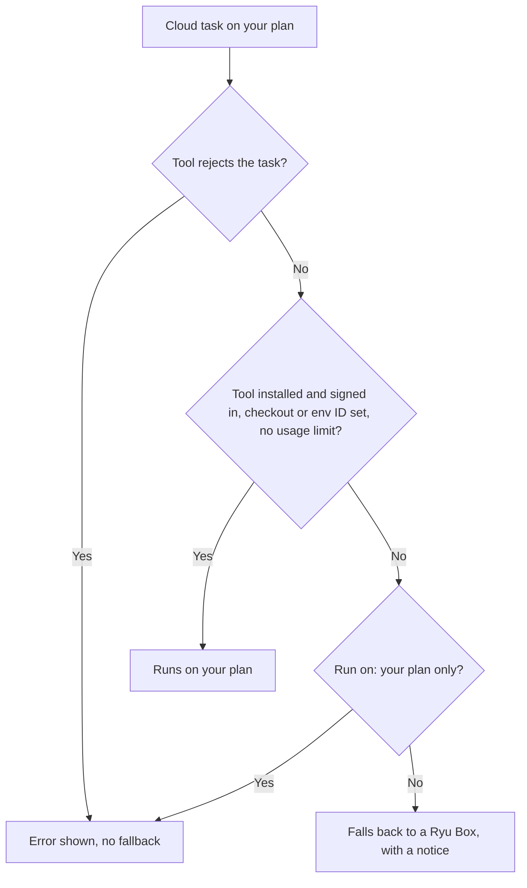

If you pay for a Claude plan (Pro, Max, Team, or Enterprise) or a ChatGPT plan, a cloud task
for the **Claude Code** or **Codex** agent can run on that plan. The task counts toward your
plan's usage limits, not toward Ryu credits, except for Ryu Box time.

Ryu does this through the provider's own command-line tool, signed in by you through the
provider's own sign-in page. Ryu never asks for, stores, or forwards your Claude or ChatGPT
login. It only asks the tool whether it is signed in.

<Callout type="info">
  If **Run on your own plan** is missing from **Gateway settings → Developer → Cloud
  environments**, it is not available for your account yet. Ryu is not affiliated with Anthropic or OpenAI, and your
  plan's own terms and limits apply.
</Callout>

## Set it up

Use the desktop app on the node where the tools are installed:

1. Install Claude Code or the Codex CLI on the node.
2. Open **Gateway settings → Developer → Cloud environments → Run on your own plan** and choose
   **Sign in** for the plan. The tool opens the provider's sign-in page in your browser. You can also run
   `claude auth login` or `codex login` in a terminal yourself.
3. Turn on **Use my own plan for cloud tasks when I can**.
4. For each environment, enter the **local checkout** (the absolute path of a git checkout on
   the node, used by Claude's cloud sessions and by runs on this computer) or the **Codex
   environment ID** (`codex cloud` lists them).
5. Choose the **Default order**, and optionally a different order for an agent.

When you start a cloud chat with one of these agents, **Run on** chooses where this session runs:

- **Auto**, which uses the agent's order, otherwise the default order;
- your plan, with the Ryu Box as a fallback;
- your plan only;
- the Ryu Box.

## When a task falls back to a Ryu Box

Ryu falls back to a Ryu Box, and shows a notice saying why, when:

- the tool is not installed or not signed in with your plan;
- the environment has no checkout or Codex environment ID; or
- your plan reports a usage or rate limit. Ryu then skips that plan for an hour. Choose **Try
  again now** in Settings to clear it sooner.

A task that falls back runs and bills exactly like any other Ryu Box task, including the
computer-use cost notice. A task that the tool rejects (for example, a checkout it cannot upload)
does not fall back. Neither does a session set to **your plan only**. Ryu shows the error
instead, so a mistake never turns into a billed box.

A usage limit applies to the whole plan, so when one Claude option reports it, Ryu skips both
Claude options for the hour.

A conversation that started on your plan stays on it. It never gets a Ryu Box, its own screen, or
a Box charge. To use a Ryu Box, start a new conversation.

## Monthly API credits on Claude Max and Team

Claude Max and Team plans include monthly API credits that cover the Claude API and the Agent
SDK. To spend them in Ryu, link a Claude Console organization to your plan, then bind that
organization's API key as `ANTHROPIC_API_KEY` in an environment. A Ryu Box run then uses those
credits for the model. Its Box time is still billed in Ryu credits.

## Where a session can run

| | On your computer | In the provider's cloud | In a Ryu Box |
| --- | --- | --- | --- |
| How | Claude Code in headless mode (`claude -p`, the runtime the Claude Agent SDK uses) or Codex in headless mode (`codex exec`), on the node where you signed in | `claude --cloud` or `codex cloud exec`, started from your node | The Claude Code or Codex tool inside your session's Ryu Box, signed in by you |
| Claude | Yes | Yes | Yes |
| ChatGPT (Codex) | Yes | Yes | Not yet |
| Accounts | Any of your linked Claude or ChatGPT accounts, chosen per session | One account per session; follow-ups use the same account | The account you sign in with inside that Box |
| What you pay | Your plan's usage | Your plan's usage | Your plan's usage for the model, plus Ryu credits for Box time |
| Live screen | No | No | Yes |
| Run log in Ryu | Yes | No: use claude.ai or Codex | Yes |
| Changes (diff) in Ryu | Yes, on its own branch | No: use claude.ai or Codex | Yes |
| Stop from Ryu | Yes | No: stop it on the provider's site | Yes |
| Push and pull request from Ryu | No: push the branch from your checkout | No: use the provider's site | Yes |

### On your computer

Ryu runs Claude Code or Codex on your node, in a separate git worktree of the checkout you
choose, on a new `ryu/task-…` branch. Your own working copy is never changed. Nobody is there
to approve anything, so each tool runs in its most limited unattended mode:

- **Claude Code** may edit files there. Commands and web fetches that would need your approval
  are refused.
- **Codex** runs in its workspace sandbox and never asks for approval. It may edit files and run
  commands inside that worktree, but those commands have no network access. It does not search
  the web or use MCP servers. Settings in your Codex `config.toml`, including your model choice
  and MCP servers, do not apply to these runs.

Each session keeps its run log, its branch, and **Stop** in Ryu, and you can review its changes
before you push the branch. A follow-up message continues the same Claude Code or Codex session.

On your computer, Codex uses the ChatGPT plan you signed in to with `codex login`. It is
available on a node you host yourself, such as your own computer or VM, and not yet on a node
that Ryu hosts for you.

### In the provider's cloud

Claude starts a cloud session that clones your checkout's GitHub remote at its current branch,
so push your branch first. Codex submits a task to the Codex environment you name. Ryu shows the
link to the session or task. Review, stop, and open pull requests on the provider's site.

### In a Ryu Box

A Ryu Box has its own screen. To use your own account there:

1. Leave the provider's API key out of the environment, so the tool uses your sign-in.
2. Open the Box's screen, choose **Take control**, and sign in to the tool in a terminal on the
   Box (`claude auth login`). The provider's sign-in page opens in the Box's browser.
3. Send your task.

The sign-in stays inside that running Box. Ryu does not save it with the Box's work, in its
snapshots, or in its logs. When the Box stops, is parked, or is restored, sign in again. Box
time is billed in Ryu credits as usual. See [Credits](/docs/billing/credits).

Using a ChatGPT plan inside a Ryu Box is not available yet. To run Codex in a Box, bind an
OpenAI API key to the environment.

## Link several accounts

You can link more than one Claude or ChatGPT account on your node, for example "work" and
"personal". In **Settings → Cloud environments → Run on your own plan**:

- **Add account**: choose the provider, type a label, and choose **Add and sign in**. The
  provider's sign-in page opens for that account. Each account keeps its own sign-in on your
  node.
- **Make default** picks the account each provider's tasks use.
- **Account per agent** picks a different account for one agent.
- **Run on**, in a new chat, picks the place and the account for that session.
- **Remove** signs that account out on your node, after you confirm. Conversations that ran on
  it keep their history but cannot continue.

Ryu picks the account in this order: your choice for the session, then the agent's account,
then your default account.

A session stays on the account it started on. Its follow-ups, status, changes, and **Stop** all
use that account. To use a different account, start a new conversation.

**Sessions on your plans** lists sessions across all your accounts, each labeled with its
account, for example "Claude · work". For a Codex account, the list also includes its recent
Codex cloud tasks. For a Claude account, it shows the sessions you started from Ryu.

## Usage limits

Usage limits are tracked per account. When an account reports a usage or rate limit, Ryu skips
that account for an hour. Choose **Try again now** to clear that sooner.

Ryu never switches to another of your accounts on its own. If you want a different account to
take over when one reaches its limit, tick it in the list under **When the account a task
starts on reaches its usage limit**, in the order you want. Otherwise the task follows the
[fallback rules](#when-a-task-falls-back-to-a-ryu-box) above.

## Teams and organizations

- You can link and use only your own accounts, on your own node, from the desktop app.
- A session always runs on the account of the person who started it.
- Teammates who can open the conversation see its result there, but they cannot continue it
  through your account.
- Tasks for other people on a shared node, and tasks started from the web app, run on a Ryu Box.

## Privacy

- Ryu never stores, reads, or forwards your Claude or ChatGPT login. Each tool keeps its own
  sign-in.
- Ryu runs the tools without any API key or token from your node's environment, so a task
  always uses the sign-in you made.
- Ryu masks anything that looks like a key or token in the run output it shows you.
- A sign-in inside a Ryu Box disappears when the Box stops.

<Callout type="warn">
  These flows are covered by automated tests with simulated `claude` and `codex` tools. They have
  not been verified against every release of those tools.
</Callout>

<Cards>
  <DocCard href="/docs/surfaces/desktop/user-guide/cloud-environments" />
  <DocCard href="/docs/billing/credits" />
</Cards>
