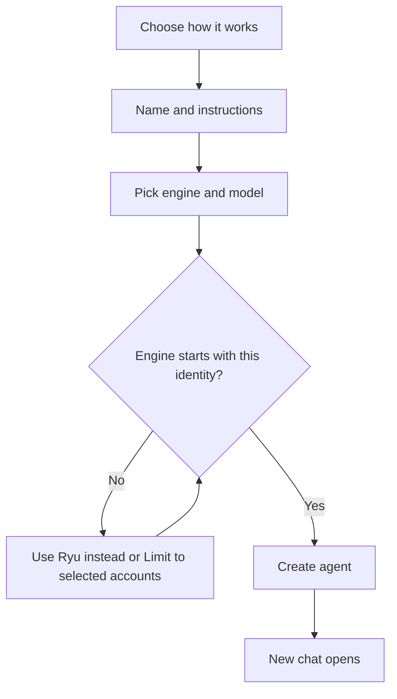

Create a custom agent from the **Agents** page. For what agents are and the built-in ones, see
[Agents](/docs/surfaces/desktop/user-guide/agents).

## Create a new agent

1. On the Agents page, click **+** to create a new agent.
2. Under **How should this agent work?**, choose one of three options. You can change this later in
   the agent's settings.
   - **Acts as you**: works on your behalf with the accounts you've connected. This is the default.
     It can't connect new accounts itself. It asks you with a card in the chat, and you finish the
     sign-in.
   - **Its own identity**: gets its own accounts and logins, and never touches yours.
     - Models Ryu routes for it run on Ryu credits, your organization's Ryu Cloud model use, or a
       local model, not on your provider keys.
     - The default **Ryu** engine runs it on Ryu's built-in engine. Engines that use your own
       sign-in (such as Claude Code, Codex with your ChatGPT sign-in, or Gemini CLI), and engines
       Ryu can't route through its Gateway, don't start for it.
     - It can't use MCP servers or app tools that need an API key or secret you saved, control your
       desktop with Ghost, or read what Shadow captured.
     - You can [connect apps for it](/docs/surfaces/desktop/user-guide/agent-account-access#connect-apps-for-an-agent)
       after you save it.
   - **Both**: has its own accounts, and can also use the ones of yours you allow.
3. Give it a **name**.
4. Write its instructions in the setup composer. It accepts Markdown, and the expand button
   opens the full Plate editor with formatting, blocks, links, and other writing controls.
5. Use the agent and provider/model picker at the bottom of that composer to choose the model and
   provider that run it. The choice is saved with the agent; existing agents use the same composer.
6. Select **Create agent**. Ryu opens a new chat with it, and the agent introduces itself and asks
   what you want to do first.

### Optional channel setup

Before you create the agent, you can turn on channel setup for **Telegram**, **Discord**, and
**WhatsApp**. The first selected setup opens automatically with the new agent selected.

- Telegram can use Ryu's managed bot flow.
- Discord and WhatsApp ask for the credentials their platforms require.
- If you select more than one, finish the first setup and add the others from **Channels**.

On shorter windows, the dialog scrolls so **Create agent** and **Advanced setup** stay reachable.

If you close the dialog before creating the agent, the details you entered are kept. Next time it
starts again at **How should this agent work?** with **Acts as you** selected, so check that choice.

## Engine check

Before the agent is created, Ryu checks that the engine you picked will start with the choice from
step 2. If it won't, the dialog shows the same message the agent's first chat would show, and
**Create agent** stays unavailable until you fix it:

- **Use Ryu instead** switches the agent to the **Ryu** engine. It isn't offered for **Both** with
  no limit on a computer without the account sandbox, because Ryu can't run that either.
- **Limit to selected accounts** creates the agent limited. Choose its accounts in the editor
  afterwards.

On a computer without the [account sandbox](/docs/surfaces/desktop/user-guide/agent-account-sandbox),
the first step also says that an agent with its own identity or limited accounts can run only on
Ryu there.

When a custom agent on the **Ryu** engine has its own identity or limited model providers, a line
under the engine picker says it runs on Ryu's built-in engine while its accounts are limited.

If such an agent would start on Ryu's local model and that model isn't downloaded, the dialog warns
that it has no usable model. You can still create it, but its chats fail until you download the
local model, pick a default model it can use, or allow a model provider.

Which engines start depends on that choice and on the agent's account access:

| Agent | Engines that start |
| --- | --- |
| **Acts as you**, no limit | Every engine. |
| **Both**, no limit | Every engine, in the account sandbox. On a computer without the sandbox, none, **Ryu** included. |
| **Acts as you** or **Both** with **Limit to selected accounts** on | **Ryu**, engines that send their model calls through Ryu's Gateway, and Claude Code, Codex with your ChatGPT sign-in, Gemini CLI or Kiro when that engine's provider is selected. In the account sandbox. |
| **Its own identity** | **Ryu** and engines that send their model calls through Ryu's Gateway. In the account sandbox. |

[Choose which accounts an agent can use](/docs/surfaces/desktop/user-guide/agent-account-access#choose-which-accounts-an-agent-can-use)
has the full rules.

## Account access

A new agent starts with access to every account its choice allows. To limit it, use **Account
access** on the advanced **Connections** tab of the agent's editor. The **Bot** editor has no
**Connections** tab, so it shows **Account access** under **Identity** on **Tools & knowledge**.

The same panel has:

- the agent's **Treg** switch, which covers the Treg calls apps make for the agent, including later
  calls for work the agent set up;
- **Model providers**, which limit the provider keys and sign-ins its models may run on.

When an app update asks for a wider identity choice for one of its agents, Ryu keeps your choice
and the editor shows the request under the identity choice. **Accept** selects it, and saving the
agent applies it. **Keep current** dismisses the request.

With **Advanced setup**, you can keep the full editor open in another tab.

## Editor layout

The agent editor opens with a short profile row (picture, name, and a one-line description) and
three essential tabs:

- **Behavior**: instructions with the model picker, personality and tone, and rules.
- **Tools & knowledge**: **Identity** (whether it acts as you, has its own identity, or both),
  lifecycle and safety, the tools and skills it may use, and the Spaces it may read and whether it
  may remember new things.
- **Triggers**: when it runs on its own. An event trigger watches one of your connected accounts
  or, for an agent with **Its own identity** or **Both**, one of the apps connected to the agent
  itself. A trigger whose account the agent's **Identity** or account access no longer allows is
  marked **Paused: account not allowed**.

### Advanced tabs

In **Bot**, the editor shows only the essential tabs. With access to Agent, **Advanced settings in
the Agent workspace** switches to the full editor. In **Agent** and **OS**, advanced tabs follow
after a divider: **Connections**, **Integrations**, **Health**, **Activity**, **Prompt Studio**,
**Versions**, and **Advanced**. Settings search sits alongside them.

- **Connections** holds **Account access** (which of your accounts and the agent's own it may use)
  and its channels.
- **Health** holds the scorecard described in [Health review](#health-review).
- **Advanced** holds the profile card (banner, badge, and display name), model capabilities,
  orchestration, and engine defaults.

### Built-in engine tools

The Ryu agent and Jay Jr. run on Ryu's own engine, whose shell and file tools are not in the tools
list.

- The Ryu agent keeps them in your own chats. Its tools list controls only which Ryu tools it calls.
- Jay Jr. keeps them only while it may use every tool. Once its tools are limited, as they are by
  default, its shell and file tools are off.

### Sandbox and engine check in the editor

An agent with limited account access, or set to **Its own identity** or **Both**, runs in a
sandbox, in trusted folders too. The sandbox hides Ryu's data, your credential stores, and on macOS
your Keychain. See [Agent Account Sandbox](/docs/surfaces/desktop/user-guide/agent-account-sandbox).

The editor runs the same [engine check](#engine-check) as the new-agent dialog. The **Identity**
section and **Account access** panel show why an engine won't start, and a custom agent's editor
offers **Use Ryu instead**. **Identity** also shows the no-usable-model warning.

While a custom agent on the **Ryu** engine runs on Ryu's built-in engine, its saved **Agent
launch** settings are set aside. They apply again when the limit is off.

### Remote A2A agents

An agent that stands in for a remote A2A peer (added from **Settings → A2A**) runs on the peer's
node, with the accounts set up there. Ryu reaches it with the credential you saved for the peer and
hands it none of your accounts.

- Its **Identity** section shows **Runs on another node** instead of the three choices.
- It has no **Account access** panel.
- Only an agent that acts as you with no account limit can hand work to a remote peer.

## Health review

The editor in Agent and **Advanced setup** include a **Health** tab. The small **New agent** dialog
does not. Its scorecard updates while you edit and checks:

- name, instructions, runtime, and model;
- lifecycle and access scope;
- memory writes, external connections, and background triggers.

Failed checks mark setup contradictions to fix before the agent can run. Warnings flag optional or
broad access to review. The scorecard is read-only. It does not replace Core or Gateway
authorization, and it does not claim the model was live-tested.

### Audit with an agent

**Audit with agent** sends the current editor snapshot, including unsaved changes, to your default
chat agent with the bundled `ryu-health-audit` skill. Override the reviewer in **Gateway settings →
Safety filters → Health audit agent**. The normal agent runtime, permissions, and approvals apply.

- The result has an advisory score, confidence, evidence, prioritized recommendations, and
  limitations, separate from the static grade.
- The audit does not save editor changes or authorize applying recommendations. Editing the
  snapshot clears its previous assessment.
- **Open audit conversation** shows the transcript, where you can continue an incomplete review.

## Related

<Cards>
  <DocCard href="/docs/surfaces/desktop/user-guide/agents" />
  <DocCard href="/docs/surfaces/desktop/user-guide/agent-account-access" />
  <DocCard href="/docs/surfaces/desktop/user-guide/agent-account-sandbox" />
</Cards>
