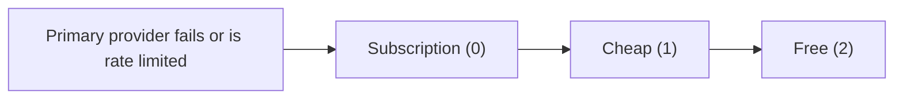

Open **Gateway settings → Usage & cost** to review the active node's upstream quota windows, your signed-in account's usage rollup, provider-side balances, and the provider cost tiers used by Gateway routing.

## Provider quota

The quota table lists providers that report upstream quota headers. For each one it shows the remaining requests or tokens, the window limit when available, and a countdown to reset. A provider that is limiting requests now is marked **Rate limited**; a healthy window carries no status. The countdown advances between Gateway status polls. A provider without observed quota headers is not listed. If no provider has reported quota yet, the section says quota appears once providers report their limits.

## Account usage rollup

The account rollup reads the signed-in profile's lifetime request count, token totals, spend, and most-used models. It is for information only and is separate from the active organization's shared Ryu credits. A temporary request error leaves the rollup empty and offers **Retry**. You must be signed in to see it.

## Provider cost tiers

Cost tiers set the Gateway fallback order when a provider fails or is rate limited. A failed primary falls back down the ladder from Subscription to Cheap to Free. A provider with no tier counts as Subscription.

| Tier | Value | Meaning |
|---|---:|---|
| Subscription | `0` | Subscription-backed provider |
| Cheap | `1` | Lower-cost provider |
| Free | `2` | Free provider |

Choose a tier for a configured provider and it saves right away; there is no Save button. The save keeps the rest of the routing configuration. Restart Gateway for the new order to take effect. If the config read fails, select **Retry** in the card. A failed save keeps your selected values and shows **Retry** so you can send it again.

## BYOK provider key balances

The BYOK card shows provider-side prepaid balances for OpenRouter, DeepSeek, and Moonshot keys stored on the active node. These are provider balances, not Ryu credits. A provider can report a dollar balance or explain why one is unavailable, such as no key being stored, an expired key, or a rate limit.

## Additional account keys

This read-only list is in **Gateway settings → API keys**, under **Providers**. It counts extra rotation keys set through the `OPENAI_API_KEYS`, `ANTHROPIC_API_KEYS`, and `OPENROUTER_API_KEYS` environment variables (comma-separated); each row shows its variable name. A count of zero reads **None**. Gateway rotates through them round-robin alongside the primary key. The card never shows or edits the keys.

To change the count, set the environment variable and restart Gateway. If Gateway is unreachable or a read fails, the card reports the count as unavailable instead of zero, and you can retry from the card.

See [Credits and usage](/docs/surfaces/desktop/user-guide/marketplace-buying#the-credits-wallet) for the organization wallet and [Gateway credits and operations](/docs/gateway/configuration-operations) for server-side metering configuration.

## Captions and details

Each section has a one-line caption. Where there is more to say about how a setting works, an
information icon next to the caption shows the full explanation.

## Where provider keys live

**Gateway settings → API keys** groups every key into three parts on one page:

- **Providers**: your own keys for AI providers, account-backed provider credentials, and the additional account key counts.
- **Media & tools**: speech, web search, Composio, Replicate, and fal.ai keys.
- **App access keys**: the keys apps and command-line tools use to reach this node.

Each key row shows whether a key is set. **Clear** is in the row's **⋯** menu. On **Overview**,
Doctor's **Preview safe fixes** and **Copy report** are in the Doctor **⋯** menu next to **Run audit**.

On **MCP server**, each server you added has a switch that turns it on or off for this node. A
server that an app provides is switched from that app instead.
