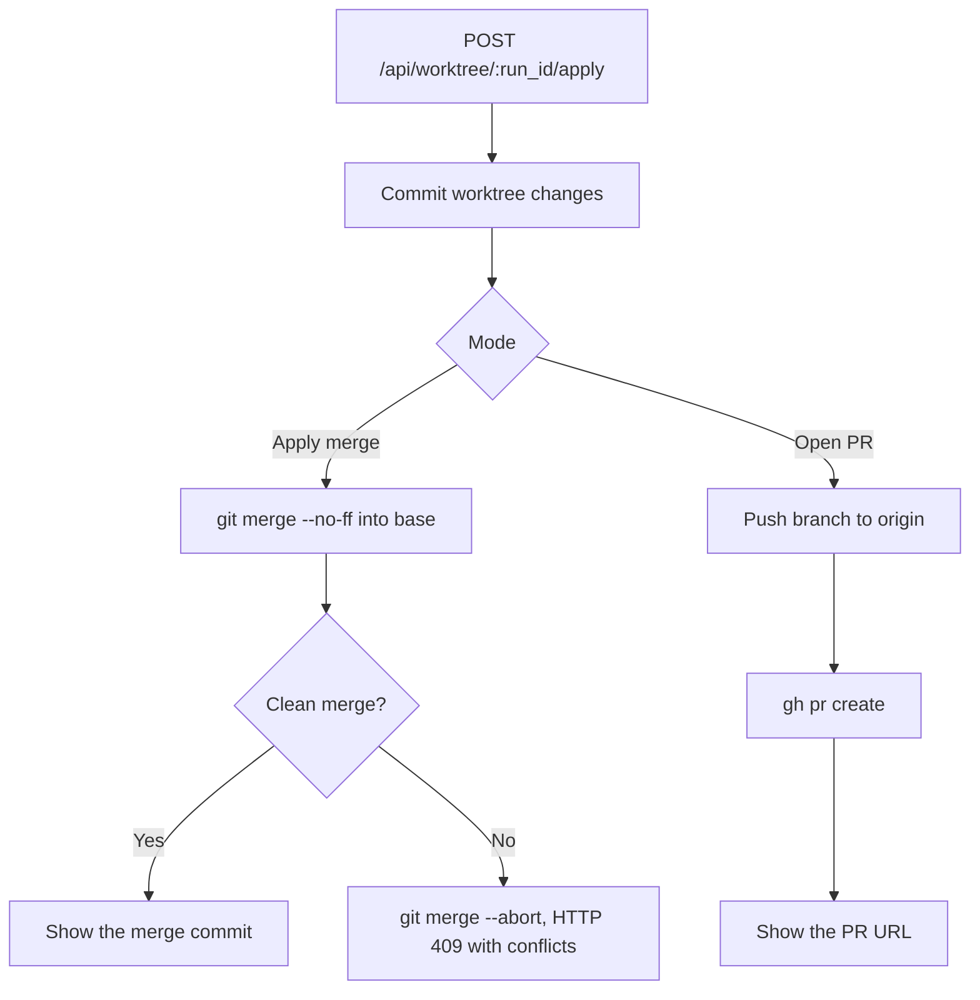

Use these controls after you choose a project folder or clone a repository. The actions apply to the
conversation's project on the active node. To choose folders, branches, and worktrees, see
[Git Workspace & Worktrees](/docs/surfaces/desktop/user-guide/git-workspace).

## Work with Git from a chat

### Start in Ryu Work mode

In **Ryu Work** mode, the new-chat composer starts without the project-folder picker. Ordinary
conversation does not require a folder. When a message clearly asks to edit or run local project files,
Ryu pauses that turn and asks for a project in context. After the first turn, the conversation remembers
its folder independently of the global project selection.

### Commit and sync from the conversation

The **Pinned summary** rail beside the conversation shows the chat's project, run mode, branch, and
change totals. Use the list icon in the chat toolbar to show or hide it. Its first Environment row is
the conversation's project name. It is read-only, so changing the global project selection cannot
move an existing chat to another project.

Choose **Commit or push** in the Environment row to open the Git action dialog:

1. Target the current branch or create a new one.
2. Add an optional commit message, and choose whether to include unstaged changes.
3. Select **Commit**, **Commit and push**, or **Push**.

While Core is working, the Environment row replaces the action with **Generating message**,
**Committing**, or **Pushing** and a stop control aligned to the right. The summary refreshes its
counts after the action.

Commit, pull-request, and repository-publishing dialogs follow your selected theme. Fields show
a visible keyboard-focus ring, and dialogs scroll in smaller windows so their actions remain
reachable. Use the close button or press **Escape** to dismiss a dialog.

Each pinned summary section shows a count beside its title. Section actions, such as opening the full
Sources or Subagents list, sit beside the collapse chevron.

### Pull and sync a remote

The Environment row also has **Pull** and **Sync** controls for repositories with an upstream.
- **Pull** runs a fast-forward-only pull.
- **Sync** pulls first and then pushes the current branch.

Neither action stages or commits local changes. Divergence, missing upstreams, and remote failures are
reported in the row instead of creating an implicit merge commit.

While either action runs, the row shows **Pulling** or **Syncing**, then refreshes the shared branch
counts. Core runs remote Git work, so the progress row has no stop control. The operation either
finishes or reports its failure.

### Create a repository

Git controls only appear after the selected folder is recognized as a Git repository. In **Ryu Work**,
a non-repository folder instead gets a **Create local Git** action in Environment. It initializes a
repository on `main` without staging or committing the folder. Once local Git exists, the normal branch,
change, commit, and remote controls appear.

If the Pull Requests app is enabled, **Create GitHub repository** opens a small publish flow for the
repository name and **Private** or **Public** visibility. Ryu then:

1. commits the folder locally;
2. asks the authenticated GitHub CLI to create the remote;
3. adds `origin` and pushes the current branch.

A failed provider operation does not remove the local repository. If publishing fails, the dialog
keeps the repository name and visibility so you can retry.

### Compare branches

For a GitHub-backed repository, the same Environment row includes **Compare branch** when the current
branch is different from its comparison base. The action opens the provider's compare view in a new
browser tab. Ryu picks the base in this order:

1. the current pull request's base, when available;
2. GitHub's default branch;
3. local `main` or `master`, with `main` as the fallback.

### Hand off work to an isolated worktree

When a conversation is already underway in the local checkout, choose **Hand off to worktree** in
the Environment row to keep the same chat while moving its next response into an isolated worktree.
Enter the branch name in the dialog and choose **Hand off**.

If a response is running, Ryu interrupts it before arming the handoff. Core creates the named worktree on the next turn. The action is hidden
once this conversation already has a live worktree.

### Organization-node safeguards

On an organization-bound node, **Pull** and **Sync** require the caller's `agent.edit` permission.
The node accepts only workspaces inside its node-home boundary, disables repository-local executable
clean/smudge/process filters, and keeps Git non-interactive. A remote operation times out after two
minutes rather than waiting indefinitely for credentials or a remote server.

### Create and review pull requests

On a branch other than `main` or `master`, the Environment row also offers **Create pull request**.
Its dialog names the source and base branches, accepts an optional title and description, and lets you **Commit and push local changes**
before choosing **Create draft PR**, **Create PR**, or **Open PR in browser**.

Pull-request creation uses the Core node's authenticated GitHub CLI (`gh`), so the repository's remote
and credentials must be available on that node. Ryu allows only one open pull request for a branch.
If one already exists, the row changes to a GitHub-linked pull-request title instead of offering a
second create action.

When the **Pull Requests** app is enabled, it adds metadata through the local authenticated `gh` CLI:

- A CI rollup below the pull-request link. A failing rollup shows **Fix**, which stages a bounded `ci-failures-pr-<number>.txt` report in the current chat composer for review before you send it.
- The PR's comment count, with a link to its discussion.
- The same title, status icon, and CI summary in a chat's sidebar hover card.
- In **Code** mode, a compact linked status icon on a code-session row with a pull request. Open is GitHub green, draft is gray, closed is red, and merged is purple.

Ryu looks up a row's pull request only when needed, so many open chats do not start a GitHub request
for every row. Local Git status and the create flow work without the app.

### Link several pull requests to one chat

A chat tracks the pull request its branch owns automatically. To follow more (a stacked change, or
a fix that spans repositories), open the chat's sidebar menu and choose **Link pull request…**, then
paste a GitHub pull request link such as `https://github.com/owner/repo/pull/123`. Linking requires
the **Pull Requests** app.

- Linked requests show their own status icons on the row and appear in the hover card.
- Reopen the same menu entry (**Linked pull requests (n)…**) to unlink one.
- Row icons refresh about every two minutes (less often after a failed lookup). The hover card loads full details only when it opens.
- Links are saved on the Core node with the chat, so they follow it to other clients.
- A chat can link up to 20 pull requests.

To find a chat by its pull request, type the number in global search or in a chat list's search
field: `#123`, `123`, `pr 123`, `repo#123`, and `owner/repo#123` all match. Linked pull requests are
always searchable. A chat's branch pull request becomes searchable once Ryu has looked it up on that
device, for example after its sidebar status icon or hover card has loaded.

### Automate linked pull requests

Two optional switches under **Gateway settings → Developer → Git → Watch and fix pull requests**
act on every pull request a chat is linked to, including its branch's request. Both are off by default.

- **Auto-address pull request comments** sends one new turn to the chat when repository
  collaborators leave new conversation comments, reviews, or inline review comments on an open
  linked pull request. The turn quotes each new item (with its file and line for inline comments)
  and includes your **Watch instructions**.
- **Archive chat when pull requests close** archives a chat once every pull request linked to it has
  been merged or closed. A request that cannot be read (for example while GitHub is unreachable)
  keeps the chat open until it can be checked again.

Comment text comes from other people, so auto-address only reacts to accounts GitHub reports as the
repository's owner, organization members, or collaborators. These never start a turn:

- comments from anyone else;
- comments from bots and GitHub Apps;
- comments from your own GitHub account, including anything Ryu posts as you;
- comments hidden on GitHub;
- inline threads that are resolved or outdated.

The turn presents the quoted feedback as untrusted text and asks the chat to make and verify the
requested changes locally. It tells the chat not to push, merge, or post on GitHub unless you asked
for that in the chat or in your watch instructions.

A chat that is already running waits until its turn finishes. Each chat gets at most three automated
turns per hour, at least five minutes apart. Feedback that arrives in between waits for the next
allowed turn.

Both switches only react to changes seen after they are turned on. Turning one off and on again
takes a fresh starting point, so it does not replay comments posted in between or archive chats
whose requests closed in between. Changes made while the app is closed, with the switches left on,
are still picked up on the next check.

The desktop app checks the most recent unarchived chats about once a minute while it is open,
through the **Pull Requests** app's GitHub connection. Each check reads a pull request's state and
recent feedback in one request, and merged or closed requests are checked less often. Only one
window checks at a time.

Each desktop client keeps its own record of what it has already addressed. If several clients have
the switch on for the same node, each one reads the chat first, skips feedback another client already
sent, and counts those turns toward the chat's hourly limit.

<Callout type="warn">
  Two clients that check at the same moment can occasionally both send the same feedback.
</Callout>

### Refresh repository and pull-request status

Repeated PR lookups can reuse a result for ten seconds within the same node and credentials. Active
views refresh every thirty seconds. Inactive views stop refreshing. Branch actions refresh matching
PR data.

Git status and worktree status and diff caches are scoped to the node and credentials. Identical
folder paths or conversation IDs on different nodes do not share results.

The branch segment's status polling and checkout are described in
[the workspace bar](/docs/surfaces/desktop/user-guide/git-workspace#the-workspace-bar).

### Save changes during run review

In a completed run's **Changes** section, choose a file and turn on **Edit**.
**Save file** writes your edits back to that run's working file and refreshes its diff.
If the write fails, the review shows the error and keeps your unsaved edits so you can correct the
problem and use **Save file** again. A successful save reads the updated file contents when the diff
refreshes.

## Review the diff in chat

After a run, the in-chat **diff panel** reads the aggregate worktree diff from
`GET /api/worktree/:run_id/diff`, where `run_id` is the conversation id. It shows one file at a time
with line numbers and visible additions and deletions. Use the filterable changed-file list to move
between files; the header keeps the aggregate totals visible.

The diff captures both committed changes on the worktree branch and uncommitted working-tree edits,
so files the agent created but never committed still appear (Core stages with `git add -A` before
diffing).

## Review local project changes

Open the project **Changes** tab to inspect the selected folder's tracked Git changes. The source menu
shows the working-tree diff, the staged diff, recent commits, and local branches. Choosing a commit
shows its patch. Choosing a branch compares the current branch with the changes since it diverged from
that branch. The branch menu lists the repository's local refs.

Use **Split** or **Stacked** to change the diff layout. **Edit** enables editing in the working-tree
view, and **Save file** writes a changed file back to the project folder. **Refresh diff** rereads the
selection. If Git cannot read it, the panel shows the command error and keeps Refresh available for a
retry.

## Apply the changes

From the diff panel you can apply the run's work with `POST /api/worktree/:run_id/apply` in one of two
modes.

| Mode | What it does |
|---|---|
| **Apply (merge)** | Commits the worktree's changes, then merges the worktree branch into the base branch with `git merge --no-ff`. |
| **Open PR** | Commits, pushes the branch to `origin`, and opens a pull request with `gh pr create`. |

On a clean merge the panel shows the resulting commit. For a PR it shows the created PR URL. If the
merge cannot complete cleanly, Core runs `git merge --abort` so your base repository is never left
mid-merge, returns the list of conflicted files (HTTP 409), and still cleans up the worktree.

<Callout type="warn">
  PR mode requires the GitHub CLI (`gh`) to be installed and authenticated on the machine running
  Core. Merge mode needs only git. Both modes operate on the Core node, so for a remote node these run
  against that node's repo and credentials.
</Callout>
