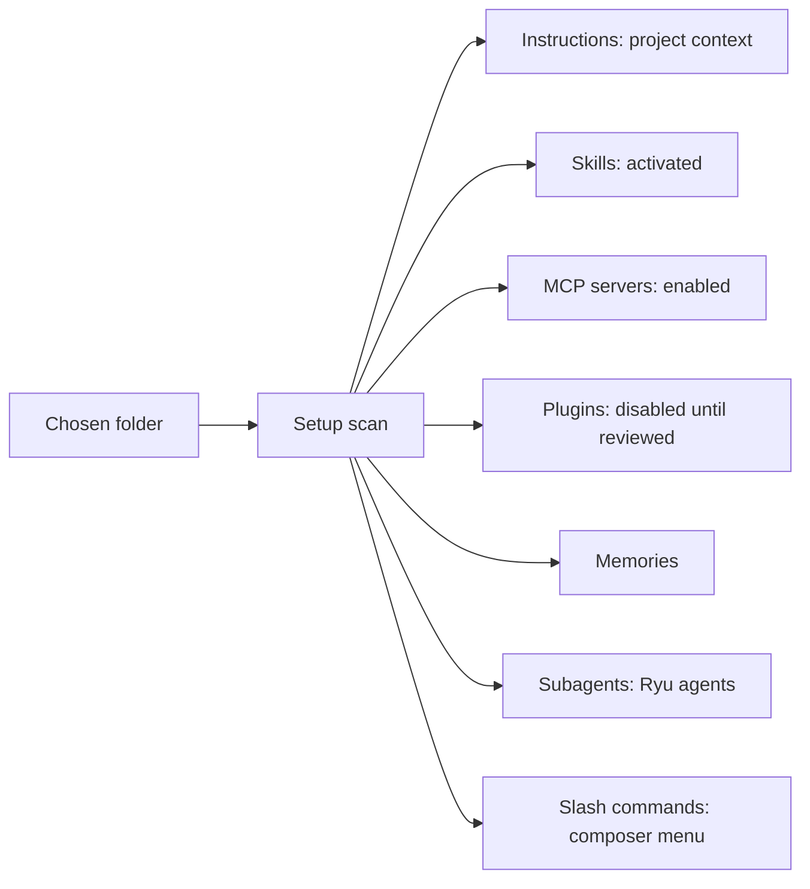

Ryu can import work and setup from **Claude Code**, **Cursor**, and **Codex**.

<Callout type="warn">
  Setup import supports all three agents. Chat import supports only Claude Code and Codex. Cursor
  conversation history cannot be imported.
</Callout>

You can import two things:

- **Chats** - your past agent conversations (threads), restored as Ryu
  conversations filed under the project folder they ran in.
- **Setup** - your agent configuration: project instructions, skills, MCP servers,
  plugins, project memories, subagents, and slash commands.

Importing reads your folders and copies the items into Ryu. It never changes the source files.

Pick the right tool for the move:

- **Setup and chat import** (this page) copies another tool's instructions, agents, skills, plugins,
  memories, slash commands, or chats.
- A [portable package](/docs/extend/develop/extensions/portable-packages) moves a versioned
  definition and its declared artifacts between folders, archives, GitHub, or Marketplace.
- [Data Folder & Storage](/docs/surfaces/desktop/user-guide/data-and-storage) covers a complete node
  backup.

## Import past chats

Open **Import a past agent thread** from the Chats section of the sidebar, the
launchpad, or the command palette. Pick the agent (Claude Code or Codex), choose
the threads you want, and import them.

Each imported thread becomes a normal Ryu conversation. Importing the same thread again on the same
node and in the same account adds only its new messages when the source has a native session ID.
Older Claude Code transcripts use their session filename for the same behavior.

Messages you added inside Ryu are preserved. A transcript without a reusable native session identity
can import as a separate conversation.

## Import agent setup

Open **Import agent setup** from the Chats section, the launchpad, or the command
palette. Point at a folder and Ryu scans it for anything it can import:

- **Instructions** - `AGENTS.md` / `CLAUDE.md` at the folder root. The folder is
  registered as a project so chats group under it in the sidebar. The file is
  added to the agent's context for every turn that runs in that folder, as Claude
  Code and Cursor do with their instruction files.
  - Ryu reads the live file, so an edit (in the folder, or from the project settings dialog)
    applies to the next turn.
  - Ryu also adds matching instruction files from your home directory and each parent folder,
    broadest first.
- **Skills** - any Agent Skills (`SKILL.md`) directories found inside.
- **MCP servers** - servers declared in an `mcp.json`, a Cursor `.cursor/mcp.json`,
  a Codex `config.toml`, or a Claude `~/.claude.json`. Remote servers that need
  authentication keep their headers, so you may need to finish setup after import.
- **Plugins** - plugin bundles (`manifest.json`) found in the folder. Plugins are
  installed but stay **disabled** until you review their permissions and enable
  them, so nothing runs until you allow it.
- **Memories** - Claude Code project memories (`memory/*.md`). Importing again
  does not create duplicates.
- **Agents** - Codex subagents (`~/.codex/agents/*.md`), imported as Ryu agents
  with their description, model, and instructions.
- **Slash commands** - Codex prompt commands (`~/.codex/prompts/*.md`). Imported
  commands appear in the composer's `/` menu and expand to their prompt template
  when you pick them.

The dialog offers one-click scans of your `~/.claude`, `~/.cursor`, and `~/.codex`
folders. You can also choose any folder (for example, a project that vendors its own
`skills/` directory or plugin bundles).

### Keep setup in sync

Turn on **Auto-import agent setup** in **Settings → General → Chats** to keep
imported instructions in sync with your Claude Code, Cursor, and Codex folders.
Ryu rescans on launch, on a timer, and when the window regains focus.

- An edit to an instruction file, or a reverted edit, refreshes the imported copy on the next rescan.
- Unchanged files are not imported again when the connected node supports content revisions.

Auto-sync imports **instructions only**. Import skills, MCP servers, and plugins
yourself so you can review them first.

Automatic imports follow the selected node and its current sign-in:

- Switching nodes or accounts cancels a pending scan, so old results do not reach the new
  connection. An import already submitted can still finish on its original node.
- Each connection keeps its own record of imported items. An item that Core refuses stays eligible
  for a later scan.
- Turning off an automatic import setting stops a pending scan from submitting more items.

## What to review after importing

- **MCP servers** - entries with custom authentication, headers, or environment
  variables may need you to sign in again. Imported servers are enabled.
- **Plugins** - imported plugins are disabled until you review their grants and
  enable them.
- **Skills** - imported skills are activated so they are available to your agents;
  disable any you don't want.
- **Agents** - imported subagents appear in the Agents library like any agent you
  created; their tools may need an MCP server that isn't configured yet.
- **Slash commands** - imported commands show up in the composer's `/` menu and
  expand to a prompt template when picked (see
  [Slash command reference](/docs/surfaces/desktop/user-guide/slash-commands)).

## Related

- [Chat](/docs/surfaces/desktop/user-guide/chat)
- [Slash command reference](/docs/surfaces/desktop/user-guide/slash-commands)
- [Agents](/docs/surfaces/desktop/user-guide/agents)
- [Git workspace](/docs/surfaces/desktop/user-guide/git-workspace)
- [Spaces](/docs/surfaces/desktop/user-guide/spaces-memory)
- [Long-term memory](/docs/surfaces/desktop/user-guide/memory)
