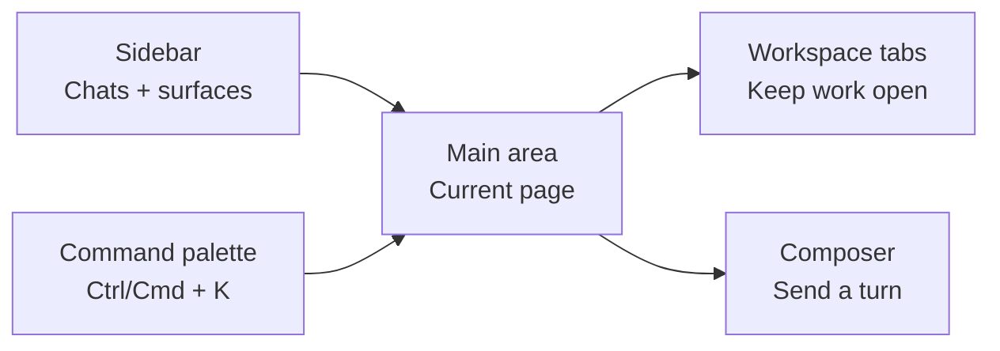

This guide is for anyone who uses the Ryu desktop app day to day. Start with the
[Desktop Tour](/docs/surfaces/desktop/user-guide/desktop-tour), then open the task you need.

<Figure name="desktop" />

<SurfacePreview surface="chat" />

The same four areas work together on every desktop surface:

## Start here

<Cards>
  <DocCard href="/docs/surfaces/desktop/user-guide/desktop-tour" />
  <DocCard href="/docs/surfaces/desktop/user-guide/onboarding" />
  <DocCard href="/docs/surfaces/desktop/user-guide/tabs-and-panes" />
  <DocCard href="/docs/surfaces/desktop/user-guide/appearance" />
</Cards>

## Common tasks

<Cards>
  <DocCard href="/docs/surfaces/desktop/user-guide/chat-basics" />
  <DocCard href="/docs/surfaces/desktop/user-guide/agents" />
  <DocCard href="/docs/surfaces/desktop/user-guide/tools-and-connections" />
  <DocCard href="/docs/surfaces/desktop/user-guide/spaces-memory" />
  <DocCard href="/docs/surfaces/desktop/user-guide/store" />
  <DocCard href="/docs/surfaces/desktop/user-guide/data-and-storage" />
</Cards>
