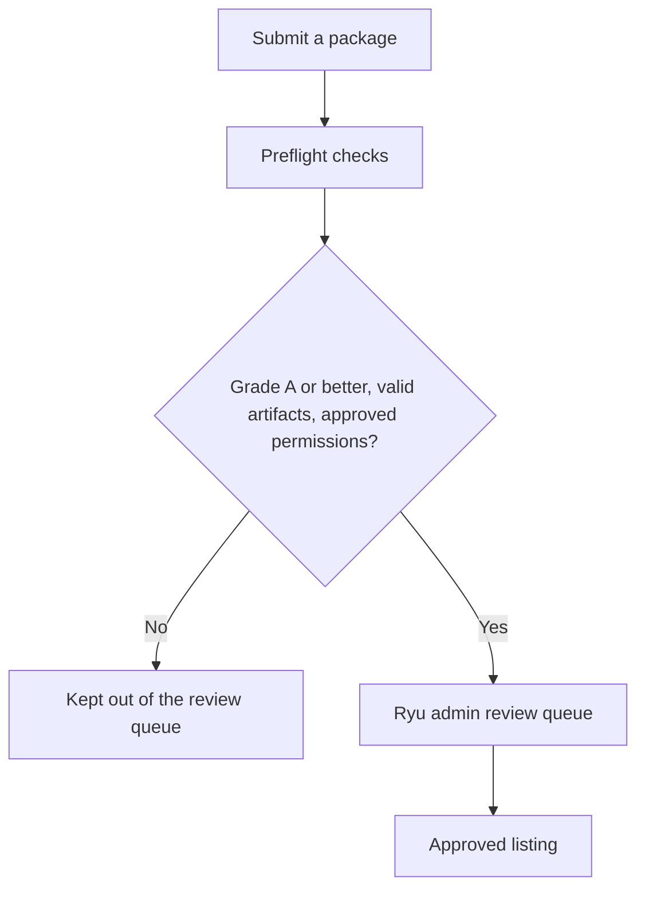

This page is for organizations that publish or sell Marketplace listings. Publishing and payouts belong to an organization. To browse listings, use the [Marketplace guide](/docs/surfaces/desktop/user-guide/marketplace).

See [Develop: Marketplace](/docs/extend/develop/extensions/marketplace) for the publishing and signing workflow.

Publishing requires an authenticator app or a passkey on your account. A new release also waits
seven days after its GitHub release before installs and updates pick it up; until then, people get
your previous approved version. See
[Supply-chain protections](/docs/extend/develop/extensions/marketplace#supply-chain-protections).

## Marketplace item pricing and publisher pool

Paid apps and plugins show their price and any recurring or update terms on their Marketplace listing. Free and paid listings follow the same signature, permission, and node-access checks.

**A Major Pass** is an individual subscription, currently offered at $20 per month or $200 per year. Eligible paid apps can opt into its publisher pool after the organization completes payout setup.

The default pool is 70%, distributed from first-use signals and price-tier weights. Publisher totals and payout status appear in **Sell → A Major Pass**.

One-time and bounded-update sales remain direct seller transactions. Private or community listings do not participate in the recurring publisher pool. Check Marketplace for current prices and eligibility.

## Publisher marks and organization collections

A publisher mark identifies who stands behind a listing. It is separate from the listing's health score, signature, and permission checks.

| Mark | Meaning |
|---|---|
| **Gold** | A Business or Enterprise organization with a Stripe-verified identity and a verified domain, approved by Ryu staff. |
| **Blue** | A paid organization that verified its identity with Stripe Connect or a domain; Ryu has not reviewed the publisher. |
| **No mark** | Everyone else. Community publishing is still allowed. |

The blue mark is automatic. To add a domain:

1. Open **Verification** from the organization switcher.
2. Publish the TXT record shown there at your DNS provider.
3. Select **Check DNS**.

Keep the record in place. A domain whose record is gone for three daily checks is removed. Each
domain belongs to one organization, so use a subdomain for a second one.

To request the gold mark, your organization must be on Business or Enterprise and have both a
Stripe-verified identity and a verified domain. The page shows a checklist of anything missing.
Personal workspaces cannot request gold verification.

An owner or admin submits the request with:

- the registered legal name;
- a valid contact email;
- an optional HTTPS website;
- up to 10 HTTPS evidence links;
- a statement of 20 to 2,000 characters.

Gold shows only while all of those still hold. A pending request cannot be duplicated. After a
rejection, the previous details and reviewer note are shown so you can correct and resubmit.

Select a mark to see its verification details, including **Verified since** when available. Public profiles can also show verified email or domain signals; the underlying email address and domain are not displayed.

Organizations can create private Marketplace collections. Members of that organization can browse them, and administrators can assign supported plugins, MCP servers, and skills to enrolled nodes. Private collections do not appear in the public catalog.

When a listing has a muted publisher mark, review its health score and signals before you choose the `I understand the risk, install` button. The score is a review aid, not a safety guarantee; signature and permission checks still apply.

### Follow publisher organizations on the web Marketplace

The web Marketplace follows publisher organizations rather than individual listings. Open the **Marketplaces** tab, choose a public publisher, and select **Follow**. The choice is stored on your account and remains available in future browser sessions.

Choose **Following** in the Marketplace filter to narrow listings to organizations you follow. Federated catalogs and Ryu's built-in catalogs are not included in that filter. Switch to **All listings** to see them again.

## Listing presentation comes from GitHub

A signed `manifest.json` provides the listing's presentation details. Publishers can include an author, homepage, repository, license, keywords, tags, policy links, example prompts, a banner, and screenshots. GitHub-compatible `.codex-plugin/plugin.json` and `.claude-plugin/plugin.json` files can also provide discovery details.

The desktop preview shows the listing name, short description, and up to three example prompts. Use **More details** to review screenshots, setup instructions, bundled skills, capabilities, publisher details, links, and reviews. Publishers can choose a banner palette in the manifest; Ryu derives a consistent palette when one is not supplied.

Listing details may show declared layers such as **Browser toolkit**. The **External** mark identifies a hosted provider; a local provider remains local even when its description mentions an upstream service.

### How to read Support & extensions

Listing details answer three separate questions:

| Detail | Meaning |
|---|---|
| **Support** | Where the listing appears and the declared support level: full, limited, list-only, or command-only. |
| **Extends** | The existing capability or shell slot it adds to, such as **Browser** or the **Shared Ryu shell**. |
| **Where it lives** | The ownership boundary: **Core runtime**, **Shared Ryu shell**, or **Package sidecar**. |

Web, Mobile, and the Browser extension can use the shared Desktop shell for navigation and host-rendered contributions. A shared-shell listing does not gain Desktop-only windows or native APIs. For example, the Browser app contributes its dock panel while Chromium remains the browser runtime.

## Sell your own items

Selling a paid item requires your organization to complete Stripe Connect payout setup. Free listings do not require seller onboarding.

1. Open the **Sell** tab and choose **Set up payouts** (or **Continue onboarding**).
2. Complete Stripe's identity, bank, and tax verification.
   - On the web, **Marketplace payouts** opens as a page in the organization console (**Organization Settings → Marketplace & payouts**), and Stripe's verification runs inside Ryu, styled to match.
   - In the desktop app, Stripe's hosted form opens in your browser. Return to the Sell tab when you're done.
3. Once verification completes, the status changes to **Payouts enabled**. If Stripe is still verifying or needs more information, the payouts view says so, with **Review details** and **Check again**.
4. Add the GitHub repository for your listing and follow the publishing flow.

After setup, **Manage seller account** on the web reopens **Marketplace payouts**, with any notices from Stripe and these views for your organization:

| Tab | What it shows |
|---|---|
| **Payouts** | Balance, upcoming and past payouts, and the payout schedule. Payouts are sent automatically on Stripe's schedule; manual and instant payouts and schedule changes are not available, so recent sales stay available to cover refunds and disputes. |
| **Payments** | Sales paid to your organization. This view is read-only: refunds and disputes for Marketplace sales are not handled here. |
| **Account** | Business details and the bank account payouts go to. |

Opening payouts asks you to confirm it's you first, because payout settings change where your organization's money goes.

Payouts belong to one organization. If a different organization becomes active while the page is open (for example after switching in another tab), Ryu stops and asks you to open payouts from that organization's Marketplace settings instead.

If a deployment can't show Stripe's views inside Ryu, the page offers **Continue on Stripe**, which opens Stripe's hosted form and brings you back afterwards.

For an app, choose **Include in A Major Pass** if it should participate in the recurring publisher pool. The [Develop: Marketplace guide](/docs/extend/develop/extensions/marketplace) covers package publishing, signatures, and release requirements.

<Callout type="warn">
  Payout setup and paid purchases require Stripe to be available on your deployment. Only organization owners and members with billing permission can set up or change payouts. If setup is unavailable, ask your organization administrator.
</Callout>

If a private collection's packages fail to load, close and reopen its item list to retry.

### Publish from GitHub

On the web, the **Publish from GitHub** panel can submit a free package without Connect. For a
private repository:

1. Install the Ryu GitHub App when prompted.
2. Approve the authorization request GitHub shows.
3. Choose **Check again**. The browser never receives a GitHub token.

Your GitHub account needs write access to the repository, and the installation is linked to the
organization you are publishing as. When you publish from the desktop app, finish the GitHub step in
a browser signed in to the same Ryu account. If that browser is signed out, Ryu asks you to sign in
and retry.

### Package review

Ryu checks every portable package before it enters review. The preflight detects UI automatically:

- Custom UI source is checked against the shared design system.
- Manifest-declared surfaces that Ryu renders (such as settings tabs and composer controls) use the shared-renderer profile.
- Packages with no UI receive a passing not-applicable UI check and are graded on their package-type artifacts.

A grade below A, an invalid artifact, or an unapproved permission keeps the submission out of the Ryu
admin queue. Organization-private packages receive the same review and remain private after approval.

