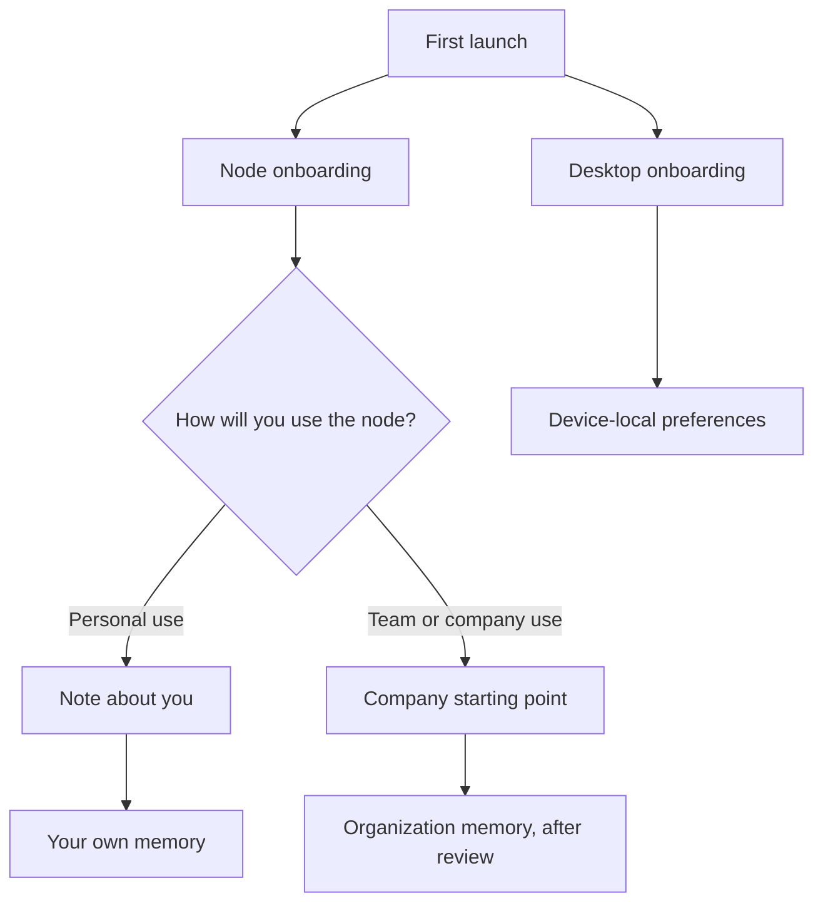

Onboarding sets up Ryu the first time you open it. It has two separate flows:

- **Node onboarding** applies to the node (server) you are connected to. It records whether the
  node is for **Personal use** or **Team or company use**. That choice decides which context Ryu
  builds next.
- **Desktop onboarding** applies only to this installed desktop. It covers appearance, window
  behavior, privacy choices, and other device-local preferences.



A fresh setup opens with a short welcome: Ryu introduces itself one line at a time, says hello,
and then moves into setup on its own. Choose **Skip** (or press Enter or Escape) to go straight to
setup.

With the app's animations setting off, or reduced motion on in your system, the welcome
shows only the "Welcome to Ryu" line.

Desktop onboarding saves your current step on this device. On macOS, some permission changes take
effect only after Ryu restarts. If you quit and reopen Ryu to finish one, onboarding returns to the
step you were on. Onboarding motion follows the app's reduced-motion setting.

## Choose the node's context

The first node setup step asks how you will use the node.

- **Personal use** lets you add a short note about yourself. It stays with the personal node and
  does not become shared company knowledge. The note is part of every thread's system prompt, so
  adding or changing it asks you to confirm first, because it resets the prompt cache for the node's
  existing threads.
- **Team or company use** lets a node administrator add a short company starting point: the team,
  products, customers, policies, or working style. Ryu can then use approved, read-only
  connections and imported work to draft shared company knowledge for the organization. You review
  the draft. Onboarding never edits an external account or changes an agent without asking.

Only a node administrator with the `gateway.configure` permission can save or reset team setup.
On a personal node, only the node's owner can save or reset it. The server enforces both rules, on
any desktop.

## Follow setup progress

During local setup, the progress bar follows the installer's reported percentage and setup
milestones. When a phase reports no percentage, the bar shows an indeterminate indicator. It
reaches 100% only when setup is complete.

## Personalize the default agent

New setups start with the built-in **Ryu** agent. You can change its name or avatar later in agent
settings, and find more agents in the Store. Renaming changes only the displayed name. The agent
keeps its stable `ryu` id.

## Create your first project

Onboarding offers to create your first [project](/docs/apps/projects):

1. Type a name.
2. Optionally add an icon, a short description, and a folder (desktop app only). The description
   becomes the project's instructions, which every bot working on it receives.
3. Choose **Create project**, or **Skip for now** to continue without a project.

The default agent coordinates the project, which is created on the node you are setting up. When
onboarding finishes, Ryu opens the project's main thread, so you start by telling the coordinator
what you want done. If you skip, the getting-started checklist offers **Create your first project**
until you have one.

If the node cannot create the project, the step shows the reason and keeps your entries, so you can
retry or skip. If you reload before setup finishes, Ryu checks the created project on the same node
and account before it opens the main thread. If the project was removed, setup returns to the
project step.

## Choose optional recommended skills

New setups keep the built-in agent and skills, so you do not install extra collections before your
first task. Find more skills in the Store when you need them. An unfinished setup from an older
version can still resume the optional collection picker.

This choice belongs to the node, because skills install into the node's shared Skills home. The
owner controls a personal node. An administrator with `gateway.configure` controls an organization
or team node. Ryu's embedded skills (including the Ryu and pstack skills) and skills from enabled
plugins are always built in and do not appear as options.

Clients can read and set the selection:

```text
GET /api/onboarding/skills
PUT /api/onboarding/skills
```

The server validates pack ids and installs only the selected external repositories. An empty
`selectedPackIds` array is valid: the node keeps only its built-in and plugin skills. If a download
fails, the selection stays saved and Core retries on a later start.

## Model defaults and connections

New setups move from node context to model defaults, safety, guidance, and privacy choices.
Provider setup, broad app connections, thread imports, profile builds, and Telegram wait until you
want those features. Existing provider choices and connected accounts stay in place.

- The local-default step starts with Gemma 4. If saving a local or cloud default fails, choose
  **Save default** again.
- The later provider step supports API keys and subscription OAuth sign-in.
- Optional ACP agents come from the earlier **Add your agents** step. Their own account setup
  follows after installation.
- Connecting an account first asks you to choose its access level. Canceling that dialog does not
  start a connection.

Profile builds keep memory scopes separate. Personal setup writes context to your own memory. Team
setup writes company knowledge to the organization's memory.

The profile build starts as soon as you choose **Build my profile**. You can wait on the progress
screen for it to finish, or pick another action:

- **Try again** starts another draft after a profile draft fails.
- **Run in background** keeps a longer build running while **Continue setup** advances onboarding.
  The profile is saved when the build finishes.
- **Skip and cancel** stops a draft that has not started saving, removes its profile chat so nothing
  is kept, and continues setup.

Sensitive-topic memory is a separate choice that is off by default. See
[Long-Term Memory](/docs/surfaces/desktop/user-guide/memory).

## Microphone and device access

New setups leave microphone, appearance, and general preferences out of the main path. Grant
microphone access when you first use voice input, or in **Settings → Privacy → Device
permissions**. Denying the OS dialog does not stop you from finishing setup.

**Settings → Privacy → Device permissions** shows the current access. Choose **Check access
again** after you change it. Microphone access for voice input is separate from the native capture
devices that Clips and Shadow use. For a remote node, check permissions on that node. Access on
your desktop does not grant access on another computer.

| Platform | Permission behavior |
| --- | --- |
| macOS | Microphone, Screen Recording, Accessibility, and Input Monitoring are separate OS permissions. Use the request controls or open the matching Privacy & Security pane. Restart Ryu after changing permissions, then retry. |
| Windows | Voice input uses the webview's microphone consent and Windows microphone privacy settings. Native screen capture and UI Automation have no matching permission prompt. Elevated windows can need extra privileges. |
| Linux | Microphone access depends on the webview and available audio devices. Native screen capture and global automation require X11; the recorder does not support Wayland portals. Input learning also needs read access to input devices. |

<Callout type="warn">
  A permission status checks only the OS gate. It does not prove that a microphone, display, or
  capture backend works. Retry the actual recording after you change access.
</Callout>

## Turn on notifications

Onboarding asks whether Ryu should notify you when an agent replies, needs your approval, or
finishes a run. The preview uses your default agent's name and avatar, and notifications use that
avatar as their picture. The step depends on where Ryu runs:

| Where Ryu runs | What happens |
| --- | --- |
| Desktop app (macOS, Windows, Linux) | Ryu turns on native notifications and sends a test one. Desktop systems do not tell apps when notifications are muted. If no banner appears, choose **Notification settings** to open the system pane (macOS **System Settings → Notifications → Ryu**, Windows **Settings → System → Notifications → Ryu**). |
| Browser extension | The browser asks to let the Ryu extension show notifications. They arrive while a Ryu tab is open. "Agent finished" notifications also arrive when no Ryu tab is open. |
| Web app in a desktop browser | The browser asks for permission for the site. Notifications keep working after you close the tab. If you blocked them before, allow them from the site controls beside the address bar. |
| Web app in a phone browser | On Android, the browser asks on that phone. On iPhone and iPad, Safari offers notifications only to web apps on the Home Screen, so the step shows how to add Ryu (**Share → Add to Home Screen**) and open it from there. |
| Telegram | Replies already arrive as Telegram messages, so there is nothing to turn on. |

Choose **Not now** to skip. Ryu does not ask again in the middle of your work. Change the choice at
any time in **Settings → Privacy → Device permissions → Notifications**, which also offers
**Send test notification**. The choice applies to this device only. If you already chose in
Settings, onboarding skips the step.

## Review privacy choices

A short screen first explains that agents can take approved actions, that active or scheduled work
can continue in the background, and where to review connections and approvals. After the
notifications step, the next screen shows product analytics, community stats, crash reports, and
diagnostics export with their defaults.

Set the switches, then choose **Get started**. Ryu saves the choices to the node's preferences, and
you can change them later under **Settings → Privacy**. Finishing this screen counts as seeing the
first-run privacy notice, so Ryu does not show a separate privacy dialog on the next launch.

- The switches wait for the node's current choices to load. If loading fails, choose **Retry**.
- Turning off analytics or crash reports takes effect at once.
- If a save fails, the previous choice returns and **Retry saving** tries again.
- **Full privacy details** is always available.

## Preview and choose a first task

The sign-in screen shows a sample workspace. It is only an illustration. It does not run agents or use
credits. After setup, eligible workspace owners can preview a starting task and choose an outcome
before connecting an app. Ryu asks for the task's connection and access level only when it needs
them.

- **See managed pricing** shows the subscription for Ryu-managed execution. No managed task starts
  before you confirm the subscription, and Ryu checks your entitlement again before it creates the
  task. An existing subscriber starts without another checkout.
- **Choose my own model** opens an editable chat draft with the context you gave. It is not sent
  automatically. Select your model before sending. Your own provider may charge for its usage.

The desktop license unlocks desktop features such as additional tabs. Managed AI and hosting are
separate purchases.

## Reset node onboarding

To run node setup again:

1. Open the node selector and choose **Gateway settings**.
2. Open **This device → Onboarding**.
3. Choose **Reset onboarding**.

This resets only the node's onboarding state. It does not delete chats, Spaces, memories, themes,
or other data. The next launch (or a reload) asks for the node context again.

Clients can read, set, and reset the node state:

```text
GET    /api/onboarding/state
PUT    /api/onboarding/state
DELETE /api/onboarding/state
```

Restart desktop onboarding separately with **Reset onboarding** in
**Settings → General → Setup & recovery**. It also clears your saved theme, typography, and layout
preferences. Resetting desktop onboarding does not reset the node's personal or team choice.

## Related

<Cards>
  <DocCard href="/docs/surfaces/desktop/user-guide/spaces-memory" />
  <DocCard href="/docs/surfaces/desktop/user-guide/memory" />
  <DocCard href="/docs/gateway/configuration-operations" />
  <DocCard href="/docs/surfaces/desktop/user-guide/data-and-storage" />
</Cards>
