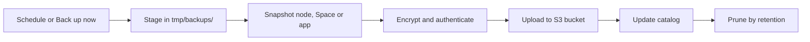

Ryu can encrypt and upload backups directly to your own S3-compatible bucket. Configure them in
the active node's **Storage → S3 backups** settings. A Space also exposes backups in its settings.
Node administrators manage destinations and schedules. On a shared node this requires the
`nodes.manage` permission.

## Connect a destination

Create a bucket in your storage provider, then select **Add destination** in Ryu.

| Field | What to enter |
| --- | --- |
| Destination name | A label you recognize |
| S3 endpoint | The service endpoint, without the bucket name or a path |
| Bucket | An existing bucket |
| Region | The bucket's region; use `auto` for Cloudflare R2 |
| Object prefix | An optional folder prefix that separates this backup catalog |
| Access key ID and secret | Credentials that can write, read, list and delete within the destination |
| Session token | Optional, for temporary AWS credentials |
| Recovery key | Generate and download a key, or enter the key for an existing backup catalog |

**Validate & save** writes a small probe, reads it back, lists it and removes it. A failed test
does not save the destination. Access credentials and the recovery key are sealed in Ryu's local
secret boundary and are not returned by destination listings.

<Callout type="warn">
  Keep the recovery key outside your Ryu node. If you lose both the node and this key, the backups
  cannot be recovered.
</Callout>

You can reconnect a replacement node using the same bucket, prefix and recovery key;
**Browse backups** reads the authenticated catalog from S3.

### Amazon S3

Use the region endpoint, such as `https://s3.us-east-1.amazonaws.com`, and the matching region.
The credentials need these permissions:

- `s3:ListBucket` on the bucket.
- `s3:GetObject`, `s3:PutObject`, `s3:DeleteObject` and `s3:AbortMultipartUpload` on the backup
  prefix.

Large backups use multipart uploads. Add a bucket lifecycle rule that removes incomplete multipart
uploads after a suitable interval, so a machine failure does not leave unfinished parts forever.

### Cloudflare R2

Use `https://ACCOUNT_ID.r2.cloudflarestorage.com`, region `auto`, and path-style requests. Supply
the S3 access key ID and secret from an R2 token with object read and write access to your bucket.

### Other S3-compatible services

Supply their endpoint and region. Path-style requests are enabled by default. HTTP requires an
explicit opt-in for a trusted private S3 service. TLS certificate validation remains enabled and
uses your operating system's trust store, so a server certificate from a private CA you have
installed there is accepted.

Ryu does not create buckets, manage provider accounts, or depend on a deployment dashboard.

## Choose what to back up

| Scope | Backup contents | Restore behavior |
| --- | --- | --- |
| Entire node | Durable data inside the active Ryu data folder: databases, conversations, Spaces, memories, source history, blobs and app state | Creates a new recovery folder and preserves the running node |
| Space | Pages, databases, row pages, whiteboards, app-owned documents, hierarchy and binary files | Creates a new private Space with new local IDs and rebuilt search indexes |
| App | A JSON snapshot submitted through the granted app primitive | Returns the snapshot to the same app and tenant |

Node backups omit downloaded runtimes, caches, logs, process handles, reusable node admission
credentials, provider-account credentials, backup settings and backup staging. External project
folders and remote app services are outside the node data folder and need their own backups. Symlinked source paths
are refused rather than followed outside the backup boundary.

SQLite databases use SQLite's online backup mechanism so committed WAL data is included. Each
database is consistent individually; separate app databases do not form one global transaction.
Ordinary files are checked for changes during the snapshot, and a changed file fails the backup
so it can be retried. Pause an app's writes if you need a single coordinated point across its stores.

Archives and their catalogs are authenticated and encrypted before upload. Transfers use bounded
buffers.

| Scope | Size limit |
| --- | --- |
| Node archive | Up to one million files and 1 TiB of uncompressed data |
| Space snapshot | Up to 100,000 documents and 128 MiB of source metadata; binary files are stored separately inside the archive |
| App snapshot | 8 MiB of JSON |

## Schedule and retain backups

Select a destination and scope, enter a five-field cron expression, choose how many backups to
keep (from 1 to 500), and select **Enable schedule**. The default `0 2 * * *` runs daily at
02:00 UTC.

The node must be running at the scheduled time; missed offline runs are not replayed. You can
pause or resume the schedule and use **Back up now** at any time.

Retention runs after a successful upload and applies only to that source node, destination and
scope. It never removes unrelated bucket objects. If pruning fails, the uploaded backup stays available and recent
activity reports the failure. Removing a destination from Ryu keeps the objects already in S3.

Catalogs keep node, Space, and app scopes separate, so one app's backup history does not use up
another scope's catalog limit. A scoped catalog supports up to 2,000 entries. An oversized or
unreadable catalog fails as a whole, and retention never prunes from an incomplete list.

Node and Space settings browse their own catalogs. API clients can request
`scope=node` for node backups or `spaceId` for a Space; omitting both keeps the
all-scope catalog view.

## Restore

Select **Browse backups**, choose a snapshot, then **Restore**. Ryu verifies its size, checksum and
encryption before recovery. Recent activity shows queued, running, completed and failed operations.

### Preview a restore

API clients can set `dryRun: true` on the restore request. Ryu checks that the authenticated
catalog entry is available and returns the recovery plan. It does not queue an operation or write a
Space, recovery directory, or local operation record.

The preview is marked `status: "dry_run"` and reports whether a private Space or a node recovery
directory would be created. Archive checksum and encryption checks still run when the live restore
is queued, so a preview is a plan, not a substitute for the final integrity check.

### Restore a Space

Space recovery preserves the original Space. If the embedding model is unavailable, the recovered
source remains available and the result tells you to run re-indexing later.

### Restore a node

Node recovery creates a separate folder. It includes the original data-encryption key, protected
inside the encrypted archive. The completed operation shows the start command for the recovered
folder in file-key mode.

1. Stop Core.
2. If your deployment explicitly injects a master key, remove that override or replace it with the
   recovered key. An unrelated key cannot decrypt the recovered data.
3. Start Core from the recovered folder.
4. Reconnect accounts, providers and node access.
5. Keep the original data folder until you have checked the restored node.

In the recovery folder, the key is written to `secrets/` as an owner-only file, because the folder
starts in file-key mode. Ryu does not remove recovery folders. Delete one yourself once you have
started from it or no longer need it, since it is a second full copy of the node with its key.

While a backup or restore runs, Ryu stages it in the data folder's owner-only `tmp/backups/`, never
in the shared system temporary folder. The unencrypted archive exists only as a temporary file with
no name, which the OS removes even if Ryu is killed, and it is dropped as soon as it is encrypted,
before the upload starts. Anything an interrupted job left there is removed when Ryu next starts.

## Apps and APIs

Apps use the [backup primitive](/docs/extend/develop/sdk/primitives#backupsclient) with the
`backups:app` permission. The node administrator must also add the app's ID to a destination's
allowed-app list. This does not give apps access to node backups, another app's snapshots,
filesystem paths, S3 credentials, or the recovery key.

The [Core API reference](/docs/extend/develop/api-reference/core/backups) documents destination,
schedule and operation endpoints. Manual requests carry an `idempotencyKey`, so retrying the same
request returns the same operation. Reusing a key with a different request fails. The node keeps
the latest 1,000 operation records; use a new request ID after that history has expired.
