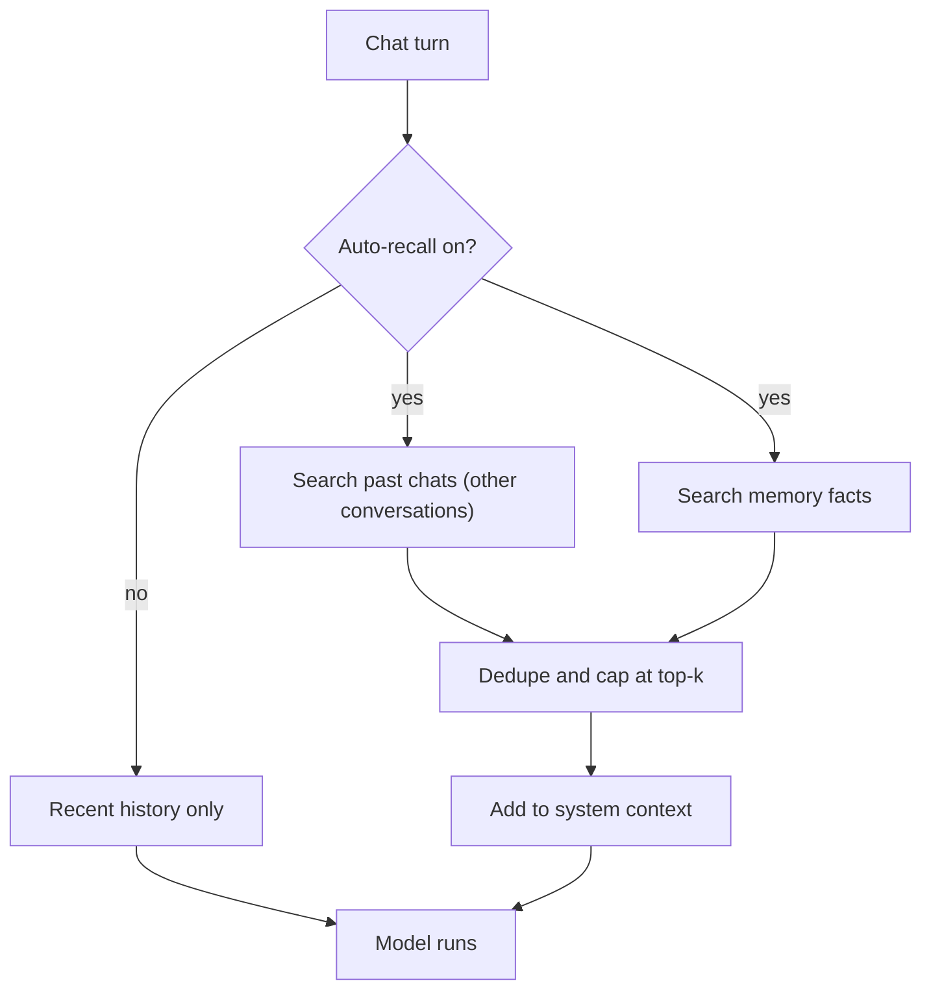

Ryu can find old discussions by keyword or by meaning. There are two ways to use it:

- **Search** - ask an agent to find earlier messages with the `search_conversations` tool, or use
  the desktop command palette.
- **Auto-recall** - let Ryu add relevant past messages and memory facts to each turn.

Semantic search and auto-recall use the configured embedder. With the local embedding runtime, the
embedding work stays on the node. A remote embedding endpoint is a separate data destination.

Keyword search uses a local index of whole words and does not need the embedder. It has no
exact-phrase or prefix matching, and a search made only of very common words finds nothing. The
index stores keyed tokens instead of your words. See [Memory & message index](/docs/core/memory)
for index storage and encryption.

<Callout type="info">
  Chat-message indexing is opt-in through **Remember chats** (the `chat-memory-enabled`
  preference), which is off by default. Turn it on with the **Remember chats** switch in
  **Library → Memory → Dream**. While it is off, new messages are not indexed, both message
  indexes are emptied, and a search does not backfill older messages. Conversations are still saved
  normally. Deleting a conversation also removes it from both indexes.
</Callout>

<Callout type="warn">
  Semantic search and auto-recall need a running embedder. Keyword search does not. By default
  Core uses a local hashing embedder. Better semantic results need the `llamacpp-embed` sidecar,
  which onboarding downloads.

  If the embedder is down, semantic search reports the index as
  unavailable and auto-recall gives up after 4 seconds. A missing embedder never blocks a chat
  turn.
</Callout>

Once existing history is indexed, later searches reuse the index and process only pending
messages. Imported messages are indexed even when their timestamps are older than your current
chats. If an embedding service is unavailable, pending work waits and can be retried.

## Search your past conversations

Ask an agent in plain language. It uses the built-in `search_conversations.search` tool:

```text
Search our past chats for what we decided about the database schema
```

The tool can search by meaning or by exact words. Exact search finds the words you give it, which
suits identifiers, error codes, and file names that a meaning-based search can miss:

```text
Find the chat where we hit error E0499 in parser.rs last month
```

Exact search also covers the tool calls an agent made in a chat, not only what it wrote. Each tool
call adds its tool name and a short excerpt of its arguments and result to the keyword index, so you
can find the chat where an agent looked up a supplier or read a file even if its reply never named
it. The excerpt is limited to about 1.5 KB per tool call. Images, files, and other attachments are
skipped. Recognized secrets and personal details, such as API keys, tokens, passwords, and email
addresses, are replaced with a `[REDACTED]` marker before indexing, so searching for one finds
nothing. A value passed in a field such as `password`, `token`, `secret`, or `api_key` is replaced
whole, however many words it has. When a result matched through a tool call, its snippet shows that tool call. Chats indexed
before this was added are re-indexed the next time an exact search runs. Semantic search still
covers message text only.

By default the tool runs both searches and merges them into one ranked list. A message that both
searches find ranks above one that only a single search finds. Each matching snippet includes the
conversation id and title, the message id, the role, a timestamp, which search matched it (`exact`,
`semantic`, or `both`), and a relevance score. Scores only rank results within one search, so do
not compare them across searches.

The tool works on both the ACP and OpenAI-compatible chat paths, appears in
`GET /api/tools/search`, and is gated and audited like any other tool. Both searches return only
messages from conversations you can see. Naming a conversation you cannot see returns no results.
On an organization node, a tool call made with your own sign-in (the tool API or the MCP endpoint)
also covers chats shared with your teams, the same set your chat list shows. An agent answering
inside a chat searches as that chat's owner. When the owner sent the message the agent is answering,
the search also covers the team-shared chats the owner can see. When a collaborator sends a message
in someone else's chat, the agent still searches as the owner, without team-shared chats.
If **Remember chats** is off, the tool reports that conversation search is disabled.

<Callout type="info">
  If an agent says it cannot search your history, add the `search_conversations.search` tool to the
  agent's tools list. See [Tools & connections](/docs/surfaces/desktop/user-guide/tools-and-connections).
</Callout>

| Argument | Type | Default | Meaning |
|---|---|---|---|
| `query` | string | required unless `around_message_id` is set | A question, or the exact words to find |
| `mode` | `all`, `exact`, or `semantic` | `all` | `exact` matches whole words, `semantic` matches by meaning, `all` merges both |
| `limit` | integer (1-20) | 5 | Maximum number of matching snippets to return |
| `conversation_ids` | string array | all | Restrict the search to specific conversations; omit to search everything you can see |
| `since` | timestamp | none | Only messages sent at or after this time |
| `until` | timestamp | none | Only messages sent at or before this time |
| `around_message_id` | string | none | Read the conversation around this message instead of searching |
| `before` | integer (0-10) | 3 | With `around_message_id`, how many earlier messages to return |
| `after` | integer (0-10) | 3 | With `around_message_id`, how many later messages to return |

`since` and `until` take an RFC 3339 timestamp (`2026-03-01T09:00:00Z`), a date (`2026-03-01`,
read as midnight UTC), or unix seconds. An unrecognized value is rejected rather than ignored.

Snippets are shortened to keep tool output compact. To check what was actually said, an agent can
pass a result's message id as `around_message_id`:

```text
Open the conversation around that result and check what we actually agreed
```

The tool then returns the messages before and after it, oldest first, each with its role, timestamp,
and text, plus the conversation title. The requested message is marked as the target, and the reply
says whether more messages exist on either side. The window follows the version of the conversation
you currently have selected; an older version of an edited message shows only the messages that led
up to it. The same visibility rules apply as for search: a message from a conversation you cannot
see is reported as not found, exactly like a message that does not exist. Long messages are
shortened, so open the conversation itself to read one in full.

<TryInRyu page="chat" />

## Search from the command palette

The desktop command palette searches chat titles, archived chats, Spaces, page titles and page
text, and individual chat messages.

1. Open the command palette and type at least two characters.
2. Use the **Messages** or **Pages** tab to narrow the results.
3. Select a message to open its conversation at that message, or a page to open it in its Space.

Message results list whole-word keyword matches first. They can add semantic matches when the
local message index is available, so you can search for distinctive words or describe the
discussion.

Page results match page titles, Space names, and Space descriptions on any part of a word. Page
bodies and extracted file text match whole words only, with no partial-word or quoted-phrase
matching. Page search does not need an embedding model. See
[Encryption and search](/docs/core/spaces-rag#encryption-and-search).

Each row shows a short relative age such as **just now**, **5m ago**, or **2d ago**. If a search
index is unavailable, normal navigation still works.

The **Search / Compose** switch at the top of the palette moves between finding items and writing a
message. Press **Tab** to switch. In Compose, you can attach photos. **Enter** sends the message in a
new chat tab, and **Shift+Enter** adds a new line.

When the Memory app is enabled, agents can also use its semantic retrieval through the
`memory.search` capability. That searches durable memory facts, not chat messages.

## Auto-recall

On every chat turn, Core retrieves relevant past chat messages (not from the current conversation)
and relevant long-term memory facts. It adds them to the system context before the model runs. Both
chat paths get it, because it uses the same injection point as skills.

Memory recall can also follow a typed graph of topics, people, categories, agents, and scope levels.
A graph match is only a candidate. The normal caller, agent, project, organization, and
sensitive-topic checks still run.

Auto-recall is **on by default**. Core stores the setting, so it applies to every chat turn the
node serves, not just the device where you changed it.

### Turn it on or off

Open **Gateway settings → Plugins → Memory** and use the **Automatically recall relevant context**
switch.

| Setting | Where | Default | Effect |
|---|---|---|---|
| `auto-recall-enabled` | Gateway settings → Plugins → Memory, or env `RYU_AUTO_RECALL_ENABLED` | on | Master switch for per-turn recall |
| `auto-recall-top-k` | **Snippets per reply** in the same tab, or env `RYU_AUTO_RECALL_TOP_K` | 5 | Caps how many recalled snippets (memory and past chats combined) are added per turn |
| **Include sensitive topics in memory** | Gateway settings → Plugins → Memory (per user) | off | Allows detected sensitive topics, such as health conditions and religious beliefs, in memory capture and recall |

**Remember chats** is a separate privacy switch for chat messages, in **Library → Memory → Dream**
(see [Memory](/docs/surfaces/desktop/user-guide/memory)). While it is off, Core keeps the
encrypted transcript but stops embedding, searching, and recalling past chat messages. Turning it
back on lets the message index rebuild. Durable memory facts keep their own Memory settings.

Sensitive memory facts, such as health conditions, religious beliefs, and other special
categories, are not captured and stay out of search, the graph, and auto-recall until the owning
user turns on the sensitive-topic switch. Turning it off again hides existing sensitive facts from
search, the graph, and prompt context. It does not delete them.

<TryInRyu page="settings" />

### What recall adds

Auto-recall adds only what the recent-history window missed. Recalled memory facts are deduplicated
by fact id against the facts already added, so a fact never appears twice.

The recent-history path stays in place as the fallback. Turning auto-recall off stops the per-turn
semantic search but keeps your stored facts and that fallback. See
[Memory & message index](/docs/core/memory) for the full mechanism.



To bring in sessions from other agents, see
[Import from another agent](/docs/surfaces/desktop/user-guide/import-agent).

## Related

<Cards>
  <DocCard href="/docs/surfaces/desktop/user-guide/memory" />
  <DocCard href="/docs/surfaces/desktop/user-guide/spaces-memory" />
  <DocCard href="/docs/surfaces/desktop/user-guide/tools-and-connections" />
  <DocCard href="/docs/surfaces/desktop/user-guide/chat" />
</Cards>
