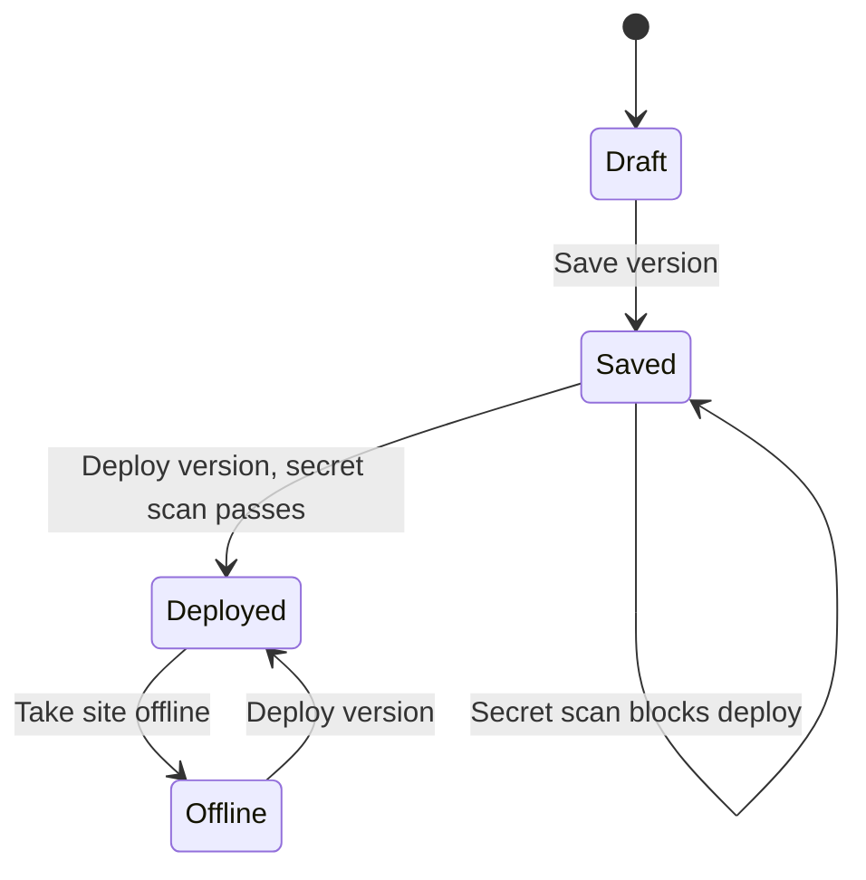

Sites is a Ryu app for building, reviewing, and deploying websites, separate from the chat
that started them. Operators can also run it without Desktop as a [standalone service](/docs/standalone/sites). Open **Sites** from the Apps shelf.

## Build from chat

Ask Ryu's **Site Builder** agent to create, revise, save, deploy, or share a Site in a
conversation. It uses the same checks as the Sites app. Saving does not publish, and only the
owner can deploy a Site's first version or change who can visit.

On a node registered to an organization, the chat tools refuse unless Ryu can verify your
identity, so use the Sites app.

## Create and refine

Choose **New site**, enter a name and URL name, and select a website, help-center,
dashboard, game, or **reset-calendar** starter. New sites are private and use browser-local data.

The reset-calendar starter tracks Codex, Claude Code, and GitHub Copilot usage resets in
**Month** and **Agenda** views. Replace its sample times with your own provider-reported
times, which stay in that browser.

### Gallery, remix, and duplicate

Choose **Gallery** to browse the built-in templates and the sites you can remix.

- **Use template** opens **New site** with that starter selected.
- **Remix** creates a new private site that you own from the deployed version. A site appears
  under **Remixable sites** when you can visit it, it is deployed, and its owner turned on
  **Allow remixing** in Settings (off by default).
- **Duplicate** copies the latest saved version instead, even when remixing is off. Owners, and
  editors from the Gallery, can use it.

A remix or duplicate copies the page and its data runtime choice only. Everything else stays
with the original: sharing, editors, sign-in, AI instructions, knowledge Spaces, databases,
records, files, shared data, connections, extensions, custom domains, old URLs and analytics.

The new site starts private and undeployed, shows which site it was remixed from, and counts
toward the project limit. Deployed pages can check `RyuSite.capabilities()` for `remixable` to
show a remix hint.

### Generate or import code

Describe changes and choose **Generate changes** to use your configured Ryu model. You can also
edit the HTML source or import a self-contained HTML build.

Build an existing project before you import it, because Sites does not run imported package
scripts. The supported artifact is a complete HTML document with inline styles and scripts, up
to 2 MB.

<Callout type="warn">
  The default policy blocks external scripts, styles, fonts, frames, form posts, and fetch or
  WebSocket calls to other sites. Links, page navigation, and some browser peer-connection features
  can still reach other sites. Review imported or generated code before you deploy it.
</Callout>

### Design visually or with chat

Open **Design** to edit the page directly:

- Click an element to select it, and double-click text to change it in place.
- Drag elements on the canvas or in **Layers** to rearrange them.
- **Add** offers sections, headings, text, buttons, images, columns, cards, lists, quotes, and
  dividers. Drag one onto the page, or click it to add it after the selection.
- The inspector edits text, links, image sources, alt text, and common styles. It can also move,
  duplicate, or delete the selection.

**Ask Ryu** describes a change in words. Ryu edits the page (or the selected element)
through the same small edits the canvas makes, so the result appears on the canvas and
**Undo** reverts it. A request that cannot be expressed as an edit is reported instead of
applied. Chat needs a configured Ryu model.

Scripts do not run while you design, so interactive parts appear in their initial state.
Use **Preview** to try them. Design edits change only the working copy. **Save version**
keeps them.

The sandboxed preview has desktop and mobile widths. It has no persistent browser origin, so
browser storage works only on the deployed site.

### Run reset-calendar account checks

For a reset-calendar Site:

1. Open **Settings** in Sites, enable **Owner reset checks**, and save settings.
2. Choose **Check Codex**, **Check Claude Code**, or **Check GitHub Copilot**.
3. Review the connected-account confirmation and choose **Run account check**.

Ryu runs a bounded agent and keeps the report in Settings. Deployed pages and embedded Site
views cannot launch checks or read reports.

The agent first checks the connected account's current reset window. An upcoming automatic reset
stops the flow without spending a banked reset.

If no reset is upcoming, the agent continues only when the account reports an unexpired reset and
a provider or reset plugin exposes an idempotent, separately authorized action. Missing actions,
stale or public forecasts, and unsupported Claude or Copilot redemption paths are reported as
blocked, not simulated.

## Save and deploy separately

**Save version** creates an immutable build without changing the deployed version.
Open **Versions** to review a build and choose **Deploy version**. Deploying changes
which saved build is served to the selected audience.



<Callout type="warn">
  The running Sites service serves a local deployment, not managed hosting. A public internet URL
  needs a configured public edge, DNS, and TLS.
</Callout>

## Security checks before deployment

Open **Security** to check the latest saved version. Sites sends that exact artifact through the
Gateway secret scanner and shows its build fingerprint and check time.

Deployment repeats the check for the version being deployed. A detected secret or unavailable
scanner blocks deployment. The result does not include source snippets or the detected value.

A passed secret check is not a complete code audit or certification.

## Data and knowledge

The starters use the shared browser data primitives. The help center imports text and
Markdown articles and searches them locally. Browser data is scoped by origin and is not a server
backup. Clearing browser storage removes it.

A connected site can use per-visitor durable records and file uploads:

- Records need a verified visitor. They are rows in a private Ryu Spaces database for that Site,
  which the owner can inspect in Spaces or query from **Database**.
- Uploaded files stay in the Sites file store, scoped to the Site and visitor.
- Switching to connected mode never uploads local browser data.

For AI answers grounded in Space passages (see [In-page AI](#in-page-ai)), an operator binds
approved Spaces through Ryu's retrieval capability. A site searches only that binding; visitors
cannot pick another Space or supply a node address. Unavailable services return an error instead of demo data.

### Query records

The query editor in **Database** accepts one read-only `SELECT` or `WITH` query against the
`data` table. Column names are normalized from the table's property labels. Run
`SELECT * FROM data` to inspect them. Results are capped at 500 rows or 1 MB, and queries stop
after 500 ms.

The `@ryuhq/client` SDK also exposes `client.spaces.queryDatabase(spaceId, databaseId,
{ query, parameters })`, which binds values separately from the SQL text. See the
[Spaces query API](/docs/extend/develop/api-reference/core/spaces/query_space_database).

### Visitor data

**Visitor data**, below the query editor in **Database**, lists each signed-in visitor
who has saved records or uploaded files. Only the owner sees it.

Choose **Delete data** and confirm to permanently remove one visitor's records and files, such
as for a deletion request. The visitor can keep using the Site. **Recent deletions**
lists each deletion with its time, the counts removed, and a digest of the visitor's account ID.

### In-page AI

Turn on **AI for visitors** in **Access and capabilities** on a connected Site, then choose
an **AI mode**:

- **Grounded answers** (the default) answers questions only from the bound knowledge Space,
  with source IDs. Pages call `RyuSite.ask(question)`.
- **General page AI** lets the page call the Ryu model for its own tasks, such as a summary,
  a classification, or a chat widget. No knowledge Space is needed. It is available only
  when a Ryu model is connected to the node.

General calls require a signed-in visitor unless you turn on **Allow AI without visitor
sign-in**. **Owner AI instructions** are always applied before the page's own instructions,
and visitors cannot replace them.

Only you can see owner instructions in Sites settings, but the model can still be talked into
repeating them, so keep secrets out. Generated pages use:

```js
const caps = await RyuSite.capabilities();
if (caps.completions) {
  const { text } = await RyuSite.ai.complete({
    prompt: "Summarize: " + article.textContent,
    system: "Reply in two sentences.",
    maxTokens: 200,
  });
  const reply = await RyuSite.ai.chat([{ role: "user", content: "Hello" }]);
}
```

A prompt, or all chat messages together, may be up to 8,000 characters. `maxTokens`
defaults to 512 and is limited to 2,000; longer replies are cut to that budget. Grounded and
general calls share the Site's daily AI limit and each visitor's share of it.

A failed call keeps its status for the page to explain: 401 (sign-in required), 403 (general
AI off), 413 (prompt too long), 429 (daily limit reached) or 503 (model unavailable). Sites never
substitutes text when the model fails.

### Shared visitor data

Turn on **Shared visitor data** in **Access and capabilities** to let a connected Site keep
records that every permitted visitor sees together, such as a team tracker, a multiplayer
game, or an incident timeline.

- It is off by default and needs the **Connected to Ryu** runtime, a connected database, and
  platform identity.
- Anyone who can open the Site can read shared records.
- You choose who can add them: **Signed-in visitors** or **Editors only**.
- A record can be changed or removed only by its author, a Site editor, or the owner.

Generated pages call `RyuSite.shared(collection)`.

```js
const board = RyuSite.shared("board");
const page = await board.list({ limit: 50 });
const created = await board.set(null, { text: "Ship it" });
await board.set(created.id, { text: "Shipped" }, { expectedRevision: created.revision });
const stop = board.subscribe((event) => {
  if (event.type === "reset") reload();
}, { since: page.eventCursor });
```

Replacing a record requires the revision you read. A stale revision fails with status 409 and
returns the `current` record so the page can merge or retry. Live updates use Server-Sent Events
on the Site's own origin; a `reset` event means changes were missed, so list again. Record fields
and cursors are in the [Sites API](/docs/standalone/sites-api#shared-visitor-data).

A write that would grow an author past their share (see [Analytics and limits](#analytics-and-limits))
fails with status 429. An editor changing someone else's record is charged to that record's
author.

Shared records appear in the Site database under the reserved owner `ryu-sites:shared`.
**Visitor data** counts each visitor's shared records, and **Delete data** removes them too.

## Plugins and MCP

Open **Extensions** to select visitor connections or expose the Site's own tools. MCP tools can
list, save, and delete records in a named collection, or search approved Site knowledge. Record
access is scoped to the connected visitor.

Enable **Show Site UI in chat** to expose the saved website as a versioned MCP Apps view.
Supported hosts can open it beside a conversation or from an app entrypoint. Record and knowledge
operations use the Site's published MCP tools. Browser-only connections, uploads, and sign-in stay
on the visitor website.

To publish the tools:

1. Save extensions, save a new version, and deploy that version.
2. Choose **Install plugin**, then review and enable it in Plugins.
3. Connect your account.

Changing draft tools does not change the published plugin. Deploy a new version and choose
**Update installed plugin**. Unpublishing the Site takes its tools offline.

### Connected data and consent

For connected data, select only operator-approved connections and use a workspace-restricted Site
in connected mode. Each visitor signs in and reviews access, and can revoke it later. A permission
change needs a new review.

Consent does not share the builder's credentials and cannot authorize background jobs. Confirm
write actions explicitly, and check the provider state before you retry a failed write.

### Owner connections

To let visitors use their own accounts in tools such as Slack, Notion, Google Drive, or GitHub, add
an **Owner connection** in **Extensions** with a label, a description, the Ryu tool ID, and its
access. Owners and editors can edit or remove these, and each change asks visitors to review
the connection again. Your operator can turn owner connections off or limit which tools they may use.

Generated pages see them in `RyuSite.connections.list()` with `source: "owner"`, an `owner.` prefix
on the ID, and the description you wrote. Operator connections have `source: "operator"`.

<Callout type="warn">
  These features need configured platform identity, MCP OAuth support, and the relevant app
  permissions. The Sites runtime does not host arbitrary server frameworks.
</Callout>

## Access and sign-in

Keep a site private while reviewing it. Public publishing must be enabled by the operator. If the
operator turns it off, Sites that were public stop serving visitors and become owner-only until it
is turned back on. Choose another audience before you save other settings.

Platform identity must be connected before using invited viewers, workspace access, editors, or
visitor sign-in.

The Sites list separates **Owned by you** and **Shared with you**. Use **Share** to add
named viewers or workspace editors, set link access, or copy a visit link. **Settings** includes
the Site name, URL name, custom domains, access, connected capabilities, and deletion.

Sharing changes apply only after the service confirms the save. A refused change keeps the last
saved audience. If another edit changed the Site, close Share, choose **Reload**, and retry.

### Viewers and editors

- Editors must belong to the site's workspace. They can save versions and deploy updates after
  the owner's first deployment.
- Only the owner manages sharing, domains, URL names, analytics and deletion.
- Removing a viewer does not override access they still have through public or workspace sharing.

Sites identifies you by your verified Ryu account, its email, and your workspace. On a node
registered to an organization, each member owns the Sites they create. **Shared with you**
lists workspace Sites and Sites that name your email as a viewer or editor.

A named editor who belongs to the Site's workspace gets the editing sections. A named viewer
can preview the Site in the app or sign in to the deployed site.

An email-named grant applies only after your account email is verified. Some sign-in
methods, such as single sign-on, do not verify it for Ryu. If **Settings → Account** asks you
to verify your email, do that first, or the Site does not appear under **Shared with you**.

### Visitor sign-in

The identity connection uses the platform's OpenID Connect provider. Sites validates the issuer,
audience, nonce and verified email, and keeps visitor sessions in HTTP-only, origin-scoped
cookies. Operator credentials are never sent to generated pages.

On HTTPS sites, the temporary sign-in cookie is host-bound, so a sibling domain cannot plant
another site's login state in a visitor's browser. Sessions expire and are cleared when the
Sites service restarts.

## URL names and custom domains

URL names start with a lowercase letter, contain at least five characters, and use
lowercase letters, digits and single hyphens. Changing a name keeps saved versions
and redirects the previous name, including its path and query. Browser storage is
origin-scoped, so a new hostname has separate local data.

To add a custom domain you own:

1. In **Settings**, add the domain and copy the ownership TXT record to your DNS provider.
2. Choose **Check DNS and TLS** to refresh its state. Successful ownership verification moves it
   to pending TLS.
3. The domain becomes active only when your operator's edge confirms it serves the domain over
   HTTPS with a valid certificate.

Sites does not register domains or provision certificates, and no edge ships with it. Your
operator connects one through an edge readiness check. See
[Standalone Ryu Sites](/docs/standalone/sites#custom-domains). Until then, Settings says custom
domains are unavailable and **Add domain** is disabled.

## Analytics and limits

**Analytics** shows total unique visitors and page views, daily trends, and top page paths over
7, 30, or 90 days. No tracking cookie or analytics SDK is required.

- Visitors are estimated with a keyed digest of the visitor address and user agent. Restarting
  the service rotates the digest key.
- The visitor address comes from the edge your operator trusts, or is the connecting address when
  no trusted edge is configured. Behind an untrusted edge, visitors share one address.
- Counts are approximate, include bot requests, and are kept for 90 days.
- Each site records up to 1,000 distinct page paths, 20,000 visitors, and 50,000 visitor and page
  pairs per day. Views beyond that are grouped under **(other)** or a shared overflow visitor.

<Callout type="warn">
  Sites serves static pages. Private API keys and server-side environment variables are not
  available to generated pages. Do not put secrets in HTML or browser code.
</Callout>

| Resource | Local runtime limit |
| --- | --- |
| Projects | 30 per service |
| Saved versions | 100 per site |
| Saved build storage | 50 MB per site |
| Durable records | 1,000 per site; 100 records and 120 KB per visitor; 64 KB per record; 1.2 MB per Ryu Spaces database |
| Shared visitor records | 1,000 per site; 100 records and 120 KB per author; 16 KB per value; 30 changes per minute per visitor and 600 per site; 100 live connections per site and 4 per visitor. They also count toward the database size |
| Uploaded files | 100 per site; 10 files and 25 MB per visitor; 5 MB per file |
| AI answers and in-page AI calls | The site's daily limit, shared by both; each visitor can use 20% of it (at least 1) per day; 8,000 prompt characters and 2,000 tokens per call |
| Owner connections | 20 per site; 200 connected tool calls per signed-in visitor per site per day |
| Remixes and duplicates | 20 started per person per day |
| Custom domains | 5 per site |
| Visitor requests | 120 per minute per visitor address; 6,000 per minute per site |

A limit never blocks reviewing saved versions or taking a site offline. Per-visitor shares
keep one visitor from using up a site-wide limit. Signed-in visitors each have their own
share; visitors who are not signed in share by visitor address.

Shares use a daily keyed digest, never the raw account or address. A service restart does not
reset them.

## Take down or delete

**Take site offline** removes the deployed build from visitor access while keeping
saved versions and data. To delete a site permanently, enter its URL name in the
confirmation dialog. Deletion removes its versions, the Site's Ryu Spaces database,
uploads, and analytics.

## Related

<Cards>
  <DocCard href="/docs/apps/sites" />
  <DocCard href="/docs/standalone/sites" />
  <DocCard href="/docs/core/spaces-rag" />
  <DocCard href="/docs/extend/develop/extensions/app-reuse-standard" />
</Cards>
