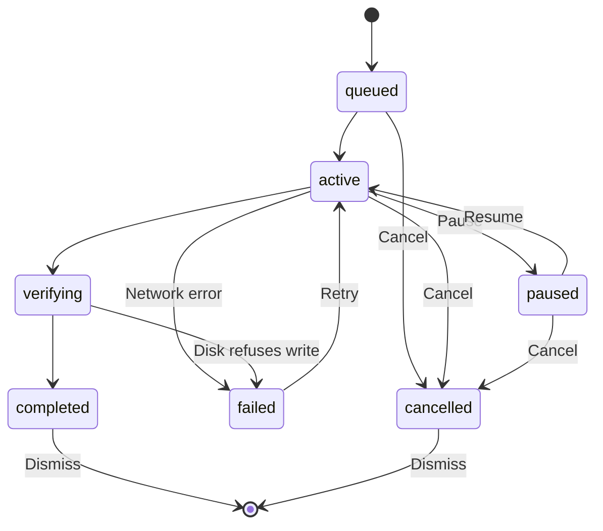

This guide covers installing each item type and tracking downloads. To browse the catalog, see the
[Store guide](/docs/surfaces/desktop/user-guide/store).

## Install a model

The **Models** page searches the active model source (Hugging Face by default) for models you can
run locally.

1. Search for a model.
2. Open a result to see its details: the README plus the quantization **download dropdown** (with
   real file sizes and SHA-256 checksums). The dropdown preselects the best device-fit quantization
   for this machine, badged "Recommended for your Mac/PC/device".
3. Check the **device-fit verdict**. Ryu detects your RAM and GPU VRAM and grades each file as
   *great*, *ok*, *partial offload*, *cpu*, or *too big*.
4. Click **Install**. The selected quant shows **Adding…** while Core downloads it, verifies the
   checksum, and records its provenance. If the request fails, you can retry.

Device-fit is computed locally with no setup. If you set an Artificial Analysis API key, model
detail views also show benchmark stats. No key is required. The full
model-browsing flow lives on [Models](/docs/surfaces/desktop/models).

## Install a skill

The **Skills** page browses all registered skill marketplaces together by default, including [skills.sh](https://skills.sh),
vendor/community GitHub taps, [browse.sh](https://browse.sh), [ClawHub](https://clawhub.ai),
[LobeHub](https://lobehub.com), Ryu Marketplace, and custom Claude marketplaces. Use the source
picker to narrow the view to one registry.

1. Search the directory, or browse the featured default list.
2. Open a skill to read its `SKILL.md` documentation and file list.
3. Click **Install**. Core writes the skill into your local skills directory and reloads the
   registry, so the skill is available at once.

For an installed skill, Desktop also offers **Use with agents** from the detail view and Library
card. Choose the local agent clients that should get the same `SKILL.md` and its supporting files.
The target picker is available only in Desktop.

- Remember the selection for future installs, or leave it empty to keep the skill in Ryu only.
- If a target already has a different copy, Ryu leaves it unchanged and reports the conflict.

Skills can also be installed directly from a source URL or repository. See the
[Skills](/docs/surfaces/desktop/skills) reference for the activation model and the per-agent allowlist.

## Install an MCP server

MCP (Model Context Protocol) servers provide tools to an MCP host. The **MCP** source lists servers
from the official MCP registry, Smithery, or the Ryu-hosted catalog.

Installing one adds a **disabled** server, so you can review it before enabling it. Executable
packages must use an exact version and pass registry ownership checks. Hosted servers connect
directly without a local npm bridge. Enable the server from
[Tools and connections](/docs/surfaces/desktop/user-guide/tools-and-connections).

## Install a plugin

A **plugin** is a `manifest.json` manifest that bundles Runnables (agents, workflows, tools, skills)
together with the permission grants they need.

- The **Plugins** page lists the plugins Ryu Core has loaded, each showing its status (Installed or
  Enabled) and its **permission grants**. You can also **install from a URL** that points at a
  `manifest.json`. Core fetches, validates, and hot-reloads it with no restart.
- **Install** a plugin to validate it and its grants, then **Enable** it to activate its Runnables.
  Ryu reports an install, enable, or disable as done only after Core confirms it.
- System plugins such as **Ghost** (desktop automation) and **Shadow** (capture and search) are
  available from Core. Other official plugins are signed marketplace packages and are installed
  when you choose Install.

To add your own, publish a `manifest.json` or choose **install from URL** to load it without a
restart. Ryu validates each declared Runnable when it loads. The manifest format is documented in
[Plugin manifests](/docs/extend/develop/extensions/plugin-json-manifest).

<Callout type="warn">
  Review a plugin's permission grants before enabling it. Grants determine what the plugin's
  Runnables are allowed to reach, and they are enforced through the Gateway.
</Callout>

<Callout type="info">
  Plugins that declare `post_assistant_turn` hooks (such as the built-in **double-check** and
  **goal** plugins) run their hook code in the same deny-by-default JavaScript sandbox as tool
  execution. The sandbox ships inside Core, so hooks need nothing else installed. If a hook fails,
  it does nothing and chat continues.
</Callout>

### Filter, compare versions, and read listings

Marketplace and Library cards also show declared **swappable layers**. A badge such as **Browser
toolkit** means the plugin provides the `browser.control` layer. Open its detail view to see the
canonical verbs and whether the provider acts locally or on a hosted/remote target. Hosted
providers carry an **External** badge.

Use the **Filters** control in the Apps or Plugins catalog to narrow results by a manifest's curated
`tags[]` array. Tags are short browsing labels. `keywords` stay search vocabulary. The filter covers
the first-party and community rows visible in the catalog.

Experimental apps and plugins are hidden from the catalog by default. Open **Filters** and check
**Show unstable releases** to include releases marked **Experimental**, **Alpha**, **Beta**,
**Release candidate**, or another publisher-defined maturity level.

The setting applies to both Apps and Plugins, not to Library. Combined with the **Installed**
filter, you see only installed stable releases unless you include unstable ones.

Open a listing's **Versions** tab to compare published releases. Each version shows the stability
declared by its manifest.

- When Ryu has a trusted immutable Marketplace artifact for a historical release, the row includes
  **Install this version**. Ryu verifies that exact release before installing it, and asks for
  confirmation when it is older than the version you have.
- Community, tag-only, or otherwise unavailable history remains readable but does not offer an
  install action.

GitHub listings can declare presentation metadata from `manifest.json`, `.codex-plugin/plugin.json`,
or `.claude-plugin/plugin.json`. Screenshots, banners, author details, policy links, and prompts
are imported as safe server-side display metadata. Executable code, permissions, MCP definitions,
and install instructions are not imported from those display manifests.

Open a listing to see its metadata rail: Developer, Category, Version, License,
Repository, Website, Privacy Policy, Terms of Service, Tags, Keywords, capabilities, example
prompts, and the declared screenshot gallery when those fields exist. A banner becomes the listing's
hero background, and a `provides` entry such as `browser.control` is shown as its canonical layer.

A detail view shows a screenshot gallery when the listing has screenshots. Click a screenshot to
open it full screen. Use **Download** at the top right, the zoom control at the bottom, and the
arrow keys or chevrons to move through the gallery. Press **Esc** or click outside to close it.

## The Download Center

The Download Center tracks long-running downloads, including engine binaries, GGUF models, audio
models, skills, and other items. Open the download icon in the desktop sidebar footer to see active
and failed downloads.

Choose **Auto** to let the node tune how many downloads run at once, or select a fixed count. The
choice is saved on the node and shared by everyone connected to it.

- **Auto** keeps your saved manual count, so switching back to manual does not lose it.
- If the node cannot save the choice, the previous setting stays in use.
- A count fixed by the node operator cannot be changed here.

Each row shows a progress bar, transfer size, speed, and an estimated time left, with per-item
controls that depend on the download's state:

| State | Available controls |
|---|---|
| `active` | Pause, Cancel |
| `paused` or `queued` | Resume, Cancel |
| `verifying` | Cancel |
| `failed` (retryable) | Retry, Dismiss |
| `completed` or `cancelled` | Dismiss |

**Clear finished** removes all completed and cancelled entries at once. The list stays current
while downloads run. To check for new updates on demand, choose **Refresh** in the Downloads panel
header or the Downloads page, or pull the list down. The Inbox panel has the same **Refresh**
control.

### Completion and retries

A download reports `completed` only after its verified file is written to disk and moved into
place. On macOS and Linux, Ryu also flushes the folder that holds it, so a power loss right after
completion does not lose the file.

If the disk refuses either step, the download fails and the new version is not recorded as
installed. A previously installed copy stays in place. On a drive without hard links, such as FAT
or exFAT, a failed folder flush during an update keeps the new, verified file instead of the old
one.

A download that receives no data for about a minute, or whose server does not start responding
within a minute, counts as a network error. Ryu retries it automatically a few times.

If it still cannot continue, the row moves to `failed` with **Retry**. The data already downloaded
is kept, so Retry continues from where the transfer stopped when the server supports resuming.

Switching to another node or sign-in reloads download progress for that connection. It does not
cancel downloads on the previous node.

<Callout type="info">
  Some installs cannot report a total size up front, for example a model or audio model fetched from
  Hugging Face, where the source streams no byte total. Those downloads show an indeterminate
  progress bar (a running byte count without a percentage) rather than a filling bar, then complete
  normally.
</Callout>

## Catalog actions and engines

On the web, the federated Models, Skills, and MCP actions open a handoff dialog. Choose **Active
server** or a named server. **App** opens a `ryu://` link in Ryu (MCP opens Tools). **CLI** shows a
copyable command such as `ryu mcp add <id> --node <name>`. Opening the dialog does not install
anything. Run the command or confirm the handoff in the app to make changes.

On desktop, **Add** on a model shelf chooses the best-fitting available GGUF file for this device.
Safetensors and MLX listings add their repo snapshot. Each shelf uses its normal install path, and a
failed add leaves the action available to retry.

If the Skills or MCP catalog list fails to load, choose **Try again**. After you add a skill, its
**Added** state and enable switch come from Core's installed-skill list. An added MCP server stays
disabled until you enable it from Tools.

In the desktop **Apps** and **Plugins** catalogs, the source picker narrows only that tab's results.
**Add marketplace** validates the repository and keeps the form open if Core rejects it. **Add from
URL** keeps the manifest URL and shows the Core error beside the field after a failed install. **Get**
on a community card or its detail preview installs from that listing's repository URL.

### Engines

The desktop **Engines** tab groups text runtimes, image engines, speech engines, and sandbox
backends.

- **Text runtimes.** A text runtime is the node's resident engine. Use **Set as active** on an
  installed, supported runtime to swap it in. The active runtime cannot be switched off or removed,
  so choose a different runtime first.
- **Image and speech engines** run alongside the text engine. Start or stop them from their detail
  preview or card menu, and stop a running engine before you remove it.
- **Update** installs a newer build of an installed engine, and **Remove** uninstalls an inactive
  runtime. If the engine plugin declares settings, its card menu also opens them.
- **Sandbox backends** share one default for `sandbox_exec`. Ryu offers the built-in Wasmtime
  backend and shows detected external runtimes. It does not install runtimes such as Docker; use
  the **How to install** link to open the runtime's own guide.

The llama.cpp preview also lets you choose **Automatic** or an available hardware build.
Unsupported builds are disabled. If a switch fails, the preview keeps the current build selected
and shows an error so you can retry.

## Related

<Cards>
  <DocCard href="/docs/surfaces/desktop/models" />
  <DocCard href="/docs/surfaces/desktop/skills" />
  <DocCard href="/docs/surfaces/desktop/user-guide/marketplace" />
  <DocCard href="/docs/surfaces/desktop/user-guide/tools-and-connections" />
</Cards>
