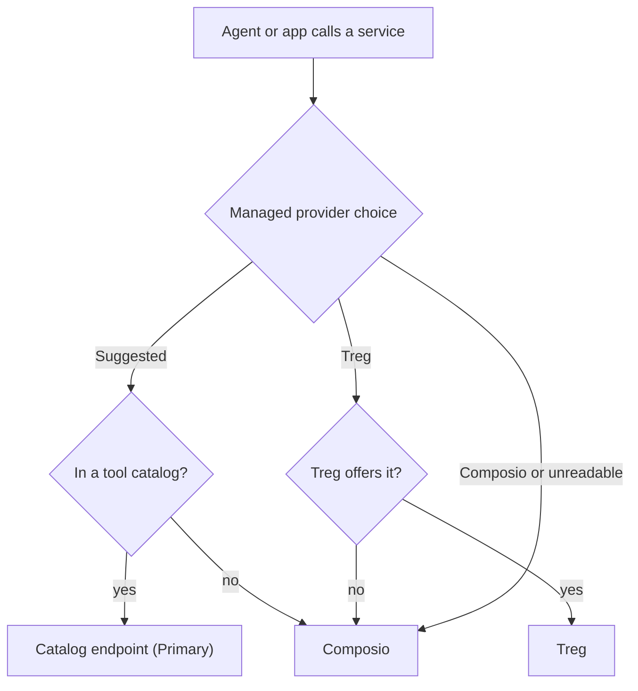

Use the Store to add **apps**, **models**, **skills**, **MCP (Model Context Protocol) servers** that
provide tools, and **plugins** without leaving Ryu.

<TryInRyu page="store" />

This page covers browsing free and paid catalog items. A listing's price is Marketplace metadata. It
does not add a plan or purchase gate to installing.

- To **buy, sell, or manage licenses**, see [Marketplace](/docs/surfaces/desktop/user-guide/marketplace).
- To install each item type and track downloads, see [Install items](#install-items-and-track-downloads).
- For browsing and running models, see [Models](/docs/surfaces/desktop/models).

## Apps vs plugins

- **Apps** are complete experiences you use inside Ryu, like Tests or Learning.
- **Plugins** add capabilities to Ryu, such as tools, skills, agents, and workflows.

An installed app opens straight into its Companion UI. The Marketplace listing holds the app's
description, screenshots, and preview. Each enabled app gets one icon tile in the sidebar's **Apps**
shelf, and its record lists can appear as sidebar sections. Plugins do not appear in the Apps shelf.

## For you

The Store can show a **For you** section with apps, plugins, skills, MCP servers, agents, and models.
Ryu uses limited signals, such as what you installed and which plugins you enabled. It does not send
your raw memories, service domains, or sign-in details to the Store or its recommendation cache.

The section is enabled by default and refreshes weekly. Use the refresh action to generate a new set
immediately, or choose a daily, weekly, or monthly cadence.

The hide icon at the right of the section heading stops fetching and generating recommendations for
your account. Re-enable it from Marketplace preferences. A Gateway administrator can disable
recommendation generation for the whole Gateway, which overrides individual preferences.

## One Marketplace surface on web and desktop

The web Marketplace at `/marketplace` and the desktop Store share the same sections, in this order:
**Home**, **Integrations**, **Apps**, **Plugins**, **Models**, **Skills**, **MCP**, **Agents**,
**Engines**, **Workflow Templates**, **Themes**, **Marketplaces**, **Browse**, **Connections**,
**My licenses**, and **Sell**.

Both use the same search bar, section strip, catalog cards, and
six-card shelf limit. Install, account, and preview actions differ by platform.

Home has one optional **For you** block, then the **Popular models**, **Featured skills**,
**MCP servers**, **Agents**, **Apps**, and **Plugins** shelves. An empty shelf keeps its heading and
empty state.

The Browse tab uses one category order: Apps, Skills, Plugins, MCP, Models, Agents, Stack
Templates, Workflows, Themes, Spaces, Profiles, Output Styles, and Bundles. On the web, the
category chips filter Browse results while the section strip stays visible.

On a listing's **Reviews** tab, signed-out visitors can still read reviews and use **Sign in to
review** to start sign-in. Choose a star rating before posting. Your own review can be updated or
deleted. **Cancel** discards unsaved edits and restores the saved rating and text. **Load more
reviews** appends the next page when more are available.

The web Skills catalog is read-only because it has no local node install state. Its filter panel
can sort by **Most installed** or **Name (A–Z)**, but it does not show the desktop **Added only**
switch.

On the web, opening a published listing updates the URL to its `/marketplace/<kind>/<id>` page. On
a phone-sized screen, the listing opens as a full-page preview. Opening the URL directly shows the
same page. Press **Esc**, use the close control, or go back to close the preview.

## Library and section counts

The desktop **Library** brings its collections into one tabbed surface: Chats, Agents, Channels,
Projects, Skills, MCP, Tools, Engines, Wallpapers, and sections that apps register. The Groups
collection comes from the Groups app and opens its Companion UI.

The search above the tabs covers all the Library's item types. Use the type chips (including
**Group**) to narrow mixed results, and **All** to show them again. Selecting another collection
clears the search and type filter. Store and Library tabs show the total item count after the tab
label. Searching does not change that count.

## Desktop wallpapers in Store and Library

The desktop Store has a **Wallpapers** tab with every marketplace wallpaper the desktop host can
render, including the bundled PatternCraft CSS designs, Remocn shader presets, and supported
wallpaper contributions. **Install** adds a wallpaper to this device's Library. **Use wallpaper**
applies it immediately through the desktop wallpaper adapter and also keeps it in the Library.

Open **Library → Wallpapers** to find installed wallpapers. Use one there to apply it again, or
choose **Remove** to remove it from this device's Library. Wallpaper installation and preferences are
local to this device. The web Marketplace does not show this desktop-only tab.

## Choose a collection view

Desktop Library and card-based Store catalog tabs have a view switcher. **Showcase** keeps a collection's
richer presentation when that tab supports one: agent badges, Space folders, workflow previews, and
skill book cards in Library, plus agent badges in Store. **Grid** and **List** use compact cards and
rows. Each tab remembers its own choice.

## Agents and templates

The Store's **Agents** tab separates installable runtimes from community Agent Templates. Runtime
cards show whether the agent is installed, available on this platform, or already detected on the
machine. Add and Remove update the agents available in the chat picker. The built-in Ryu agent stays
installed.

Agent Templates are user-authored configurations, not runtime programs. Adding one creates a new
local agent and shows which requested plugins, connected-account actions, identities, memory scopes,
or publisher Spaces were withheld. Ryu never grants those requests during installation. Review the
new agent and decide what to configure yourself.

A template's details show its Identity setting before you add it: **Acts as you**, **Its own
identity**, or **Both**. The new agent keeps that setting and gets none of your credentials, Spaces,
or connected-account actions.

An agent set to **Acts as you** or **Both** can use your connected accounts, like an agent you
create, until you limit it. After adding it, select **Choose account access** to open the agent at
**Account access** and pick which of your accounts it may use.

### Agent Mystery Box

Open the **Mystery Box** at the top of the Agents tab to try a random agent. Tap the box (or choose
**Open box**) to pull a runtime you have not added yet that runs on this platform, or a community
Agent Template. A box does not repeat an agent until every agent in it has come out once.

- **Add to my agents** keeps it.
- **View details** opens its full listing.
- **Skip** opens another box.

Each card shows a rarity that comes from the listing itself:

| Rarity | Agents | Templates |
|---|---|---|
| **Legendary** | Agents Ryu recommends | From Ryu or a verified publisher |
| **Epic** | Already detected on this machine | Rated 4.5 or higher by at least three people |
| **Rare** | Registry agents | Signed or rated templates |
| **Common** | Everything else | Everything else |

Adding from the box works the same way as adding from a card: templates still withhold their
requested access for you to review. With reduced motion turned on, the box opens without the
shaking and confetti.

## How the catalog works

Catalogs group listings by type and let you choose which source to browse. The selected source is
remembered separately for each type.

| Catalog | Example sources |
|---|---|
| Models | Hugging Face, ModelScope, and compatible model indexes |
| Skills | skills.sh, GitHub collections, community catalogs, and Marketplace |
| MCP servers | The official MCP Registry, Smithery, and Ryu's hosted catalog |
| Plugins | Ryu Marketplace |
| Apps | Built-in experiences and Marketplace listings |
| Knowledge and agents | Ryu-hosted catalogs |
| Bundles | Curated sets of existing Marketplace items |

When a source provides download totals, a card's install action shows the compact count (for
example, `12.4k`) until you hover or focus it, then changes to **Add**. For GitHub-backed listings,
the total counts downloadable release assets, not signatures, checksums, or metadata files. You can
like apps, plugins, skills, MCP servers, agents, engines, workflows, and themes from their cards.

<Callout type="warn">
  Packages not promoted to stable carry an **Experimental** badge. Review the publisher,
  permissions, and documentation before you enable one in an important workflow.
</Callout>

## Compare integrations across providers

The **Integrations** tab is one directory of services. It merges records from
[integrations.sh](https://integrations.sh), Composio toolkits, Ryu's own
[tool catalog](/docs/standalone/connect-api-catalog), and the public
[Treg catalog](https://treg.to). Matching services are combined, and each provider's option stays
visible in the preview, labelled with the catalog it came from.

| Option | What it does |
|---|---|
| integrations.sh REST/OpenAPI or GraphQL | Uses Core's importers |
| MCP record | Opens the MCP catalog |
| CLI or environment-specific record | Opens a setup chat with a pre-written request |
| Composio | Opens the **Connections** tab. Composio-only entries need the node's Composio API key |
| Ryu or Treg endpoint | Opens a setup chat. Browsing either public index needs no key and does not create a credential |

### Primary and alternative providers

Integration records from integrations.sh (MCP servers, REST and GraphQL imports) stay first, since
they connect to the service directly. When a service is available from a tool catalog (Ryu's or
Treg's) and from Composio, Ryu suggests the catalog: its option is listed first and marked
**Primary**, and the Composio option is marked **Alternative**.

Treg is the default managed provider and is billed at the provider's cost for each endpoint.
Composio stays the provider for what Treg does not offer:

- Gmail and other apps that act on your own connected account.
- Treg endpoints that need your own account.
- Triggers.

Configuring Treg never hides or removes a Composio integration.

### Choose a managed provider

To choose differently for one service, open it and use **Managed provider** in the side panel.
The choice is saved on the node.

| Choice | Effect |
|---|---|
| **Suggested** | Follows Ryu's suggestion |
| **Treg** | Uses Treg, and keeps Composio available for anything Treg does not offer |
| **Composio** | Stops agents and apps (such as Social) from calling that service through Treg, including apps that otherwise let Ryu pick the provider |

If Ryu cannot read your choice, it uses Composio for that call rather than guess.

### Duplicate catalog rows

When Ryu's catalog and Treg's list the same endpoint (the same vendor and endpoint id), one row is
kept. By default that is Ryu's row when Ryu has verified it, otherwise Treg's. Anything only Treg
lists always stays.

Ryu's endpoint rows carry Ryu's verification state. A drifted one is shown as not eligible with the
reason, and a retired one is left out (its successor is listed on the endpoint's own catalog page).

Self-hosted operators can change this on the Core node, with the variable or its
[`node-config.json`](/docs/start-here/configuration#core-node-config) path (`tool.catalogPrecedence`, `treg.catalogUrl`,
`treg.catalogCacheTtlSecs`):

| Setting | Effect |
|---|---|
| `RYU_TOOL_CATALOG_PRECEDENCE` | `ryu_verified_first` (default), `treg_first` (Treg's row when Treg lists the endpoint, and Treg rows first), `ryu_only` or `treg_only` |
| `RYU_TOOL_CATALOG_URL` | Ryu's catalog base. Defaults to the control plane's `/api/tool-catalog` (from `RYU_CONTROL_PLANE_URL` or `RYU_SERVER_URL`, else `https://api.ryuhq.com`). Catalogs are read over HTTPS only, so a default derived from a plain-`http` control plane is not used. `off` hides the Ryu catalog |
| `RYU_TREG_CATALOG_URL` | Treg's catalog base (default `https://treg.to`) |
| `RYU_TREG_CATALOG_CACHE_TTL_SECS` | How long both catalogs' answers are cached (default one day). Both catalogs are read at once, and a catalog that cannot be reached is retried after five minutes rather than on every page load |

When a provider publishes a USD price, Ryu marks **Lowest listed price** only among options with the
same capability and billing unit. Unknown prices and unlike units are not ranked. The badge is not
a guarantee of account eligibility or runtime availability.

A base price that has usage billed on top of it reads, for example,
`$0.007 / call + results over 10`. It is compared only with base prices billed the same way, never
with an all-in per-call price.

## Health and agent scans

App and plugin detail views show a fixed, rule-based catalog scorecard in their **Health** tab.
Skills get a skill-specific scorecard that covers source trust, audits, maintenance,
documentation, and package integrity.

When a listing has its own UI, the report also includes **Ryu design system** checks: the shared App
UI shell and theme, shared controls, semantic tokens, typography and shapes, accessible states,
reduced motion, and host-owned navigation. If UI source is missing, those checks show as
unavailable.

On a node-backed desktop, supported detail views also have **Audit with agent**. It sends a bounded
evidence snapshot (including UI source snippets when supplied) to the reviewer selected in
**Gateway → Guardrails → Health audit agent**.

The audit runs only when you ask, through that agent's normal runtime, permissions, and approvals.
The bundled `ryu-health-audit` skill guides a read-only investigation. Use **Open audit
conversation** to inspect or continue the review.

<Callout type="info">
  The agent's score and recommendations are advisory. The rule-based grade stays authoritative, and
  incomplete output is labeled **Partial**. Auditing does not authorize repairs. The web catalog does
  not offer this control.
</Callout>

## Add a custom marketplace

The **Marketplaces** tab is the unified source manager. It lists every source registry for Apps and
plugins, Skills, MCP servers, Models, Knowledge, and Agents, with which source is active and whether
it declares authentication. The **Installed** switch stays inside each catalog tab.

Ryu-hosted and translated registry sources are managed by Ryu and cannot be removed. The supported
free-form marketplace flow is for custom GitHub-style sources: choose **Apps and plugins** or
**Skills**, then add the repository or manifest URL. Private source access is represented by an
environment-variable reference. The Marketplace UI never displays or returns the token itself.

In the **Marketplaces** tab, **Add marketplace** registers a custom `marketplace.json` catalog. The
reference may be any of:

| Reference | What it points at |
|---|---|
| `owner/repo` or `https://github.com/owner/repo` | a GitHub repo |
| `https://gitlab.com/group/repo`, `git@host:group/repo.git`, or any other git URL | a repo on any git host |
| `/abs/path`, `./rel/path`, or `~/path` | a local directory holding `marketplace.json` |
| `https://host/path/marketplace.json` | a directly-hosted manifest file |

GitHub references are read over `raw.githubusercontent.com`. Any other git URL is cloned with
`git clone`, so a private repo works through your own git credentials. A local path is read
straight from disk. The manifest is looked up at `.ryu-plugin/marketplace.json`, then `.agents/plugins/`,
`.claude-plugin/`, then `.cursor-plugin/` (first hit wins).

Marketplace sources are catalog inputs, not a second permission system. Organization, team, project,
and user assignments are resolved by the connected node's effective policy. A source row does not
grant an agent access to an item. Use the catalog tab's **Installed** filter and the agent or tools
allowlist controls for the resulting capability.

For a shared organization, owners and feature managers can also use **Organization → Features** on
the website to turn Marketplace apps, Marketplace plugins, or engine updates off for everyone, or
for one member. A member sees the effective value (including any member-specific override) and
cannot change the organization setting.

Those organization-owned controls are separate from Ryu's global rollout flags and from the role
permissions that decide who may install or manage an item.

## Install items and track downloads

See [Store: Install and Manage Downloads](/docs/surfaces/desktop/user-guide/store-installation) for
each item type:

- [Install a model](/docs/surfaces/desktop/user-guide/store-installation#install-a-model)
- [Install a skill](/docs/surfaces/desktop/user-guide/store-installation#install-a-skill)
- [Install an MCP server](/docs/surfaces/desktop/user-guide/store-installation#install-an-mcp-server)
- [Install a plugin](/docs/surfaces/desktop/user-guide/store-installation#install-a-plugin)
- [The Download Center](/docs/surfaces/desktop/user-guide/store-installation#the-download-center)
