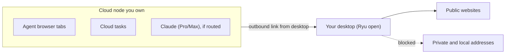

Cloud nodes reach the internet from their data center's network. Some sites block data center
addresses or show different content by location. **Route traffic through this computer** sends your
cloud nodes' web traffic out through your desktop instead, so sites see your computer's IP address.

## Turn it on

Open **Settings → Gateway → Network** and turn on **Route traffic through this computer** under
**Traffic routing**. The setting belongs to this computer. Ryu must stay open and signed in here
while it is on.

Routing applies to cloud nodes you own personally. Shared organization and team nodes keep their
cloud network path, so one member's computer never carries traffic for a node others use. Each
node you own shows its own status below the switch:

- **Routing through this computer** - the node's traffic leaves through your desktop.
- **Not connected** - your computer can't reach the node right now. Ryu retries automatically.
- **Sign in again** - the node rejected your sign-in. Signing in again reconnects it.

## What is routed

- **Browser tabs** opened by agents on the cloud node.
- **Cloud tasks** in a workspace with
  [internet access](/docs/surfaces/desktop/user-guide/cloud-environments#internet-access). Tools
  that use the standard HTTP or SOCKS proxy settings (such as `curl`, `git`, `npm`, and `pip`)
  send their traffic through your computer. A tool that ignores proxy settings cannot reach the
  network while routing is on.

Model providers keep their cloud path unless you route them too (see below). Ryu's own service
traffic and your computer's own traffic are not affected.

## Route a model provider through your computer

Some providers block data center addresses. Anthropic, for example, can refuse Claude
subscription requests that come from cloud hosts. You can send a provider's traffic through your
computer as well:

1. On the computer that should carry the traffic, turn on **Route traffic through this computer**.
2. Switch to the cloud node, open **Gateway → LLM Providers**, and expand **Claude (Pro/Max)**.
3. Turn on **Route through your computer**.

This is recommended for Claude subscription logins on cloud nodes. API-key providers keep their
cloud path. The route covers these Claude requests:

- Requests from the managed Pi engine.
- Requests from Claude Code on that node, whether or not Claude Code routes through the Gateway.
- Usage readings, sign-ins, and sign-in token refreshes.

Turning the switch on or off applies to the next request. Claude Code picks it up on its next turn.

The route applies to the whole node, so Claude subscription traffic from everyone who uses that
node leaves through your computer. Only Claude's own HTTPS hosts take the route. Commands Claude
Code runs on the node, such as `git` or a package manager, see a local proxy setting but still
reach their own destinations, including internal hosts, from the node as before.

Routing a provider means your computer has to stay on, awake, and signed in to Ryu for that
provider to work on the cloud node. While your computer is away, the provider's requests fail
instead of quietly using the data center network.

If no computer routes the node, the switch has no effect and the provider uses the cloud network.

## When your computer is away

<Callout type="warn">
  While routing is on, a cloud node never switches back to its data center network on its own. If
  your computer is asleep or offline, or Ryu is closed, the node's browser and cloud-task traffic
  stops with an error until your computer reconnects.
</Callout>

To use the cloud network again, turn the setting off. Ryu tells each node to go back to its cloud
path.

Cloud environments whose sandbox can't use your computer's connection don't run networked tasks
while routing is on. Turn routing off to run them from the cloud.

## Safety

- Your computer opens no inbound port. It connects out to your cloud nodes and carries only the
  connections they request.
- Only you, as the node's owner, can route a node through your computer.
- Private and local network addresses stay blocked. A cloud node can't reach this computer's own
  services, your home or office network, or cloud metadata addresses through the route.

## Organization controls

Organization admins can turn off **Allow local egress routing** for the whole organization in its
[feature toggles](/docs/gateway/organization-policy#organization-feature-toggles). The switch then
shows "Disabled by your admin. You can't turn this on." Active routes stop within a few minutes,
and traffic returns to the cloud network path. Your choice is kept and takes effect again if your
admin allows routing later.
